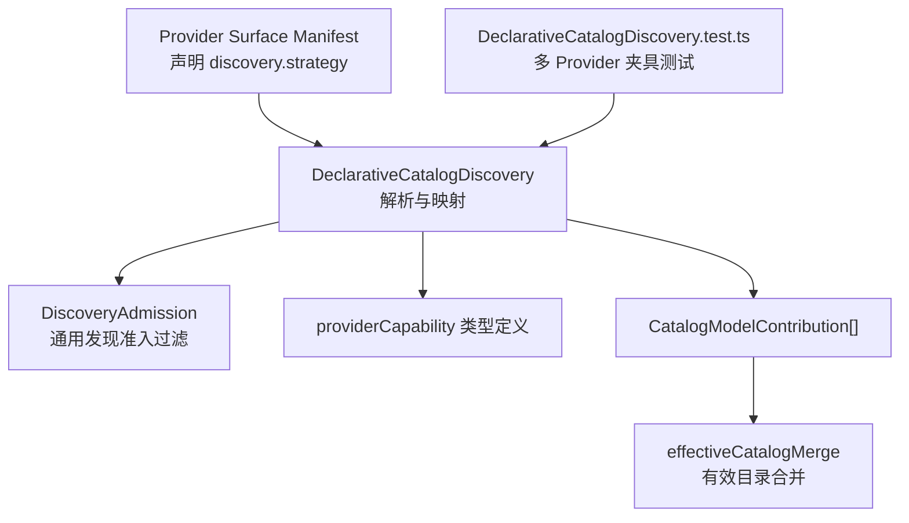
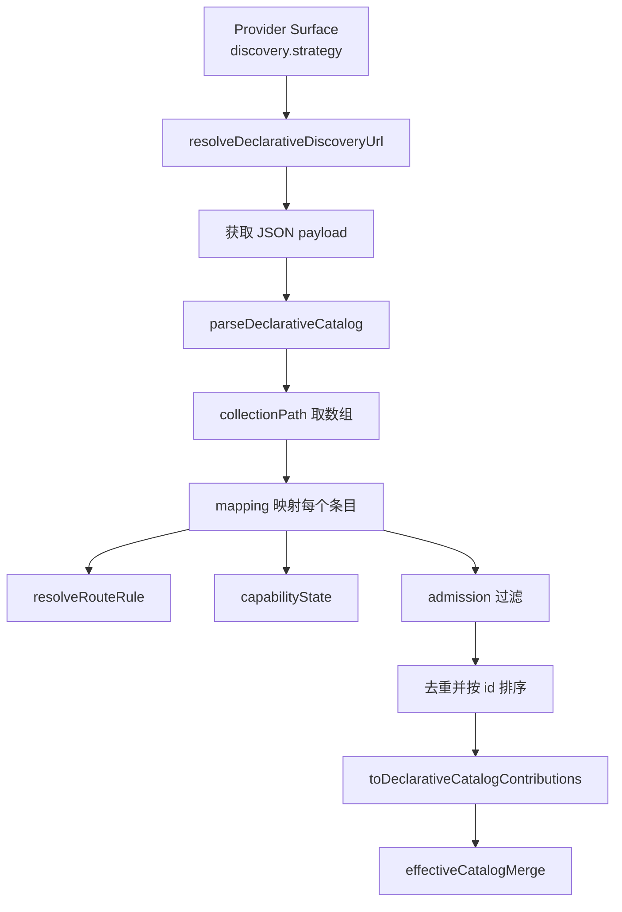
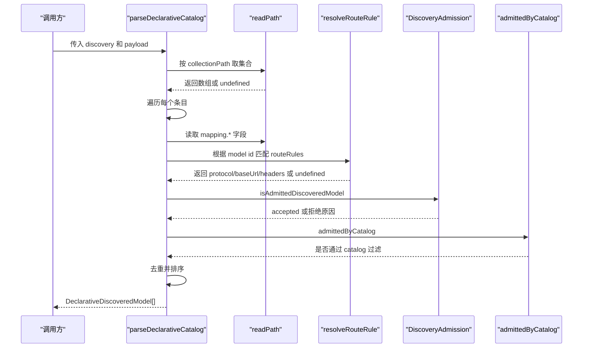
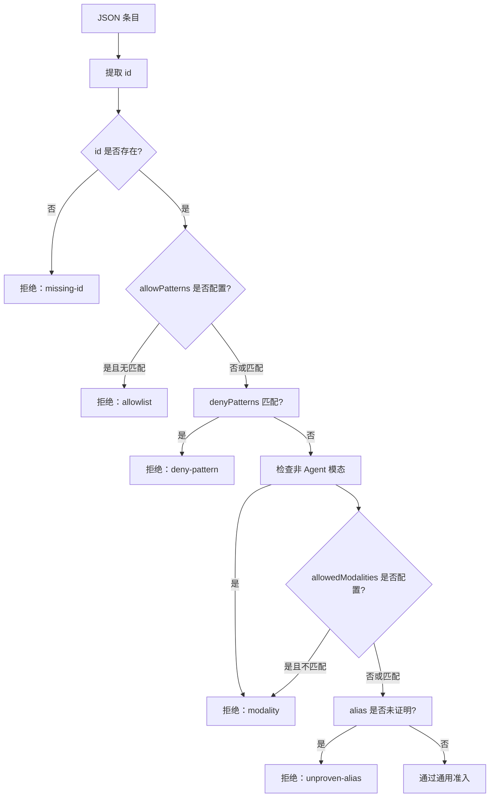
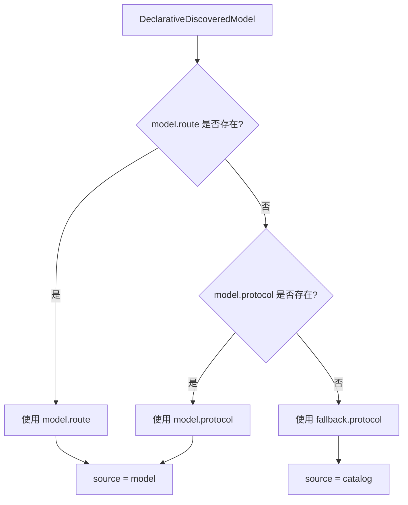
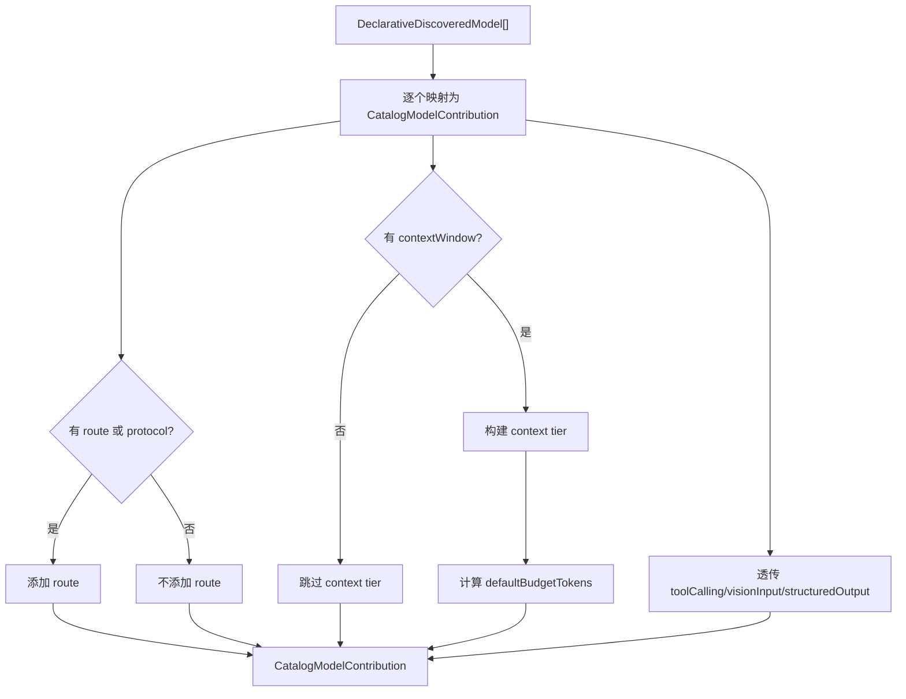
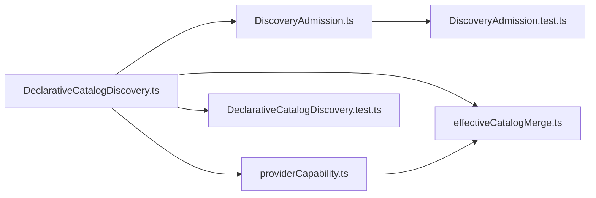

# Declarative Catalog Discovery 发现机制

<cite>
**本文引用的文件**   
- [DeclarativeCatalogDiscovery.ts](file://src/main/settings/DeclarativeCatalogDiscovery.ts)
- [DiscoveryAdmission.ts](file://src/main/settings/DiscoveryAdmission.ts)
- [providerCapability.ts](file://src/shared/types/providerCapability.ts)
- [effectiveCatalogMerge.ts](file://src/main/settings/effectiveCatalogMerge.ts)
- [DeclarativeCatalogDiscovery.test.ts](file://src/main/settings/DeclarativeCatalogDiscovery.test.ts)
- [DiscoveryAdmission.test.ts](file://src/main/settings/DiscoveryAdmission.test.ts)
</cite>

## 目录

1. [引言](#引言)
2. [项目结构定位](#项目结构定位)
3. [核心数据结构与类型](#核心数据结构与类型)
4. [架构总览](#架构总览)
5. [详细组件分析](#详细组件分析)
6. [依赖关系分析](#依赖关系分析)
7. [性能与健壮性](#性能与健壮性)
8. [配置示例](#配置示例)
9. [故障排除指南](#故障排除指南)
10. [结论](#结论)

## 引言

Declarative Catalog Discovery（声明式目录发现）是 Provider 系统中用于从任意 JSON API 响应中自动发现模型的能力。它不要求 Provider 实现特定运行时协议，而是通过一个“声明式 discovery 策略”描述：

- 从哪里取出模型列表；
- 如何把每个模型条目映射为内部 `DeclarativeDiscoveredModel`；
- 如何通过 admission 规则过滤掉嵌入、图像生成、语音等不适合 Agent 对话的模型；
- 如何根据模型 ID 分配不同 protocol 和 baseUrl；
- 如何把原始能力字段转换为稳定的 `CapabilityState`；
- 最终如何投影为 `CatalogModelContribution[]`，并参与有效目录合并。

这套机制让 OpenCode Zen、LongCat、Together AI、Fireworks AI、GitHub Models、Chutes、LM Studio、NVIDIA NIM、Ollama Cloud 等不同 Provider 都能用各自的数据格式暴露模型清单，同时保持统一的发现、过滤和路由语义。

## 项目结构定位

该机制位于主进程设置层，属于 Provider 目录发现体系的一部分：

**图示来源**
- [DeclarativeCatalogDiscovery.ts:1-241](file://src/main/settings/DeclarativeCatalogDiscovery.ts#L1-L241)
- [DiscoveryAdmission.ts:1-136](file://src/main/settings/DiscoveryAdmission.ts#L1-L136)
- [providerCapability.ts:200-396](file://src/shared/types/providerCapability.ts#L200-L396)
- [effectiveCatalogMerge.ts:1-200](file://src/main/settings/effectiveCatalogMerge.ts#L1-L200)
- [DeclarativeCatalogDiscovery.test.ts:1-176](file://src/main/settings/DeclarativeCatalogDiscovery.test.ts#L1-L176)

**章节来源**
- [DeclarativeCatalogDiscovery.ts:1-241](file://src/main/settings/DeclarativeCatalogDiscovery.ts#L1-L241)
- [DeclarativeCatalogDiscovery.test.ts:1-176](file://src/main/settings/DeclarativeCatalogDiscovery.test.ts#L1-L176)

## 核心数据结构与类型

### DeclarativeDiscoveredModel

这是声明式发现阶段的中间模型，表示“从某个 JSON payload 中发现的一个候选模型”。其关键职责是承载：

| 字段 | 含义 |
|---|---|
| `id` | 模型唯一标识，由 `mapping.id` 提取 |
| `label` | 显示标签，默认回退到 `id` |
| `aliases` | 别名数组，用于关联同义模型名 |
| `contextWindow` | 上下文窗口 token 数，可选正整数 |
| `contextWindowKind` | 上下文窗口类型，`prompt` 或 `total` |
| `contextWindowAuthority` | 上下文窗口权威来源，`account-effective` 或 `model-catalog` |
| `maxOutputTokens` | 最大输出 token，可选正整数 |
| `protocol` | 模型级 LLM Provider 协议，由 mapping 或 routeRule 决定 |
| `route` | 模型级路由，包含 protocol、baseUrl、headers |
| `modality` | 模态，支持字符串或字符串数组 |
| `toolCalling` | 工具调用能力状态 |
| `visionInput` | 视觉输入能力状态 |
| `structuredOutput` | 结构化输出能力状态 |

### DiscoveryStrategy 相关子类型

| 类型 | 作用 |
|---|---|
| `DiscoveryFieldMapping` | 描述 JSON 字段到模型字段的映射 |
| `DiscoveryCapabilityMapping` | 描述能力字段的转换规则 |
| `DiscoveryRouteRule` | 按 allowPatterns 匹配模型 ID，分配 protocol/baseUrl/headers |
| `DiscoveryAdmission` | 控制哪些模型允许进入有效目录 |

**章节来源**
- [DeclarativeCatalogDiscovery.ts:11-33](file://src/main/settings/DeclarativeCatalogDiscovery.ts#L11-L33)
- [providerCapability.ts:289-396](file://src/shared/types/providerCapability.ts#L289-L396)

## 架构总览

**图示来源**
- [DeclarativeCatalogDiscovery.ts:60-241](file://src/main/settings/DeclarativeCatalogDiscovery.ts#L60-L241)
- [effectiveCatalogMerge.ts:1-200](file://src/main/settings/effectiveCatalogMerge.ts#L1-L200)

## 详细组件分析

### 路径表达式与数据提取

`readPath()` 使用点号分隔的路径在 JSON 对象中逐级取值。例如：

- `$` 表示整个 payload；
- `data.models` 表示先取 `data`，再取其中的 `models`；
- 如果某一级不存在或不是对象，则返回 `undefined`。

配合以下辅助函数：

| 函数 | 行为 |
|---|---|
| `toString()` | 只保留非空字符串，并去除首尾空白 |
| `toStringArray()` | 支持单字符串或字符串数组，过滤空值 |
| `toPositiveNumber()` | 将数字或可解析为正数的字符串转为正数，否则返回 `undefined` |
| `globMatches()` | 用转义后的 glob 模式匹配模型 ID |

这意味着 discovery 可以适配任意嵌套结构的 JSON payload，而不需要硬编码 Provider 地址。

**章节来源**
- [DeclarativeCatalogDiscovery.ts:35-66](file://src/main/settings/DeclarativeCatalogDiscovery.ts#L35-L66)

### parseDeclarativeCatalog() 实现原理

`parseDeclarativeCatalog()` 是整个发现流程的核心入口。它的处理顺序如下：

1. 通过 `discovery.collectionPath` 从 payload 中提取集合；
2. 如果不是数组，直接返回空结果；
3. 遍历每个条目，提取 `mapping.id`；
4. 如果 `id` 为空，跳过该条目；
5. 读取 `mapping.protocol`，并校验是否为合法的 `LlmProviderProtocol`；
6. 调用 `resolveRouteRule()` 检查是否有匹配 model ID 的路由规则；
7. 读取 `mapping.modality`，支持字符串或数组；
8. 构建 `DeclarativeDiscoveredModel`，包括 label、aliases、contextWindow、maxOutputTokens、protocol、route、modality；
9. 对 toolCalling、visionInput、structuredOutput 调用 `capabilityState()`；
10. 执行三层过滤：
    - `isAdmittedDiscoveredModel()`：通用发现准入；
    - `rawAdmissionPredicates()`：自定义谓词；
    - `admittedByCatalog()`：catalog 级别 admission；
11. 去重：同一 `id` 只保留第一个；
12. 按 `id` 的本地化排序返回结果。

**图示来源**
- [DeclarativeCatalogDiscovery.ts:100-179](file://src/main/settings/DeclarativeCatalogDiscovery.ts#L100-L179)
- [DiscoveryAdmission.ts:87-136](file://src/main/settings/DiscoveryAdmission.ts#L87-L136)

**章节来源**
- [DeclarativeCatalogDiscovery.ts:100-179](file://src/main/settings/DeclarativeCatalogDiscovery.ts#L100-L179)

### discovery mapping 配置方式

`mapping` 是 discovery 策略中最关键的配置部分，它定义了如何将任意 JSON 字段映射到内部模型。

| mapping 字段 | 说明 |
|---|---|
| `id` | 必填路径，用于确定模型唯一标识 |
| `label` | 可选路径，未提供时回退到 `id` |
| `aliases` | 可选路径，支持字符串或字符串数组 |
| `contextWindow` | 可选路径，必须为正数才生效 |
| `contextWindowKind` | 可选，`prompt` 或 `total`，默认 `total` |
| `contextWindowAuthority` | 可选，`account-effective` 或 `model-catalog` |
| `maxOutputTokens` | 可选路径，必须为正数才生效 |
| `protocol` | 可选路径，仅当值是合法协议时才写入 `model.protocol` |
| `modality` | 可选路径，支持字符串或字符串数组 |
| `toolCalling` | 能力映射对象 |
| `visionInput` | 能力映射对象 |
| `structuredOutput` | 能力映射对象 |

需要注意：

- 只有成功提取到 `id` 的条目才会进入后续流程；
- `protocol` 和 `route` 会被 `resolveRouteRule()` 覆盖；
- 如果 provider 没有声明协议，但 discovery 返回了模型列表，这被视为“可用性证据”，而不是“路由证据”；
- `contextWindowKind` 影响生成的 context tier：`prompt` 对应 `maxPromptTokens`，`total` 对应 `maxTotalTokens`。

**章节来源**
- [DeclarativeCatalogDiscovery.ts:114-161](file://src/main/settings/DeclarativeCatalogDiscovery.ts#L114-L161)
- [providerCapability.ts:289-326](file://src/shared/types/providerCapability.ts#L289-L326)

### admission 过滤机制

admission 有两层：

#### 第一层：通用发现准入

`DiscoveryAdmission.evaluateDiscoveryAdmission()` 负责通用过滤，主要规则包括：

| 规则 | 行为 |
|---|---|
| `allowPatterns` | 如果配置了白名单模式，模型 ID 必须至少匹配一个 |
| `denyPatterns` | 内置拒绝模式包含 embedding、moderation、rerank、whisper、tts、dall-e、image-gen、stable-diffusion、flux、imagine、video-generation、sora、veo、realtime、transcribe、computer-use 等 |
| `allowedModalities` | 如果配置了允许模态，且记录中存在 modality，则必须匹配 |
| 非 Agent 模态 | audio、embedding、image、music、speech、transcription、tts、video 等会被拒绝 |
| alias 校验 | `type` 为 alias 的记录必须有 canonical target，否则会因 “unproven-alias” 被拒绝 |

#### 第二层：catalog 级别 admission

`admittedByCatalog()` 基于已解析出的 `DeclarativeDiscoveredModel` 进行判断：

| 条件 | 行为 |
|---|---|
| `allowPatterns` | 匹配 `model.id` |
| `denyPatterns` | 匹配 `model.id` 则拒绝 |
| `allowedModalities` | 匹配 `model.modality`，支持字符串或数组 |
| `requireContextWindow` | 如果要求上下文窗口，而 `model.contextWindow` 不存在，则拒绝 |

#### 第三层：自定义谓词

`rawAdmissionPredicates()` 允许在 discovery 策略中声明一组谓词，每个谓词包含：

- `path`：从原始 payload 读取路径；
- `equals`：期望值；
- `includes`：期望包含的值。

如果任一谓词失败，整个条目被丢弃。

**图示来源**
- [DiscoveryAdmission.ts:1-136](file://src/main/settings/DiscoveryAdmission.ts#L1-L136)

**章节来源**
- [DiscoveryAdmission.ts:1-136](file://src/main/settings/DiscoveryAdmission.ts#L1-L136)
- [DiscoveryAdmission.test.ts:1-37](file://src/main/settings/DiscoveryAdmission.test.ts#L1-L37)
- [DeclarativeCatalogDiscovery.ts:80-98](file://src/main/settings/DeclarativeCatalogDiscovery.ts#L80-L98)

### resolveRouteRule() 与 discoveredModelRoute()

`resolveRouteRule()` 的作用是根据模型的 `id` 查找 `discovery.routeRules` 中第一个匹配的项。匹配规则是：

- 遍历所有 `routeRules`；
- 检查 `allowPatterns`；
- 使用 `globMatches()` 比较模型 ID；
- 如果匹配，返回 `{ protocol, baseUrl, headers }`；
- 如果没有匹配，返回 `undefined`。

这个设计允许同一个 discovery 策略为不同模型分配不同的协议或端点。例如：

- 某些模型走 OpenAI Compatible Chat Completions；
- 某些模型走 Anthropic Messages；
- 某些模型走 OpenAI Responses；
- 某些模型有额外的请求头。

`discoveredModelRoute()` 负责将 `DeclarativeDiscoveredModel` 的路由信息融合到 fallback 路由中，优先级如下：

1. 优先使用 `model.route`；
2. 其次使用 `model.protocol`；
3. 最后回退到 `fallback.protocol`；
4. `source` 标记为：
   - `model`：如果模型拥有自己的 route 或 protocol；
   - `catalog`：如果只依赖 catalog 提供的 fallback。

**图示来源**
- [DeclarativeCatalogDiscovery.ts:68-78](file://src/main/settings/DeclarativeCatalogDiscovery.ts#L68-L78)
- [DeclarativeCatalogDiscovery.ts:181-191](file://src/main/settings/DeclarativeCatalogDiscovery.ts#L181-L191)

**章节来源**
- [DeclarativeCatalogDiscovery.ts:68-78](file://src/main/settings/DeclarativeCatalogDiscovery.ts#L68-L78)
- [DeclarativeCatalogDiscovery.ts:181-191](file://src/main/settings/DeclarativeCatalogDiscovery.ts#L181-L191)

### capabilityState() 能力映射

`capabilityState()` 将原始能力字段转换为 `CapabilityState`，支持三种映射模式：

| 映射模式 | 输入类型 | 输出 |
|---|---|---|
| `includes` | 必须是数组 | 如果数组包含指定值，则为 `supported`，否则为 `unsupported`；否则为 `unknown` |
| `equals` | 任意值 | 如果与期望值严格相等，则为 `supported`，否则为 `unsupported` |
| 布尔值 | 原生 boolean | `true` 为 `supported`，`false` 为 `unsupported` |
| 其他情况 | 非 boolean、非 mapped | `unknown` |

这种设计允许不同 Provider 以不同方式表达能力：

- 有的 Provider 用 `capabilities.tool_calling === true`；
- 有的 Provider 用 `capabilities.supported_features.includes('function_call')`；
- 有的 Provider 用 `capabilities.vision === 'enabled'`。

**章节来源**
- [DeclarativeCatalogDiscovery.ts:53-66](file://src/main/settings/DeclarativeCatalogDiscovery.ts#L53-L66)
- [providerCapability.ts:314-326](file://src/shared/types/providerCapability.ts#L314-L326)

### toDeclarativeCatalogContributions() 与有效目录集成

`toDeclarativeCatalogContributions()` 将发现的模型转换为 `CatalogModelContribution[]`，供后续有效目录计算使用。

关键行为包括：

1. 每个模型贡献包含 `modelId`、`label`、`aliases`、`availability: available`；
2. 如果模型拥有 `route` 或 `protocol`，则调用 `discoveredModelRoute()` 生成路由；
3. 如果模型没有 route 也没有 protocol，则不写入 `route`，因为此时 discovery 只提供“存在性证据”，不提供“路由证据”；
4. 如果存在 `contextWindow`，则生成 default context tier：
   - `contextWindowKind === 'prompt'`：使用 `maxPromptTokens`；
   - 否则使用 `maxTotalTokens`；
5. 如果存在 `maxOutputTokens`，则写入 `maxOutputTokens`；
6. `activation.kind` 固定为 `implicit`；
7. `entitlement` 根据 `contextWindowAuthority` 决定：
   - `model-catalog`：`unknown`；
   - 否则：`granted`；
8. `defaultBudgetTokens` 根据上下文窗口和最大输出计算；
9. `controls.maxContext` 根据上下文窗口权威来源决定；
10. 能力字段 `toolCalling`、`visionInput`、`structuredOutput` 直接透传。

**图示来源**
- [DeclarativeCatalogDiscovery.ts:193-241](file://src/main/settings/DeclarativeCatalogDiscovery.ts#L193-L241)
- [effectiveCatalogMerge.ts:1-200](file://src/main/settings/effectiveCatalogMerge.ts#L1-L200)

**章节来源**
- [DeclarativeCatalogDiscovery.ts:193-241](file://src/main/settings/DeclarativeCatalogDiscovery.ts#L193-L241)
- [effectiveCatalogMerge.ts:1-200](file://src/main/settings/effectiveCatalogMerge.ts#L1-L200)
- [DeclarativeCatalogDiscovery.test.ts:79-176](file://src/main/settings/DeclarativeCatalogDiscovery.test.ts#L79-L176)

## 依赖关系分析

**图示来源**
- [DeclarativeCatalogDiscovery.ts:1-10](file://src/main/settings/DeclarativeCatalogDiscovery.ts#L1-L10)
- [DiscoveryAdmission.ts:1-5](file://src/main/settings/DiscoveryAdmission.ts#L1-L5)
- [providerCapability.ts:289-396](file://src/shared/types/providerCapability.ts#L289-L396)
- [effectiveCatalogMerge.ts:1-20](file://src/main/settings/effectiveCatalogMerge.ts#L1-L20)

耦合关系要点：

- `DeclarativeCatalogDiscovery` 依赖 `DiscoveryAdmission` 做通用准入；
- 两者都依赖 `@shared/types/providerCapability` 的类型定义；
- `toDeclarativeCatalogContributions` 的输出被 `effectiveCatalogMerge` 消费；
- 测试覆盖多个 Provider fixture，验证 discovery 在不同 JSON 格式下的稳定性。

**章节来源**
- [DeclarativeCatalogDiscovery.ts:1-10](file://src/main/settings/DeclarativeCatalogDiscovery.ts#L1-L10)
- [DiscoveryAdmission.ts:1-5](file://src/main/settings/DiscoveryAdmission.ts#L1-L5)
- [providerCapability.ts:289-396](file://src/shared/types/providerCapability.ts#L289-L396)
- [effectiveCatalogMerge.ts:1-20](file://src/main/settings/effectiveCatalogMerge.ts#L1-L20)

## 性能与健壮性

### 时间复杂度

- `parseDeclarativeCatalog()` 对 collection 数组做一次线性扫描；
- 每次条目处理涉及有限次 `readPath`、字符串转换、正则匹配；
- 去重使用 `Map<string, DeclarativeDiscoveredModel>`，平均 O(1)；
- 最终排序使用 `localeCompare`，总体 O(n log n)。

因此，对于典型 Provider 模型清单（几十到几百个模型），性能开销很小。

### 健壮性设计

| 风险 | 防护措施 |
|---|---|
| 非数组 collection | 直接返回空数组 |
| 缺失 id | 跳过该条目 |
| 非字符串 label | 回退到 id |
| 非正数 contextWindow | 忽略 |
| 非法 protocol | 不写入 `model.protocol` |
| 空 aliases | 转为空数组 |
| 能力字段缺失 | 返回 `undefined` 或 `unknown` |
| 无效 glob 模式 | `globMatches` 捕获异常后返回 false |
| 重复 id | 去重，保留第一个 |

**章节来源**
- [DeclarativeCatalogDiscovery.ts:35-66](file://src/main/settings/DeclarativeCatalogDiscovery.ts#L35-L66)
- [DiscoveryAdmission.ts:39-62](file://src/main/settings/DiscoveryAdmission.ts#L39-L62)

## 配置示例

以下示例描述的是 discovery 策略应包含的关键字段，而不是完整代码片段。

### 基础示例：从 data.models 提取模型

- `collectionPath`：`data.models`
- `mapping.id`：`id`
- `mapping.label`：`name`
- `mapping.aliases`：`aliases`
- `mapping.protocol`：`protocol`

适用场景：API 返回标准模型列表，每个模型有 id、name、aliases、protocol。

### 复杂示例：按模型分配不同协议

- `collectionPath`：`data.items`
- `mapping.id`：`model_id`
- `mapping.label`：`display_name`
- `mapping.contextWindow`：`limits.context_window`
- `mapping.contextWindowKind`：`prompt`
- `mapping.contextWindowAuthority`：`model-catalog`
- `mapping.toolCalling.path`：`capabilities.function_calling`
- `mapping.vision.path`：`capabilities.image_input`
- `mapping.structuredOutput.path`：`capabilities.json_mode`
- `routeRules`：
  - `allowPatterns`：`*gpt-*`，`protocol`：`OpenAIResponses`
  - `allowPatterns`：`*claude-*`，`protocol`：`AnthropicMessages`
  - `allowPatterns`：`*gemini-*`，`protocol`：`OpenAICompatibleChatCompletions`

适用场景：Provider 混合多种协议，需要根据模型 ID 路由到不同 endpoint。

### Admission 示例：只接受文本模型

- `admission.allowPatterns`：`gpt-*`、`claude-*`
- `admission.denyPatterns`：`*-preview`、`*-test`
- `admission.allowedModalities`：`text`
- `admission.requireContextWindow`：`true`

适用场景：只允许已知聊天模型，并要求每个模型声明上下文窗口。

### 自定义谓词示例

- `admission.predicates`：
  - `path`：`data.plan`，`equals`：`paid`
  - `path`：`data.capabilities`，`includes`：`multimodal`

适用场景：只接受付费计划或多模态能力的模型。

**章节来源**
- [DeclarativeCatalogDiscovery.ts:68-179](file://src/main/settings/DeclarativeCatalogDiscovery.ts#L68-L179)
- [providerCapability.ts:327-396](file://src/shared/types/providerCapability.ts#L327-L396)

## 故障排除指南

### 发现结果为空

可能原因：

1. `collectionPath` 指向的不是数组；
2. `mapping.id` 在所有条目中都为空；
3. 所有条目都被 admission 过滤；
4. 所有条目都有重复的 `id`，只剩一个或全部被提前过滤；
5. payload 结构与 discovery 声明不一致。

排查步骤：

- 确认 `collectionPath` 能取到数组；
- 检查 `mapping.id` 是否能解析出非空字符串；
- 临时移除 `allowPatterns`、`denyPatterns`、`allowedModalities`；
- 打印第一条 payload，对照 mapping 路径；
- 使用测试夹具验证 discovery 配置是否正确加载。

**章节来源**
- [DeclarativeCatalogDiscovery.ts:100-112](file://src/main/settings/DeclarativeCatalogDiscovery.ts#L100-L112)
- [DiscoveryAdmission.ts:87-136](file://src/main/settings/DiscoveryAdmission.ts#L87-L136)

### 模型被意外拒绝

可能原因：

1. 命中 `denyPatterns`；
2. `modality` 是 audio、image、embedding、video 等非 Agent 模态；
3. 配置了 `allowedModalities`，但模型 modality 不在允许列表中；
4. 是 alias 但没有 canonical target；
5. `requireContextWindow` 为真，但模型没有 `contextWindow`。

排查步骤：

- 检查 `id` 是否匹配默认 deny 模式；
- 检查记录的 `modality`、`type`、`kind`、`output_modalities`；
- 检查 alias 是否带 `canonical_id`；
- 检查 discovery 的 `admission` 配置；
- 参考 `DiscoveryAdmission.test.ts` 中的用例。

**章节来源**
- [DiscoveryAdmission.ts:1-86](file://src/main/settings/DiscoveryAdmission.ts#L1-L86)
- [DiscoveryAdmission.test.ts:1-37](file://src/main/settings/DiscoveryAdmission.test.ts#L1-L37)

### 路由不符合预期

可能原因：

1. `routeRules` 的 `allowPatterns` 没有匹配到模型 ID；
2. `mapping.protocol` 不是合法协议；
3. 模型没有 route 也没有 protocol，导致 contribution 不包含 `route`；
4. effective catalog merge 覆盖了 model-owned route。

排查步骤：

- 确认 `resolveRouteRule()` 能匹配目标模型；
- 确认 `mapping.protocol` 是支持的 `LlmProviderProtocol`；
- 检查 `discoveredModelRoute()` 的 source 是 `model` 还是 `catalog`；
- 查看测试中关于 DeepSeek、OpenCode Zen 的路由断言。

**章节来源**
- [DeclarativeCatalogDiscovery.ts:68-78](file://src/main/settings/DeclarativeCatalogDiscovery.ts#L68-L78)
- [DeclarativeCatalogDiscovery.test.ts:101-147](file://src/main/settings/DeclarativeCatalogDiscovery.test.ts#L101-L147)

### 能力状态为 unknown

可能原因：

1. `mapping.toolCalling`、`visionInput`、`structuredOutput` 未配置；
2. 能力字段路径不存在；
3. `includes` 模式下输入不是数组；
4. `equals` 模式下值不相等；
5. 原始值是 boolean 以外的类型。

排查步骤：

- 确认能力映射配置了 `path`；
- 确认 payload 在该路径下存在值；
- 如果是 `includes`，确保值是数组；
- 如果是 `equals`，确认期望值与真实值一致；
- 如果是 boolean，确认值是原生 boolean。

**章节来源**
- [DeclarativeCatalogDiscovery.ts:53-66](file://src/main/settings/DeclarativeCatalogDiscovery.ts#L53-L66)

### 上下文窗口预算不正确

可能原因：

1. `contextWindowKind` 配置错误；
2. `maxOutputTokens` 未声明或与 `contextWindow` 冲突；
3. `contextWindowAuthority` 为 `model-catalog`，导致 entitlement 为 `unknown`；
4. `contextWindow` 不是正数。

排查步骤：

- 确认 `contextWindowKind` 是 `prompt` 或 `total`；
- 确认 `contextWindow` 是正数；
- 检查 `maxOutputTokens` 是否超过上下文窗口；
- 检查 `defaultBudgetTokens` 的计算逻辑；
- 查看测试中关于 github-models、chutes、fireworks-ai 的断言。

**章节来源**
- [DeclarativeCatalogDiscovery.ts:114-161](file://src/main/settings/DeclarativeCatalogDiscovery.ts#L114-L161)
- [DeclarativeCatalogDiscovery.ts:193-241](file://src/main/settings/DeclarativeCatalogDiscovery.ts#L193-L241)
- [DeclarativeCatalogDiscovery.test.ts:149-176](file://src/main/settings/DeclarativeCatalogDiscovery.test.ts#L149-L176)

## 结论

Declarative Catalog Discovery 通过“声明式 mapping + 多层 admission + 模型级路由 + 能力映射”的组合，实现了从任意 JSON payload 到统一 `CatalogModelContribution[]` 的稳定转换。它的核心价值在于：

- 不依赖 Provider 运行时协议即可发现模型；
- 用 path 表达式适配不同 JSON 结构；
- 用 admission 过滤非 Agent 模型；
- 用 routeRules 为不同模型分配不同 protocol 和 baseUrl；
- 用 `capabilityState()` 标准化能力字段；
- 用 `toDeclarativeCatalogContributions()` 输出可与有效目录合并的贡献；
- 用测试夹具覆盖多个 Provider，保证跨实现的稳定性。

在实际使用中，最需要注意的是：

- `collectionPath` 和 `mapping` 必须与实际 API payload 对齐；
- `admission` 要谨慎配置，避免误拒正常聊天模型；
- `routeRules` 要精确匹配模型 ID，避免协议错配；
- 如果 discovery 没有提供 protocol，不应假设它具备路由能力；
- 如果 `contextWindowAuthority` 是 `model-catalog`，系统会保守地将 entitlement 标记为 `unknown`。