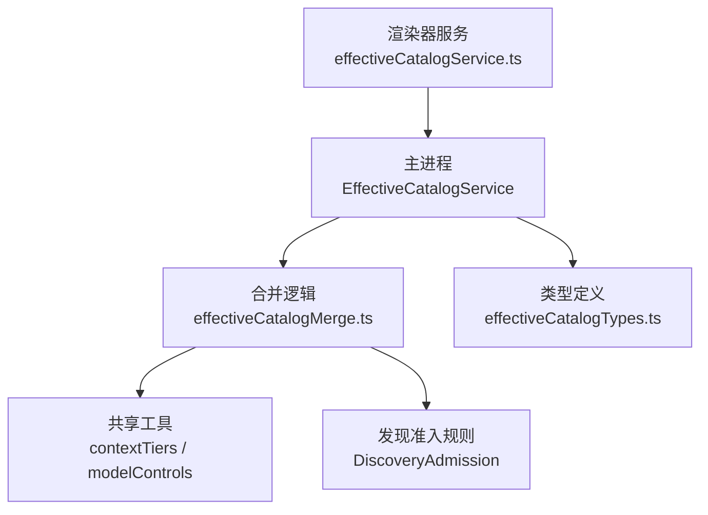
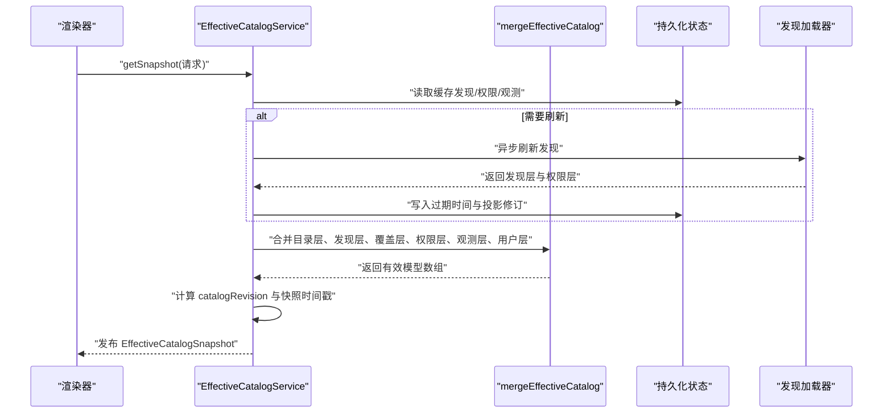
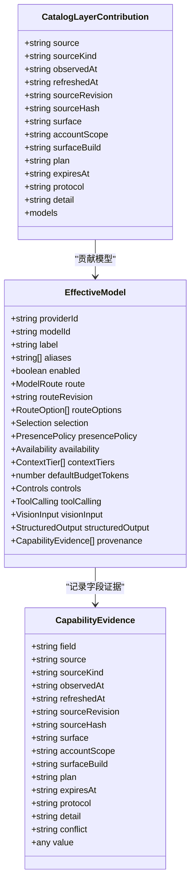
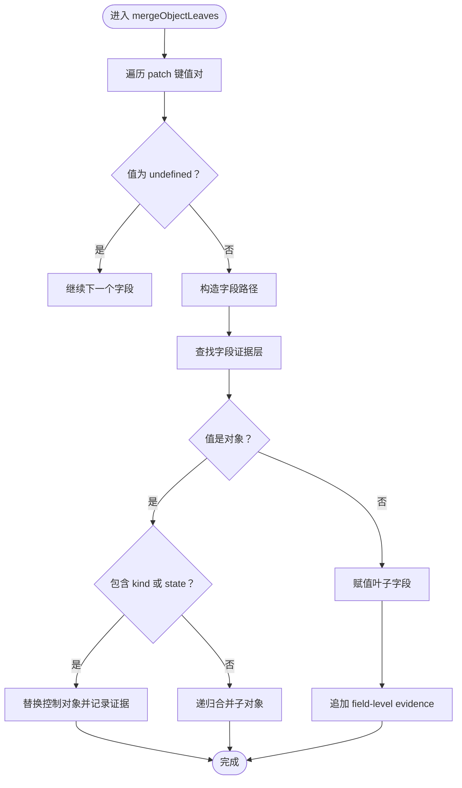
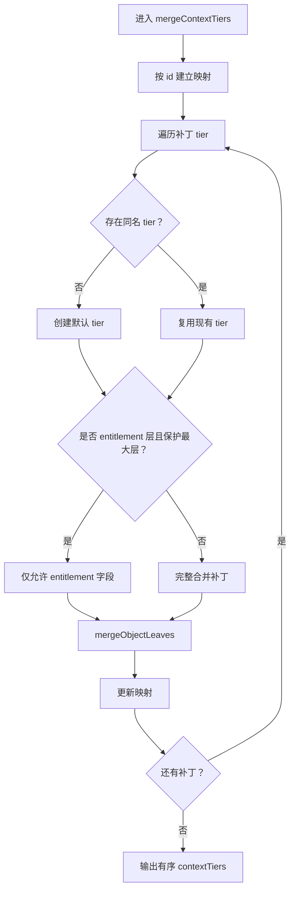
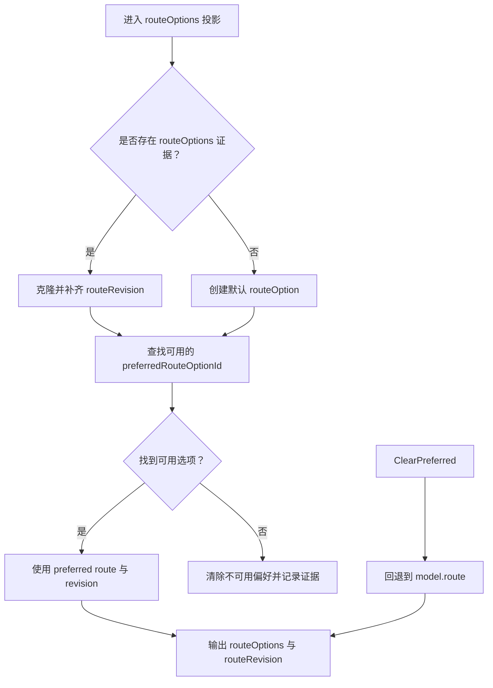
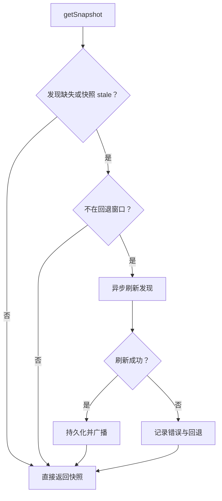
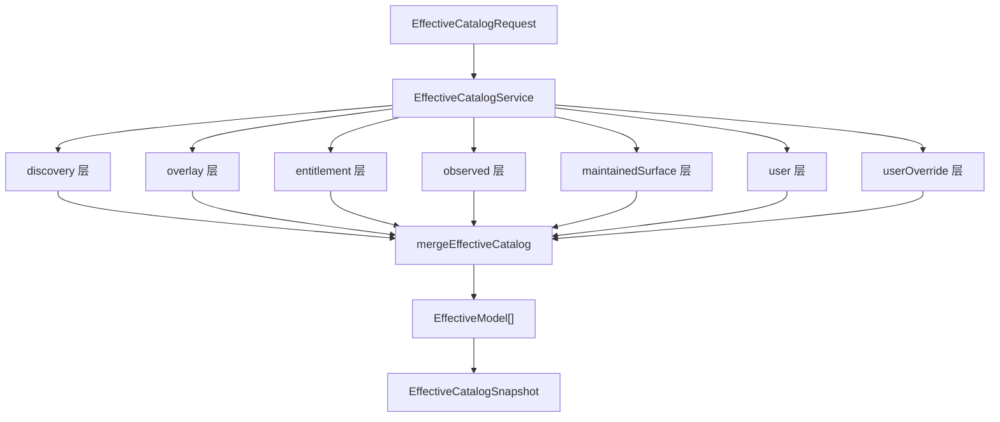
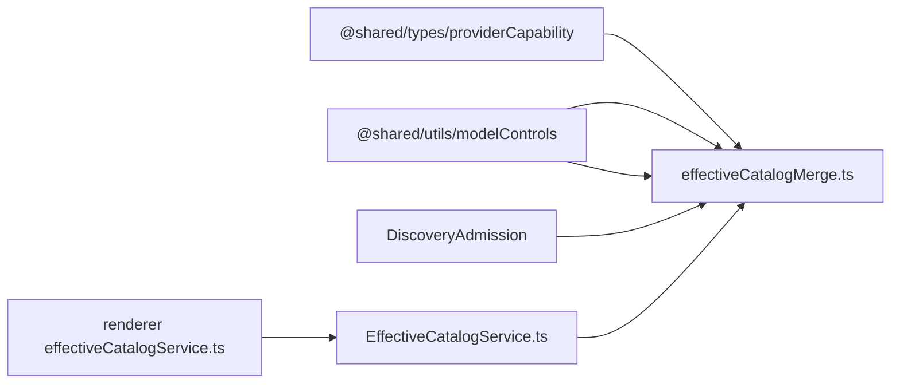

# Effective Catalog Merge 合并策略

<cite>
**本文引用的文件**   
- [effectiveCatalogMerge.ts](file://src/main/settings/effectiveCatalogMerge.ts)
- [EffectiveCatalogService.ts](file://src/main/settings/EffectiveCatalogService.ts)
- [effectiveCatalogTypes.ts](file://src/main/settings/effectiveCatalogTypes.ts)
- [effectiveCatalogService.ts](file://src/renderer/services/effectiveCatalogService.ts)
</cite>

## 目录
1. [引言](#引言)
2. [项目结构](#项目结构)
3. [核心组件](#核心组件)
4. [架构总览](#架构总览)
5. [详细组件分析](#详细组件分析)
6. [依赖关系分析](#依赖关系分析)
7. [性能与并发特性](#性能与并发特性)
8. [故障排查指南](#故障排查指南)
9. [结论](#结论)

## 引言
Effective Catalog（有效目录）是运行时最终可见的模型配置视图。它不是单一来源，而是由多个 catalog sources 按严格优先级合并而成：内置清单、动态发现、覆盖层、权限层、观测证据、维护表面、用户偏好以及最高优先级的用户自定义覆盖。该设计确保：

- 系统始终有一个保守且可审计的最终状态；
- 每个字段都可以追溯其来源、版本和变更历史；
- 冲突可以显式记录，而不是静默覆盖；
- 模型可见性受 presencePolicy、availability 和 provider runtime 可用性共同约束；
- route options 支持协议级 overlay、revision 检测与 availability 传播；
- 时间戳 observedAt / refreshedAt / expiresAt 保证目录数据的时效性和可刷新能力。

## 项目结构
本节聚焦 effective catalog 相关代码在仓库中的位置与职责分工。

**图示来源**
- [EffectiveCatalogService.ts:1-80](file://src/main/settings/EffectiveCatalogService.ts#L1-L80)
- [effectiveCatalogMerge.ts:1-40](file://src/main/settings/effectiveCatalogMerge.ts#L1-L40)
- [effectiveCatalogTypes.ts:1-60](file://src/main/settings/effectiveCatalogTypes.ts#L1-L60)
- [effectiveCatalogService.ts:1-11](file://src/renderer/services/effectiveCatalogService.ts#L1-L11)

**章节来源**
- [EffectiveCatalogService.ts:1-80](file://src/main/settings/EffectiveCatalogService.ts#L1-L80)
- [effectiveCatalogMerge.ts:1-40](file://src/main/settings/effectiveCatalogMerge.ts#L1-L40)
- [effectiveCatalogTypes.ts:1-60](file://src/main/settings/effectiveCatalogTypes.ts#L1-L60)
- [effectiveCatalogService.ts:1-11](file://src/renderer/services/effectiveCatalogService.ts#L1-L11)

## 核心组件
- **EffectiveCatalogService**：管理有效目录快照、缓存、发现刷新、观察证据持久化、监听器广播和回退策略。
- **mergeEffectiveCatalog**：核心合并函数，按 layer 顺序应用 patch，生成最终 EffectiveModel 列表。
- **createConservativeModel**：为尚未被 catalog 或 discovery 承认的模型创建保守基线。
- **mergeObjectLeaves**：深度对象合并，逐叶记录 field-level evidence。
- **mergeContextTiers**：上下文层级合并，保护 entitlement 对最大层级的控制。
- **applyLayer**：单 layer 应用逻辑，包含匹配、重键、协议过滤、availability 传播等。
- **类型与请求模型**：CatalogLayerContribution、EffectiveCatalogRequest、PartialContextTier 等。

**章节来源**
- [EffectiveCatalogService.ts:1-120](file://src/main/settings/EffectiveCatalogService.ts#L1-L120)
- [effectiveCatalogMerge.ts:180-595](file://src/main/settings/effectiveCatalogMerge.ts#L180-L595)
- [effectiveCatalogTypes.ts:1-140](file://src/main/settings/effectiveCatalogTypes.ts#L1-L140)

## 架构总览
Effective Catalog 的生命周期从请求进入 EffectiveCatalogService 开始，经过快照构建、合并计算、时间戳与 revision 冻结、快照指纹去抖，再到渲染器订阅与事件通知。

**图示来源**
- [EffectiveCatalogService.ts:80-180](file://src/main/settings/EffectiveCatalogService.ts#L80-L180)
- [EffectiveCatalogService.ts:180-320](file://src/main/settings/EffectiveCatalogService.ts#L180-L320)
- [effectiveCatalogMerge.ts:480-595](file://src/main/settings/effectiveCatalogMerge.ts#L480-L595)

## 详细组件分析

### Effective Catalog 的设计理念
Effective Catalog 是“运行时最终可见状态”，它回答的问题是：“当前这个 Provider 在这个 Account、Protocol 下，有哪些模型可用？它们如何路由？能力是什么？预算是多少？为什么是这个结果？”

关键设计原则：
- **多源分层**：catalog、discovery、overlay、entitlement、observed、maintainedSurface、user、userOverride。
- **保守默认**：未被承认的模型通过 createConservativeModel 获得最小可行状态。
- **字段级证据**：每个字段变更都记录 source、sourceRevision、sourceHash、observedAt、refreshedAt、expiresAt 等审计信息。
- **冲突显式化**：当同一字段在不同 layer 中出现不同值时，生成 conflict 描述。
- **可见性与可用性分离**：presencePolicy 决定模型是否出现在目录中；availability 决定模型是否真正可执行。
- **时间敏感**：observedAt、refreshedAt、expiresAt 控制数据新鲜度；catalogRevision 冻结语义快照。

**章节来源**
- [effectiveCatalogTypes.ts:1-140](file://src/main/settings/effectiveCatalogTypes.ts#L1-L140)
- [effectiveCatalogMerge.ts:180-595](file://src/main/settings/effectiveCatalogMerge.ts#L180-L595)
- [EffectiveCatalogService.ts:1-120](file://src/main/settings/EffectiveCatalogService.ts#L1-L120)

### CatalogLayerContribution 与 provenance 追踪
CatalogLayerContribution 表示一个来源层，例如内置清单、动态发现、覆盖层、权限层、观测层或用户配置。它携带以下审计元数据：

| 字段 | 含义 | 审计价值 |
|---|---|---|
| source | 来源类别，如 catalog、discovery、overlay、entitlement、observed、maintainedSurface、user、userOverride | 判断可信度与优先级 |
| sourceKind | 来源子类型 | 区分清单、发现、用户配置等 |
| observedAt | 首次观测时间 | 审计数据来源生命周期起点 |
| refreshedAt | 最近刷新时间 | 反映动态更新节奏 |
| sourceRevision | 源版本标识 | 比较同层数据是否变化 |
| sourceHash | 源内容摘要 | 快速识别内容变更 |
| surface | 暴露面标识 | 关联产品功能或 UI 区域 |
| accountScope | 账户范围 | 判断跨账户影响 |
| surfaceBuild | 构建版本 | 辅助定位构建差异 |
| plan | 计划标识 | 关联订阅或计费方案 |
| expiresAt | 过期时间 | 控制 TTL 与刷新策略 |
| protocol | 协议标识 | 限制跨协议污染 |
| detail | 人类可读说明 | 帮助排障与日志分析 |
| models | 模型贡献集合 | 实际合并输入 |

provenance 是每个 EffectiveModel 上的证据链。每个字段可能有多条证据，最新一条作为当前值来源，冲突会记录 previous 与 current 的差异。

**图示来源**
- [effectiveCatalogTypes.ts:20-140](file://src/main/settings/effectiveCatalogTypes.ts#L20-L140)
- [effectiveCatalogMerge.ts:100-220](file://src/main/settings/effectiveCatalogMerge.ts#L100-L220)

**章节来源**
- [effectiveCatalogTypes.ts:20-140](file://src/main/settings/effectiveCatalogTypes.ts#L20-L140)
- [effectiveCatalogMerge.ts:100-220](file://src/main/settings/effectiveCatalogMerge.ts#L100-L220)

### createConservativeModel：保守基线模型
当一个模型仅出现在 user 层且不符合 admission 条件时，系统不会直接丢弃，而是用 createConservativeModel 创建最小可用模型。该基线包括：

- 基础标识：providerId、modelId、label、aliases；
- 默认启用：enabled 为 true；
- 路由：使用 fallbackRoute 克隆并附带 routeRevision；
- routeOptions：以 fallbackRoute.protocol 作为初始选项；
- presencePolicy：默认 discovered；
- availability：unknown；
- contextTiers：默认 tier，activation implicit，entitlement unknown；
- 控制项：fast、maxContext、reasoning、toolCalling、visionInput、structuredOutput 使用未知或不支持状态；
- provenance：为关键字段生成保守证据，标记为“保守有效目录基线”。

这种设计防止“用户偏好制造不存在模型”，同时允许用户在正确 admission 条件下扩展模型行为。

**章节来源**
- [effectiveCatalogMerge.ts:40-120](file://src/main/settings/effectiveCatalogMerge.ts#L40-L120)

### mergeObjectLeaves：深度对象合并与证据记录
mergeObjectLeaves 负责将 patch 递归合并到 target，并为每个叶子字段追加 evidence。其关键行为如下：

1. 跳过 undefined 字段。
2. 构造字段路径，例如 `route.protocol` 或 `contextTiers.default.activation.kind`。
3. 使用 layerForField 查找字段专属证据层，支持 fieldFactSources 细粒度溯源。
4. 如果值是对象且包含 kind 或 state 这类控制型结构，则整体替换并记录对象级证据。
5. 否则递归合并子对象或直接赋值叶子值。
6. 每次赋值都会调用 evidenceFor，生成 field-level evidence，并在值发生变化时记录 conflict。

**图示来源**
- [effectiveCatalogMerge.ts:140-220](file://src/main/settings/effectiveCatalogMerge.ts#L140-L220)

**章节来源**
- [effectiveCatalogMerge.ts:140-220](file://src/main/settings/effectiveCatalogMerge.ts#L140-L220)

### context tiers 合并与 contextTierPromptCap
contextTiers 表示模型支持的上下文层级，例如默认层、高容量层等。合并过程由 mergeContextTiers 处理：

- 按 id 匹配现有 tier；
- 未匹配的 tier 创建默认激活方式 activation: implicit，entitlement: unknown；
- 如果 layer.source 是 entitlement，并且当前 maxContext 控制固定到该 tier，则只允许 entitlement 覆盖 entitlement 字段，避免覆盖其他字段；
- 其余字段通过 mergeObjectLeaves 合并；
- 最终输出按 id 排序的 contextTiers 列表。

contextTierPromptCap 来自共享工具，用于推导 defaultBudgetTokens。若模型未提供正数 defaultBudgetTokens，则根据 normalTier 的 prompt cap 推导预算。

**图示来源**
- [effectiveCatalogMerge.ts:220-280](file://src/main/settings/effectiveCatalogMerge.ts#L220-L280)

**章节来源**
- [effectiveCatalogMerge.ts:220-280](file://src/main/settings/effectiveCatalogMerge.ts#L220-L280)

### presencePolicy 与模型可见性
presencePolicy 决定模型是否在有效目录中可见。实现中，若模型没有显式设置 presencePolicy，则默认为 discovered。这意味着：

- 来自 catalog 或 discovery 的模型通常可见；
- 仅由 user 层引入但未经 admission 的模型会被过滤；
- custom 用户覆盖模型可绕过部分限制；
- availability 与 presencePolicy 不同：presencePolicy 控制“是否列出”，availability 控制“是否可执行”。

此外，当 catalog 明确标记某模型 unavailable 时，后续 layer 若未显式声明 unavailable，也会被抑制为不可用。

**章节来源**
- [effectiveCatalogMerge.ts:280-420](file://src/main/settings/effectiveCatalogMerge.ts#L280-L420)
- [effectiveCatalogMerge.ts:520-595](file://src/main/settings/effectiveCatalogMerge.ts#L520-L595)

### route options 合并策略与 routeRevision
route options 是模型路由的多协议或多实例视图。合并阶段：

1. 如果 provenance 中存在 routeOptions 或 routeOptions.* 的证据，则认为存在显式 routeOptions。
2. 对每个 option 克隆 route，并补全 routeRevision；若 option 未提供 routeRevision，则基于 route 和 option.id 计算。
3. 若无显式 routeOptions，则生成一个默认 option，id 为 model.route.protocol，route 为 model.route，availability 继承 model.availability。
4. preferredRouteOptionId 只能指向 availability 不为 unavailable 的 option。
5. 如果 preferredRouteOptionId 指向的 option 不可用，则清除该选择并追加 provenance 说明。
6. routeRevision 优先使用 selected option 的 revision，否则回退到 model.route 的 revision。

routeRevision 的计算使用稳定 JSON 序列化加 SHA-256，保证相同路由结构产生相同哈希，便于变更检测。

**图示来源**
- [effectiveCatalogMerge.ts:480-560](file://src/main/settings/effectiveCatalogMerge.ts#L480-L560)

**章节来源**
- [effectiveCatalogMerge.ts:480-560](file://src/main/settings/effectiveCatalogMerge.ts#L480-L560)

### observedAt / refreshedAt / expiresAt 时间戳管理
时间戳贯穿目录数据生命周期：

- **observedAt**：layer 首次被观测的时间，用于证明数据来源何时进入系统。
- **refreshedAt**：layer 最近刷新时间，反映动态更新节奏。
- **expiresAt**：layer 过期时间，超过后视为 stale，触发重新发现或刷新。
- **catalogProjectionRevision**：catalog 投影版本，用于检测请求参数变化导致的投影失效。
- **catalogRevision**：有效目录快照版本，冻结一次合并结果的语义，避免仅因审计时间戳变化导致渲染层无效。

EffectiveCatalogService 在刷新发现时：
- 记录 observedAt；
- 计算 expiresAt = observedAt + discoveryTTL；
- 写入 discovery 与 entitlement 层；
- 清理过期的 observed 层；
- 持久化状态；
- 广播快照。

**章节来源**
- [EffectiveCatalogService.ts:180-320](file://src/main/settings/EffectiveCatalogService.ts#L180-L320)
- [effectiveCatalogTypes.ts:1-40](file://src/main/settings/effectiveCatalogTypes.ts#L1-L40)

### refresh 策略与失效窗口
EffectiveCatalogService 实现渐进式刷新与回退：

- getSnapshot 先返回当前快照；
- 若发现缺失或快照 stale，且不在 backoff 窗口，则启动异步 refreshDiscovery；
- refreshDiscovery 使用 loader 加载发现层与权限层；
- 成功时清理错误与 backoff，持久化并广播；
- 失败时记录 lastRefreshError，并增加 backoff；
- backoff 指数增长，上限为固定最大值；
- emit 使用 fingerprint 去抖，避免重复通知渲染器。

**图示来源**
- [EffectiveCatalogService.ts:120-200](file://src/main/settings/EffectiveCatalogService.ts#L120-L200)
- [EffectiveCatalogService.ts:320-464](file://src/main/settings/EffectiveCatalogService.ts#L320-L464)

**章节来源**
- [EffectiveCatalogService.ts:120-200](file://src/main/settings/EffectiveCatalogService.ts#L120-L200)
- [EffectiveCatalogService.ts:320-464](file://src/main/settings/EffectiveCatalogService.ts#L320-L464)

### 有效目录数据流图
以下图展示 effective catalog 从输入到输出的主要数据流：

**图示来源**
- [EffectiveCatalogService.ts:120-200](file://src/main/settings/EffectiveCatalogService.ts#L120-L200)
- [effectiveCatalogMerge.ts:480-595](file://src/main/settings/effectiveCatalogMerge.ts#L480-L595)

### 常见冲突场景与处理方案

| 场景 | 表现 | 合并策略 | 建议处理方式 |
|---|---|---|---|
| 同字段多处来源 | 多个 layer 设置同一字段 | 使用最新证据，并记录 conflict | 检查 provenance.conflict，确认期望来源 |
| 用户层引入未 admitted 模型 | 模型未出现在目录中 | user 层不制造新成员，custom 除外 | 将模型加入 catalog 或通过 discovery 暴露 |
| discovery 覆盖 catalog route | discovery 携带 catalog-sourced route | 删除 route，保留 availability 证据 | 使用 model 层显式 route 覆盖 |
| discovery 提供零预算 | defaultBudgetTokens ≤ 0 | 不覆盖已有正预算 | 确保 discovery 提供正预算或手动配置 |
| preferredRouteOptionId 指向不可用选项 | 偏好路由不可用 | 清除偏好并记录证据 | 修正 preferredRouteOptionId 或修复 route availability |
| provider runtime unavailable | 所有模型不可用 | 强制 availability 为 unavailable | 检查 provider 连接状态与 quota |
| observed 层过期 | observed 层被过滤 | 不再参与合并 | 重新记录观测证据或延长 ttl |
| 发现层过期 | 快照 stale | 触发刷新 | 等待刷新或手动 invalidate |

**章节来源**
- [effectiveCatalogMerge.ts:280-595](file://src/main/settings/effectiveCatalogMerge.ts#L280-L595)
- [EffectiveCatalogService.ts:180-320](file://src/main/settings/EffectiveCatalogService.ts#L180-L320)

## 依赖关系分析
Effective Catalog 合并逻辑依赖以下模块：

- 共享类型：EffectiveModel、ModelRoute、ContextTier、ProviderAvailability 等；
- 共享工具：contextTierPromptCap、resolveContextTierChoices、resolveExecutionBinding、resolveModelControls；
- 发现准入：isAdmittedDiscoveredModel、normalizeDiscoveredModelMatchKey；
- 服务层：EffectiveCatalogService 负责缓存、刷新、持久化、监听；
- 渲染器层：effectiveCatalogService.ts 提供 readEffectiveCatalog 与 observeEffectiveCatalog。

**图示来源**
- [effectiveCatalogMerge.ts:1-40](file://src/main/settings/effectiveCatalogMerge.ts#L1-L40)
- [EffectiveCatalogService.ts:1-80](file://src/main/settings/EffectiveCatalogService.ts#L1-L80)
- [effectiveCatalogService.ts:1-11](file://src/renderer/services/effectiveCatalogService.ts#L1-L11)

**章节来源**
- [effectiveCatalogMerge.ts:1-40](file://src/main/settings/effectiveCatalogMerge.ts#L1-L40)
- [EffectiveCatalogService.ts:1-80](file://src/main/settings/EffectiveCatalogService.ts#L1-L80)
- [effectiveCatalogService.ts:1-11](file://src/renderer/services/effectiveCatalogService.ts#L1-L11)

## 性能与并发特性
- **Map 索引模型**：按 modelId 或别名匹配模型，避免 O(n²) 全量比较。
- **稳定哈希**：revisionFor 使用稳定 JSON 序列化，避免随机键序影响哈希。
- **异步刷新**：refreshDiscovery 使用 Promise 缓存，避免并发重复刷新。
- **回退机制**：backoff 指数增长，上限有限，避免雪崩。
- **快照去抖**：emit 使用 fingerprint 去重，减少渲染器重绘。
- **轻量投影**：projectionChanged 仅在 catalog 投影变化时重建 discovery，降低不必要合并成本。

[本节为通用性能讨论，不直接分析具体代码片段]

## 故障排查指南
排查 effective catalog 问题时，建议按以下顺序：

1. **查看 provenance**：确认每个字段的 source、sourceRevision、sourceHash、conflict。
2. **检查 presencePolicy**：确认模型是否被预期列入目录。
3. **检查 availability**：确认模型是否被 provider runtime 或 budget gate 标记为不可用。
4. **检查 routeOptions**：确认 preferredRouteOptionId 是否指向可用 option。
5. **检查 time stamps**：确认 observedAt、refreshedAt、expiresAt 是否合理。
6. **检查 catalogProjectionRevision**：确认请求变化是否导致 discovery 投影失效。
7. **检查 refresh 状态**：确认 refreshing、stale、lastRefreshError。
8. **检查持久化状态**：确认 discoveries、entitlements、observed 是否被正确写入。

常用诊断入口：
- 渲染器读取有效目录：[effectiveCatalogService.ts:1-11](file://src/renderer/services/effectiveCatalogService.ts#L1-L11)
- 主进程快照与刷新：[EffectiveCatalogService.ts:120-320](file://src/main/settings/EffectiveCatalogService.ts#L120-L320)
- 合并与证据生成：[effectiveCatalogMerge.ts:100-595](file://src/main/settings/effectiveCatalogMerge.ts#L100-L595)

**章节来源**
- [effectiveCatalogService.ts:1-11](file://src/renderer/services/effectiveCatalogService.ts#L1-L11)
- [EffectiveCatalogService.ts:120-320](file://src/main/settings/EffectiveCatalogService.ts#L120-L320)
- [effectiveCatalogMerge.ts:100-595](file://src/main/settings/effectiveCatalogMerge.ts#L100-L595)

## 结论
Effective Catalog Merge 是一个面向审计、容错和可扩展的运行时配置系统。它通过多 layer 合并、field-level provenance、conservative baseline、presencePolicy 与 availability 双重约束、route options 修订检测，以及时间戳驱动的刷新策略，构建了清晰、可解释、可恢复的模型可见性视图。

在实际使用中，应优先通过 provenance 理解“为什么是这个结果”，再通过 availability、routeOptions 和 refresh 状态判断“是否需要刷新或调整配置”。对于扩展开发者，CatalogLayerContribution 提供了标准化的证据注入点；对于平台维护者，effectiveCatalogMerge 与 EffectiveCatalogService 的组合提供了稳定的合并语义与可靠的刷新机制。