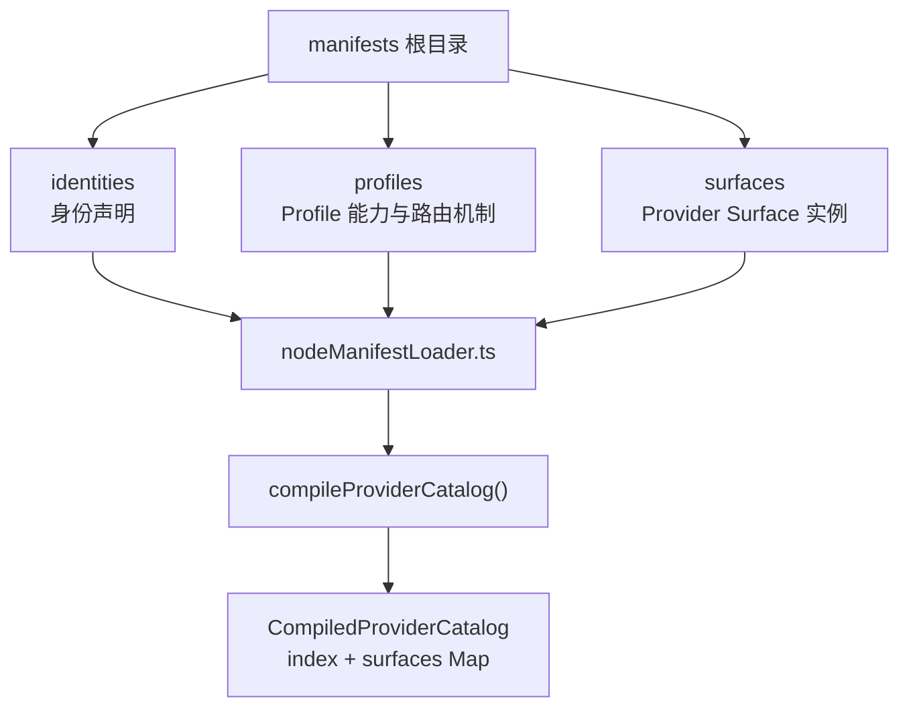
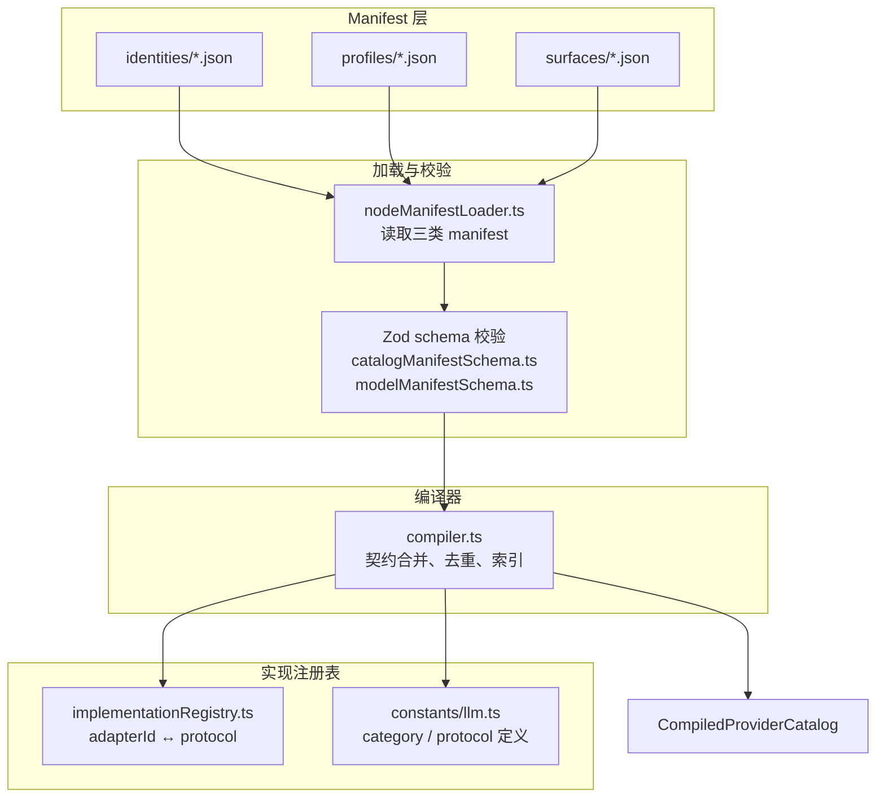
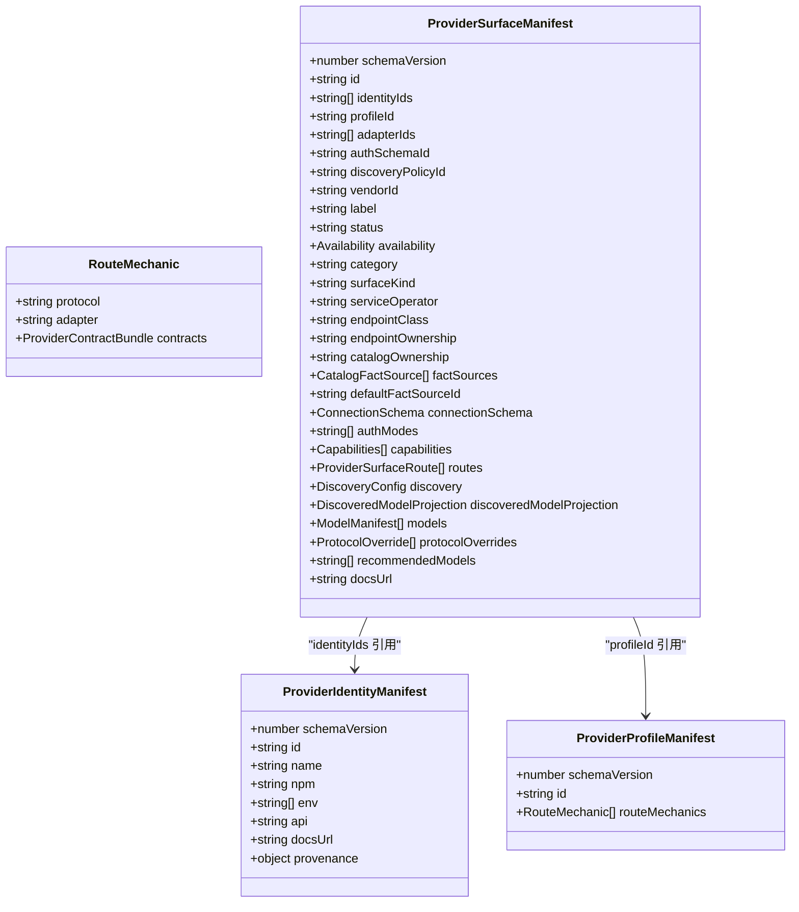
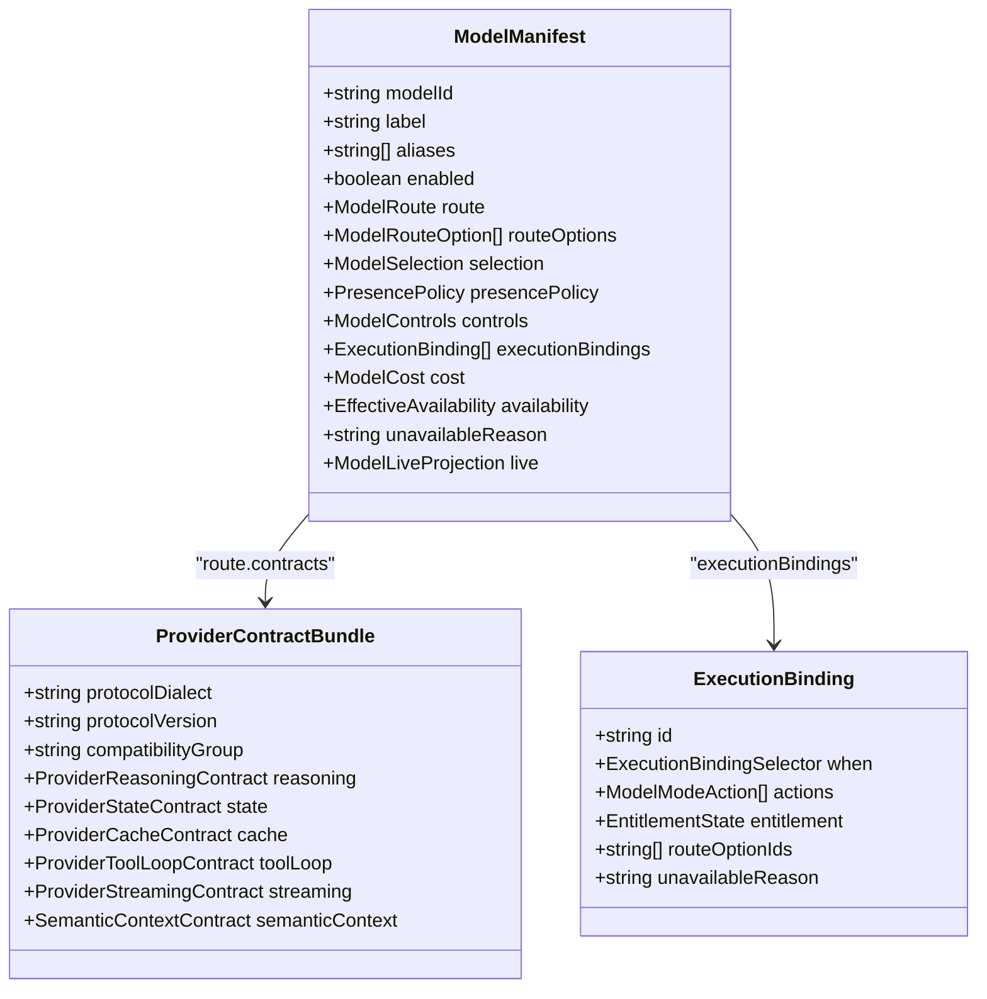
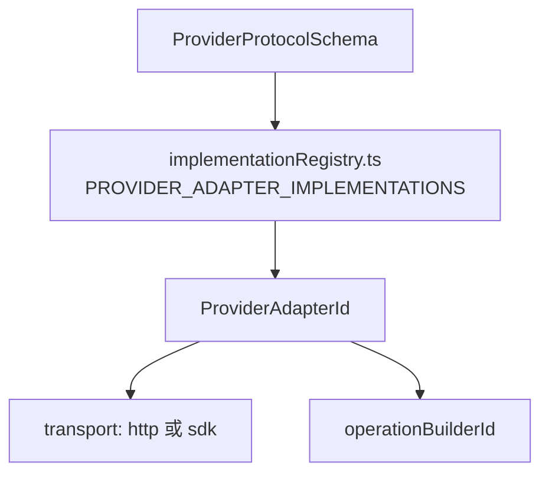
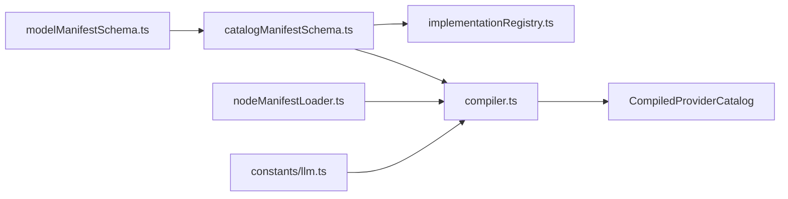

# Manifest 结构与 Schema 定义

<cite>
**本文引用的文件**   
- [modelManifestSchema.ts](file://src/shared/provider-catalog/modelManifestSchema.ts)
- [catalogManifestSchema.ts](file://src/shared/provider-catalog/catalogManifestSchema.ts)
- [implementationRegistry.ts](file://src/shared/provider-catalog/implementationRegistry.ts)
- [compiler.ts](file://src/shared/provider-catalog/compiler.ts)
- [nodeManifestLoader.ts](file://src/shared/provider-catalog/nodeManifestLoader.ts)
- [llm.ts](file://src/shared/constants/llm.ts)
- [manifest.json](file://src/shared/provider-catalog/manifests/surfaces/manifest.json)
</cite>

## 目录
1. [引言](#引言)
2. [项目结构](#项目结构)
3. [核心组件](#核心组件)
4. [架构总览](#架构总览)
5. [详细组件分析](#详细组件分析)
6. [依赖关系分析](#依赖关系分析)
7. [性能与兼容性考虑](#性能与兼容性考虑)
8. [故障排查指南](#故障排查指南)
9. [结论](#结论)

## 引言
本文聚焦 Provider Catalog Manifest 的结构与 Schema 定义，围绕三层目录组织展开：身份声明、Profile 能力与路由机制、Provider Surface 实例化。目标是帮助开发者理解 identity、profile、surface 的引用关系，掌握 `modelManifestSchema` 中 `ModelManifest`、`ProviderContractBundle`、`ExecutionBinding` 等核心类型的语义与校验规则，并说明 provider category、authMode、LlmProviderProtocol 及其与运行时适配器之间的对应关系。文末提供一份完整的 manifest 示例路径和 schema version 管理策略。

## 项目结构
Provider Catalog 由三类 JSON manifest 组成，分别位于 manifests 根目录下的 identities、profiles、surfaces 三个子目录。加载器会按目录顺序读取所有 `.json` 文件，形成编译输入，再由编译器完成校验、去重、契约合并与索引构建。

**图示来源**   
- [nodeManifestLoader.ts:10-26](file://src/shared/provider-catalog/nodeManifestLoader.ts#L10-L26)
- [compiler.ts:28-73](file://src/shared/provider-catalog/compiler.ts#L28-L73)

加载阶段只负责把三类 manifest 聚合为 `ProviderCatalogCompileInput`；实际校验与语义约束由 Zod schema 与 compiler 共同承担。Surface manifest 是最终对外暴露的 Provider 实例描述，它通过 `identityIds` 和 `profileId` 引用前两层，再通过 `adapterIds`、`routes`、`models` 等字段绑定协议、适配器与模型契约。

**章节来源**   
- [nodeManifestLoader.ts:10-26](file://src/shared/provider-catalog/nodeManifestLoader.ts#L10-L26)
- [compiler.ts:28-73](file://src/shared/provider-catalog/compiler.ts#L28-L73)

## 核心组件
Provider Catalog Manifest 的核心由以下组件构成：

| 组件 | 作用 | 关键字段 | 验证入口 |
|---|---|---|---|
| Identity | 声明上游身份来源、包名、环境变量、文档地址等元数据 | `schemaVersion`、`id`、`name`、`npm`、`env`、`api`、`docsUrl`、`provenance` | `ProviderIdentityManifestSchema` |
| Profile | 声明某类协议下可复用的路由机制与契约模板 | `schemaVersion`、`id`、`routeMechanics` | `ProviderProfileManifestSchema` |
| Surface | 实例化一个 Provider，绑定身份、Profile、适配器、认证模式、能力、模型清单 | `schemaVersion`、`id`、`identityIds`、`profileId`、`adapterIds`、`authSchemaId`、`discoveryPolicyId`、`routes`、`models` | `ProviderSurfaceManifestSchema` |
| ModelManifest | 描述单个模型的路由、可选路由选项、控制项、执行绑定、成本、可用性 | `modelId`、`label`、`aliases`、`enabled`、`route`、`routeOptions`、`controls`、`executionBindings`、`cost` | `ModelManifestSchema` |
| ProviderContractBundle | 对协议方言、推理、状态、缓存、工具循环、流式传输、语义上下文的契约建模 | `protocolDialect`、`reasoning`、`state`、`cache`、`toolLoop`、`streaming`、`semanticContext` | `ProviderContractBundleSchema` |
| ExecutionBinding | 将 fast/maxContext/reasoning 选择映射到具体动作和路由选项 | `id`、`when`、`actions`、`entitlement`、`routeOptionIds` | `ExecutionBindingSchema` |

这些类型全部由 Zod schema 严格校验，且大部分对象使用 `strict()` 阻止未声明字段泄漏到编译产物中。

**章节来源**   
- [catalogManifestSchema.ts:206-265](file://src/shared/provider-catalog/catalogManifestSchema.ts#L206-L265)
- [modelManifestSchema.ts:339-539](file://src/shared/provider-catalog/modelManifestSchema.ts#L339-L539)

## 架构总览
Provider Catalog 的运行时装配过程可以概括为：JSON manifest → schema 校验 → profile 契约继承 → adapter 注册表匹配 → 编译索引。

**图示来源**   
- [nodeManifestLoader.ts:10-26](file://src/shared/provider-catalog/nodeManifestLoader.ts#L10-L26)
- [catalogManifestSchema.ts:1-265](file://src/shared/provider-catalog/catalogManifestSchema.ts#L1-L265)
- [modelManifestSchema.ts:1-539](file://src/shared/provider-catalog/modelManifestSchema.ts#L1-L539)
- [implementationRegistry.ts:1-177](file://src/shared/provider-catalog/implementationRegistry.ts#L1-L177)
- [compiler.ts:28-73](file://src/shared/provider-catalog/compiler.ts#L28-L73)

## 详细组件分析

### 三层结构：identity → profile → surface

#### Identity 身份声明
Identity 是上游身份来源的描述，通常来自 models.dev 等外部来源。它不直接参与请求转发，而是为 Surface 提供“谁的身份”这一上下文。

关键字段语义：
- `schemaVersion`：固定为 `1`，用于标识 identity manifest 的版本。
- `id`：身份唯一标识，供 surface 通过 `identityIds` 引用。
- `name`、`npm`、`env`、`api`、`docsUrl`：描述提供方名称、NPM 包、环境变量、API 文档等元信息。
- `provenance`：记录数据来源、修订版本、刷新时间、commit 哈希等溯源信息。

验证规则要点：
- `id`、`name`、`npm`、`env`、`docsUrl`、`provenance.sourceRevision`、`provenance.refreshedAt`、`provenance.openCodeCommit`、`provenance.hermesCommit` 均为必填且非空字符串。
- `api` 可选。
- `provenance.sourceKind` 固定为 `models.dev`。

#### Profile 能力与路由机制
Profile 是对一类协议路由行为的抽象。多个 surface 可以共享同一个 profile，从而复用协议到适配器的映射以及默认契约。

关键字段语义：
- `schemaVersion`：固定为 `1`。
- `id`：Profile 唯一标识，被 surface 的 `profileId` 引用。
- `routeMechanics`：数组，每个元素声明一个协议对应的 `adapter` 和默认 `contracts`。

校验与行为要点：
- `routeMechanics` 至少包含一项。
- 每个 route mechanic 必须指定 `protocol`、`adapter`、`contracts`。
- compiler 在 materialize 阶段会把 surface 的 route 与 profile 的 `routeMechanics` 进行匹配，若找到相同协议或相同协议加相同 adapter 的记录，则继承其 `contracts`；否则根据协议构造失败闭合契约。

#### Surface Provider Surface 实例
Surface 是真正面向用户的 Provider 实例描述。它组合 identity、profile、adapter、认证模式、发现策略、能力、模型清单和文档链接。

关键字段语义：
- `schemaVersion`：固定为 `2`。
- `id`：surface 唯一标识。
- `identityIds`：引用一个或多个 identity，表示该 surface 可使用的身份集合。
- `profileId`：引用一个 profile，决定默认路由机制与契约模板。
- `adapterIds`：声明该 surface 支持的适配器 id 列表，至少一个。
- `authSchemaId`：认证 schema id，来自 `PROVIDER_AUTH_SCHEMA_IDS`。
- `discoveryPolicyId`：模型发现策略 id，来自 `PROVIDER_DISCOVERY_POLICY_IDS`。
- `vendorId`、`label`、`status`、`availability`：供应商、标签、发布状态、可用性。
- `category`：provider 分类。
- `surfaceKind`：surface 形态，如 account、native-api、cloud、plan、compatible-api、local。
- `serviceOperator`、`endpointClass`、`endpointOwnership`、`catalogOwnership`：服务运营方、端点类别、所有权、目录所有权。
- `factSources`、`defaultFactSourceId`、`factConflicts`：事实来源与冲突记录。
- `connectionSchema`：连接字段定义，包括 secret、text、url、region、path 等字段。
- `authModes`：支持的认证模式数组，例如 none、api-key、oauth、device、environment、local。
- `authModeAvailability`：按认证模式标注可用性。
- `capabilities`：chat、tool-calling、structured-output、reasoning、prompt-cache、vision-input、model-discovery。
- `routes`：协议路由列表，每条路由指定协议、协议拥有者、适配器、基础地址、可选头部和契约。
- `discovery`：模型发现权威性与策略。
- `discoveredModelProjection`：动态发现模型的投影，包含 fast、maxContext、executionBindings、factSourceId。
- `models`：静态模型清单。
- `protocolOverrides`：按 modelId 覆盖协议与契约 patch。
- `recommendedModels`、`docsUrl`：推荐模型与文档地址。

**图示来源**   
- [catalogManifestSchema.ts:206-265](file://src/shared/provider-catalog/catalogManifestSchema.ts#L206-L265)

**章节来源**   
- [catalogManifestSchema.ts:206-265](file://src/shared/provider-catalog/catalogManifestSchema.ts#L206-L265)
- [compiler.ts:104-149](file://src/shared/provider-catalog/compiler.ts#L104-L149)

### ModelManifest、ProviderContractBundle、ExecutionBinding 核心类型

#### ModelManifest
`ModelManifest` 描述单个模型在某个 surface 中的可见性、路由、控制项、执行绑定、成本与可用性。

关键字段语义：
- `modelId`：模型唯一标识。
- `label`、`aliases`：显示名称与别名。
- `enabled`：是否启用。
- `route`：主路由，包含协议、可选 baseUrl、headers、契约。
- `routeOptions`：可选路由配置列表，每项含 id、label、route、availability、authMode、requiredConnectionFieldIds 等。
- `selection`：模型选择 UI 行为。
- `presencePolicy`：模型存在策略。
- `controls`：fast、maxContext、reasoning 控制项。
- `executionBindings`：执行绑定，用于根据用户选择切换路由选项或模型。
- `cost`：输入输出成本。
- `availability`、`unavailableReason`：可用性与不可用原因。
- `live`：运行时观测投影。

校验要点：
- `modelId`、`label`、`route` 必填。
- `route.protocol` 必须是受支持的 `ProviderProtocolSchema`。
- `routeOptions.authMode` 限定为 api-key、local、account、environment。
- `controls.reasoning` 使用 `ReasoningControlSchema`，其中 `wireProfile` 是判别联合，针对不同协议族配置推理开关模式。

#### ProviderContractBundle
`ProviderContractBundle` 是对协议契约的统一建模，涵盖协议方言、推理、状态、缓存、工具循环、流式传输、语义上下文。

关键字段语义：
- `protocolDialect`、`protocolVersion`、`compatibilityGroup`：协议元信息。
- `reasoning`：推理契约，包括语义、载体、artifact 格式、延续策略、投影来源等。
- `state`：会话状态契约，包括支持模式、载体、保留范围、跨模型策略。
- `cache`：缓存契约，包括模式、键载体、断点载体、遥测、TTL。
- `toolLoop`：工具循环契约，包括 artifact 策略、作用域、排序、模型切换策略。
- `streaming`：流式传输契约，包括传输方式、输出身份、usage、错误处理。
- `semanticContext`：语义上下文契约，固定版本与消息历史、工具对、附件、溢出策略。

Patch 类型 `ProviderContractBundlePatchSchema` 允许在 route 级别覆盖部分字段，但不会破坏基础契约结构。

#### ExecutionBinding
`ExecutionBinding` 将用户选择的 fast、maxContext、reasoning 维度映射为具体动作，例如 request-patch、request-headers、model-switch、client-tier、fixed、unsupported。

关键字段语义：
- `id`：绑定唯一标识。
- `when`：选择条件，包含 fast、maxContext、reasoning 数组。
- `actions`：至少一个动作。
- `entitlement`：权限状态。
- `routeOptionIds`：可选的目标路由选项 id 列表。
- `unavailableReason`：不可用原因。

compiler 会对 binding 做去重与特异性排序，以便在运行时正确选择最具体的执行绑定。

**图示来源**   
- [modelManifestSchema.ts:339-539](file://src/shared/provider-catalog/modelManifestSchema.ts#L339-L539)

**章节来源**   
- [modelManifestSchema.ts:339-539](file://src/shared/provider-catalog/modelManifestSchema.ts#L339-L539)
- [compiler.ts:170-200](file://src/shared/provider-catalog/compiler.ts#L170-L200)

### Provider Category 七分类与 AuthMode 映射

当前 schema 中定义的 provider category 枚举值为六项：

| category 值 | 含义 | 典型说明 |
|---|---|---|
| `login-authorization` | OAuth / 登录 | 官方账号登录、OAuth、设备流程或账号授权提供商 |
| `official-direct` | 第一方直连 | 模型厂商直接运营的原生 API |
| `cloud-platform` | 云平台 | 企业云平台通过云凭证或部署托管模型 API |
| `coding-token-plan` | Coding / Token Plan | 独立的 coding plan 或 token plan 产品 |
| `compatible-access` | 兼容接入 | 通过兼容协议访问的服务，operator facts 保持显式 |
| `local` | 本地模型服务 | 本地运行时与 localhost 服务 |

注意：虽然文档目标提到“七分类”，但当前 `ProviderSurfaceManifestSchema.category` 只定义了上述六个枚举值。第七个语义空间体现在 `surfaceKind` 上，包括 account、native-api、cloud、plan、compatible-api、local，用于区分 surface 形态而非 provider 分类。

AuthMode 支持以下值：
- `none`
- `api-key`
- `oauth`
- `device`
- `environment`
- `local`

Surface 可同时声明多个 authMode，并通过 `authModeAvailability` 标注每种模式的可用性。

Category 与 authMode 的关系不是硬编码映射，而是由 Surface manifest 的组合字段表达：
- `category` 表达业务归属。
- `surfaceKind` 表达接入形态。
- `authSchemaId` 表达认证 schema。
- `authModes` 表达支持的认证模式。
- `connectionSchema` 表达连接字段。
- `discoveryPolicyId` 表达模型发现策略。

因此，不能简单地将 category 与 authMode 做一对一映射；更准确的理解是：category 描述 Provider 的业务类别，authMode 描述该 surface 支持的认证方式，两者共同影响连接 UI、认证流程和模型发现逻辑。

**章节来源**   
- [catalogManifestSchema.ts:146-170](file://src/shared/provider-catalog/catalogManifestSchema.ts#L146-L170)
- [llm.ts:13-40](file://src/shared/constants/llm.ts#L13-L40)

### LlmProviderProtocol 枚举与 Protocol 适配器对应关系

`ProviderProtocolSchema` 定义协议枚举，而 `implementationRegistry.ts` 将 `ProviderAdapterId` 映射到一组协议、操作构建器和传输方式。

协议枚举值：
- `OpenAICompatibleChatCompletions`
- `OpenAIResponses`
- `AnthropicMessages`
- `OpenRouterChatCompletions`
- `AzureOpenAIChatCompletions`
- `AzureOpenAIResponses`
- `GoogleInteractions`
- `GoogleGemini`
- `GoogleVertexGemini`
- `GoogleVertexAnthropic`
- `GitLabDuo`
- `SapAiCoreOrchestration`
- `SapAiCoreFoundationModels`
- `OllamaOpenAICompatibleChatCompletions`
- `MistralConversations`
- `BedrockConverseStream`

运行时适配器映射如下：

| adapterId | protocols | operationBuilderId | transport |
|---|---|---|---|
| `anthropic-messages` | `AnthropicMessages` | `anthropic-messages` | http |
| `azure-openai-chat` | `AzureOpenAIChatCompletions` | `azure-chat-completions` | http |
| `azure-openai-responses` | `AzureOpenAIResponses` | `azure-openai-responses` | http |
| `bedrock-converse-stream` | `BedrockConverseStream` | `bedrock-converse-stream` | http |
| `gitlab-duo` | `GitLabDuo` | `gitlab-agentic-chat` | sdk |
| `google-interactions` | `GoogleInteractions` | `google-interactions` | http |
| `google-gemini` | `GoogleGemini` | `google-gemini` | http |
| `google-vertex-anthropic` | `GoogleVertexAnthropic` | `google-vertex-anthropic` | http |
| `google-vertex-gemini` | `GoogleVertexGemini` | `google-vertex-gemini` | http |
| `mistral-conversations` | `MistralConversations` | `mistral-conversations` | http |
| `ollama-openai-compatible` | `OllamaOpenAICompatibleChatCompletions` | `ollama-chat-completions` | http |
| `openai-compatible` | `OpenAICompatibleChatCompletions` | `openai-chat-completions` | http |
| `openai-responses` | `OpenAIResponses` | `openai-responses` | http |
| `openrouter-chat` | `OpenRouterChatCompletions` | `openrouter-chat-completions` | http |
| `sap-ai-core-foundation-models` | `SapAiCoreFoundationModels` | `sap-ai-core-foundation-models` | sdk |
| `sap-ai-core-orchestration` | `SapAiCoreOrchestration` | `sap-ai-core-orchestration` | sdk |

校验时，surface 的 `adapterIds` 和 route 的 `adapterId` 必须存在于 `PROVIDER_ADAPTER_IMPLEMENTATIONS`；compiler 还保证每个协议只能解析到一个 runtime adapter，否则会抛出错误。

**图示来源**   
- [modelManifestSchema.ts:44-66](file://src/shared/provider-catalog/modelManifestSchema.ts#L44-L66)
- [implementationRegistry.ts:1-143](file://src/shared/provider-catalog/implementationRegistry.ts#L1-L143)

**章节来源**   
- [modelManifestSchema.ts:44-66](file://src/shared/provider-catalog/modelManifestSchema.ts#L44-L66)
- [implementationRegistry.ts:1-143](file://src/shared/provider-catalog/implementationRegistry.ts#L1-L143)
- [catalogManifestSchema.ts:138-160](file://src/shared/provider-catalog/catalogManifestSchema.ts#L138-L160)

### 完整 Manifest 示例路径

仓库提供一个最小化的 surface manifest 示例，展示从 identity、profile 到 surface 的定义方式：

- 示例文件：[manifest.json](file://src/shared/provider-catalog/manifests/surfaces/manifest.json)

该示例的关键语义：
- `schemaVersion` 为 `2`。
- `profileId` 指向 `openai-compatible`，表示使用 OpenAI 兼容路由机制。
- `adapterIds` 包含 `openai-compatible`。
- `authSchemaId` 为 `declarative-api-key`。
- `discoveryPolicyId` 为 `openai-compatible`。
- `category` 为 `compatible-access`。
- `surfaceKind` 为 `compatible-api`。
- `connectionSchema` 声明一个名为 `apiKey` 的 secret 字段。
- `authModes` 为 `api-key`。
- `routes` 中声明一条 `OpenAICompatibleChatCompletions` 路由，baseUrl 指向 `https://app.manifest.build/v1`。
- `recommendedModels` 包含 `gpt-4.1`。
- `docsUrl` 指向提供方文档。

注意：本文件作为示例，并未包含完整的 identity 清单，而是以 `identityIds: []` 开头。实际生产 surface 通常会关联真实 identity，并通过 profiles 目录中的 `openai-compatible` profile 复用路由机制。

**章节来源**   
- [manifest.json:1-75](file://src/shared/provider-catalog/manifests/surfaces/manifest.json#L1-L75)
- [catalogManifestSchema.ts:146-265](file://src/shared/provider-catalog/catalogManifestSchema.ts#L146-L265)

## 依赖关系分析

依赖关系说明：
- `modelManifestSchema.ts` 定义模型层类型，被 `catalogManifestSchema.ts` 复用。
- `catalogManifestSchema.ts` 定义 identity、profile、surface 的 schema，并引入 implementation registry 中的 adapterId、authSchemaId、discoveryPolicyId。
- `implementationRegistry.ts` 维护 adapterId 与 protocol 的闭合集。
- `compiler.ts` 使用 schema 校验 manifest，并把 profile 的 routeMechanics 注入到 surface routes。
- `nodeManifestLoader.ts` 负责把 manifests 目录加载为编译输入。
- `constants/llm.ts` 提供 category 与 protocol 的用户侧描述。

潜在耦合点：
- adapterId 必须同时出现在 manifest 与 TypeScript 注册表中，新增协议需要同时更新两处。
- protocol 与 adapterId 是一对一映射，compiler 会在反向查找时检查数量是否为 1。
- profile 的 `routeMechanics` 与 surface 的 `routes` 协议必须一致，否则无法继承契约。

**图示来源**   
- [modelManifestSchema.ts:1-539](file://src/shared/provider-catalog/modelManifestSchema.ts#L1-L539)
- [catalogManifestSchema.ts:1-265](file://src/shared/provider-catalog/catalogManifestSchema.ts#L1-L265)
- [implementationRegistry.ts:1-177](file://src/shared/provider-catalog/implementationRegistry.ts#L1-L177)
- [compiler.ts:28-73](file://src/shared/provider-catalog/compiler.ts#L28-L73)
- [nodeManifestLoader.ts:10-26](file://src/shared/provider-catalog/nodeManifestLoader.ts#L10-L26)
- [llm.ts:13-116](file://src/shared/constants/llm.ts#L13-L116)

**章节来源**   
- [implementationRegistry.ts:120-143](file://src/shared/provider-catalog/implementationRegistry.ts#L120-L143)
- [compiler.ts:104-149](file://src/shared/provider-catalog/compiler.ts#L104-L149)

## 性能与兼容性考虑

### Schema Version 管理
- Identity manifest 使用 `schemaVersion: 1`。
- Profile manifest 使用 `schemaVersion: 1`。
- Surface manifest 使用 `schemaVersion: 2`。
- 编译器暴露 `PROVIDER_CATALOG_SCHEMA_VERSION = 2`，用于标记编译产物的目录版本。

向后兼容性策略：
- 使用 Zod strict schema 拒绝未知字段，确保新字段不会静默进入编译产物。
- 新增字段应优先采用可选字段，避免破坏旧 manifest。
- 对必需字段增加最小长度、枚举值和数值范围校验，防止空值或非法值进入索引。
- contract patch 使用 partial 模式，允许在 route 级别覆盖部分契约而不改变基础结构。
- compiler 对 duplicate id 和 duplicate modelId 进行检测并收集错误，保证索引唯一性。
- `materializeSurfaceContractInput` 明确禁止 surface route 直接携带 `contracts`，要求通过 profile 继承并使用 `contractOverrides`，从而保证契约继承的一致性。

### 编译期优化
- loader 按文件名排序读取 manifest，保证加载顺序稳定。
- compiler 对 identities、profiles、surfaces、models 进行唯一性校验。
- ExecutionBinding 使用 `selectorKey` 与 `bindingSpecificity` 计算选择键与优先级，避免重复绑定并提升匹配效率。
- stableJson 用于生成稳定的哈希输入，有利于缓存和 diff。

**章节来源**   
- [compiler.ts:28-73](file://src/shared/provider-catalog/compiler.ts#L28-L73)
- [compiler.ts:104-200](file://src/shared/provider-catalog/compiler.ts#L104-L200)
- [modelManifestSchema.ts:339-539](file://src/shared/provider-catalog/modelManifestSchema.ts#L339-L539)
- [catalogManifestSchema.ts:206-265](file://src/shared/provider-catalog/catalogManifestSchema.ts#L206-L265)

## 故障排查指南

常见诊断场景：

1. **adapterId 未注册**
   - 现象：schema 校验失败，提示未注册的 adapter。
   - 原因：manifest 使用了未在 `PROVIDER_ADAPTER_IMPLEMENTATIONS` 中声明的 adapterId。
   - 解决：添加新的 adapter 实现，或修正 manifest 中的 adapterId。

2. **协议与适配器不匹配**
   - 现象：route 中 protocol 与 adapterId 不一致。
   - 原因：adapter 不支持该 protocol。
   - 解决：调整 route 的 adapterId，或扩展 adapter 的 protocols 列表。

3. **protocol 无法唯一解析到 adapter**
   - 现象：compiler 报错，指出协议解析到的 adapter 数量不为 1。
   - 原因：多个 adapter 声明了同一 protocol。
   - 解决：移除重复协议声明，确保一对一映射。

4. **Surface route 直接携带 contracts**
   - 现象：compiler 抛出错误，提示应从 profile 继承契约。
   - 原因：surface route 不应直接设置 `contracts`。
   - 解决：删除 route 中的 `contracts`，改用 profile 的 `routeMechanics` 或 `contractOverrides`。

5. **Duplicate id 或 Duplicate modelId**
   - 现象：编译阶段报告重复 id。
   - 原因：manifest 中存在重复 id。
   - 解决：修改重复的 id，确保全局唯一。

6. **AuthMode 或 Category 不在枚举中**
   - 现象：Zod 校验失败。
   - 原因：使用了未被 schema 接受的字符串。
   - 解决：改为 `authModes` 或 `category` 枚举中的合法值。

7. **Discovery Policy 或 Auth Schema 不存在**
   - 现象：`discoveryPolicyId` 或 `authSchemaId` 校验失败。
   - 原因：使用了未声明的策略或认证 schema。
   - 解决：改为 `PROVIDER_DISCOVERY_POLICY_IDS` 或 `PROVIDER_AUTH_SCHEMA_IDS` 中的值。

**章节来源**   
- [catalogManifestSchema.ts:18-21](file://src/shared/provider-catalog/catalogManifestSchema.ts#L18-L21)
- [implementationRegistry.ts:120-143](file://src/shared/provider-catalog/implementationRegistry.ts#L120-L143)
- [compiler.ts:104-149](file://src/shared/provider-catalog/compiler.ts#L104-L149)

## 结论
Provider Catalog Manifest 通过 identities、profiles、surfaces 三层结构实现了身份、能力与实例的清晰分离。Surface 是最终的 Provider 实例描述，它通过 `identityIds`、`profileId`、`adapterIds`、`authSchemaId`、`discoveryPolicyId`、`routes`、`models` 等字段组合出可用的模型接入方案。`modelManifestSchema` 中的 `ModelManifest`、`ProviderContractBundle`、`ExecutionBinding` 提供了模型级契约、协议行为和运行时绑定的统一建模。category 与 authMode 共同表达 Provider 的业务归属与认证能力，而 `LlmProviderProtocol` 与 `implementationRegistry` 保证了 JSON manifest 与 TypeScript 运行时适配器的一致性。Schema version 与 Zod strict 校验构成了向后兼容与健壮性的基础。