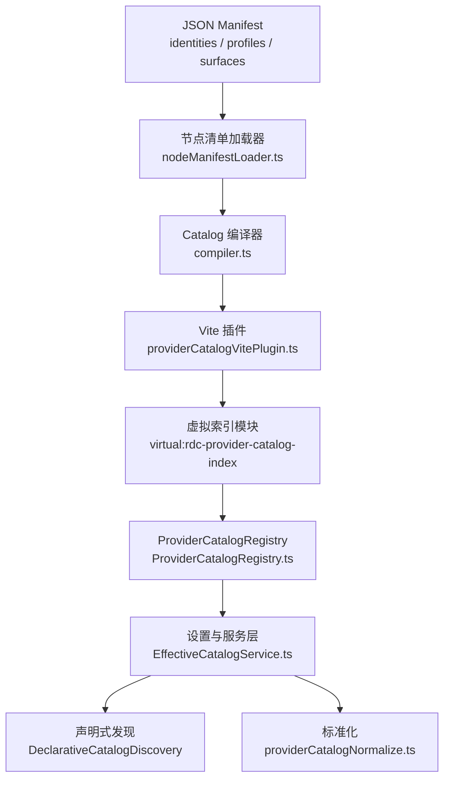
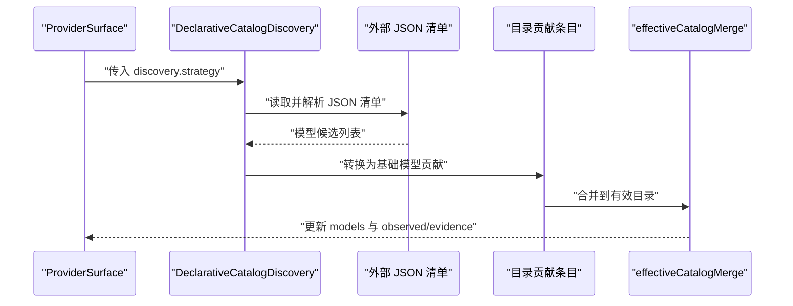
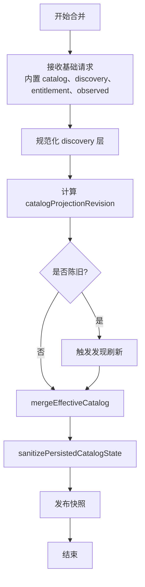
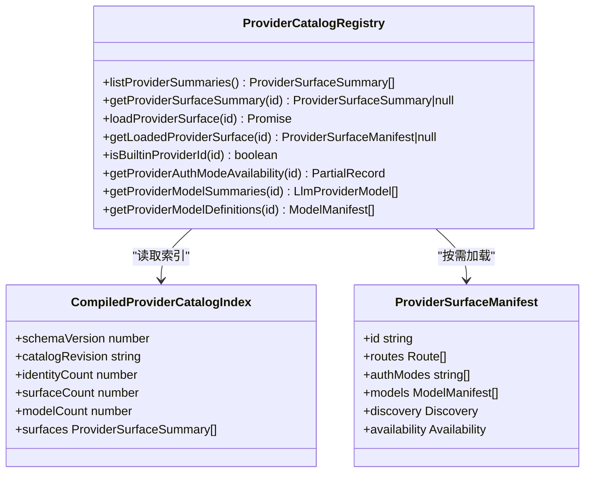
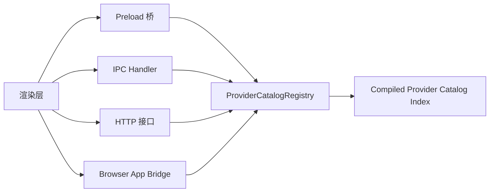
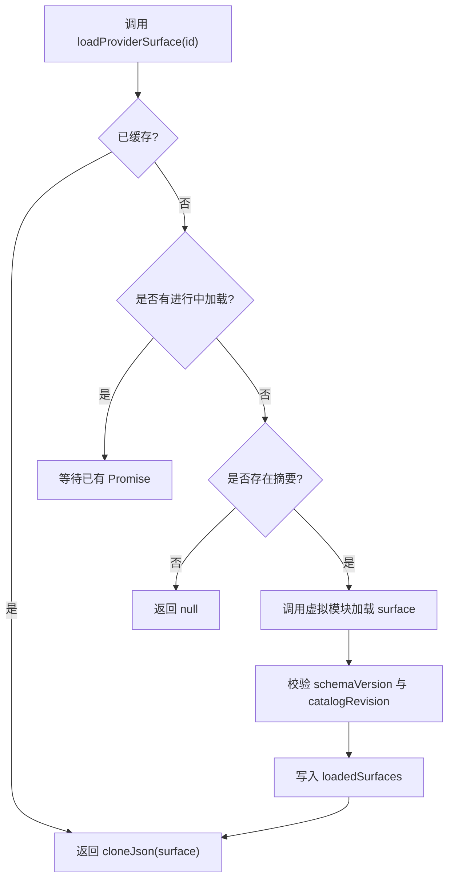
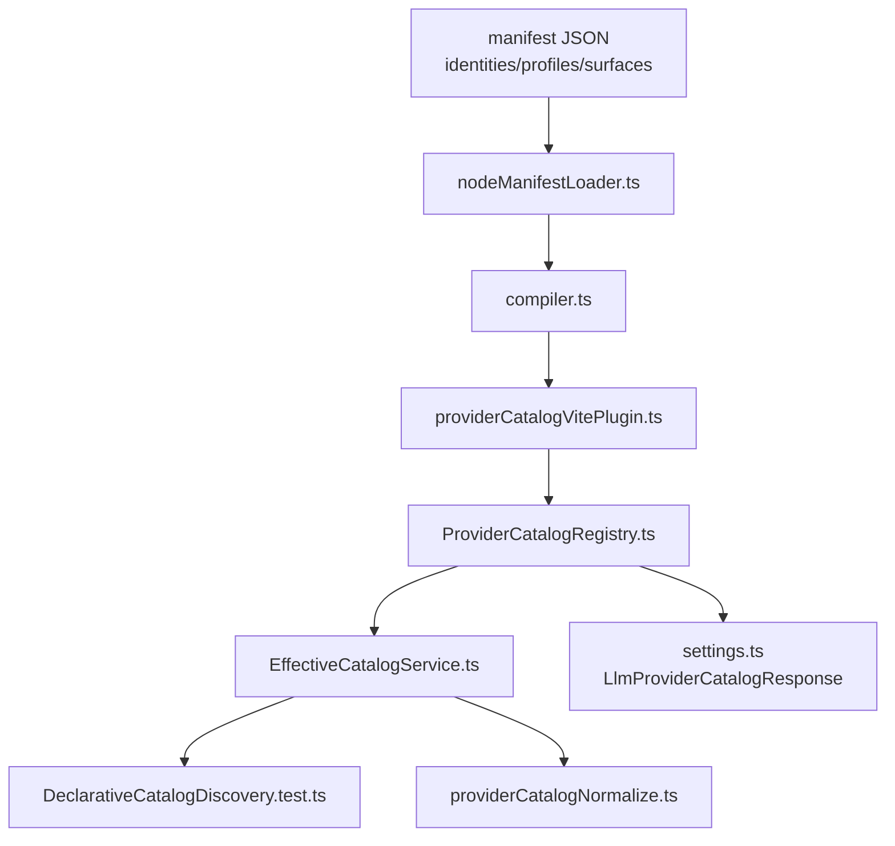

# Provider Catalog 发现与管理

<cite>
**本文引用的文件**
- [ProviderCatalogRegistry.ts](file://src/main/provider-catalog/ProviderCatalogRegistry.ts)
- [providerCatalogVitePlugin.ts](file://src/main/provider-catalog/providerCatalogVitePlugin.ts)
- [compiler.ts](file://src/shared/provider-catalog/compiler.ts)
- [nodeManifestLoader.ts](file://src/shared/provider-catalog/nodeManifestLoader.ts)
- [index.ts](file://src/shared/provider-catalog/index.ts)
- [providerCatalogNormalize.ts](file://src/main/settings/providerCatalogNormalize.ts)
- [EffectiveCatalogService.ts](file://src/main/settings/EffectiveCatalogService.ts)
- [DeclarativeCatalogDiscovery.test.ts](file://src/main/settings/DeclarativeCatalogDiscovery.test.ts)
- [settings.ts](file://src/shared/types/settings.ts)
- [provider-catalog-index.cjs](file://scripts/provider-catalog-index.cjs)
</cite>

## 目录

1. [引言](#引言)
2. [项目结构与职责边界](#项目结构与职责边界)
3. [核心组件](#核心组件)
4. [架构总览](#架构总览)
5. [详细组件分析](#详细组件分析)
6. [依赖关系分析](#依赖关系分析)
7. [性能与一致性考虑](#性能与一致性考虑)
8. [故障排查指南](#故障排查指南)
9. [结论](#结论)

## 引言

Provider Catalog 是 RDC Agent 中用于描述、发现和暴露 LLM Provider 能力的独立契约层。它不是 `settings:get` 的派生 UI 状态，也不是在运行时动态拼装出的临时对象；它是一个由构建期编译、主进程注册、多入口一致访问的类型安全目录。

它的职责可以概括为：

- 用 JSON manifest 声明 Provider 身份、配置模板和运行表面。
- 通过 catalog compiler 把 manifest 编译成类型安全的索引与 surface 数据。
- 通过 ProviderCatalogRegistry 提供只读、可克隆、带校验的发现 API。
- 通过 DeclarativeCatalogDiscovery 支持从远程或本地 JSON 清单声明式发现模型。
- 通过 EffectiveCatalogService 与 effectiveCatalogMerge 合并多个来源的有效目录。
- 通过 providerCatalogNormalize 将 id、category、protocol 等字段标准化。
- 对外暴露 categories、protocols、providers 三个维度的公开信息，不泄露 apiKey、secretRef、OAuth token 等敏感字段。

## 项目结构与职责边界

Provider Catalog 相关代码分布在四个层次：

| 层次 | 主要路径 | 职责 |
|---|---|---|
| 共享契约与编译器 | `src/shared/provider-catalog/*` | 定义 manifest schema、compiler、implementation registry、model manifest 等跨进程共享类型 |
| 构建期插件 | `src/main/provider-catalog/providerCatalogVitePlugin.ts` | Vite 插件把 manifest 编译进虚拟模块，并输出 `provider-catalog/index.json` |
| 运行时目录服务 | `src/main/provider-catalog/ProviderCatalogRegistry.ts` | 加载编译后的 index，缓存 surface，提供 list、load、summary 等 API |
| 设置与服务集成 | `src/main/settings/*` | 声明式发现、有效目录合并、分类与协议标准化、IPC/HTTP/Bridge/Preload 入口 |

**图表来源**
- [nodeManifestLoader.ts:1-26](file://src/shared/provider-catalog/nodeManifestLoader.ts#L1-L26)
- [compiler.ts:1-200](file://src/shared/provider-catalog/compiler.ts#L1-L200)
- [providerCatalogVitePlugin.ts:1-59](file://src/main/provider-catalog/providerCatalogVitePlugin.ts#L1-L59)
- [ProviderCatalogRegistry.ts:1-200](file://src/main/provider-catalog/ProviderCatalogRegistry.ts#L1-L200)
- [EffectiveCatalogService.ts:1-200](file://src/main/settings/EffectiveCatalogService.ts#L1-L200)

**章节来源**
- [nodeManifestLoader.ts:1-26](file://src/shared/provider-catalog/nodeManifestLoader.ts#L1-L26)
- [providerCatalogVitePlugin.ts:1-59](file://src/main/provider-catalog/providerCatalogVitePlugin.ts#L1-L59)
- [ProviderCatalogRegistry.ts:1-200](file://src/main/provider-catalog/ProviderCatalogRegistry.ts#L1-L200)

## 核心组件

### 独立 contract：Provider Catalog 不是 settings 的派生 UI 状态

Provider Catalog 的生命周期始于构建期：

1. `nodeManifestLoader` 读取 `identities`、`profiles`、`surfaces` 三个目录下的 JSON 清单。
2. `compiler` 解析、去重、校验、合并 profile、route contract、model alias 等信息，生成 `CompiledProviderCatalogIndex` 和每个 surface 的 `CompiledProviderSurface`。
3. `providerCatalogVitePlugin` 把编译结果注入到虚拟模块 `virtual:rdc-provider-catalog-index`，并在打包时输出 `provider-catalog/index.json`。
4. `ProviderCatalogRegistry` 在运行时加载该索引，并通过 `listProviderSummaries()`、`getProviderSurfaceSummary()`、`loadProviderSurface()` 暴露稳定 API。

因此，UI 只能消费 Provider Catalog 提供的公开摘要；真正的 Provider 能力、路由、协议、认证模式、模型列表都由 manifest + compiler 决定，而不是由前端根据 settings 反向推导。

**章节来源**
- [nodeManifestLoader.ts:1-26](file://src/shared/provider-catalog/nodeManifestLoader.ts#L1-L26)
- [compiler.ts:1-200](file://src/shared/provider-catalog/compiler.ts#L1-L200)
- [providerCatalogVitePlugin.ts:1-59](file://src/main/provider-catalog/providerCatalogVitePlugin.ts#L1-L59)
- [ProviderCatalogRegistry.ts:1-200](file://src/main/provider-catalog/ProviderCatalogRegistry.ts#L1-L200)

### manifest 文件结构：identities、profiles、surfaces

manifest 输入由三类文件组成：

| manifest 类型 | 作用 | 关键约束 |
|---|---|---|
| identities | 描述 Provider 品牌、归属、所有权、默认认证方式等身份元信息 | 作为 surface 的引用目标，id 必须唯一 |
| profiles | 提供可复用的 route mechanics、contract base、capability 基线 | surface 可通过 `profileId` 引用 |
| surfaces | 描述一个 Provider 的可发现运行表面，包括 routes、authModes、models、discovery、availability 等 | 是 `loadProviderSurface(id)` 返回的单位 |

编译器会：

- 对 identity、profile、surface、model 做 id 去重和错误收集。
- 将 surface 的 route contracts 与 profile 的 route mechanic 合并。
- 将 model alias、presencePolicy、selection、availability、unavailableReason 投影到摘要。
- 计算 schemaVersion、catalogRevision、identityCount、surfaceCount、modelCount。

**章节来源**
- [compiler.ts:1-200](file://src/shared/provider-catalog/compiler.ts#L1-L200)
- [nodeManifestLoader.ts:1-26](file://src/shared/provider-catalog/nodeManifestLoader.ts#L1-L26)

### catalog compiler 的类型安全产出

编译器输出的核心类型包括：

| 类型 | 含义 |
|---|---|
| `CompiledProviderCatalogIndex` | 构建期生成的目录索引，包含 revision、count、surfaces 摘要 |
| `CompiledProviderSurface` | 单个 surface 的编译产物，包含校验过的 `ProviderSurfaceManifest` |
| `ProviderSurfaceSummary` | 面向运行时的轻量摘要，已移除 identityIds、adapterIds、discovery、models 原始结构等内部字段 |
| `ModelManifest` | 模型级别的能力、别名、可见性、存在策略、可用性描述 |

这种设计让：

- 构建期可以严格校验 manifest。
- 运行时只拿到必要字段，减少序列化体积和误用风险。
- 所有 surface 都经过 `ProviderSurfaceManifestSchema.parse`，避免脏数据进入目录。

**章节来源**
- [compiler.ts:1-200](file://src/shared/provider-catalog/compiler.ts#L1-L200)
- [index.ts:1-4](file://src/shared/provider-catalog/index.ts#L1-L4)

### DeclarativeCatalogDiscovery：声明式发现

声明式发现用于处理“已知 Provider 的模型清单以 JSON 形式存在于外部资源”的场景。测试用例表明：

- discovery.strategy.kind 为 `json-catalog`。
- 外部 JSON payload 被 `parseDeclarativeCatalog` 解析。
- 解析结果通过 `toDeclarativeCatalogContributions` 转换为贡献条目。
- 每个模型贡献可以携带上下文能力、工具调用、视觉输入、结构化输出、默认预算等元数据。
- 如果候选列表没有显式 route，系统不会用它替换模型自身拥有的 route；它只作为可用性或证据补充。

**图表来源**
- [DeclarativeCatalogDiscovery.test.ts:1-176](file://src/main/settings/DeclarativeCatalogDiscovery.test.ts#L1-L176)
- [EffectiveCatalogService.ts:1-200](file://src/main/settings/EffectiveCatalogService.ts#L1-L200)

**章节来源**
- [DeclarativeCatalogDiscovery.test.ts:1-176](file://src/main/settings/DeclarativeCatalogDiscovery.test.ts#L1-L176)

### effectiveCatalogMerge：多源目录合并

`effectiveCatalogMerge` 负责把以下来源合并成一个有效目录：

- 内置 catalog：来自 `ProviderCatalogRegistry` 编译后的 surface。
- 声明式发现：来自 `DeclarativeCatalogDiscovery` 的外部 JSON 清单。
- 用户配置：settings 中的 Provider 配置。
- 探测证据：capability probe、observed capability 等运行时观察。

合并的关键规则包括：

- 保留模型自身的 route 优先于 catalog 或 discovery 提供的 fallback route。
- 对 stale discovery 进行过期判断，并在需要时触发刷新。
- 使用 evidenceKey、entitlements、observed 区分不同 account 和 protocol 的上下文。
- 持久化 state 前执行 sanitize，确保 discovery admission 安全。

**图表来源**
- [EffectiveCatalogService.ts:1-200](file://src/main/settings/EffectiveCatalogService.ts#L1-L200)

**章节来源**
- [EffectiveCatalogService.ts:1-200](file://src/main/settings/EffectiveCatalogService.ts#L1-L200)

### providerCatalogNormalize：标准化处理

`providerCatalogNormalize.ts` 提供两类标准化：

| 方法 | 输入 | 行为 |
|---|---|---|
| `normalizeProviderCategory` | id、category、authMode | 若 id 对应内置 surface，则采用内置 category；否则按 authMode 映射；无法识别时降级为兼容接入 |
| `normalizeProviderProtocol` | id、protocol | 若 id 对应内置 surface，则取 default route 的 protocol；否则使用显式 protocol；否则抛出错误 |

这保证了：

- 内置 Provider 的 category 和 protocol 不可被任意覆盖。
- 非内置 Provider 在没有明确协议时会失败，而不是静默进入未知状态。
- 设置层可以基于 authMode 自动推断合理分类。

**章节来源**
- [providerCatalogNormalize.ts:1-65](file://src/main/settings/providerCatalogNormalize.ts#L1-L65)

### LlmProviderCatalogResponse：公开数据契约

`LlmProviderCatalogResponse` 是向调用方暴露的目录响应契约。其核心维度包括：

| 维度 | 含义 | 为什么不能包含敏感字段 |
|---|---|---|
| categories | Provider 分类集合，如 OAuth/Login、第一方直连、Cloud、兼容接入、Coding/Token Plan、Local、Image | 仅用于 UI 分组与筛选，不包含凭据 |
| protocols | 支持的协议集合，如 OpenAIResponses、AnthropicMessages、OpenAICompatibleChatCompletions 等 | 仅描述传输协议，不包含密钥 |
| providers | Provider 摘要列表，包括 id、label、category、authMode、availability、models 等 | 只暴露公开能力；apiKey、secretRef、OAuth token 属于配置或会话凭证，不应出现在目录契约中 |

敏感字段（apiKey、secretRef、OAuth token）属于 credentials 或 session lease 范畴，应由 settings、account service、credential lease 等专门子系统管理，而不是随 catalog 暴露给渲染层、IPC、HTTP 或第三方消费者。

**章节来源**
- [settings.ts:512-540](file://src/shared/types/settings.ts#L512-L540)

### ProviderCatalogRegistry.listProviderSummaries() 与 loadProviderSurface(id)

`ProviderCatalogRegistry` 是运行时访问 Provider Catalog 的核心入口：

| API | 返回值 | 用途 |
|---|---|---|
| `listProviderSummaries()` | `ProviderSurfaceSummary[]` | 列出所有内置 Provider 摘要，供 UI 展示、筛选、统计 |
| `getProviderSurfaceSummary(id)` | `ProviderSurfaceSummary \| null` | 获取指定 surface 的轻量摘要 |
| `loadProviderSurface(id)` | `Promise<ProviderSurfaceManifest \| null>` | 按需加载完整 surface，含 routes、models、discovery、authModes |
| `getLoadedProviderSurface(id)` | `ProviderSurfaceManifest \| null` | 读取已缓存的 surface |
| `isBuiltinProviderId(id)` | `boolean` | 判断是否为内置 Provider |
| `getProviderAuthModeAvailability(id)` | `Partial<Record<LlmProviderAuthMode, LlmProviderAvailability>>` | 查询各认证模式的可用性 |
| `getProviderModelSummaries(id)` | `LlmProviderModel[]` | 暴露模型摘要，过滤 internal picker |
| `getProviderModelDefinitions(id)` | `ModelManifest[]` | 暴露完整模型定义 |

实现特点包括：

- 使用 `cloneJson` 返回副本，防止调用方修改内部状态。
- 使用 `loadedSurfaces` 缓存已加载的 surface。
- 使用 `surfaceLoads` 并发保护，避免重复加载同一 id。
- 校验 compiled index 的 schemaVersion 与 catalogRevision。
- 当 surface 缺失或 revision 不匹配时抛出错误。

**图表来源**
- [ProviderCatalogRegistry.ts:1-200](file://src/main/provider-catalog/ProviderCatalogRegistry.ts#L1-L200)
- [compiler.ts:1-200](file://src/shared/provider-catalog/compiler.ts#L1-L200)

**章节来源**
- [ProviderCatalogRegistry.ts:1-200](file://src/main/provider-catalog/ProviderCatalogRegistry.ts#L1-L200)

### IPC、Preload、Browser bridge、HTTP 四种访问入口的一致性保证

Provider Catalog 的访问入口可能包括：

- **IPC**：渲染进程通过 IPC 调用主进程的 catalog 相关 handler。
- **Preload**：preload 脚本封装 rendererTransport，统一桥接主进程能力。
- **Browser bridge**：浏览器环境或嵌入场景下通过 BrowserAppBridgeServer 暴露能力。
- **HTTP**：服务端或调试接口可能暴露目录查询端点。

一致性保证的关键在于：

1. 所有入口最终都应调用 `ProviderCatalogRegistry` 的公开 API。
2. 返回的数据必须是 `cloneJson` 后的副本，避免跨进程共享可变状态。
3. 不返回敏感字段；敏感字段不在 catalog manifest、compiled index、surface summary 中。
4. 对 surface 的加载应遵循 revision 校验，避免旧索引与新 surface 不一致。
5. 如果某个入口直接拼接 settings 内容，必须确保不泄露 credential 字段。

**图表来源**
- [ProviderCatalogRegistry.ts:1-200](file://src/main/provider-catalog/ProviderCatalogRegistry.ts#L1-L200)
- [providerCatalogVitePlugin.ts:1-59](file://src/main/provider-catalog/providerCatalogVitePlugin.ts#L1-L59)

**章节来源**
- [ProviderCatalogRegistry.ts:1-200](file://src/main/provider-catalog/ProviderCatalogRegistry.ts#L1-L200)
- [providerCatalogVitePlugin.ts:1-59](file://src/main/provider-catalog/providerCatalogVitePlugin.ts#L1-L59)

## 详细组件分析

### ProviderCatalogRegistry 运行时行为

`ProviderCatalogRegistry` 的核心流程如下：

1. 从虚拟模块导入编译后的 `bundledCatalogIndex`。
2. 校验 index 是否为有效的 `CompiledProviderCatalogIndex`。
3. 提供 `listProviderSummaries()` 返回浅拷贝的 surfaces 摘要。
4. 提供 `loadProviderSurface(id)` 懒加载 surface，并进行 revision 校验。
5. 维护 `loadedSurfaces` 和 `surfaceLoads` 两个 Map，分别缓存已加载结果和正在进行的异步加载。
6. 提供 authMode availability、model summaries、ownership、discoveryAuthority 等辅助查询。

**图表来源**
- [ProviderCatalogRegistry.ts:1-200](file://src/main/provider-catalog/ProviderCatalogRegistry.ts#L1-L200)

**章节来源**
- [ProviderCatalogRegistry.ts:1-200](file://src/main/provider-catalog/ProviderCatalogRegistry.ts#L1-L200)

### Vite 插件与构建期产物

`providerCatalogVitePlugin` 的职责：

- 将 `virtual:rdc-provider-catalog-index` 解析为内部模块。
- 将 `virtual:rdc-provider-catalog-surface/<surfaceId>` 解析为具体 surface。
- 在 `load` 钩子中生成虚拟模块导出。
- 在 `buildStart` 中监听 manifest 文件变更。
- 在 `generateBundle` 中输出 `provider-catalog/index.json`。

同时，`scripts/provider-catalog-index.cjs` 提供了一个命令行友好的导出方式，允许外部脚本直接调用 `compileProviderCatalog` 和 `loadProviderSurface`。

**章节来源**
- [providerCatalogVitePlugin.ts:1-59](file://src/main/provider-catalog/providerCatalogVitePlugin.ts#L1-L59)
- [provider-catalog-index.cjs:1-18](file://scripts/provider-catalog-index.cjs#L1-L18)

### 七类 Provider category 与 protocol 适配器映射

根据 `providerCatalogNormalize.ts` 的实现逻辑，category 的来源优先级为：

1. 内置 surface 的 category。
2. 显式提供的合法 category。
3. 基于 authMode 的默认映射。
4. 无法识别时的兼容接入降级。

其中 authMode 到 category 的默认映射体现为：

| authMode | 默认 category |
|---|---|
| account | login-authorization |
| local | local |
| environment | cloud-platform |
| 其他 | compatible-access |

结合仓库中 manifest 的分类语义，可归纳出七类典型 category：

| 类别 | 典型场景 | 说明 |
|---|---|---|
| OAuth/Login | GitHub Copilot、企业登录型 Provider | 通常对应 account 认证 |
| 第一方直连 | Anthropic、Google、OpenAI 官方 | 官方直连协议 |
| Cloud | Azure、Bedrock、Vertex、Fireworks 等云平台 | 通常对应 environment 或 cloud 托管 |
| 兼容接入 | OpenAICompatibleChatCompletions、iflow 兼容层 | 兜底兼容多种上游 |
| Coding/Token Plan | Alibaba coding plan、token plan | 计费计划或编码订阅相关 |
| Local | LM Studio、Ollama 本地推理 | 对应 local 认证 |
| Image | 图像模型或图像能力主导的 Provider | 图像类模型入口 |

protocol 适配器的映射由内置 surface 的 routes 决定。例如：

- OpenAIResponses
- AnthropicMessages
- OpenAICompatibleChatCompletions
- Gemini
- 以及其他由 implementation registry 定义的协议

**章节来源**
- [providerCatalogNormalize.ts:1-65](file://src/main/settings/providerCatalogNormalize.ts#L1-L65)

## 依赖关系分析

**图表来源**
- [nodeManifestLoader.ts:1-26](file://src/shared/provider-catalog/nodeManifestLoader.ts#L1-L26)
- [compiler.ts:1-200](file://src/shared/provider-catalog/compiler.ts#L1-L200)
- [providerCatalogVitePlugin.ts:1-59](file://src/main/provider-catalog/providerCatalogVitePlugin.ts#L1-L59)
- [ProviderCatalogRegistry.ts:1-200](file://src/main/provider-catalog/ProviderCatalogRegistry.ts#L1-L200)
- [EffectiveCatalogService.ts:1-200](file://src/main/settings/EffectiveCatalogService.ts#L1-L200)
- [providerCatalogNormalize.ts:1-65](file://src/main/settings/providerCatalogNormalize.ts#L1-L65)
- [settings.ts:512-540](file://src/shared/types/settings.ts#L512-L540)

**章节来源**
- [compiler.ts:1-200](file://src/shared/provider-catalog/compiler.ts#L1-L200)
- [ProviderCatalogRegistry.ts:1-200](file://src/main/provider-catalog/ProviderCatalogRegistry.ts#L1-L200)
- [EffectiveCatalogService.ts:1-200](file://src/main/settings/EffectiveCatalogService.ts#L1-L200)

## 性能与一致性考虑

### 性能特性

- `listProviderSummaries()` 返回浅拷贝数组，适合 UI 初始化枚举。
- `loadProviderSurface(id)` 支持懒加载和并发保护，避免重复网络或解析开销。
- `loadedSurfaces` 缓存已加载 surface，减少重复构造。
- `surfaceLoads` 保证同一 id 的异步加载只执行一次。
- Vite 插件在构建期完成 manifest 编译，运行时不需要再次扫描文件系统。

### 一致性要求

- 所有 catalog 响应不得包含 apiKey、secretRef、OAuth token。
- 所有返回对象应为 cloneJson 副本，避免跨进程共享可变状态。
- surface 加载时必须校验 schemaVersion 与 catalogRevision。
- 内置 surface 的 category 和 protocol 由 manifest 决定，不应被设置随意覆盖。
- 声明式发现的模型贡献不应覆盖模型自身已有的 route，除非明确配置。

## 故障排查指南

### 构建期问题

| 现象 | 可能原因 | 排查方向 |
|---|---|---|
| 编译后无法加载 catalog index | virtual module 未正确解析或 manifest 根路径错误 | 检查 Vite 插件 resolveId/load |
| 报 “Unknown compiled Provider surface” | surface id 不存在于 manifests/surfaces | 检查 manifest id 与加载参数 |
| 报 “Bundled Provider Catalog index is invalid” | index 缺少 schemaVersion、catalogRevision、surfaces 等字段 | 检查 compiler 输出 |

**章节来源**
- [providerCatalogVitePlugin.ts:1-59](file://src/main/provider-catalog/providerCatalogVitePlugin.ts#L1-L59)
- [ProviderCatalogRegistry.ts:1-200](file://src/main/provider-catalog/ProviderCatalogRegistry.ts#L1-L200)

### 运行时问题

| 现象 | 可能原因 | 排查方向 |
|---|---|---|
| loadProviderSurface(id) 返回 null | id 不在 catalog index 中 | 先调用 getProviderSurfaceSummary 确认 |
| 报 “Compiled Provider surface revision does not match” | index 与 surface 版本不一致 | 重新构建 catalog |
| 报 “Bundled Provider surface missing” | surface 未在编译产物中 | 检查 manifests/surfaces |
| category 显示为兼容接入 | 非内置且 authMode 无法识别 | 检查 normalizeProviderCategory |
| protocol 报错 | 非内置且未显式提供 protocol | 检查 normalizeProviderProtocol |

**章节来源**
- [ProviderCatalogRegistry.ts:1-200](file://src/main/provider-catalog/ProviderCatalogRegistry.ts#L1-L200)
- [providerCatalogNormalize.ts:1-65](file://src/main/settings/providerCatalogNormalize.ts#L1-L65)

### 发现与合并问题

| 现象 | 可能原因 | 排查方向 |
|---|---|---|
| 声明式发现未生效 | discovery.strategy 不是 json-catalog | 检查 surface.discovery |
| 外部 JSON 模型未出现 | parse 或 toDeclarativeCatalogContributions 失败 | 检查 fixture 与 contribution 结构 |
| 模型 route 被意外覆盖 | 使用了错误的 merge 顺序或 fallback route | 检查 effectiveCatalogMerge 调用 |
| 目录长期 stale | TTL 过期但未刷新 | 检查 EffectiveCatalogService refresh 逻辑 |

**章节来源**
- [DeclarativeCatalogDiscovery.test.ts:1-176](file://src/main/settings/DeclarativeCatalogDiscovery.test.ts#L1-L176)
- [EffectiveCatalogService.ts:1-200](file://src/main/settings/EffectiveCatalogService.ts#L1-L200)

## 结论

Provider Catalog 是一个独立的、构建期编译、运行时只读的 Provider 发现契约。它通过 manifest 的 identities、profiles、surfaces 三层结构表达 Provider 身份、配置模板和运行表面，再通过 compiler 生成类型安全的索引与 surface。ProviderCatalogRegistry 提供稳定的 list、load、summary API，而 EffectiveCatalogService 与 effectiveCatalogMerge 负责把内置目录、声明式发现、用户配置、探测证据合并成最终有效目录。

对外暴露的 `LlmProviderCatalogResponse` 只包含 categories、protocols、providers 三个公开维度，严禁包含 apiKey、secretRef、OAuth token 等敏感字段。所有访问入口——IPC、Preload、Browser bridge、HTTP——都必须复用 ProviderCatalogRegistry 的公开 API，以保证数据契约、安全性、版本一致性和缓存行为一致。