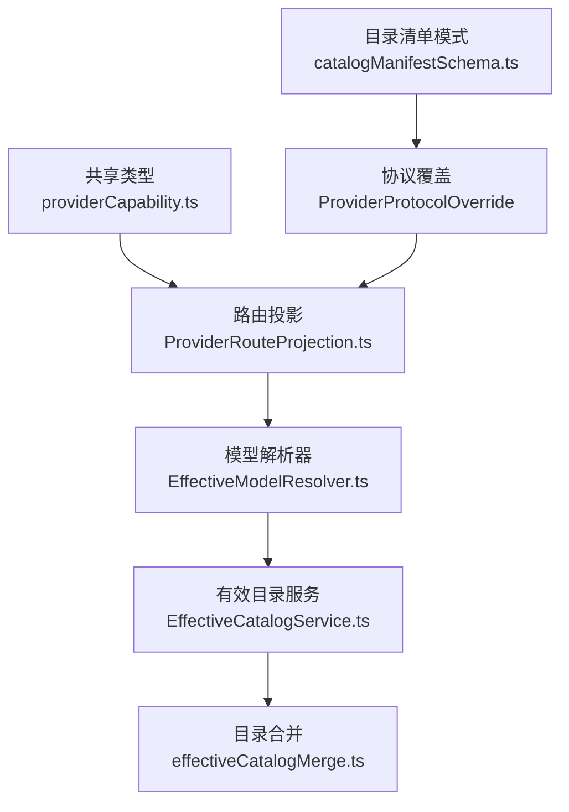
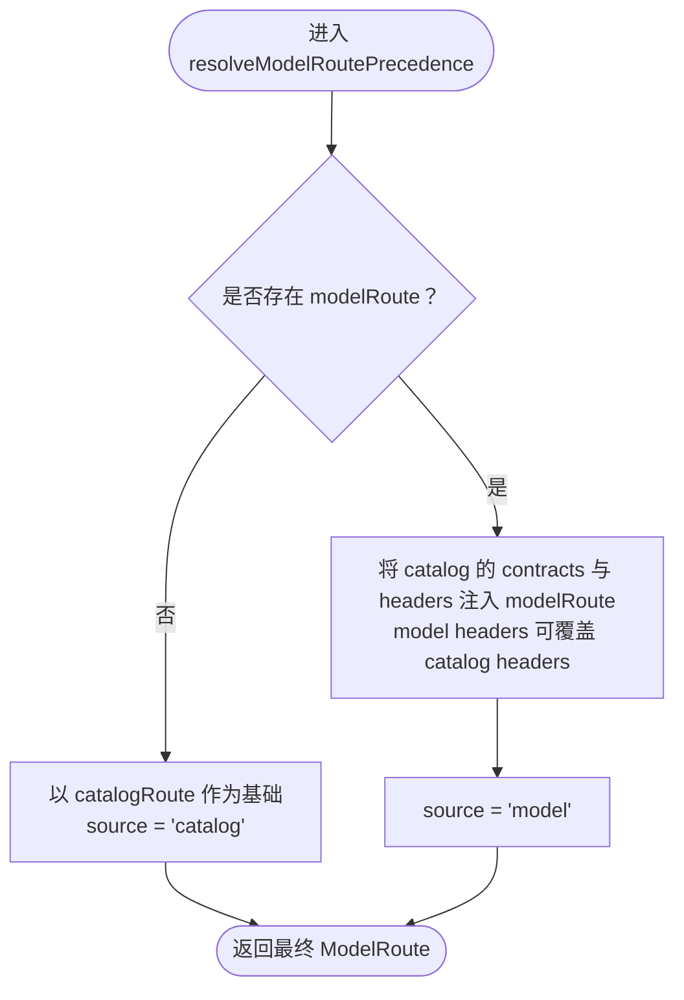
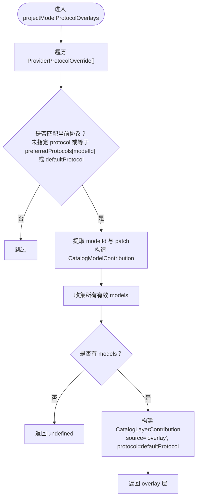
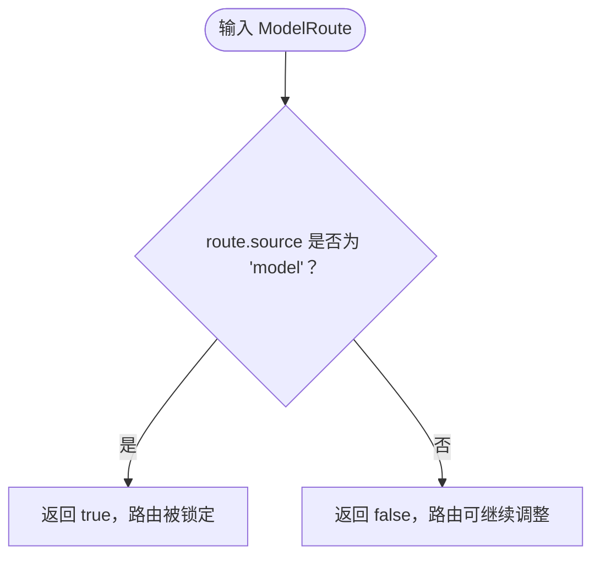
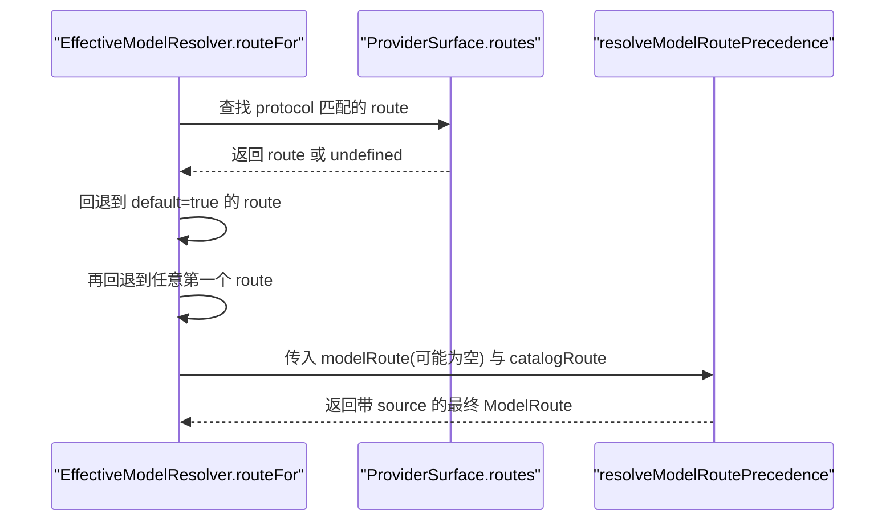
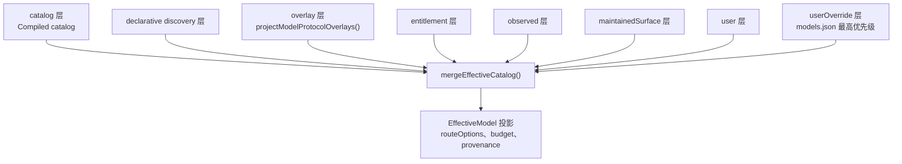
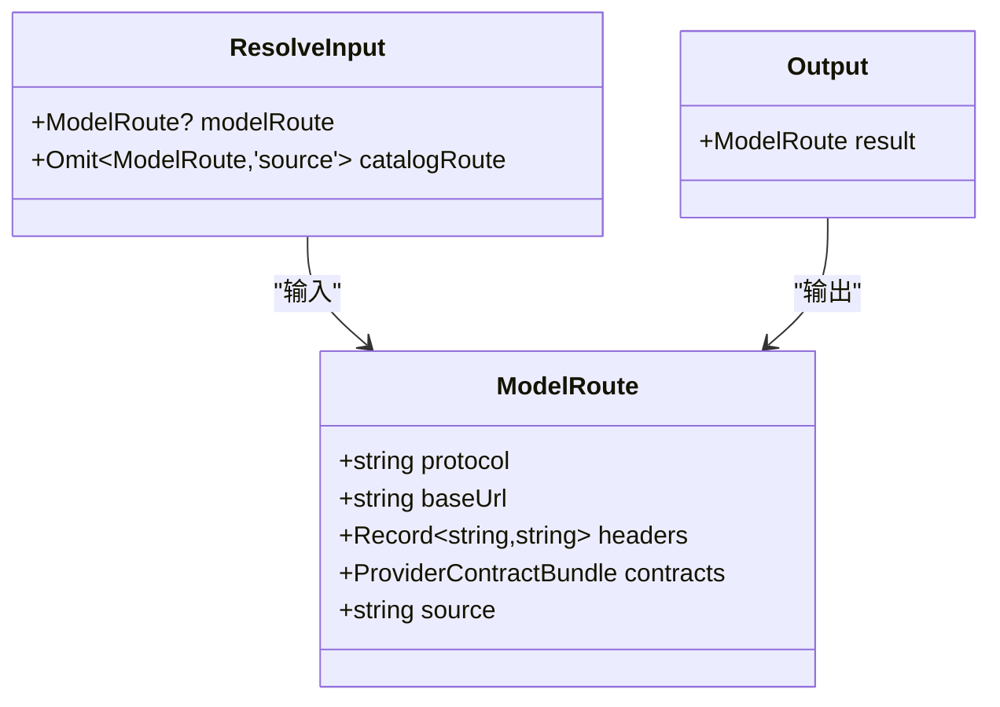
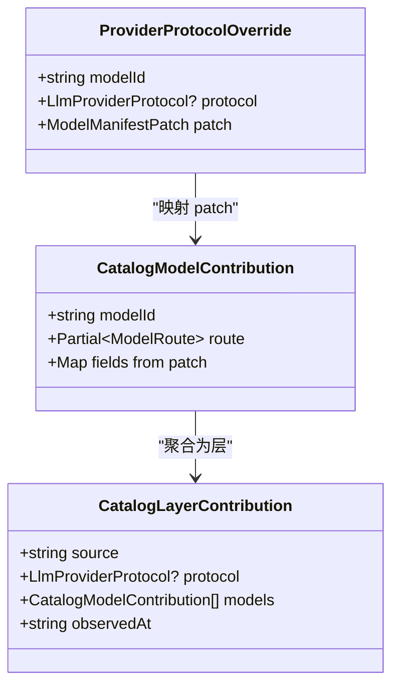
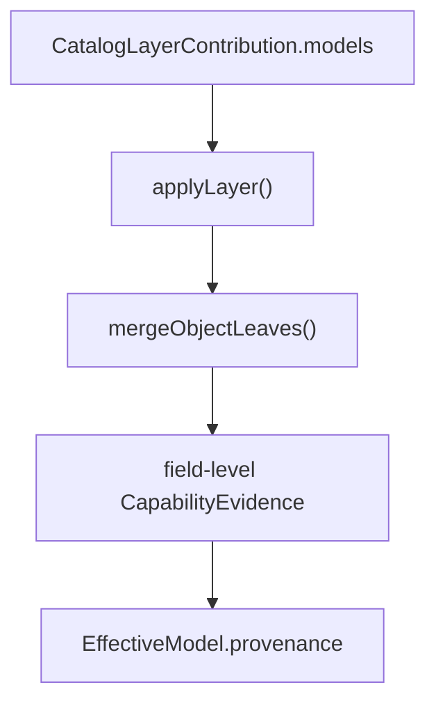
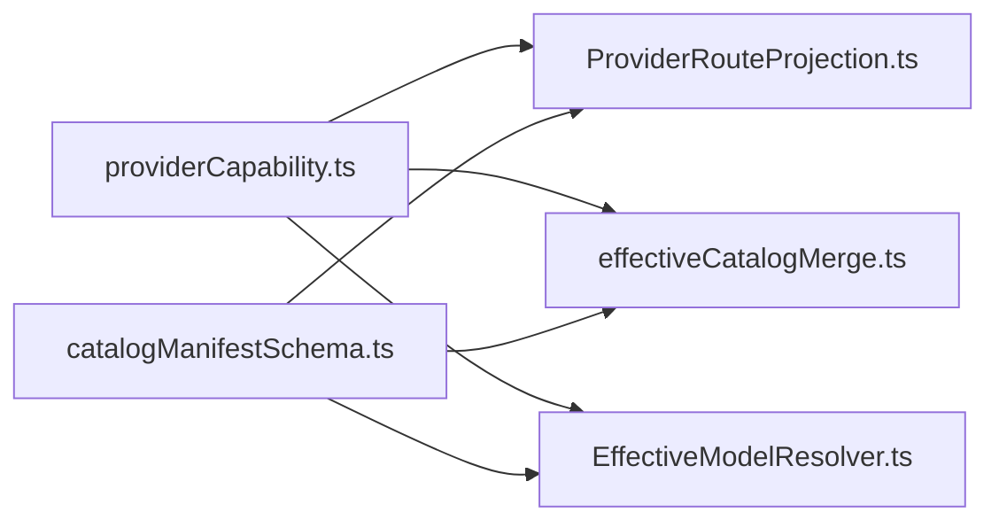

# Provider Route 投影与优先级

<cite>
**本文引用的文件**   
- [ProviderRouteProjection.ts](file://src/main/settings/ProviderRouteProjection.ts)
- [EffectiveModelResolver.ts](file://src/main/settings/EffectiveModelResolver.ts)
- [effectiveCatalogMerge.ts](file://src/main/settings/effectiveCatalogMerge.ts)
- [effectiveCatalogTypes.ts](file://src/main/settings/effectiveCatalogTypes.ts)
- [EffectiveCatalogService.ts](file://src/main/settings/EffectiveCatalogService.ts)
- [providerCapability.ts](file://src/shared/types/providerCapability.ts)
- [catalogManifestSchema.ts](file://src/shared/provider-catalog/catalogManifestSchema.ts)
- [ProviderRouteProjection.test.ts](file://src/main/settings/ProviderRouteProjection.test.ts)
</cite>

## 目录
1. [引言](#引言)
2. [项目结构与定位](#项目结构与定位)
3. [核心组件](#核心组件)
4. [架构总览](#架构总览)
5. [详细组件分析](#详细组件分析)
6. [依赖关系分析](#依赖关系分析)
7. [性能考虑](#性能考虑)
8. [故障排查指南](#故障排查指南)
9. [结论](#结论)

## 引言
本文聚焦 Provider 路由投影与优先级机制，围绕以下目标展开：
- `resolveModelRoutePrecedence()` 如何决定 `modelRoute` 与 `catalogRoute` 的优先级。
- 请求头 `headers` 的合并策略：catalog 提供基础 headers，model 可以覆盖。
- `projectModelProtocolOverlays()` 如何应用 `ProviderProtocolOverride[]`，包括 `preferredProtocols` 映射、`defaultProtocol` 回退以及 overlay patch 字段合并。
- `isModelRouteLocked()` 的判断逻辑，即 `source === 'model'` 时路由被锁定不可修改。
- catalog layer contribution 中 `models` 数组结构，以及如何把 overlay 转换为有效的能力增强。
- route projection 在整个 effective catalog 构建流程中的位置，以及与 declarative discovery 和 user configuration 的交互关系。
- 路由冲突的实际案例与调试技巧。

## 项目结构与定位
Provider Route 投影位于主进程设置层，是有效目录（effective catalog）构建链路上的关键转换点：
- 类型定义集中在共享类型模块。
- 路由投影逻辑独立在专用文件中，便于测试与复用。
- 路由选择与目录贡献组装发生在 Effective Model Resolver 与 Effective Catalog Service 及 Merge 层。

**图表来源**
- [providerCapability.ts:1-200](file://src/shared/types/providerCapability.ts#L1-L200)
- [ProviderRouteProjection.ts:1-52](file://src/main/settings/ProviderRouteProjection.ts#L1-L52)
- [EffectiveModelResolver.ts:1-120](file://src/main/settings/EffectiveModelResolver.ts#L1-L120)
- [EffectiveCatalogService.ts:1-120](file://src/main/settings/EffectiveCatalogService.ts#L1-L120)
- [effectiveCatalogMerge.ts:1-120](file://src/main/settings/effectiveCatalogMerge.ts#L1-L120)
- [catalogManifestSchema.ts:223-229](file://src/shared/provider-catalog/catalogManifestSchema.ts#L223-L229)

**章节来源**
- [ProviderRouteProjection.ts:1-52](file://src/main/settings/ProviderRouteProjection.ts#L1-L52)
- [effectiveCatalogTypes.ts:1-140](file://src/main/settings/effectiveCatalogTypes.ts#L1-L140)

## 核心组件
本节聚焦三个函数与一个判定方法：
- `resolveModelRoutePrecedence()`
- `projectModelProtocolOverlays()`
- `isModelRouteLocked()`
- 调用方 `routeFor()` 与 effective catalog 合并流程。

### 路由优先级与头部合并：`resolveModelRoutePrecedence()`
该函数的职责是：
- 若存在 `modelRoute`，则以 model 侧路由为主。
- 否则使用 catalog 提供的 `catalogRoute`。
- 无论哪种情况，都会保留 catalog 的基础 `headers`，并允许 model 侧 `headers` 覆盖同名键。
- `contracts` 默认沿用 catalog 的值，除非 model 侧显式提供。
- 最终结果会带上 `source`，区分来源为 `'model'` 或 `'catalog'`。

**图表来源**
- [ProviderRouteProjection.ts:11-26](file://src/main/settings/ProviderRouteProjection.ts#L11-L26)

要点说明：
- 优先级顺序：model > catalog。
- 头部合并顺序：先 catalog headers，再 model headers；后者覆盖前者。
- `contracts` 默认继承 catalog，避免丢失契约信息。
- `source` 明确标注来源，供后续锁定与审计。

**章节来源**
- [ProviderRouteProjection.ts:11-26](file://src/main/settings/ProviderRouteProjection.ts#L11-L26)
- [ProviderRouteProjection.test.ts:7-20](file://src/main/settings/ProviderRouteProjection.test.ts#L7-L20)

### 协议覆盖投影：`projectModelProtocolOverlays()`
该函数将清单中的 `ProviderProtocolOverride[]` 转换为 effective catalog 可用的 `CatalogLayerContribution`：
- 过滤条件：overlay 未指定 `protocol`，或者其 `protocol` 等于 `preferredProtocols.get(modelId)`，否则回退到 `defaultProtocol`。
- 映射阶段：对每个通过的 overlay，提取 `modelId` 与 `patch`，生成 `CatalogModelContribution`。
- 输出：如果至少有一个模型通过过滤，则返回 source 为 `'overlay'` 的层；否则返回 `undefined`。
- `observedAt` 由调用方传入，用于证据时间戳。

**图表来源**
- [ProviderRouteProjection.ts:28-51](file://src/main/settings/ProviderRouteProjection.ts#L28-L51)

关键点：
- `preferredProtocols` 是按 modelId 到 LlmProviderProtocol 的映射，优先匹配选中模型的协议。
- 未命中 preferredProtocols 时使用 `defaultProtocol`，保证每个 overlay 都能按预期协议评估。
- overlay 只携带 patch 字段，不会直接复制原始 overlay 对象，从而减少污染。
- 当没有可用 overlay 时，整个层被丢弃，避免无效数据进入合并流程。

**章节来源**
- [ProviderRouteProjection.ts:28-51](file://src/main/settings/ProviderRouteProjection.ts#L28-L51)
- [catalogManifestSchema.ts:223-229](file://src/shared/provider-catalog/catalogManifestSchema.ts#L223-L229)
- [ProviderRouteProjection.test.ts:22-29](file://src/main/settings/ProviderRouteProjection.test.ts#L22-L29)

### 路由锁定判断：`isModelRouteLocked()`
该判定非常直接：只要 `route.source === 'model'`，就认为路由已锁定。

含义：
- 一旦某个 model 的 route 被标记为来自 model，后续配置不应随意替换它。
- 典型场景：用户显式选择模型路由，系统应尊重该选择，不再用 catalog 默认路由覆盖。

**图表来源**
- [ProviderRouteProjection.ts:53-55](file://src/main/settings/ProviderRouteProjection.ts#L53-L55)

**章节来源**
- [ProviderRouteProjection.ts:53-55](file://src/main/settings/ProviderRouteProjection.ts#L53-L55)

### 路由选择入口：`routeFor()`
`EffectiveModelResolver.ts` 中的 `routeFor()` 负责将 provider、model route 与 surface routes 组合起来：
- 根据 provider 的 `protocol` 查找对应 surface route；如果没有找到，则回退到 `default=true` 的第一个 route，再回退到任意第一个 route。
- 如果找不到 surface，则构造一个 user-sourced 的基础 route。
- 最后调用 `resolveModelRoutePrecedence()` 完成优先级与头部合并。

**图表来源**
- [EffectiveModelResolver.ts:36-70](file://src/main/settings/EffectiveModelResolver.ts#L36-L70)

**章节来源**
- [EffectiveModelResolver.ts:36-70](file://src/main/settings/EffectiveModelResolver.ts#L36-L70)

## 架构总览
route projection 不是孤立逻辑，而是 effective catalog 构建流程中的一环。整体流程如下：

**图表来源**
- [effectiveCatalogMerge.ts:450-595](file://src/main/settings/effectiveCatalogMerge.ts#L450-L595)
- [EffectiveCatalogService.ts:120-200](file://src/main/settings/EffectiveCatalogService.ts#L120-L200)

关键行为：
- effective catalog 合并顺序为：catalog → discovery → overlay → entitlement → observed → maintainedSurface → user → userOverride。
- overlay 层会被限制为仅作用于已 admit 的模型，避免凭空制造成员。
- discovery 层对 route 有特殊保护：声明式 discovery 中 source 为 `'catalog'` 的 route 通常只作为 availability 证据，不直接覆盖已有 manifest 路由；而 live route 使用 `source: 'model'` 时可以正常参与合并。
- userOverride 具有最高优先级，但受 ownership 限制：app-managed provider 的用户配置只保留有限字段，custom 自定义模型除外。

**章节来源**
- [effectiveCatalogMerge.ts:300-595](file://src/main/settings/effectiveCatalogMerge.ts#L300-L595)
- [EffectiveCatalogService.ts:120-200](file://src/main/settings/EffectiveCatalogService.ts#L120-L200)
- [effectiveCatalogTypes.ts:80-140](file://src/main/settings/effectiveCatalogTypes.ts#L80-L140)

## 详细组件分析

### 组件一：`resolveModelRoutePrecedence()`
该函数实现“model 优先、catalog 兜底”的路由选择，同时确保 catalog 的基础 header 不被意外丢失。

- 输入：
  - `modelRoute`：可选，可能来自 catalog definition 或用户选择。
  - `catalogRoute`：必填，不包含 `source`，由 surface 或 provider 提供。
- 处理：
  - 构造辅助函数，将 catalog 的 `contracts` 与 `headers` 注入任意 route。
  - 如果存在 `modelRoute`，则将其转为完整 `ModelRoute`，并设置 `source: 'model'`。
  - 否则直接使用 `catalogRoute`，并设置 `source: 'catalog'`。
- 输出：
  - 稳定结构的 `ModelRoute`，包含 `protocol`、`baseUrl`、`headers`、`contracts`、`source`。

**图表来源**
- [providerCapability.ts:120-160](file://src/shared/types/providerCapability.ts#L120-L160)
- [ProviderRouteProjection.ts:11-26](file://src/main/settings/ProviderRouteProjection.ts#L11-L26)

**章节来源**
- [ProviderRouteProjection.ts:11-26](file://src/main/settings/ProviderRouteProjection.ts#L11-L26)
- [ProviderRouteProjection.test.ts:7-20](file://src/main/settings/ProviderRouteProjection.test.ts#L7-L20)

### 组件二：`projectModelProtocolOverlays()`
该函数负责把清单中的协议覆盖转换为 effective catalog 层。

- 输入：
  - `overlays`：`ProviderProtocolOverride[]`，每个条目包含 `modelId`、可选 `protocol`、`patch`。
  - `defaultProtocol`：缺省协议。
  - `preferredProtocols`：按 modelId 到协议的映射。
  - `observedAt`：证据时间戳。
- 处理：
  - 过滤出协议匹配的 overlay。
  - 映射为 `CatalogModelContribution[]`，只保留 `modelId` 与 `patch`。
  - 如果有结果，则构造 `CatalogLayerContribution`。
- 输出：
  - 有效层或 `undefined`。

**图表来源**
- [ProviderRouteProjection.ts:28-51](file://src/main/settings/ProviderRouteProjection.ts#L28-L51)
- [catalogManifestSchema.ts:223-229](file://src/shared/provider-catalog/catalogManifestSchema.ts#L223-L229)

**章节来源**
- [ProviderRouteProjection.ts:28-51](file://src/main/settings/ProviderRouteProjection.ts#L28-L51)
- [ProviderRouteProjection.test.ts:22-29](file://src/main/settings/ProviderRouteProjection.test.ts#L22-L29)

### 组件三：`isModelRouteLocked()`
该函数是一个纯判定函数，用于判断某条路由是否已被模型侧显式锁定。

- 输入：`ModelRoute`。
- 判断：`route.source === 'model'`。
- 输出：布尔值。

该判定常用于防止后续层错误地覆盖用户或模型侧已经确定的路由。

**章节来源**
- [ProviderRouteProjection.ts:53-55](file://src/main/settings/ProviderRouteProjection.ts#L53-L55)

### 组件四：effective catalog 合并与 route 投影的位置
effective catalog 合并器维护了完整的优先级链路与字段级证据追踪：
- 每层贡献都带有 `source`、`observedAt`、`protocol`、`detail` 等元数据。
- 合并过程会为每个字段记录 `CapabilityEvidence`，包括冲突历史。
- route projection 的输出最终汇入 `effectiveCatalogMerge()` 的 `overlay` 层或 `catalog` 层。

**图表来源**
- [effectiveCatalogMerge.ts:200-450](file://src/main/settings/effectiveCatalogMerge.ts#L200-L450)

**章节来源**
- [effectiveCatalogMerge.ts:200-595](file://src/main/settings/effectiveCatalogMerge.ts#L200-L595)
- [effectiveCatalogTypes.ts:20-140](file://src/main/settings/effectiveCatalogTypes.ts#L20-L140)

## 依赖关系分析
- `ProviderRouteProjection.ts` 依赖：
  - `effectiveCatalogTypes.ts` 中的 `CatalogLayerContribution`、`CatalogModelContribution`。
  - `providerCapability.ts` 中的 `ModelRoute`、`ProviderProtocolOverride`。
  - `settings.ts` 中的 `LlmProviderProtocol`。
- `EffectiveModelResolver.ts` 依赖：
  - `ProviderRouteProjection.ts` 进行路由优先级计算。
  - `effectiveCatalogTypes.ts` 进行目录贡献建模。
  - `providerCapability.ts` 进行有效模型与请求规划类型建模。
- `effectiveCatalogMerge.ts` 依赖：
  - `effectiveCatalogTypes.ts` 定义合并输入与输出。
  - `providerCapability.ts` 定义最终 `EffectiveModel` 结构。

**图表来源**
- [providerCapability.ts:1-200](file://src/shared/types/providerCapability.ts#L1-L200)
- [catalogManifestSchema.ts:223-229](file://src/shared/provider-catalog/catalogManifestSchema.ts#L223-L229)
- [ProviderRouteProjection.ts:1-52](file://src/main/settings/ProviderRouteProjection.ts#L1-L52)
- [EffectiveModelResolver.ts:1-120](file://src/main/settings/EffectiveModelResolver.ts#L1-L120)
- [effectiveCatalogMerge.ts:1-120](file://src/main/settings/effectiveCatalogMerge.ts#L1-L120)

**章节来源**
- [providerCapability.ts:1-200](file://src/shared/types/providerCapability.ts#L1-L200)
- [catalogManifestSchema.ts:223-229](file://src/shared/provider-catalog/catalogManifestSchema.ts#L223-L229)
- [ProviderRouteProjection.ts:1-52](file://src/main/settings/ProviderRouteProjection.ts#L1-L52)
- [EffectiveModelResolver.ts:1-120](file://src/main/settings/EffectiveModelResolver.ts#L1-L120)
- [effectiveCatalogMerge.ts:1-120](file://src/main/settings/effectiveCatalogMerge.ts#L1-L120)

## 性能考虑
- `resolveModelRoutePrecedence()` 是常量级操作，只做浅拷贝与对象合并，开销很小。
- `projectModelProtocolOverlays()` 对 overlay 数组进行一次过滤和一次映射，复杂度为 O(n)，n 为 overlay 数量。
- effective catalog 合并是全局性操作，但仅在目录刷新或配置变化时触发，且服务层做了缓存、TTL 与 backoff 控制。
- 路由锁定与优先级判断属于轻量分支，不会影响主要运行时路径。

[本节为通用性能建议，不直接分析具体代码行]

## 故障排查指南

### 常见问题一：model 路由被 catalog 覆盖
现象：
- 用户或 catalog definition 指定的 model route 未生效。
- 最终 `route.source` 不是 `'model'`。

排查步骤：
1. 检查 `resolveModelRoutePrecedence()` 的输入是否传入了 `modelRoute`。
2. 确认 `EffectiveModelResolver.routeFor()` 是否正确从 catalog definition 或 user selection 获取 model route。
3. 查看 effective catalog provenance，确认 route 是否被后续层覆盖。

相关实现参考：
- [ProviderRouteProjection.ts:11-26](file://src/main/settings/ProviderRouteProjection.ts#L11-L26)
- [EffectiveModelResolver.ts:36-70](file://src/main/settings/EffectiveModelResolver.ts#L36-L70)

### 常见问题二：catalog headers 丢失
现象：
- 某些必需 header 未出现在最终请求中。

原因：
- model 侧 `headers` 覆盖了 catalog 基础 header。
- catalog route 本身没有提供 headers。

排查步骤：
1. 检查 catalog route 的 `headers` 是否已定义。
2. 检查 model route 的 `headers` 是否有意覆盖。
3. 使用测试用例中的断言思路验证合并结果。

相关实现参考：
- [ProviderRouteProjection.ts:11-26](file://src/main/settings/ProviderRouteProjection.ts#L11-L26)
- [ProviderRouteProjection.test.ts:12-20](file://src/main/settings/ProviderRouteProjection.test.ts#L12-L20)

### 常见问题三：overlay 未生效
现象：
- `ProviderProtocolOverride` 没有产生能力增强。

原因：
- overlay 的 `protocol` 与 `preferredProtocols[modelId]` 不一致，且不等于 `defaultProtocol`。
- overlay 对应的 modelId 未被 catalog 或 discovery admit。

排查步骤：
1. 检查 `preferredProtocols` 映射是否正确。
2. 检查 `defaultProtocol` 是否与 overlay 期望协议一致。
3. 检查 effective catalog 合并前的 admit 模型集合。

相关实现参考：
- [ProviderRouteProjection.ts:28-51](file://src/main/settings/ProviderRouteProjection.ts#L28-L51)
- [effectiveCatalogMerge.ts:420-450](file://src/main/settings/effectiveCatalogMerge.ts#L420-L450)

### 常见问题四：路由锁定导致无法调整
现象：
- 用户尝试修改路由但未成功。

原因：
- `route.source === 'model'`，路由被锁定。

排查步骤：
1. 使用 `isModelRouteLocked()` 判断。
2. 检查上游选择逻辑是否主动设置了 model route。
3. 如果需要覆盖，应先移除或降级 model route 来源。

相关实现参考：
- [ProviderRouteProjection.ts:53-55](file://src/main/settings/ProviderRouteProjection.ts#L53-L55)

### 调试技巧
- 查看 effective catalog snapshot 中的 `provenance`，确认字段变更来源。
- 关注 `conflict` 字段，了解不同层之间的值冲突。
- 针对 route 与 headers，分别检查 `route.source`、`route.headers`、`route.contracts`。
- 使用单元测试中的断言模式验证预期行为：
  - model route 优先于 catalog default。
  - catalog headers 保留并可被 model headers 覆盖。
  - overlay 按 modelId 与 protocol 过滤并映射 patch。

**章节来源**
- [ProviderRouteProjection.test.ts:7-29](file://src/main/settings/ProviderRouteProjection.test.ts#L7-L29)
- [effectiveCatalogMerge.ts:120-200](file://src/main/settings/effectiveCatalogMerge.ts#L120-L200)

## 结论
Provider Route 投影与优先级机制通过明确的函数分工与清晰的层级合并规则，实现了以下目标：
- model 路由优先于 catalog 默认路由，同时保留 catalog 的基础 header 与 contract。
- 协议覆盖通过 `preferredProtocols` 与 `defaultProtocol` 精确控制，避免误匹配。
- `source === 'model'` 的路由被锁定，防止后续配置破坏用户或模型侧的显式选择。
- effective catalog 合并流程将 catalog、discovery、overlay、entitlement、observed、maintainedSurface、user、userOverride 有序组合，并为每个字段保留证据与冲突信息。
- 通过单元测试与 provenance 追踪，开发者可以快速定位路由与头部合并问题。

[本节为总结性内容，不直接分析具体代码行]