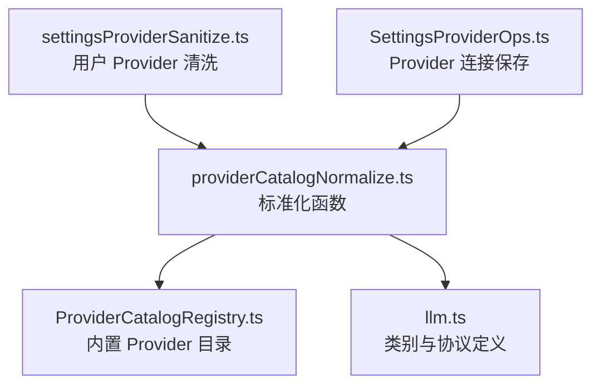
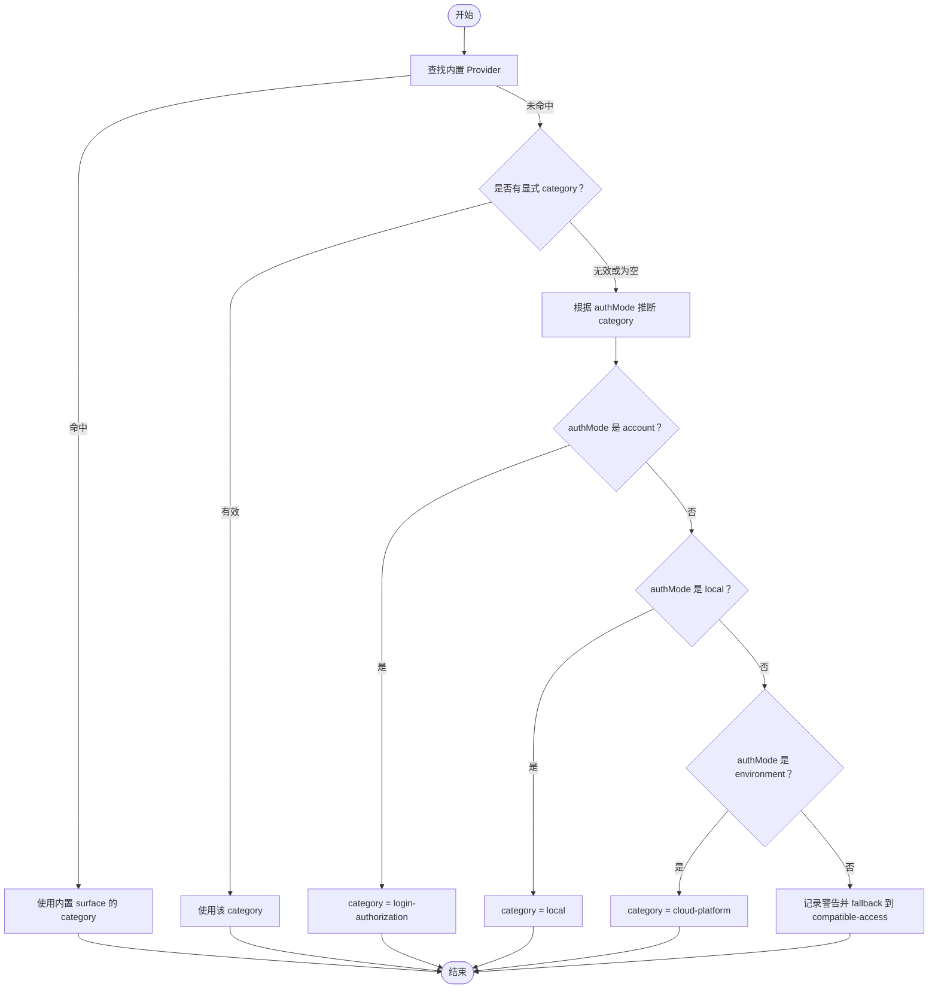
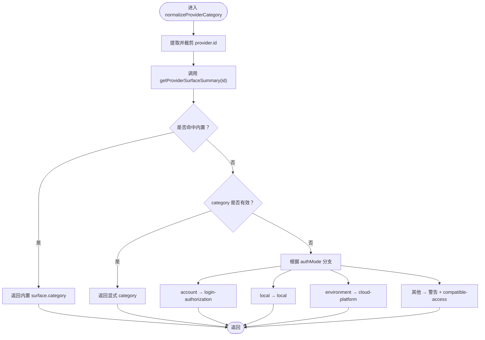
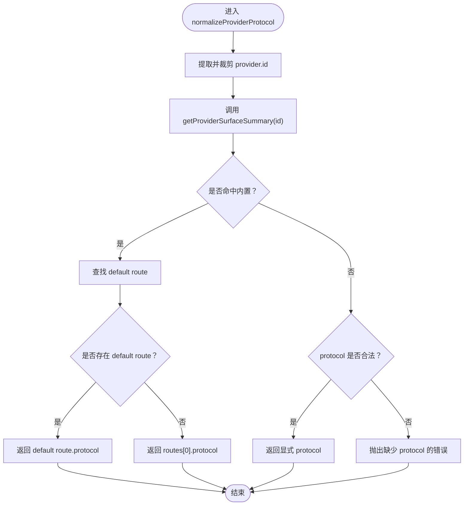
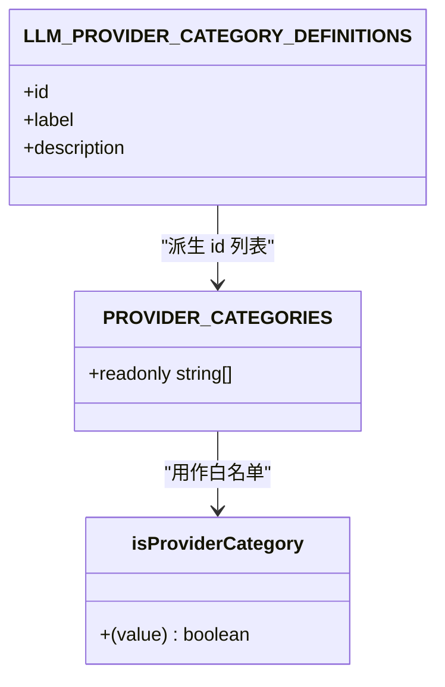
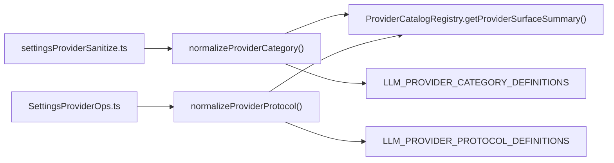

# Provider 标准化处理

<cite>
**本文引用的文件**   
- [providerCatalogNormalize.ts](file://src/main/settings/providerCatalogNormalize.ts)
- [llm.ts](file://src/shared/constants/llm.ts)
- [index.ts](file://src/shared/constants/index.ts)
- [ProviderCatalogRegistry.ts](file://src/main/provider-catalog/ProviderCatalogRegistry.ts)
- [SettingsProviderOps.ts](file://src/main/settings/SettingsProviderOps.ts)
- [settingsProviderSanitize.ts](file://src/main/settings/settingsProviderSanitize.ts)
</cite>

## 目录
1. [引言](#引言)
2. [项目结构中的定位](#项目结构中的定位)
3. [核心组件](#核心组件)
4. [架构总览](#架构总览)
5. [详细组件分析](#详细组件分析)
6. [依赖关系分析](#依赖关系分析)
7. [性能与健壮性考量](#性能与健壮性考量)
8. [常见问题与诊断](#常见问题与诊断)
9. [结论](#结论)

## 引言
本文聚焦 Provider 的“分类”和“协议”标准化流程，围绕两个核心函数展开：
- `normalizeProviderCategory()`：确定一个 provider 属于哪一类 UI 分组。
- `normalizeProviderProtocol()`：确定一个 provider 使用哪种 LLM 协议。

这两个函数共同保证用户配置、内置 catalog 以及运行时设置能统一收敛为稳定的 category 与 protocol，从而驱动 UI 分组、连接校验、鉴权模式选择等上层逻辑。

## 项目结构中的定位
- 标准化实现位于主进程设置模块中，入口是 `src/main/settings/providerCatalogNormalize.ts`。
- 类别定义与协议定义位于共享常量模块 `src/shared/constants/llm.ts`，并通过 `src/shared/constants/index.ts` 重新导出。
- 内置 provider 信息通过 `src/main/provider-catalog/ProviderCatalogRegistry.ts` 暴露，用于判断是否为内置 surface、获取其默认 route 与 category。
- 调用方包括：
  - `settingsProviderSanitize.ts`：在清理/规范化用户 provider 时计算 category。
  - `SettingsProviderOps.ts`：在保存 provider 连接时解析 protocol。

**图表来源**
- [providerCatalogNormalize.ts:1-65](file://src/main/settings/providerCatalogNormalize.ts#L1-L65)
- [ProviderCatalogRegistry.ts:1-120](file://src/main/provider-catalog/ProviderCatalogRegistry.ts#L1-L120)
- [llm.ts:1-116](file://src/shared/constants/llm.ts#L1-L116)
- [settingsProviderSanitize.ts:20-30](file://src/main/settings/settingsProviderSanitize.ts#L20-L30)
- [SettingsProviderOps.ts:220-235](file://src/main/settings/SettingsProviderOps.ts#L220-L235)

**章节来源**
- [providerCatalogNormalize.ts:1-65](file://src/main/settings/providerCatalogNormalize.ts#L1-L65)
- [llm.ts:1-116](file://src/shared/constants/llm.ts#L1-L116)
- [index.ts:1-105](file://src/shared/constants/index.ts#L1-L105)
- [ProviderCatalogRegistry.ts:1-120](file://src/main/provider-catalog/ProviderCatalogRegistry.ts#L1-L120)
- [settingsProviderSanitize.ts:20-30](file://src/main/settings/settingsProviderSanitize.ts#L20-L30)
- [SettingsProviderOps.ts:220-235](file://src/main/settings/SettingsProviderOps.ts#L220-L235)

## 核心组件
- `PROVIDER_CATEGORIES`：由 `LLM_PROVIDER_CATEGORY_DEFINITIONS` 的 id 列表派生而来，作为 category 的白名单。
- `normalizeProviderCategory()`：按优先级确定 category。
- `normalizeProviderProtocol()`：按优先级确定 protocol。
- `isLlmProviderProtocol()`：校验 protocol 是否属于系统已知的协议枚举。

**章节来源**
- [providerCatalogNormalize.ts:9-65](file://src/main/settings/providerCatalogNormalize.ts#L9-L65)
- [llm.ts:1-116](file://src/shared/constants/llm.ts#L1-L116)

## 架构总览
Provider 标准化是一个“输入 → 内置优先 → 显式字段 → 推断 → 降级/报错”的分层决策过程。

**图表来源**
- [providerCatalogNormalize.ts:15-42](file://src/main/settings/providerCatalogNormalize.ts#L15-L42)
- [ProviderCatalogRegistry.ts:70-100](file://src/main/provider-catalog/ProviderCatalogRegistry.ts#L70-L100)

## 详细组件分析

### `normalizeProviderCategory()` 的分类策略
该函数的目标是把任意 provider 配置映射到受支持的 `LlmProviderCategory`。

#### 执行顺序
1. **内置 surface 优先**  
   如果 provider 有 id，则调用 `getProviderSurfaceSummary(id)` 查询内置目录。若命中，直接返回内置 surface 的 `category`。
2. **直接使用显式 category**  
   若非内置，且 `provider.category` 是合法 category，则直接返回。
3. **基于 `authMode` 推断**  
   - `account` → `login-authorization`
   - `local` → `local`
   - `environment` → `cloud-platform`
4. **默认降级**  
   若以上都不成立，记录一条带 `id`、`authMode`、`category` 的警告日志，并回退到 `compatible-access`。

**图表来源**
- [providerCatalogNormalize.ts:15-42](file://src/main/settings/providerCatalogNormalize.ts#L15-L42)
- [ProviderCatalogRegistry.ts:70-100](file://src/main/provider-catalog/ProviderCatalogRegistry.ts#L70-L100)

#### 关键点
- 内置 surface 的 category 具有最高优先级，避免用户错误覆盖官方语义。
- 显式 category 需要落在 `PROVIDER_CATEGORIES` 白名单内，否则会被视为无效。
- `authMode` 推断提供常见场景的自动归类能力。
- 无法推断时会降级为 `compatible-access`，而不是抛出异常，保证旧配置仍可运行。

**章节来源**
- [providerCatalogNormalize.ts:15-42](file://src/main/settings/providerCatalogNormalize.ts#L15-L42)
- [ProviderCatalogRegistry.ts:70-100](file://src/main/provider-catalog/ProviderCatalogRegistry.ts#L70-L100)

### `normalizeProviderProtocol()` 的协议策略
该函数的目标是确定 provider 使用的 LLM 协议。

#### 执行顺序
1. **内置 surface 优先**  
   如果 provider 有 id，则查询内置 surface 的 routes：
   - 优先返回标记为 `default` 的 route 的 protocol。
   - 如果没有 default route，则返回 `routes[0]` 的 protocol。
2. **显式 protocol 字段**  
   如果不是内置，且 `provider.protocol` 通过 `isLlmProviderProtocol()` 校验，则直接返回。
3. **未知 provider 报错**  
   如果既不是内置，也没有合法 protocol，则抛出错误，提示该 provider 没有显式 protocol。

**图表来源**
- [providerCatalogNormalize.ts:44-65](file://src/main/settings/providerCatalogNormalize.ts#L44-L65)
- [ProviderCatalogRegistry.ts:70-100](file://src/main/provider-catalog/ProviderCatalogRegistry.ts#L70-L100)
- [llm.ts:100-116](file://src/shared/constants/llm.ts#L100-L116)

#### 关键点
- 内置 provider 的 protocol 不需要用户填写，系统会自动从 catalog 推导。
- 非内置 provider 必须提供合法 protocol，否则会中断保存流程。
- `isLlmProviderProtocol()` 依赖 `LLM_PROVIDER_PROTOCOL_DEFINITIONS`，因此新增协议必须同时更新常量。

**章节来源**
- [providerCatalogNormalize.ts:44-65](file://src/main/settings/providerCatalogNormalize.ts#L44-L65)
- [llm.ts:100-116](file://src/shared/constants/llm.ts#L100-L116)

### `PROVIDER_CATEGORIES` 与 `LLM_PROVIDER_CATEGORY_DEFINITIONS` 的关系
- `LLM_PROVIDER_CATEGORY_DEFINITIONS` 是“权威定义”，包含每个 category 的 id、label 和 description。
- `PROVIDER_CATEGORIES` 是由这些定义的 id 数组派生出来的只读白名单。
- `isProviderCategory()` 使用这个白名单校验传入的 category 是否合法。

这种设计带来三个好处：
1. 分类标签、描述、枚举值集中在一个常量文件中。
2. UI 可直接消费 label 和 description，展示更友好的分组名称。
3. 校验逻辑与显示文案解耦，减少硬编码字符串。

**图表来源**
- [llm.ts:1-40](file://src/shared/constants/llm.ts#L1-L40)
- [providerCatalogNormalize.ts:9-14](file://src/main/settings/providerCatalogNormalize.ts#L9-L14)

**章节来源**
- [llm.ts:1-40](file://src/shared/constants/llm.ts#L1-L40)
- [providerCatalogNormalize.ts:9-14](file://src/main/settings/providerCatalogNormalize.ts#L9-L14)
- [index.ts:85-105](file://src/shared/constants/index.ts#L85-L105)

### category 在 UI 分组中的作用
- `LLM_PROVIDER_CATEGORY_DEFINITIONS` 中的 label 通常用于 UI 分组标题，例如“OAuth / Login”“本地模型服务”“兼容访问”等。
- 不同 category 会影响：
  - 分组展示顺序和可见性。
  - 鉴权引导文案。
  - 与认证模式、可用性的关联展示。
- 当 provider 被归入 `compatible-access`，意味着它可能通过兼容协议接入第三方或官方服务，但 operator 的事实（如 endpoint、token）仍然需要明确配置。

**章节来源**
- [llm.ts:1-40](file://src/shared/constants/llm.ts#L1-L40)
- [providerCatalogNormalize.ts:15-42](file://src/main/settings/providerCatalogNormalize.ts#L15-L42)

### 既无显式 category 又无可推断 authMode 时的降级策略
当 provider 没有有效的内置 category、没有合法的显式 category，且 `authMode` 不在 `account`、`local`、`environment` 范围内时：
- 不会抛出异常。
- 会写入控制台警告日志，包含：
  - `id`
  - `authMode`
  - `category`
- 最终返回 `compatible-access`，使 provider 仍能被保存和使用。

这是一种“安全降级”策略，目的是兼容历史配置，同时提醒维护者需要补充明确的 category 或 authMode。

**章节来源**
- [providerCatalogNormalize.ts:28-42](file://src/main/settings/providerCatalogNormalize.ts#L28-L42)

### 常见 Provider 配置的标准化结果示例
以下示例以行为描述为主，不展示具体代码内容。

| 场景 | 输入特征 | category 结果 | protocol 结果 | 说明 |
|---|---|---|---|---|
| 内置 OAuth provider | id 匹配内置 surface | 使用内置 surface 的 category | 使用内置 default route 的 protocol，否则取第一个 route | 内置优先，无需用户指定 |
| 内置 Local provider | id 匹配内置 surface | 使用内置 surface 的 category | 同上 | 即使用户传了 protocol，也会被内置规则覆盖 |
| 用户自定义 provider | 无内置命中 | 若 category 合法则直接使用 | 若 protocol 合法则直接使用 | 完全依赖用户配置 |
| 用户自定义 provider 未填 protocol | 无内置命中 | 取决于 category 或 authMode | 抛出错误 | 非内置 provider 必须显式声明协议 |
| 用户自定义 provider 仅填 `authMode=account` | 无内置命中、无合法 category | `login-authorization` | 取决于是否传 protocol | 适合账号登录类第三方服务 |
| 用户自定义 provider 仅填 `authMode=local` | 无内置命中、无合法 category | `local` | 取决于是否传 protocol | 适合本地 Ollama 等 localhost 服务 |
| 用户自定义 provider 仅填 `authMode=environment` | 无内置命中、无合法 category | `cloud-platform` | 取决于是否传 protocol | 适合云端部署平台 |
| 用户自定义 provider 未填 category 且 authMode 未知 | 无内置命中、无合法 category、authMode 不属于三类 | `compatible-access`，并输出警告 | 取决于是否传 protocol | 兼容旧配置，建议补充 category |

**章节来源**
- [providerCatalogNormalize.ts:15-65](file://src/main/settings/providerCatalogNormalize.ts#L15-L65)
- [SettingsProviderOps.ts:220-235](file://src/main/settings/SettingsProviderOps.ts#L220-L235)

### category 选择错误的诊断方法
1. **确认是否为内置 provider**  
   如果 id 匹配内置 surface，category 应来自内置 catalog，用户显式 category 不会被采用。检查内置 catalog 是否期望该 provider 属于另一分类。
2. **检查显式 category 是否合法**  
   确认 `category` 是否等于 `PROVIDER_CATEGORIES` 中的一个值。非法值会被忽略，并继续走 authMode 推断。
3. **检查 authMode 是否可推断**  
   只有 `account`、`local`、`environment` 会被识别为可推断分类。其他值会触发 fallback。
4. **查看警告日志**  
   当 category 无法解析时，控制台会输出 `[SettingsService] Unable to resolve provider category; defaulting to compatible-access.`，并附带 id、authMode、category。
5. **修正配置**  
   - 如果是第三方兼容服务，建议显式设置 `category: "compatible-access"`。
   - 如果是账号登录服务，建议使用 `authMode: "account"`。
   - 如果是本地模型服务，建议使用 `authMode: "local"`。
   - 如果是云平台托管服务，建议使用 `authMode: "environment"`。

**章节来源**
- [providerCatalogNormalize.ts:15-42](file://src/main/settings/providerCatalogNormalize.ts#L15-L42)
- [ProviderCatalogRegistry.ts:70-100](file://src/main/provider-catalog/ProviderCatalogRegistry.ts#L70-L100)

## 依赖关系分析
- `normalizeProviderCategory()` 依赖：
  - `getProviderSurfaceSummary()`：读取内置 provider 的 category。
  - `PROVIDER_CATEGORIES`：校验显式 category。
  - `console.warn`：记录无法推断时的降级日志。
- `normalizeProviderProtocol()` 依赖：
  - `getProviderSurfaceSummary()`：读取内置 provider 的 routes。
  - `isLlmProviderProtocol()`：校验协议是否在已知协议列表中。
  - `LLM_PROVIDER_PROTOCOL_DEFINITIONS`：协议枚举来源。
- 调用链路：
  - `settingsProviderSanitize.ts` 在清洗用户 provider 时调用 `normalizeProviderCategory()`。
  - `SettingsProviderOps.ts` 在保存 provider 连接时调用 `normalizeProviderProtocol()`。

**图表来源**
- [settingsProviderSanitize.ts:20-30](file://src/main/settings/settingsProviderSanitize.ts#L20-L30)
- [SettingsProviderOps.ts:220-235](file://src/main/settings/SettingsProviderOps.ts#L220-L235)
- [providerCatalogNormalize.ts:1-65](file://src/main/settings/providerCatalogNormalize.ts#L1-L65)
- [ProviderCatalogRegistry.ts:70-100](file://src/main/provider-catalog/ProviderCatalogRegistry.ts#L70-L100)
- [llm.ts:1-116](file://src/shared/constants/llm.ts#L1-L116)

**章节来源**
- [settingsProviderSanitize.ts:20-30](file://src/main/settings/settingsProviderSanitize.ts#L20-L30)
- [SettingsProviderOps.ts:220-235](file://src/main/settings/SettingsProviderOps.ts#L220-L235)
- [providerCatalogNormalize.ts:1-65](file://src/main/settings/providerCatalogNormalize.ts#L1-L65)
- [ProviderCatalogRegistry.ts:70-100](file://src/main/provider-catalog/ProviderCatalogRegistry.ts#L70-L100)
- [llm.ts:1-116](file://src/shared/constants/llm.ts#L1-L116)

## 性能与健壮性考量
- 内置查询是一次 Map 或索引查找，时间复杂度近似 O(1)。
- category 白名单校验是数组包含判断，数据量较小，影响可忽略。
- 协议校验遍历协议定义列表，但协议数量有限，整体开销很低。
- 无法推断 category 时采用日志+降级，避免阻断用户配置；而 protocol 缺失时直接抛错，因为协议是运行时调用的关键契约。

**章节来源**
- [providerCatalogNormalize.ts:9-65](file://src/main/settings/providerCatalogNormalize.ts#L9-L65)
- [llm.ts:100-116](file://src/shared/constants/llm.ts#L100-L116)

## 常见问题与诊断
- **问题：UI 分组不符合预期**  
  检查 provider 是否命中内置 surface。如果命中，category 由内置 catalog 决定。
- **问题：category 总是 compatible-access**  
  检查是否漏填 category，且 authMode 不是 `account`、`local`、`environment`。查看控制台警告日志。
- **问题：保存 provider 时报 protocol 缺失**  
  非内置 provider 必须提供合法 protocol；内置 provider 则由 catalog 自动推导。
- **问题：新增协议不生效**  
  确保在 `LLM_PROVIDER_PROTOCOL_DEFINITIONS` 中注册新协议，并使用 `isLlmProviderProtocol()` 校验。

**章节来源**
- [providerCatalogNormalize.ts:15-65](file://src/main/settings/providerCatalogNormalize.ts#L15-L65)
- [llm.ts:100-116](file://src/shared/constants/llm.ts#L100-L116)

## 结论
Provider 标准化通过“内置优先、显式优先、推断兜底、降级保护”的策略，将多来源配置收敛为统一的 category 与 protocol。`normalizeProviderCategory()` 保障 UI 分组语义稳定，`normalizeProviderProtocol()` 保障运行时协议契约明确。对于未知或历史配置，系统通过日志和 fallback 提升兼容性，同时引导维护者完善配置。