# SettingsService 统一配置管理

<cite>
**本文引用的文件**
- [SettingsService.ts](file://src/main/settings/SettingsService.ts)
- [EffectiveCatalogService.ts](file://src/main/settings/EffectiveCatalogService.ts)
- [AgentRuntimeConfigService.ts](file://src/main/settings/AgentRuntimeConfigService.ts)
- [settingsSanitize.ts](file://src/main/settings/settingsSanitize.ts)
- [settingsDefaults.ts](file://src/main/settings/settingsDefaults.ts)
- [settingsServiceHelpers.ts](file://src/main/settings/settingsServiceHelpers.ts)
- [ExecutionProfileService.ts](file://src/main/settings/ExecutionProfileService.ts)
</cite>

## 目录
1. [引言](#引言)
2. [项目结构定位](#项目结构定位)
3. [核心组件总览](#核心组件总览)
4. [架构与职责边界](#架构与职责边界)
5. [配置加载、合并、校验与持久化流程](#配置加载合并校验与持久化流程)
6. [渲染器接口与运行时接口的职责分离](#渲染器接口与运行时接口的职责分离)
7. [安全清洗与默认值策略](#安全清洗与默认值策略)
8. [有效目录与服务视图：EffectiveCatalogService](#有效目录与服务视图effectivecatalogservice)
9. [Agent 运行时配置：AgentRuntimeConfigService 与 ExecutionProfileService](#agent-运行时配置agentruntimeconfigservice-与-executionprofileservcie)
10. [配置结构与字段说明](#配置结构与字段说明)
11. [变更监听、刷新与缓存失效](#变更监听刷新与缓存失效)
12. [依赖关系分析](#依赖关系分析)
13. [性能考虑](#性能考虑)
14. [故障排查指南](#故障排查指南)
15. [结论](#结论)

## 引言

SettingsService 是主进程中的统一配置管理入口。它把以下五类配置数据收敛为同一个边界：

- settings：应用外观、布局、用户资料、工具调用方式、Agent 运行时权限等可展示配置。
- profile：用户昵称、头像路径等轻量用户信息。
- provider：LLM Provider 列表、认证模式、模型偏好和连接状态。
- model：通过 Provider 和 Agent Route 推导出的“有效模型”。
- route：从 Agent Manifest 定义编译得到的 Agent 路由，以及每个 Agent 最终选择哪个 Provider 和 Model。
- secret：API Key、OAuth 凭据、Connection Secret 等敏感数据，由 SecretStorageService 单独管理，不在普通设置 JSON 中明文暴露。

该服务同时承担两类职责：

- **渲染器面向接口**：返回 AppSettings、Provider 元数据、诊断信息和可保存的 patch。这些数据用于界面展示、表单编辑、错误提示和磁盘写入。
- **运行时面向接口**：解析 secret、组装 LLMConfig、生成 Agent 运行所需的 provider credential、route 和模型信息，交给 provider adapter 或 Agent 编排层使用。

这样做的核心目标是：**渲染器侧只看到可展示、可保存、可诊断的数据；只有主进程在真正发起请求前才解析并注入 secret。**

## 项目结构定位

SettingsService 位于主进程 `src/main/settings` 目录，是多个子服务的协调者：

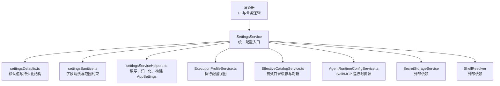

**图示来源**
- [SettingsService.ts:1-200](file://src/main/settings/SettingsService.ts#L1-L200)
- [settingsDefaults.ts:1-167](file://src/main/settings/settingsDefaults.ts#L1-L167)
- [settingsSanitize.ts:1-241](file://src/main/settings/settingsSanitize.ts#L1-L241)
- [settingsServiceHelpers.ts:1-200](file://src/main/settings/settingsServiceHelpers.ts#L1-L200)
- [ExecutionProfileService.ts:1-68](file://src/main/settings/ExecutionProfileService.ts#L1-L68)
- [EffectiveCatalogService.ts:1-200](file://src/main/settings/EffectiveCatalogService.ts#L1-L200)
- [AgentRuntimeConfigService.ts:1-200](file://src/main/settings/AgentRuntimeConfigService.ts#L1-L200)

**章节来源**
- [SettingsService.ts:1-200](file://src/main/settings/SettingsService.ts#L1-L200)
- [settingsDefaults.ts:1-167](file://src/main/settings/settingsDefaults.ts#L1-L167)

## 核心组件总览

| 组件 | 主要职责 | 关键输入 | 关键输出 |
|---|---|---|---|
| SettingsService | 加载、合并、校验、持久化 AppSettings；管理 provider、agent definition、secret 生命周期 | AppSettingsPatch、provider connection payload、agent manifest request | AppSettings、Provider 元数据、LLMConfig、持久化 JSON |
| EffectiveCatalogService | 缓存并计算 Provider 的有效模型目录，处理发现、授权、观测证据、配额、过期和刷新退避 | ProviderId、AccountId、Protocol、DiscoveryLoader | EffectiveCatalogSnapshot |
| AgentRuntimeConfigService | 扫描内置、用户和项目 Skill、MCP Server 描述符，提供运行时可用资源视图 | projectRoot、viewerAgentId | Skill 列表、MCP 描述符、技能选择投影 |
| ExecutionProfileService | 根据 Agent 定义和 Route 生成执行时使用的运行时配置视图 | AppSettings、AgentRole | EffectiveAgentRuntimeConfig、诊断 |
| settingsDefaults | 定义 PersistedSettingsPayload 结构和默认值 | 无 | DEFAULT_* 常量、createDefaultPersistedSettings |
| settingsSanitize | 对 tooling、窗口、终端、权限、上下文压缩阈值等进行类型与范围清洗 | 任意用户输入 | 安全且符合约束的设置片段 |
| settingsServiceHelpers | 读取/写入设置文件、校验 schemaVersion、归一化 providers、构建运行时 AppSettings | PersistedSettingsPayload、workspaceRoot | NormalizedPersistedSettings、AppSettings、写结果 |

**章节来源**
- [SettingsService.ts:1-510](file://src/main/settings/SettingsService.ts#L1-L510)
- [EffectiveCatalogService.ts:1-464](file://src/main/settings/EffectiveCatalogService.ts#L1-L464)
- [AgentRuntimeConfigService.ts:1-259](file://src/main/settings/AgentRuntimeConfigService.ts#L1-L259)
- [ExecutionProfileService.ts:1-68](file://src/main/settings/ExecutionProfileService.ts#L1-L68)
- [settingsDefaults.ts:1-167](file://src/main/settings/settingsDefaults.ts#L1-L167)
- [settingsSanitize.ts:1-241](file://src/main/settings/settingsSanitize.ts#L1-L241)
- [settingsServiceHelpers.ts:1-397](file://src/main/settings/settingsServiceHelpers.ts#L1-L397)

## 架构与职责边界

### 统一边界

SettingsService 不是简单的 JSON 读写器，而是：

1. **配置的权威版本持有者**：initialize 阶段重建持久化设置，保证 schemaVersion 正确、provider 合法、默认值完整。
2. **Provider 元数据的规范化中心**：将用户配置与 catalog 定义合并，填充 capabilities、authMode、status、isConfigured 等运行时所需字段。
3. **Agent 定义的持久化边界**：保存 agentManifest 定义、全局指令、revision 冲突检测。
4. **Provider 连接的持久化边界**：保存 API Key、OAuth 账户、connection values、model preferences。
5. **Secret 的管理协调者**：只持有 secretRef，不直接暴露 secret 给渲染器；真正 secret 由 SecretStorageService 管理。
6. **运行时配置生成器**：getLlmConfig 会把已验证 provider 的 secret 注入到 provider adapter 可用的 LLMConfig。

### 渲染器接口与运行时接口

| 类别 | 典型方法 | 是否解析 secret | 用途 |
|---|---|---:|---|
| 渲染器接口 | getAll、hasProviderSecret、getProviderConnectionValues、saveAll、persistWindowLayout | 否或仅返回掩码预览 | 表单展示、保存、诊断、UI 状态同步 |
| 运行时接口 | getLlmConfig、getProviderSecret | 是 | 实际调用 LLM provider 或代理编排 |
| 目录接口 | effectiveCatalogService.getSnapshot | 否 | 向 UI 暴露有效模型、stale、refreshing、错误信息 |
| 运行时资源接口 | agentRuntimeConfigService.listSkills / listMcpServers | 否 | 列出可用 Skill 和 MCP，供 Agent 选择 |

这种分离保证了：

- 渲染器不需要知道 secret 存储位置。
- 渲染器看到的是已经清洗过的、可保存的配置。
- 只有真正需要访问 provider 的主进程代码才能拿到明文 secret。
- 配置错误可以在渲染器侧以诊断形式呈现。

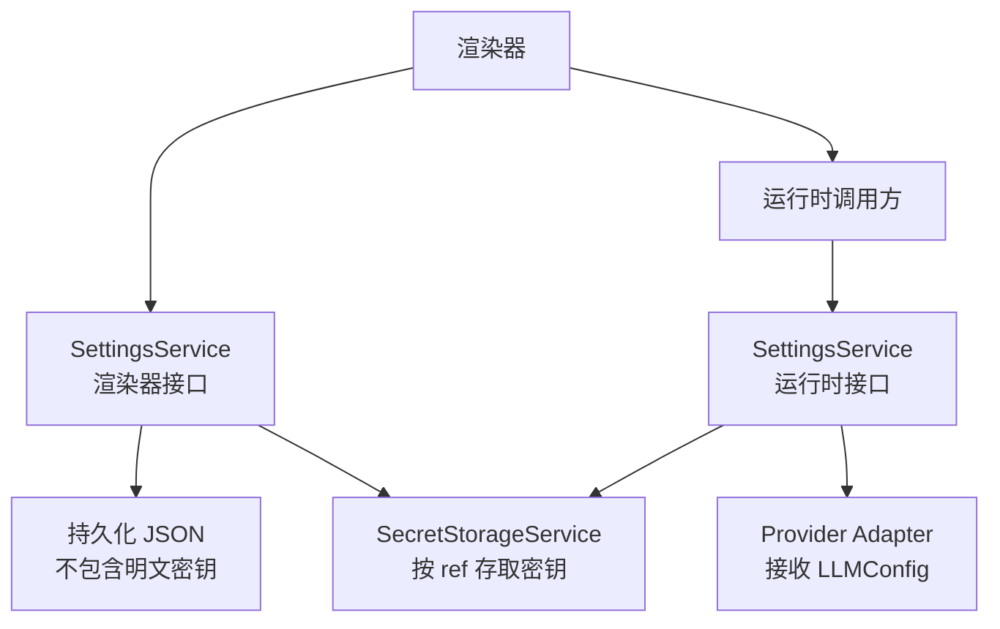

**图示来源**
- [SettingsService.ts:201-510](file://src/main/settings/SettingsService.ts#L201-L510)
- [settingsServiceHelpers.ts:201-397](file://src/main/settings/settingsServiceHelpers.ts#L201-L397)

**章节来源**
- [SettingsService.ts:201-510](file://src/main/settings/SettingsService.ts#L201-L510)

## 配置加载、合并、校验与持久化流程

### 初始化流程

initialize 的执行顺序如下：

1. 初始化运行时路径。
2. 读取原始持久化设置。
3. 校验 schemaVersion，拒绝不支持的结构。
4. 确保 execution profile scaffold。
5. 执行 rebuildPersistedSettings，清理无效 provider、修复 layout、tooling、agentRuntime 等。
6. 硬写回新的持久化设置。
7. 清除 shell resolver 缓存。
8. 删除不再需要的 secret ref。
9. 返回 getAll 构建的运行时 AppSettings。

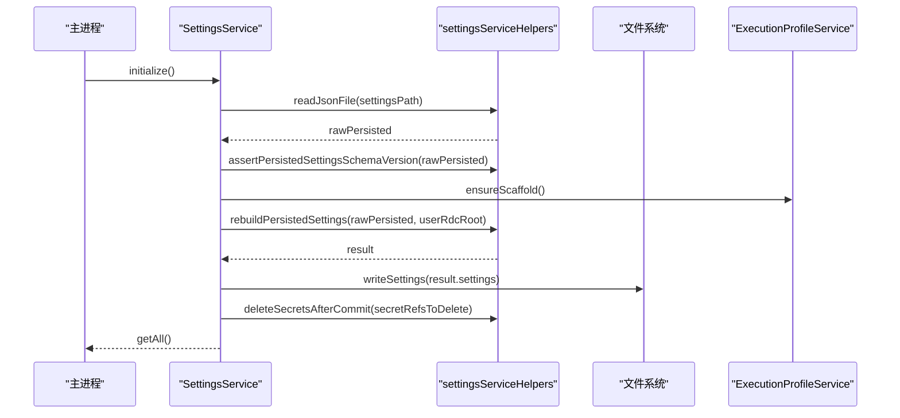

**图示来源**
- [SettingsService.ts:1-200](file://src/main/settings/SettingsService.ts#L1-L200)
- [settingsServiceHelpers.ts:1-200](file://src/main/settings/settingsServiceHelpers.ts#L1-L200)
- [ExecutionProfileService.ts:1-68](file://src/main/settings/ExecutionProfileService.ts#L1-L68)

### 读取与运行时视图

getAll 会：

1. 确保已初始化。
2. 读取当前 settings.json。
3. 如果不存在则创建默认持久化结构。
4. 校验 schemaVersion。
5. 调用 toRuntimeSettings 构建 AppSettings。
6. 注入 paths、agent routes、resourceCatalog、diagnostics。

toRuntimeSettings 的关键步骤是：

- normalizePersistedSettings：清洗 appearance、layout、profile、tooling、agentRuntime、providers。
- hydrateProviderSecrets：为运行时 provider 注入真实 secret。
- 构建 agent routes 和 model options。
- 加入 diagnostics。

这意味着：

- **持久化结构**（PersistedSettingsPayload）不含明文 apiKey。
- **运行时结构**（AppSettings）可能包含已解析的 provider secret，但只在主进程内存中使用。
- **渲染器获取的 AppSettings** 来自 getAll，而 getAll 内部确实调用了 hydrateProviderSecrets，因此对外暴露的是“可展示、可保存、可诊断”的运行期视图；真正的敏感操作应通过 getLlmConfig、getProviderSecret 等显式运行时接口完成。

**章节来源**
- [SettingsService.ts:1-200](file://src/main/settings/SettingsService.ts#L1-L200)
- [settingsServiceHelpers.ts:201-397](file://src/main/settings/settingsServiceHelpers.ts#L201-L397)

### 写入与合并流程

setAll 接收 AppSettingsPatch，而不是直接替换整个配置。它会：

1. 重新初始化运行时路径。
2. 确保 execution profile scaffold。
3. 读取当前持久化设置。
4. 判断是否存在 provider patch，决定 credentialView 是 storage-metadata 还是 runtime。
5. 对每个 provider draft：
   - 合并 activeAccountId 与 authAccountIds。
   - 根据 authMode 决定是否写入 secret。
   - 若 api-key 发生变化，创建新 account id 并标记旧 secretRef 待删除。
   - 调用 sanitizeUserProvider 清洗 provider。
6. normalizeUserProviders 合并 catalog 能力。
7. 可选保存 globalInstructions。
8. 合并 appearance、layout、profile、tooling、agentRuntime。
9. 写入持久化 JSON。
10. 删除旧的 secret refs。
11. 返回新的 AppSettings。

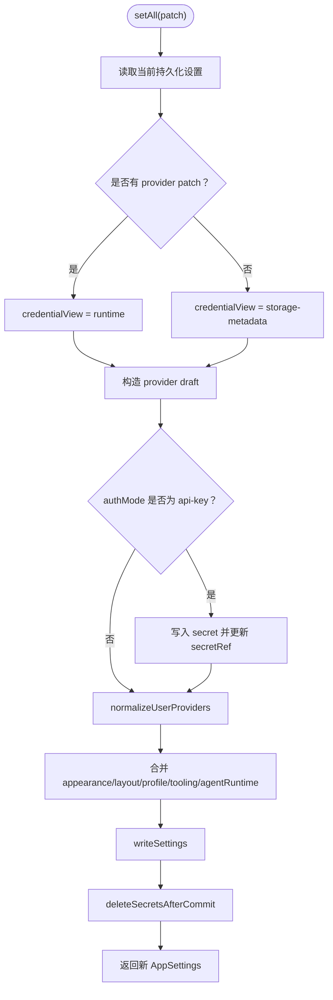

**图示来源**
- [SettingsService.ts:201-510](file://src/main/settings/SettingsService.ts#L201-L510)
- [settingsServiceHelpers.ts:201-397](file://src/main/settings/settingsServiceHelpers.ts#L201-L397)

**章节来源**
- [SettingsService.ts:201-510](file://src/main/settings/SettingsService.ts#L201-L510)

## 渲染器接口与运行时接口的职责分离

### 渲染器-facing 接口

这些接口适合被 UI 和业务层调用：

- getAll：返回 AppSettings，包括 appearance、layout、profile、tooling、agentRuntime、llm.providers、agents、resourceCatalog、paths。
- hasProviderSecret：返回 { hasSecret, maskedPreview? }，避免泄露明文。
- getProviderConnectionValues：返回连接字段的值，其中 secret 字段会通过 secretStorageService 解密。
- getProviderSecret：直接返回某个 provider 的明文 secret，属于更敏感的运行时接口。
- persistWindowLayout / persistWindowLayoutAsync：快速写入 window 布局，跳过 provider normalization 和 secret hydration，适合窗口 move/resize 防抖场景。
- saveAgentDefinition / getProviderDefinitionCommit / saveProviderDefinition：管理 agent 和 provider 定义。
- saveProviderConnection / rotateProviderAccountCredential / disconnectProvider：管理 provider 连接。
- getLlmConfig：运行时接口，返回 LLMConfig，包含已解析的 provider secret 和 compiledRoutes。

### 运行时-facing 接口

getLlmConfig 的职责是：

1. 过滤出 enabled、isConfigured、status 为 verified 的 provider。
2. 对 api-key provider，调用 getResolvedProviderSecret 解析 secret。
3. 对 account provider，调用 resolveAccountRuntimeCredential 解析 accountId、baseUrl、apiKey。
4. 从 agents.definitions 编译出 agent routes。
5. 返回 LLMConfig，供 provider adapter 或 Agent 运行时使用。

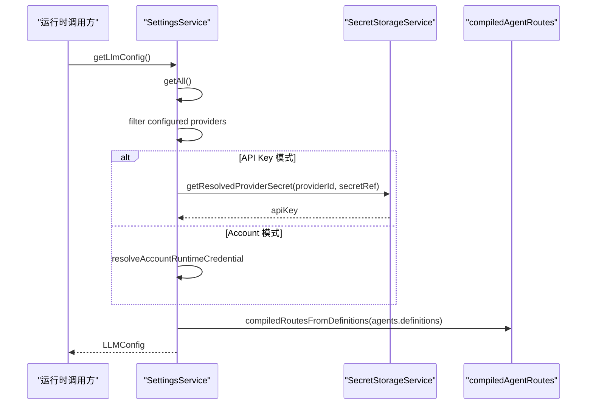

**图示来源**
- [SettingsService.ts:201-510](file://src/main/settings/SettingsService.ts#L201-L510)

**章节来源**
- [SettingsService.ts:201-510](file://src/main/settings/SettingsService.ts#L201-L510)

## 安全清洗与默认值策略

### settingsSanitize 的安全机制

settingsSanitize 负责把不可信的用户输入转换为安全的运行时配置片段。其核心规则包括：

- 字符串数组去重、过滤空值、trim。
- 字符串对象键名 trim，只保留 string 类型的值。
- RDC CLI 调用器、Code Interpreter、Shell Tooling 的 command、argsPrefix、env、timeoutMs 都经过类型检查和范围限制。
- Agent Permission 的 readableRoots/writableRoots 会展开 ~ 和 %USERPROFILE%，并转为绝对路径。
- Agent Permission 的 mode 只能从 VALID_PERMISSION_MODES 中选择。
- Agent Runtime Context 的 compactionThresholdPercent 使用专用工具函数校验。
- Sidebar、Terminal、Window 的宽高、坐标都进行 clamp 或 Math.trunc，防止异常 UI 状态。

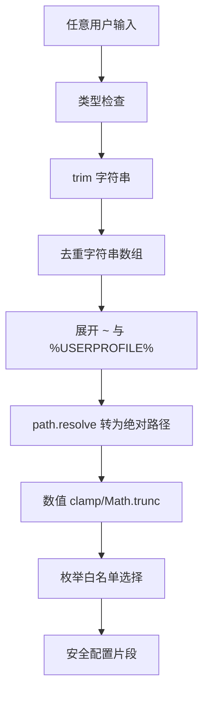

**图示来源**
- [settingsSanitize.ts:1-241](file://src/main/settings/settingsSanitize.ts#L1-L241)

### settingsDefaults 的默认值策略

settingsDefaults 定义了：

- SETTINGS_SCHEMA_VERSION：当前持久化 schema 版本。
- PersistedSettingsPayload：持久化结构的 TypeScript 定义。
- LEFT_DEFAULTS、RIGHT_DEFAULTS：左右面板宽度、最小值、最大值、折叠宽度。
- DEFAULT_LAYOUT：左侧栏、右侧面板、终端、窗口的初始布局。
- DEFAULT_PROFILE：默认昵称和头像路径。
- DEFAULT_RDC_CLI_INVOKER、DEFAULT_CODE_INTERPRETER、DEFAULT_SHELL_TOOLING：工具链默认值。
- DEFAULT_AGENT_RUNTIME：Agent 运行时权限默认模式和上下文压缩阈值。
- createDefaultPersistedSettings：完整的初始持久化结构。

默认值策略的核心原则是：

- 缺失字段不会导致 undefined。
- 非法字段会被丢弃或替换为默认值。
- 布局字段有最小/最大范围保护。
- 权限 mode 只能从白名单中选择。
- 工具命令默认关闭，避免意外执行外部程序。

**章节来源**
- [settingsSanitize.ts:1-241](file://src/main/settings/settingsSanitize.ts#L1-L241)
- [settingsDefaults.ts:1-167](file://src/main/settings/settingsDefaults.ts#L1-L167)

## 有效目录与服务视图：EffectiveCatalogService

EffectiveCatalogService 并不直接修改 settings.json，而是维护一个独立的“有效目录状态”，用于缓存 Provider 模型发现结果、授权结果和观测证据。

### 主要职责

- 维护 discoveries、entitlements、observed 三个目录层。
- 基于 EffectiveCatalogRequest 生成 EffectiveCatalogSnapshot。
- 支持 discovery loader、layer normalizer。
- 对发现结果做 admission 校验。
- 对刷新失败做指数退避。
- 记录 transient quota，例如模型用量耗尽。
- 持久化 catalog-v4.json。
- 通过 listener 通知订阅者。

### 快照生成与过期

createSnapshot 会：

1. 查找缓存的 discovery。
2. 如果 catalogProjectionRevision 变化，丢弃 cached discovery。
3. 过滤过期的 observed evidence。
4. 计算 stale。
5. 合并 models。
6. 冻结 executable/selectable 语义，生成 catalogRevision。
7. 附加 transient quota provenance。
8. 返回 snapshot。

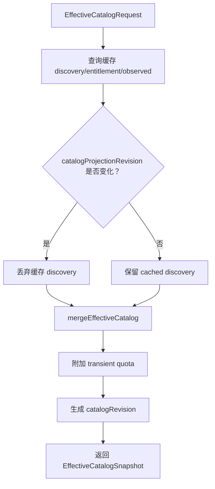

**图示来源**
- [EffectiveCatalogService.ts:1-200](file://src/main/settings/EffectiveCatalogService.ts#L1-L200)
- [EffectiveCatalogService.ts:201-464](file://src/main/settings/EffectiveCatalogService.ts#L201-L464)

### 刷新与退避

refreshDiscovery 会：

- 使用 cacheKey 防止重复刷新。
- 调用 DiscoveryLoader 拉取 discovery。
- 写入 discoveries、entitlements、observed。
- 成功时清除 lastErrors 和 backoff。
- 失败时记录 lastErrors 并增加 backoff。
- 使用指数退避：基础间隔 30 秒，最大 10 分钟。
- 最终 emit snapshot。

invalidateDiscovery 会：

- 精确匹配或前缀匹配删除 discovery 和 entitlement。
- 清理 capability-probe 相关 observed evidence。
- 清除 refresh state。
- 持久化状态并触发最新订阅者刷新。

**章节来源**
- [EffectiveCatalogService.ts:1-464](file://src/main/settings/EffectiveCatalogService.ts#L1-L464)

## Agent 运行时配置：AgentRuntimeConfigService 与 ExecutionProfileService

### AgentRuntimeConfigService

AgentRuntimeConfigService 负责扫描三类 Skill 源：

- builtin：内置模板目录。
- user：用户目录。
- project：项目目录。

它还扫描两类 MCP 描述符：

- user/.mcp.json
- project/.mcp.json

对于 MCP，它会：

- 校验 transport 是否在允许集合中。
- 计算 descriptorHash。
- 对 project 级 MCP 检查信任状态。
- 合并同名 user 和 project 描述符，但禁止 project 覆盖 user 的可执行参数。
- 标记 blockedReason 或 needsRetrust。

Skill 解析会从 SKILL.md 中提取 frontmatter 和 instructions，并推断 allowedTools、sourcePath、referencesPath、scriptsPath、assetsPath。

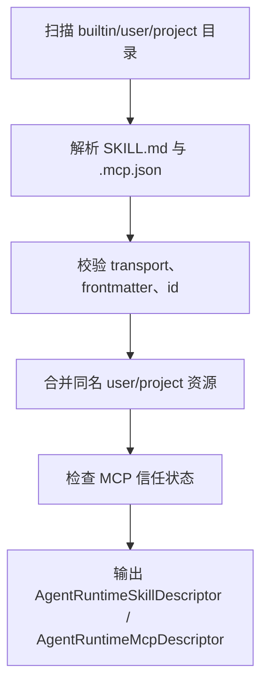

**图示来源**
- [AgentRuntimeConfigService.ts:1-200](file://src/main/settings/AgentRuntimeConfigService.ts#L1-L200)
- [AgentRuntimeConfigService.ts:201-259](file://src/main/settings/AgentRuntimeConfigService.ts#L201-L259)

### ExecutionProfileService

ExecutionProfileService 为 Agent 提供“执行配置文件视图”：

- ensureScaffold：确保 agent runtime 资源目录存在。
- normalizeResourceCatalog：注入 availableSkills 和 availableMcpServers。
- resolveAgentRuntimeProfile：根据 agentId 找到启用的 Agent 定义，再根据 compiledRoute 解析 provider 和 model。
- getDiagnostics：如果没有已配置的 provider，返回 missing_configured_provider 警告。

resolveAgentRoute 的关键规则：

- 必须找到启用的 agent 定义。
- 必须存在 compiledRoute。
- route 必须有 providerId 和 modelId。
- provider 必须 enabled、isConfigured、status 为 verified。
- 必须能通过 resolveEffectiveModel 解析到有效模型。

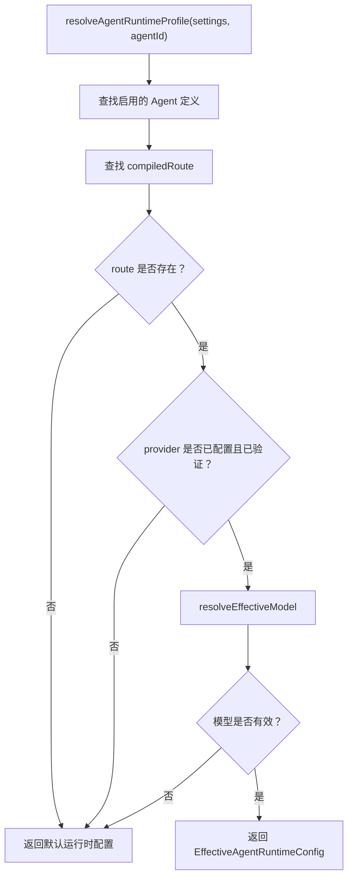

**图示来源**
- [ExecutionProfileService.ts:1-68](file://src/main/settings/ExecutionProfileService.ts#L1-L68)

**章节来源**
- [AgentRuntimeConfigService.ts:1-259](file://src/main/settings/AgentRuntimeConfigService.ts#L1-L259)
- [ExecutionProfileService.ts:1-68](file://src/main/settings/ExecutionProfileService.ts#L1-L68)

## 配置结构与字段说明

### 持久化结构：PersistedSettingsPayload

| 字段 | 类型 | 含义 | 默认值行为 |
|---|---|---|---|
| schemaVersion | number | 设置文件 schema 版本 | 新建时设为 SETTINGS_SCHEMA_VERSION |
| appearance | UiPreferences | 主题、语言、UI 偏好 | DEFAULT_APPEARANCE |
| layout | LayoutPreferences | 左侧栏、右侧面板、终端、窗口布局 | DEFAULT_LAYOUT |
| profile | ProfileSettings | nickname、avatarPath | DEFAULT_PROFILE |
| llm.providers | LlmProviderEntry[] | Provider 列表，不含明文 apiKey | [] |
| tooling.rdcCli | RdcCliInvokerSettings | RDC CLI 调用器 | DEFAULT_RDC_CLI_INVOKER |
| tooling.codeInterpreter | CodeInterpreterSettings | 代码解释器 | DEFAULT_CODE_INTERPRETER |
| tooling.shell | AgentShellSettings | Agent shell 可执行文件 | DEFAULT_SHELL_TOOLING |
| agentRuntime.permissions | AgentPermissionSettings | Agent 文件系统与命令权限 | DEFAULT_AGENT_RUNTIME.permissions |
| agentRuntime.context | context 子对象 | 上下文压缩阈值 | DEFAULT_AGENT_RUNTIME.context |

注意：

- 持久化 JSON 不直接包含明文 apiKey。
- Provider 的 secretRef 指向 SecretStorageService。
- schemaVersion 不匹配时会抛出 STORAGE_SCHEMA 错误。

### 运行时结构：AppSettings

AppSettings 在 PersistedSettingsPayload 基础上增加：

- agents.directoryPath、agents.definitions、agents.modelOptions、agents.globalInstructions、agents.diagnostics。
- llm.agentRoutes：编译后的 Agent 路由。
- resourceCatalog：availableSkills、availableMcpServers、diagnostics。
- paths：运行时路径。

运行时结构更适合主进程消费，尤其是当 hydrateProviderSecrets 注入 secret 之后。

### Provider 关键字段

| 字段 | 含义 |
|---|---|
| id | Provider 标识 |
| label | 显示名称 |
| baseUrl | 服务端地址 |
| protocol | 协议 |
| authMode | api-key 或 account |
| secretRef | 密钥引用 |
| isConfigured | 是否完成必要配置 |
| status | 如 verified、error 等 |
| enabled | 是否启用 |
| modelPreferences | 模型优先级或筛选规则 |

### Agent Route 关键字段

| 字段 | 含义 |
|---|---|
| id | Agent 定义 id |
| providerId | 目标 Provider |
| modelId | 目标模型 |
| compiledRoute | 编译后路由 |
| definitions | Agent Manifest 定义列表 |

**章节来源**
- [settingsDefaults.ts:1-167](file://src/main/settings/settingsDefaults.ts#L1-L167)
- [settingsServiceHelpers.ts:201-397](file://src/main/settings/settingsServiceHelpers.ts#L201-L397)
- [SettingsService.ts:201-510](file://src/main/settings/SettingsService.ts#L201-L510)

## 变更监听、刷新与缓存失效

### SettingsService 的变更机制

SettingsService 本身没有通用的“全局配置变更事件总线”，但它通过以下方式体现配置变更：

- initialize 后硬写设置并清理 shell resolver 缓存。
- setAll 后写盘并删除旧 secret refs。
- persistWindowLayout / persistWindowLayoutAsync 快速写入 window 布局。
- mergeAgentShellSettings 在 shell executable 变化时清理 shellResolver 缓存。
- getAll 每次都会重新读取并构建运行时 AppSettings。

### EffectiveCatalogService 的监听机制

EffectiveCatalogService 提供了明确的订阅机制：

- subscribe(listener)：注册回调。
- invalidateDiscovery(input)：使指定 provider/account/protocol 的发现缓存失效。
- recordObserved(...)：记录观测证据。
- recordTransientQuota(...)：记录模型配额。
- emit(snapshot)：发送有效目录快照。
- emitLatestSnapshots(input)：根据 latestRequests 重新计算并推送最近请求对应的快照。

listener 的错误不会影响其他 listener 或 catalog 持久化。

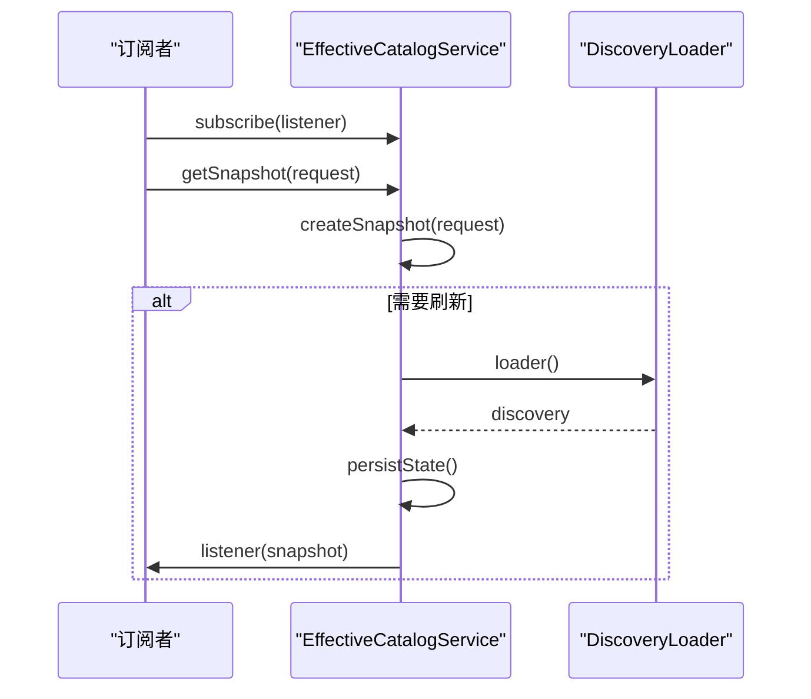

**图示来源**
- [EffectiveCatalogService.ts:1-200](file://src/main/settings/EffectiveCatalogService.ts#L1-L200)
- [EffectiveCatalogService.ts:201-464](file://src/main/settings/EffectiveCatalogService.ts#L201-L464)

### 缓存失效场景

| 场景 | 失效范围 | 后续行为 |
|---|---|---|
| invalidateDiscovery | providerId + accountId ± protocol | 删除 discovery、entitlement，清理 observed capability-probe 证据 |
| recordObserved | providerId + accountId | 追加 observation layer，并触发最新请求刷新 |
| recordTransientQuota | providerId + accountId + modelId | 更新 transientQuota，并触发最新请求刷新 |
| 刷新失败 | key | 记录 lastRefreshError，进入指数退避 |
| schemaVersion 不匹配 | catalog 状态 | 清空并重建 EMPTY_STATE |

**章节来源**
- [EffectiveCatalogService.ts:1-464](file://src/main/settings/EffectiveCatalogService.ts#L1-L464)
- [SettingsService.ts:201-510](file://src/main/settings/SettingsService.ts#L201-L510)

## 依赖关系分析

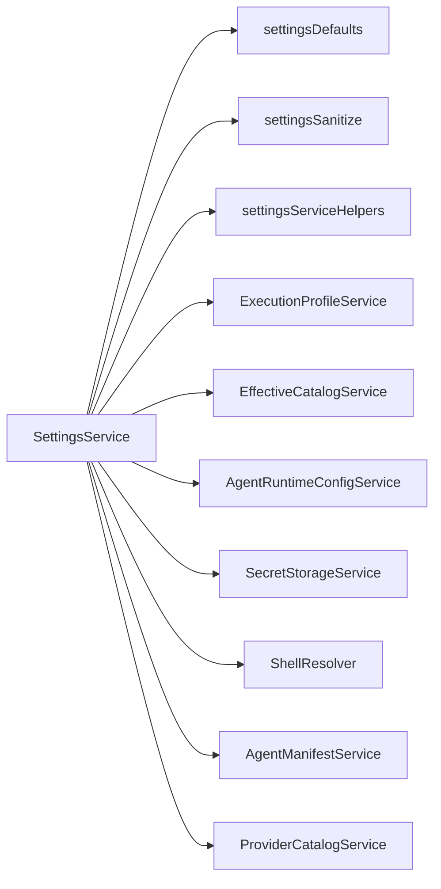

**图示来源**
- [SettingsService.ts:1-200](file://src/main/settings/SettingsService.ts#L1-L200)

### 耦合与内聚

- SettingsService 与 settingsServiceHelpers、settingsSanitize、settingsDefaults 高度内聚，共同构成配置解析管道。
- ExecutionProfileService 依赖 AgentRuntimeConfigService 提供资源目录。
- EffectiveCatalogService 独立管理 catalog 状态，但通过 EffectiveModelResolver 参与有效模型计算。
- SecretStorageService 是敏感数据边界，SettingsService 通过 secretRef 间接访问。
- ShellResolver 是副作用点：shell executable 变化会影响外部命令执行环境。

### 潜在风险

- getAll 会构建运行时 AppSettings，包括 hydrated providers；如果渲染器直接复用该对象，需要注意它可能包含敏感上下文。
- EffectiveCatalogService 的 discoverer 或 normalizer 如果抛出异常，会进入 backoff，但不会中断其他 key 的刷新。
- settingsServiceHelpers 的文件写入使用临时文件加 rename，降低部分损坏风险，但仍依赖底层文件系统。

**章节来源**
- [SettingsService.ts:1-200](file://src/main/settings/SettingsService.ts#L1-L200)
- [settingsServiceHelpers.ts:1-200](file://src/main/settings/settingsServiceHelpers.ts#L1-L200)
- [EffectiveCatalogService.ts:1-464](file://src/main/settings/EffectiveCatalogService.ts#L1-L464)

## 性能考虑

- initialize 和 setAll 会读取并可能重写 settings.json，应避免频繁调用。
- persistWindowLayout / persistWindowLayoutAsync 是窄写路径，专门优化窗口布局写入。
- EffectiveCatalogService 对 discovery 做了 TTL、backoff、去重和指纹去重 emit，避免高频无效通知。
- shellResolver.clearCache 只在 shell executable 变化时触发，减少不必要的重启或重建。
- toRuntimeSettings 会构建 resourceCatalog、agent routes 和 model options，属于较重操作，不应在热路径反复调用。

建议：

- UI 保存操作尽量使用 patch 而非全量重建。
- 窗口布局写入使用异步窄写。
- 目录刷新按需调用 invalidateDiscovery。
- 对 Provider 配置变更，优先区分 providerId 和 protocol，避免全量失效。

[本节为通用性能指导，不直接分析具体代码行]

## 故障排查指南

### 常见问题与定位方向

| 现象 | 可能原因 | 排查位置 |
|---|---|---|
| 启动时报 STORAGE_SCHEMA_UNSUPPORTED | settings.json schemaVersion 不匹配或结构损坏 | settingsServiceHelpers.assertPersistedSettingsSchemaVersion |
| 启动时报 STORAGE_CORRUPT | settings.json 无法解析为 JSON | settingsServiceHelpers.readJsonFile / readJsonFileAsync |
| Provider 未显示为已配置 | provider 缺少必需字段、authMode 不正确、status 不是 verified | SettingsService.setAll、normalizeUserProviders |
| 切换 API Key 后旧密钥残留 | secretRef 未正确更新或删除 | SettingsService.setAll 中的 secretRefsToDelete |
| Agent 无法选择模型 | route.providerId 或 route.modelId 无效，或 provider 未验证 | ExecutionProfileService.resolveAgentRoute |
| 模型目录一直 stale | discovery 超时、网络失败或 backoff 未结束 | EffectiveCatalogService.refreshDiscovery、lastRefreshError |
| Skill 未出现 | SKILL.md 缺失、frontmatter 不合法、scope 被过滤 | AgentRuntimeConfigService.parseSkill、resolveSkills |
| MCP 被阻止 | transport 不支持或项目 MCP 需要信任 | AgentRuntimeConfigService.listMcpServers |

### 推荐调试步骤

1. 检查 settings.json 是否存在、可读、schemaVersion 是否正确。
2. 检查是否有已配置的 provider：hasConfiguredProvider 或 diagnostics。
3. 检查 Provider 的 authMode、secretRef、status、isConfigured。
4. 检查 Agent 定义是否启用、是否包含 compiledRoute。
5. 检查 EffectiveCatalogService 的 lastRefreshError 和 refreshing 状态。
6. 检查 MCP descriptorHash 与 trust 状态。
7. 检查 shell executable 是否变化，是否需要清理 shellResolver 缓存。

**章节来源**
- [settingsServiceHelpers.ts:1-200](file://src/main/settings/settingsServiceHelpers.ts#L1-L200)
- [SettingsService.ts:201-510](file://src/main/settings/SettingsService.ts#L201-L510)
- [ExecutionProfileService.ts:1-68](file://src/main/settings/ExecutionProfileService.ts#L1-L68)
- [EffectiveCatalogService.ts:201-464](file://src/main/settings/EffectiveCatalogService.ts#L201-L464)
- [AgentRuntimeConfigService.ts:201-259](file://src/main/settings/AgentRuntimeConfigService.ts#L201-L259)

## 结论

SettingsService 在这个系统中扮演的是“配置统一边界”的角色：

- 它把 settings、profile、provider、model、route、secret 五类数据统一到一致的加载、合并、校验和持久化流程中。
- 它明确区分渲染器接口和运行时接口，让 UI 可以安全地展示和保存配置，同时让主进程在真正调用 provider 时才解析 secret。
- settingsSanitize 和 settingsDefaults 共同保证配置健壮性：非法值被丢弃，缺失值有默认值，路径和权限受约束。
- EffectiveCatalogService 为模型发现提供稳定、可缓存、可观察、可退避的有效目录视图。
- AgentRuntimeConfigService 和 ExecutionProfileService 为 Agent 运行时提供 Skill、MCP、systemPrompt、toolAllowlist、skillIds、mcpServerIds、providerId 和 modelId 的组合视图。

理解这套边界，有助于正确扩展新的 provider、新的 Agent route、新的 Skill 或 MCP 描述符，同时避免把敏感 secret 暴露到渲染器，或让脏数据污染持久化配置。