# Agent 安全边界

<cite>
**本文引用的文件**   
- [SettingsAgentOps.ts](file://src/main/settings/SettingsAgentOps.ts)
- [SettingsProviderOps.ts](file://src/main/settings/SettingsProviderOps.ts)
- [settingsLlmHandlers.ts](file://src/main/ipc/settingsLlmHandlers.ts)
- [types.ts](file://src/renderer/features/settings/SettingsModal/types.ts)
- [useProviderConnectionActions.ts](file://src/renderer/features/settings/SettingsModal/useProviderConnectionActions.ts)
- [SecretStorageService.ts](file://src/main/settings/SecretStorageService.ts)
- [permissions.md](file://docs/contracts/permissions.md)
- [channelCapabilities.ts](file://src/shared/renderer-api/channelCapabilities.ts)
</cite>

## 目录

1. [引言](#引言)
2. [项目结构与安全入口](#项目结构与安全入口)
3. [核心组件](#核心组件)
4. [架构总览](#架构总览)
5. [详细组件分析](#详细组件分析)
6. [依赖关系与跨进程边界](#依赖关系与跨进程边界)
7. [fail-closed 安全策略](#fail-closed-安全策略)
8. [权限矩阵与最小权限模型](#权限矩阵与最小权限模型)
9. [凭据访问与 ProviderConnectionDraft](#凭据访问与-providerconnectiondraft)
10. [威胁模型分析](#威胁模型分析)
11. [故障排查指南](#故障排查指南)
12. [结论](#结论)

## 引言

本文件聚焦 RDC-Agent 代码库中围绕 **Agent 设置**、**Provider 设置**、**凭据存储**和 **Renderer 到 Main 的 IPC 边界**构建的安全控制面。其目标是解释：

- `SettingsAgentOps` 如何为 Agent 定义提供安全的并发写保护、提交快照和回滚恢复。
- `SettingsProviderOps` 如何为 Provider 连接提供安全的凭据写入、账号模式切换、断开连接与持久化。
- `ProviderConnectionDraft` 如何在渲染进程中承载用户输入，而不把敏感字段直接写入持久化设置。
- fail-closed 策略如何通过默认拒绝、显式授权和最小权限模型实现。
- Agent 如何通过受控 API 访问凭据，而不是直接读取底层 `safeStorage` 或明文 JSON。
- Main 进程与 Renderer 进程之间如何通过通道能力、参数校验和领域服务隔离权限。

该文档同时包含架构图、序列图、流程图、权限矩阵和威胁模型，帮助非专业读者理解“凭据不能离开主进程”“未知通道默认拒绝”“草稿必须通过受控接口提交”等不变量。

**章节来源**
- [permissions.md:1-132](file://docs/contracts/permissions.md#L1-L132)

## 项目结构与安全入口

Agent 安全边界涉及四个层次：

| 层次 | 职责 | 关键文件 |
|---|---|---|
| 渲染进程 UI | 维护用户交互草稿、发起测试、保存连接、刷新模型 | [types.ts](file://src/renderer/features/settings/SettingsModal/types.ts)、[useProviderConnectionActions.ts](file://src/renderer/features/settings/SettingsModal/useProviderConnectionActions.ts) |
| 渲染进程 API | 将调用映射到唯一 IPC 通道，并通过通道能力表限制影响范围 | [channelCapabilities.ts](file://src/shared/renderer-api/channelCapabilities.ts) |
| 主进程 IPC | 解析参数、校验类型、限制大小、路由到领域服务 | [settingsLlmHandlers.ts](file://src/main/ipc/settingsLlmHandlers.ts) |
| 主进程领域服务 | 执行凭据写入、设置持久化、Agent/Provider 定义提交、并发控制和缓存 | [SettingsAgentOps.ts](file://src/main/settings/SettingsAgentOps.ts)、[SettingsProviderOps.ts](file://src/main/settings/SettingsProviderOps.ts)、[SecretStorageService.ts](file://src/main/settings/SecretStorageService.ts) |

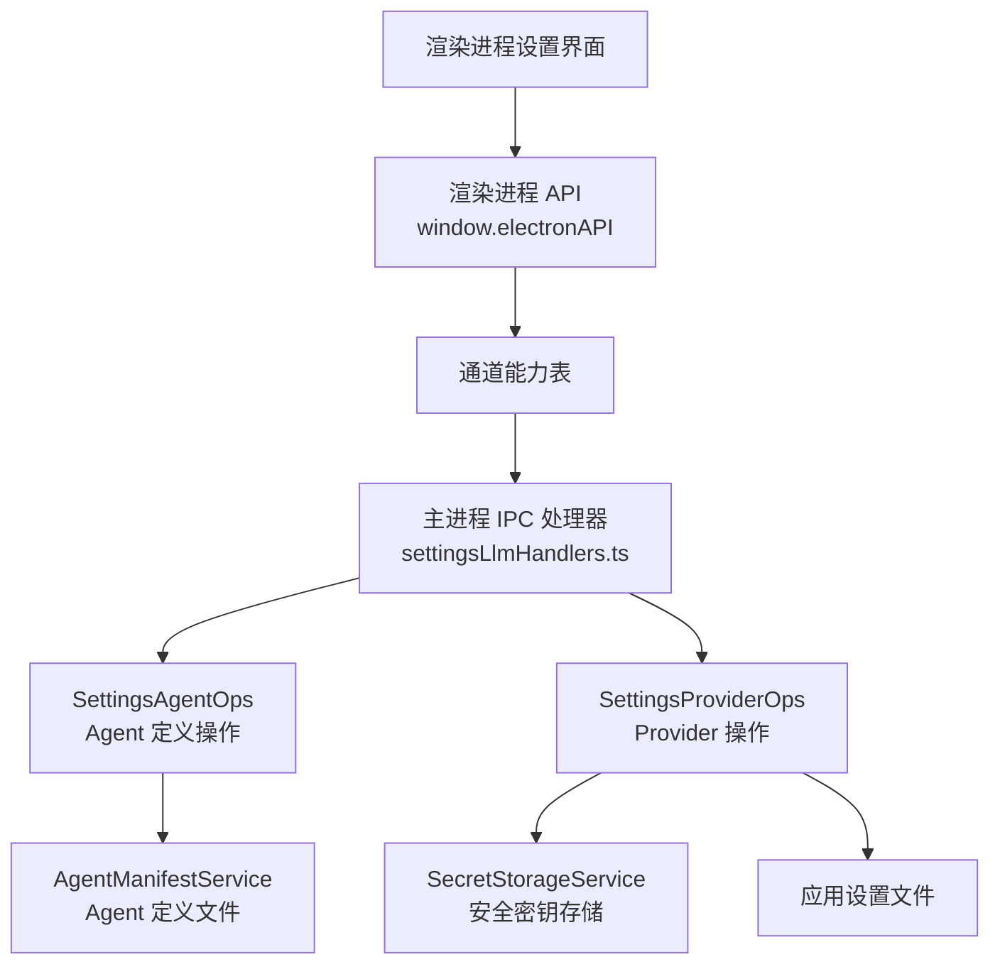

**图示来源**
- [settingsLlmHandlers.ts:52-395](file://src/main/ipc/settingsLlmHandlers.ts#L52-L395)
- [SettingsAgentOps.ts:15-191](file://src/main/settings/SettingsAgentOps.ts#L15-L191)
- [SettingsProviderOps.ts:37-546](file://src/main/settings/SettingsProviderOps.ts#L37-L546)
- [SecretStorageService.ts:1-200](file://src/main/settings/SecretStorageService.ts#L1-L200)
- [types.ts:23-55](file://src/renderer/features/settings/SettingsModal/types.ts#L23-L55)
- [useProviderConnectionActions.ts:1-198](file://src/renderer/features/settings/SettingsModal/useProviderConnectionActions.ts#L1-L198)

**章节来源**
- [settingsLlmHandlers.ts:52-395](file://src/main/ipc/settingsLlmHandlers.ts#L52-L395)
- [types.ts:23-55](file://src/renderer/features/settings/SettingsModal/types.ts#L23-L55)
- [useProviderConnectionActions.ts:1-198](file://src/renderer/features/settings/SettingsModal/useProviderConnectionActions.ts#L1-L198)

## 核心组件

### SettingsAgentOps：Agent 定义的受控写入层

`SettingsAgentOps` 是 Agent 定义的主进程操作封装。它不直接暴露文件系统读写，而是通过以下机制提供安全边界：

1. **按 lane 键序列化写入**  
   使用 scope、projectId、agentId 组合生成 laneKey，并通过 `agentDefinitionWriteTails` 保证同一 Agent 定义的写入串行化，避免并发覆盖。

2. **客户端版本冲突检测**  
   每次保存要求 `clientRevision` 为正整数且严格递增；若发现旧版本请求，返回 `superseded`，而不是静默覆盖。

3. **提交快照缓存**  
   `agentDefinitionCommits` 缓存最近一次提交的定义、commitHash、编译 route 和 clientRevision，减少重复磁盘读取。

4. **失败回滚与恢复**  
   当持久化失败时，如果当前 revision 仍属于本次请求，会尝试恢复之前的 Agent 定义，确保不会留下半更新状态。

5. **Agent ID 白名单校验**  
   读取和保存前都使用 `isSafeAgentProfileId` 校验 agentId，非法值会被拒绝并返回空结果或失败结果。

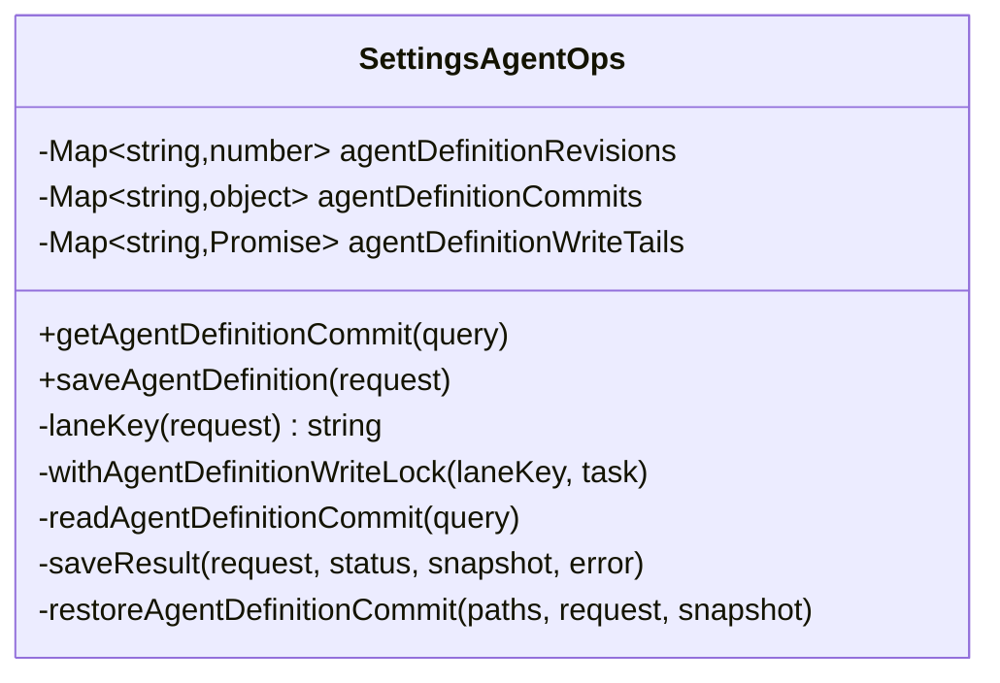

**图示来源**
- [SettingsAgentOps.ts:15-191](file://src/main/settings/SettingsAgentOps.ts#L15-L191)

**章节来源**
- [SettingsAgentOps.ts:15-191](file://src/main/settings/SettingsAgentOps.ts#L15-L191)

### SettingsProviderOps：Provider 凭据的受控写入层

`SettingsProviderOps` 负责 Provider 配置和凭据的生命周期管理。它通过 host 接口与设置系统解耦，从而避免渲染进程直接持有全局设置对象。

关键安全特性包括：

1. **仅允许内置 Provider**  
   多处检查 `isBuiltinProviderId`，防止任意 providerId 被当作真实 Provider 处理。

2. **凭据不进入持久化设置**  
   持久化 Provider 条目时清空 `apiKey`，并将实际密钥写入 `secretRef` / `secretRefs`。

3. **按字段区分普通值和密钥字段**  
   通过 connectionSchema 判断字段 `kind === 'secret'`，只把密钥字段交给 `secretStorageService`。

4. **账号标识与密钥引用分离**  
   使用 `createLocalAccountId()`、`getProviderAccountSecretRef()` 和 `createProviderConnectionSecretRef()` 生成稳定引用，而不是直接使用原始密钥。

5. **事务式清理临时密钥**  
   成功提交后删除不再使用的密钥；失败时删除暂存的新密钥，避免泄露未使用的草稿。

6. **并发写锁**  
   与 `SettingsAgentOps` 类似，使用 `providerDefinitionWriteTails` 对每个 providerId 进行串行写入。

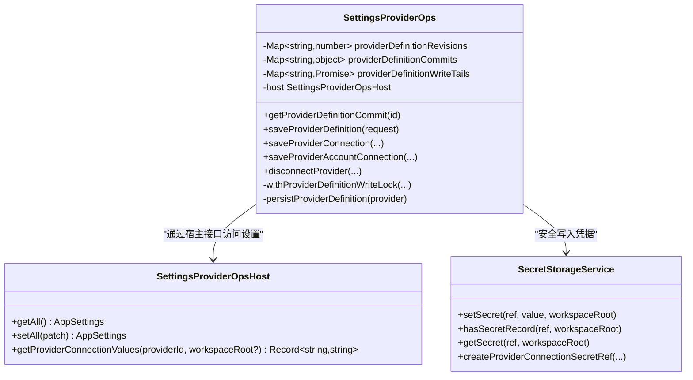

**图示来源**
- [SettingsProviderOps.ts:37-546](file://src/main/settings/SettingsProviderOps.ts#L37-L546)
- [SecretStorageService.ts:1-200](file://src/main/settings/SecretStorageService.ts#L1-L200)

**章节来源**
- [SettingsProviderOps.ts:37-546](file://src/main/settings/SettingsProviderOps.ts#L37-L546)
- [SecretStorageService.ts:1-200](file://src/main/settings/SecretStorageService.ts#L1-L200)

### SecretStorageService：凭据的最终安全边界

`SecretStorageService` 是凭据落盘的唯一可信路径之一。它的职责不是提供业务逻辑，而是保证：

- 不可用时 fail-closed，不降级为明文存储。
- 损坏文件被隔离，而不是继续信任。
- 文件权限设置为 0600，并在 Windows 上尝试收紧 ACL。
- 密钥以 `safeStorage` 编码，对外查询只提供存在性标志和掩码预览。
- 所有密钥引用由统一方法生成，避免随机字符串带来的可预测性问题。

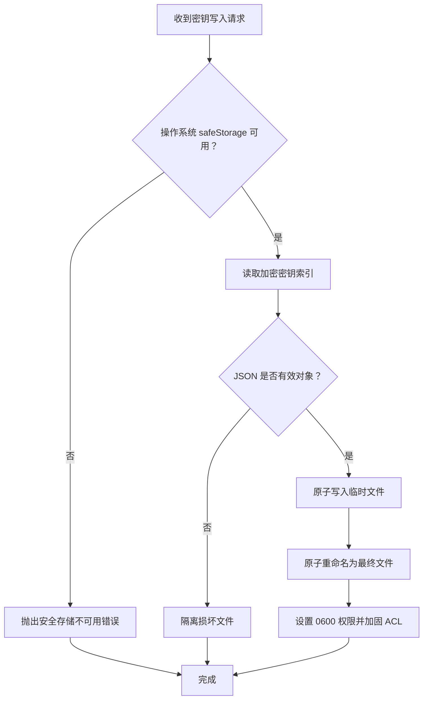

**图示来源**
- [SecretStorageService.ts:1-200](file://src/main/settings/SecretStorageService.ts#L1-L200)

**章节来源**
- [SecretStorageService.ts:1-200](file://src/main/settings/SecretStorageService.ts#L1-L200)

## 架构总览

从调用者视角看，Agent 安全边界的完整调用链如下：

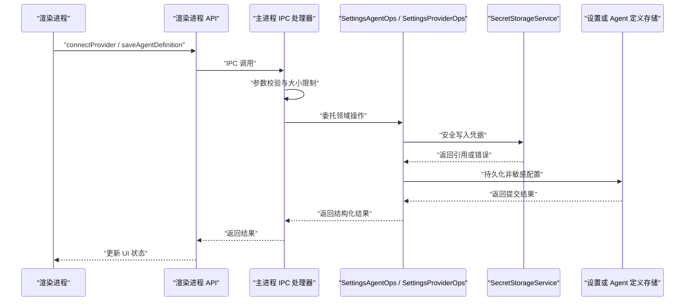

**图示来源**
- [settingsLlmHandlers.ts:52-395](file://src/main/ipc/settingsLlmHandlers.ts#L52-L395)
- [SettingsAgentOps.ts:119-191](file://src/main/settings/SettingsAgentOps.ts#L119-L191)
- [SettingsProviderOps.ts:200-546](file://src/main/settings/SettingsProviderOps.ts#L200-L546)
- [SecretStorageService.ts:1-200](file://src/main/settings/SecretStorageService.ts#L1-L200)

## 详细组件分析

### Agent 定义保存流程

`SettingsAgentOps.saveAgentDefinition` 是一个典型的 fail-closed 安全流程：

1. 清洗并校验 agentId。
2. 校验 clientRevision。
3. 比较最新版本号，旧请求返回 `superseded`。
4. 获取 laneKey 并等待之前任务完成。
5. 再次检查版本号，防止竞态条件。
6. 调用 `agentManifestService.saveDefinition` 写入 Agent 定义。
7. 成功后更新缓存并提交快照。
8. 失败时尝试恢复之前的定义。

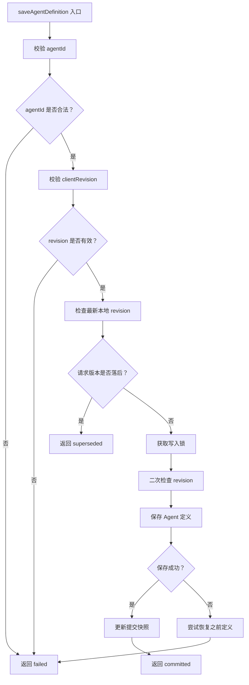

**图示来源**
- [SettingsAgentOps.ts:129-191](file://src/main/settings/SettingsAgentOps.ts#L129-L191)

**章节来源**
- [SettingsAgentOps.ts:129-191](file://src/main/settings/SettingsAgentOps.ts#L129-L191)

### Provider 连接保存流程

`SettingsProviderOps.saveProviderConnection` 是凭据访问的核心入口。它处理 api-key 模式的连接草稿，包括协议、baseUrl、认证模式、模型偏好、连接字段和密钥存储。

关键步骤：

1. 查找当前 Provider 并验证它是内置 Provider。
2. 校验 authMode 是否在允许列表中。
3. 如果是 account 模式，则拒绝手动 api-key 保存，强制走登录流程。
4. 规范化协议和 baseUrl。
5. 根据 schema 区分普通字段和密钥字段。
6. 计算凭证是否满足连接 schema。
7. 生成或复用账号标识。
8. 将密钥字段写入 `secretStorageService`，只保留引用。
9. 更新 Provider 条目，但不在设置中保留明文密钥。
10. 成功后删除不再使用的旧密钥；失败时删除新创建的暂存密钥。

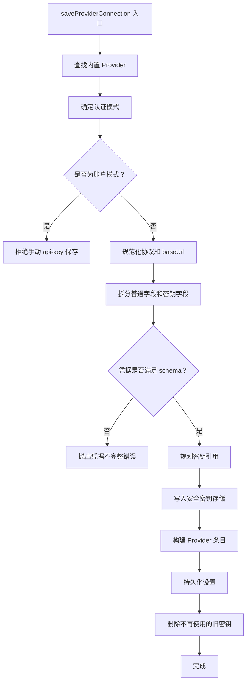

**图示来源**
- [SettingsProviderOps.ts:200-430](file://src/main/settings/SettingsProviderOps.ts#L200-L430)

**章节来源**
- [SettingsProviderOps.ts:200-430](file://src/main/settings/SettingsProviderOps.ts#L200-L430)

### 渲染进程中的连接草稿

`ProviderConnectionDraft` 是渲染进程中的临时数据结构，用于承载用户在设置面板中输入的连接信息。它的关键安全属性是注释所强调的：**瞬态 typed 连接字段从不进入持久化的渲染进程设置**。

| 字段 | 作用 | 安全含义 |
|---|---|---|
| `providerId` | 目标 Provider | 用于选择正确的 schema 和 IPC 通道 |
| `authMode` | api-key、account、local、environment | 决定后续流程是手动连接还是账户登录 |
| `connectionValues` | 瞬态连接字段 | 只在内存中使用，不写入持久化设置 |
| `usingStoredConnectionSecrets` | 标记哪些字段继续使用主进程密钥引用 | 避免重复发送明文密钥 |
| `visibleConnectionSecrets` | UI 可见性状态 | 纯展示状态，不是安全边界 |
| `apiKey` | 用户输入的 api-key 草稿 | 可能短暂进入 IPC 请求，但不写入 renderer 设置 |
| `testedApiKey` / `testedBaseUrl` | 测试后的记录 | 用于显示测试历史，不应作为最终凭据 |
| `models` | 已发现或用户选择的模型 | 非敏感元数据 |
| `busy` / `error` | UI 状态 | 非敏感状态 |

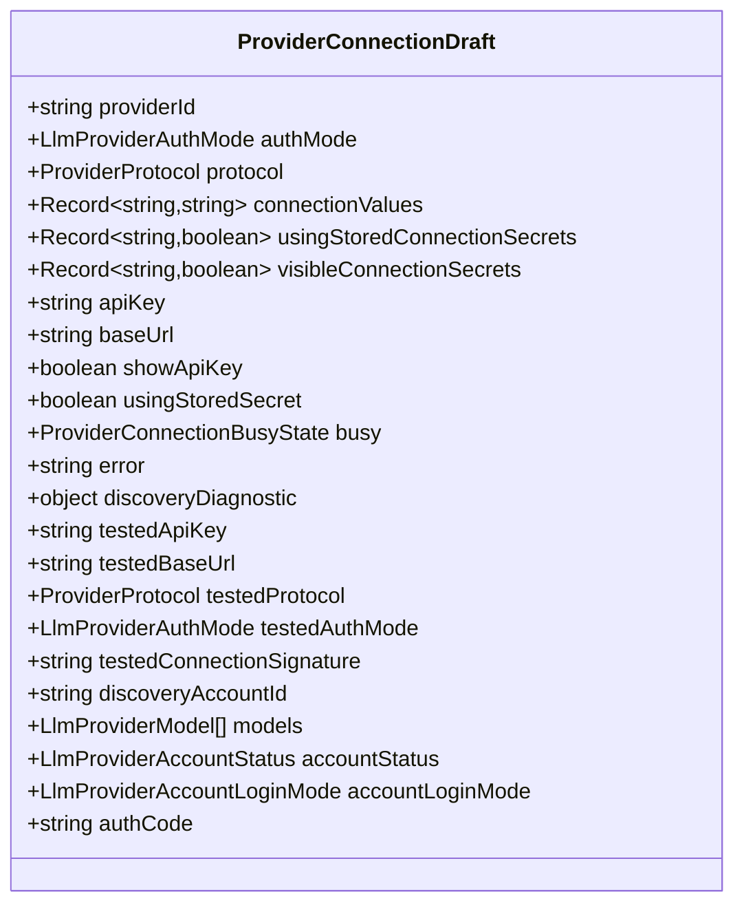

**图示来源**
- [types.ts:23-55](file://src/renderer/features/settings/SettingsModal/types.ts#L23-L55)

**章节来源**
- [types.ts:23-55](file://src/renderer/features/settings/SettingsModal/types.ts#L23-L55)

### 连接动作控制流

`useProviderConnectionActions` 将 UI 行为映射到渲染进程 API。它处理两类主要流程：

1. **账户模式**：通过 `startProviderAccountLogin` 或 `finishProviderAccountLogin` 走账户登录流程。
2. **api-key 或其他模式**：通过 `testProviderDraft` 和 `connectProvider` 提交连接草稿。

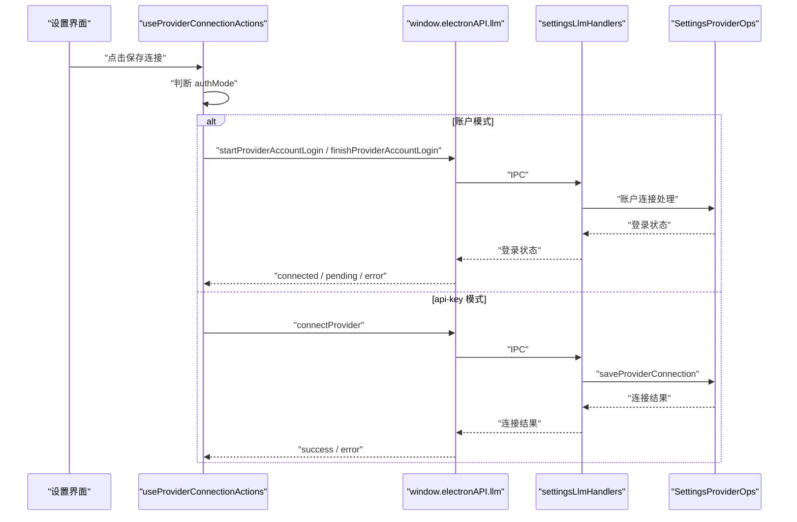

**图示来源**
- [useProviderConnectionActions.ts:1-198](file://src/renderer/features/settings/SettingsModal/useProviderConnectionActions.ts#L1-L198)
- [settingsLlmHandlers.ts:52-200](file://src/main/ipc/settingsLlmHandlers.ts#L52-L200)
- [SettingsProviderOps.ts:200-430](file://src/main/settings/SettingsProviderOps.ts#L200-L430)

**章节来源**
- [useProviderConnectionActions.ts:1-198](file://src/renderer/features/settings/SettingsModal/useProviderConnectionActions.ts#L1-L198)

## 依赖关系与跨进程边界

### 渲染进程到主进程的权限隔离

Renderer 进程不能直接调用 `SettingsAgentOps` 或 `SettingsProviderOps`。所有调用必须经过：

1. 渲染进程 API。
2. 通道能力表。
3. IPC 处理器。
4. 主进程领域服务。

通道能力表将每个 invoke channel 分类为：

| 类别 | 含义 | 示例 |
|---|---|---|
| `read` | 默认允许读取类操作 | `llm:refreshProviderModels`、`settings:getAgentDefinitionCommit` |
| `mutation` | 修改类操作 | `settings:set`、`settings:importAgentManifest` |
| `high-impact` | 高影响操作，需要额外权限 | `settings:saveAgentDefinition` |
| `desktop-only` | 桌面专属，Browser QA 永拒 | window chrome 相关能力 |

未知 channel 在运行时 fail-closed，即不被识别的通道不会被执行。

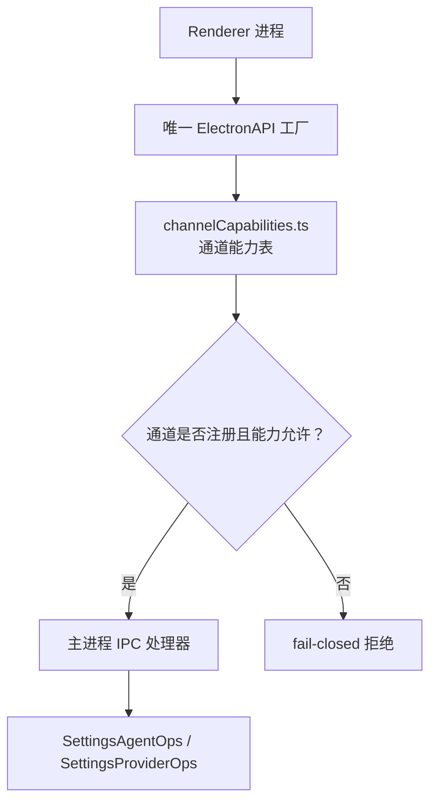

**图示来源**
- [channelCapabilities.ts:106-120](file://src/shared/renderer-api/channelCapabilities.ts#L106-L120)
- [settingsLlmHandlers.ts:52-395](file://src/main/ipc/settingsLlmHandlers.ts#L52-L395)

**章节来源**
- [channelCapabilities.ts:106-120](file://src/shared/renderer-api/channelCapabilities.ts#L106-L120)
- [settingsLlmHandlers.ts:52-395](file://src/main/ipc/settingsLlmHandlers.ts#L52-L395)

### 主进程内部依赖关系

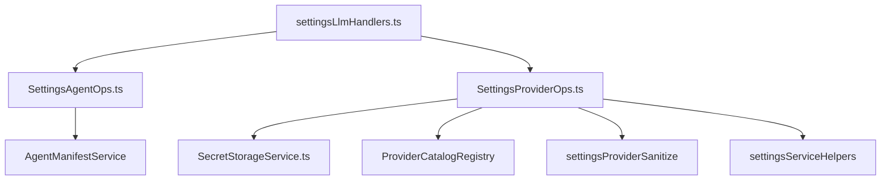

**图示来源**
- [settingsLlmHandlers.ts:52-395](file://src/main/ipc/settingsLlmHandlers.ts#L52-L395)
- [SettingsAgentOps.ts:15-191](file://src/main/settings/SettingsAgentOps.ts#L15-L191)
- [SettingsProviderOps.ts:37-546](file://src/main/settings/SettingsProviderOps.ts#L37-L546)

**章节来源**
- [settingsLlmHandlers.ts:52-395](file://src/main/ipc/settingsLlmHandlers.ts#L52-L395)

## fail-closed 安全策略

fail-closed 在本项目中体现为多个层面的默认拒绝：

| 层面 | 默认行为 | 实现位置 |
|---|---|---|
| 通道能力 | 未知 channel 拒绝 | [channelCapabilities.ts](file://src/shared/renderer-api/channelCapabilities.ts) |
| IPC 参数 | 非法 payload 拒绝 | [settingsLlmHandlers.ts](file://src/main/ipc/settingsLlmHandlers.ts) |
| safeStorage | 不可用时拒绝存储 | [SecretStorageService.ts](file://src/main/settings/SecretStorageService.ts) |
| 损坏密钥文件 | 隔离并报错，不静默继续 | [SecretStorageService.ts](file://src/main/settings/SecretStorageService.ts) |
| Agent profileId | 非安全 id 返回 null 或失败 | [SettingsAgentOps.ts](file://src/main/settings/SettingsAgentOps.ts) |
| Provider 身份 | 非内置 Provider 拒绝 | [SettingsProviderOps.ts](file://src/main/settings/SettingsProviderOps.ts) |
| 凭据完整性 | 连接字段不完整时报错 | [SettingsProviderOps.ts](file://src/main/settings/SettingsProviderOps.ts) |
| 并发写 | 旧版本请求返回 superseded | [SettingsAgentOps.ts](file://src/main/settings/SettingsAgentOps.ts)、[SettingsProviderOps.ts](file://src/main/settings/SettingsProviderOps.ts) |
| 策略文件 | 损坏或非法策略返回 POLICY_INVALID | [permissions.md](file://docs/contracts/permissions.md) |

### 显式授权机制

显式授权不是“允许一切”，而是“明确允许的集合”：

- 只有注册过的 IPC channel 才能被调用。
- 只有内置 Provider 才能被连接或断开。
- 只有满足 connectionSchema 的凭据才被视为已配置。
- 只有正整数且递增的 clientRevision 才会被接受。
- 只有符合 `isSafeAgentProfileId` 的 Agent ID 才能被读取或保存。
- Browser Bridge 中未知 channel、内部 channel 和未注册 handler 返回 403。

### 最小权限模型

最小权限体现在三个维度：

1. **进程级最小权限**  
   Renderer 不能直接访问 `safeStorage`、文件系统设置路径或主进程服务。

2. **通道级最小权限**  
   每个 IPC channel 有明确能力标签；高影响操作需要更高权限。

3. **数据级最小权限**  
   设置文件中不保留明文 `apiKey`；密钥以引用形式存储在加密文件；对外查询只返回存在性标志和掩码预览。

**章节来源**
- [permissions.md:1-132](file://docs/contracts/permissions.md#L1-L132)
- [SecretStorageService.ts:1-200](file://src/main/settings/SecretStorageService.ts#L1-L200)
- [SettingsAgentOps.ts:119-191](file://src/main/settings/SettingsAgentOps.ts#L119-L191)
- [SettingsProviderOps.ts:200-546](file://src/main/settings/SettingsProviderOps.ts#L200-L546)
- [settingsLlmHandlers.ts:52-395](file://src/main/ipc/settingsLlmHandlers.ts#L52-L395)

## 权限矩阵与最小权限模型

下表总结 Agent 安全边界中的关键操作、调用方、授权要求和风险等级：

| 操作 | 调用方 | 授权要求 | 风险等级 | 主要防护 |
|---|---|---|---|---|
| 保存 Agent 定义 | Renderer | `high-impact` 通道 | 高 | 参数校验、agentId 校验、并发锁、客户端版本冲突 |
| 读取 Agent 定义提交 | Renderer | `read` 通道 | 中 | agentId 白名单、只读快照 |
| 连接 Provider | Renderer | 对应 IPC 通道 | 高 | 内置 Provider 校验、schema 校验、凭据隔离 |
| 断开 Provider | Renderer | 对应 IPC 通道 | 中 | 内置 Provider 校验、密钥清理 |
| 刷新 Provider 模型 | Renderer | `read` 通道 | 中 | 参数校验、catalog 广播 |
| 写入安全密钥 | 主进程内部 | 无外部直接调用 | 极高 | safeStorage、文件权限、损坏隔离 |
| 读取密钥 | 主进程内部 | 通过受控 API | 高 | 不返回明文、只返回存在性标志 |
| 保存 Provider 定义 | Renderer | `high-impact` 通道 | 高 | 参数校验、并发锁、catalog 一致性 |

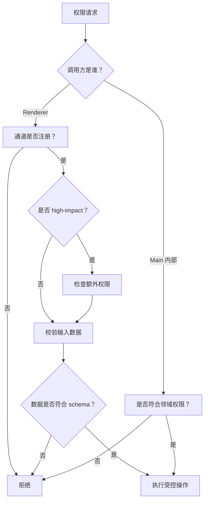

**图示来源**
- [channelCapabilities.ts:106-120](file://src/shared/renderer-api/channelCapabilities.ts#L106-L120)
- [settingsLlmHandlers.ts:52-395](file://src/main/ipc/settingsLlmHandlers.ts#L52-L395)
- [Permissions 文档](file://docs/contracts/permissions.md#L1-L132)

**章节来源**
- [channelCapabilities.ts:106-120](file://src/shared/renderer-api/channelCapabilities.ts#L106-L120)
- [settingsLlmHandlers.ts:52-395](file://src/main/ipc/settingsLlmHandlers.ts#L52-L395)

## 凭据访问与 ProviderConnectionDraft

### Agent 如何通过受控 API 访问凭据

Agent 不应该直接访问 `SecretStorageService` 或设置文件。正确路径是：

1. 渲染进程通过 `window.electronAPI.settings.hasProviderSecret` 检查是否存在凭据。
2. 主进程通过 `settingsService.hasProviderSecret` 返回布尔值。
3. 如果需要读取凭据，应由拥有主进程上下文的服务调用 `secretStorageService.getSecret`。
4. 凭据不得进入 Agent manifest、Route、RequestPlan、IPC 响应或 Trace。

这保证了：

- 凭据始终在主进程安全边界内。
- 渲染进程只能知道“是否有凭据”，而不能直接拿到明文。
- 凭据引用可以作为配置的一部分，但引用本身不是密钥。

### ProviderConnectionDraft 的验证、暂存和最终提交流程

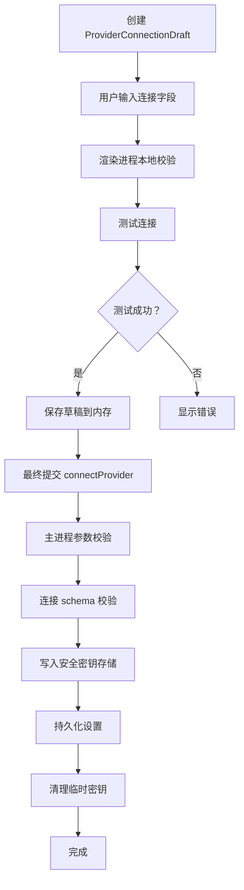

**图示来源**
- [types.ts:23-55](file://src/renderer/features/settings/SettingsModal/types.ts#L23-L55)
- [useProviderConnectionActions.ts:1-198](file://src/renderer/features/settings/SettingsModal/useProviderConnectionActions.ts#L1-L198)
- [settingsLlmHandlers.ts:52-200](file://src/main/ipc/settingsLlmHandlers.ts#L52-L200)
- [SettingsProviderOps.ts:200-430](file://src/main/settings/SettingsProviderOps.ts#L200-L430)

**章节来源**
- [types.ts:23-55](file://src/renderer/features/settings/SettingsModal/types.ts#L23-L55)
- [useProviderConnectionActions.ts:1-198](file://src/renderer/features/settings/SettingsModal/useProviderConnectionActions.ts#L1-L198)
- [settingsLlmHandlers.ts:52-200](file://src/main/ipc/settingsLlmHandlers.ts#L52-L200)
- [SettingsProviderOps.ts:200-430](file://src/main/settings/SettingsProviderOps.ts#L200-L430)

## 威胁模型分析

### 威胁主体

| 威胁主体 | 能力 | 攻击目标 |
|---|---|---|
| 恶意 Renderer 页面 | 可通过 preload 暴露的 API 调用注册通道 | 绕过权限、读取凭据、修改设置 |
| 恶意 IPC 调用方 | 构造非法 payload | 触发越界写入、注入凭据、破坏设置 |
| 本地其他进程 | 访问文件系统 | 读取明文密钥、篡改设置文件 |
| 受损运行环境 | safeStorage 不可用或密钥文件损坏 | 静默降级为明文存储 |
| 并发更新 | 多个 tab 或后台任务同时保存 | 覆盖用户配置、丢失提交 |
| 恶意 Agent 定义 | 利用 user-invocable Agent 扩权 | 绕过权限策略、执行危险工具 |

### 关键威胁与控制措施

| 威胁 | 控制措施 | 失效后果 |
|---|---|---|
| 未知通道调用 | 通道能力表 + fail-closed | 不应泄露能力，应返回错误或忽略 |
| 明文密钥泄露 | secretStorageService + safeStorage + 0600 | 不应降级为明文，应报错并隔离 |
| 凭据进入 Trace 或 IPC 响应 | 设计约束：凭据仅进入主进程 opaque lease | 不应出现在日志、Trace、RPC 返回值 |
| 并发覆盖 | clientRevision + 写锁 + 恢复机制 | 应返回 superseded 或失败，不应静默覆盖 |
| 非内置 Provider 滥用 | isBuiltinProviderId 校验 | 不应允许任意 providerId 写入 |
| 损坏密钥文件 | quarantine + 报错 | 不应继续信任旧索引 |
| Agent 定义越界 | isSafeAgentProfileId + 策略层 + 执行层 | 不应允许非法 agentId 执行 |

### 安全边界断言

1. **Renderer 不能直接访问安全密钥存储。**
2. **IPC 调用必须通过注册通道并经过参数校验。**
3. **凭据不得进入持久化设置、Agent manifest、Route 或 Trace。**
4. **unknown providerId、unknown channel、invalid schema、missing credentials 都应拒绝。**
5. **safeStorage 不可用时必须 fail-closed。**
6. **并发保存必须基于乐观版本和写锁，不能简单覆盖。**
7. **ProviderConnectionDraft 是内存中的用户输入载体，不是持久化凭据。**

**章节来源**
- [permissions.md:1-132](file://docs/contracts/permissions.md#L1-L132)
- [SecretStorageService.ts:1-200](file://src/main/settings/SecretStorageService.ts#L1-L200)
- [SettingsAgentOps.ts:119-191](file://src/main/settings/SettingsAgentOps.ts#L119-L191)
- [SettingsProviderOps.ts:200-546](file://src/main/settings/SettingsProviderOps.ts#L200-L546)

## 故障排查指南

### 常见问题与定位方式

| 现象 | 可能原因 | 排查方向 |
|---|---|---|
| 保存 Agent 定义返回 `failed` | agentId 不合法、clientRevision 无效、manifest 写入失败 | 检查 [SettingsAgentOps.ts](file://src/main/settings/SettingsAgentOps.ts#L129-L191) |
| 保存 Agent 定义返回 `superseded` | 客户端 revision 落后或并发冲突 | 检查渲染端 revision 管理 |
| Provider 连接失败提示凭据不完整 | connectionSchema 未满足 | 检查 [SettingsProviderOps.ts](file://src/main/settings/SettingsProviderOps.ts#L200-L430) |
| 账户模式无法通过 api-key 保存 | 账户模式必须走登录流程 | 检查 [SettingsProviderOps.ts](file://src/main/settings/SettingsProviderOps.ts#L200-L300) |
| 密钥文件损坏 | JSON 解析失败或权限问题 | 检查 [SecretStorageService.ts](file://src/main/settings/SecretStorageService.ts#L1-L200) |
| safeStorage 不可用 | 操作系统安全存储不可用 | 检查 [SecretStorageService.ts](file://src/main/settings/SecretStorageService.ts#L1-L80) |
| Renderer 无法调用某个设置 API | 通道未注册或能力不足 | 检查 [channelCapabilities.ts](file://src/shared/renderer-api/channelCapabilities.ts#L106-L120) |
| IPC 调用被拒绝 | 参数校验失败或通道非法 | 检查 [settingsLlmHandlers.ts](file://src/main/ipc/settingsLlmHandlers.ts#L52-L395) |

### 调试建议

1. **优先查看结构化错误结果**  
   例如 `failed`、`superseded`、`committed`，而不是只观察 UI 状态。

2. **不要假设 Provider 存在**  
   所有 Provider 操作都应先检查 `isBuiltinProviderId` 和当前设置中是否存在该 Provider。

3. **不要在 Renderer 中打印凭据**  
   即使是从 `window.electronAPI` 拿到的值，也可能包含敏感字段。

4. **关注密钥引用变化**  
   如果 `secretRef` 或 `secretRefs` 变化，说明凭据已重新存储，不应再依赖旧的明文值。

5. **并发保存失败时不要重试相同 revision**  
   应先拉取最新提交快照，再提交新的 `clientRevision`。

**章节来源**
- [SettingsAgentOps.ts:119-191](file://src/main/settings/SettingsAgentOps.ts#L119-L191)
- [SettingsProviderOps.ts:200-546](file://src/main/settings/SettingsProviderOps.ts#L200-L546)
- [SecretStorageService.ts:1-200](file://src/main/settings/SecretStorageService.ts#L1-L200)
- [settingsLlmHandlers.ts:52-395](file://src/main/ipc/settingsLlmHandlers.ts#L52-L395)
- [channelCapabilities.ts:106-120](file://src/shared/renderer-api/channelCapabilities.ts#L106-L120)

## 结论

RDC-Agent 的 Agent 安全边界由多层防御组成：

- `SettingsAgentOps` 保护 Agent 定义免受并发覆盖、非法 ID 和无效版本影响。
- `SettingsProviderOps` 保护 Provider 凭据免受明文持久化、非内置 Provider 和凭据不完整的影响。
- `SecretStorageService` 是凭据落盘的最后防线，保证 safeStorage 不可用时 fail-closed，并在文件损坏时隔离而非信任。
- `ProviderConnectionDraft` 将用户输入限定在渲染进程内存中，最终通过受控 IPC 和主进程领域服务提交。
- Renderer 与 Main 之间的权限隔离通过通道能力表、参数校验和领域服务共同实现。
- fail-closed 策略贯穿通道、参数、凭据、文件和并发控制，默认拒绝未知、非法、不完整和不可信输入。

对于开发者而言，最重要的实践原则是：

1. 永远不要把明文密钥放入渲染进程设置、Agent manifest、IPC 响应或日志。
2. 永远不要假设外部输入合法；先校验，再执行业务逻辑。
3. 永远不要让 Renderer 直接访问安全密钥存储。
4. 永远不要静默降级安全机制；safeStorage 不可用就是失败，不是继续运行。
5. 始终使用 `SettingsAgentOps` 和 `SettingsProviderOps` 提供的受控接口，而不是绕过安全边界。