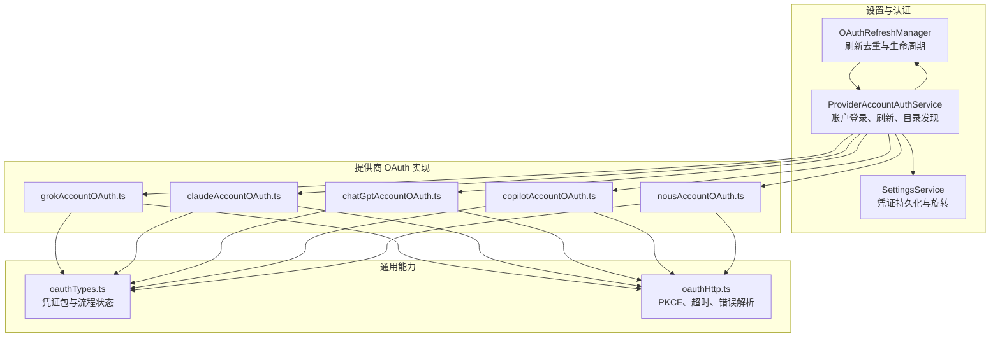
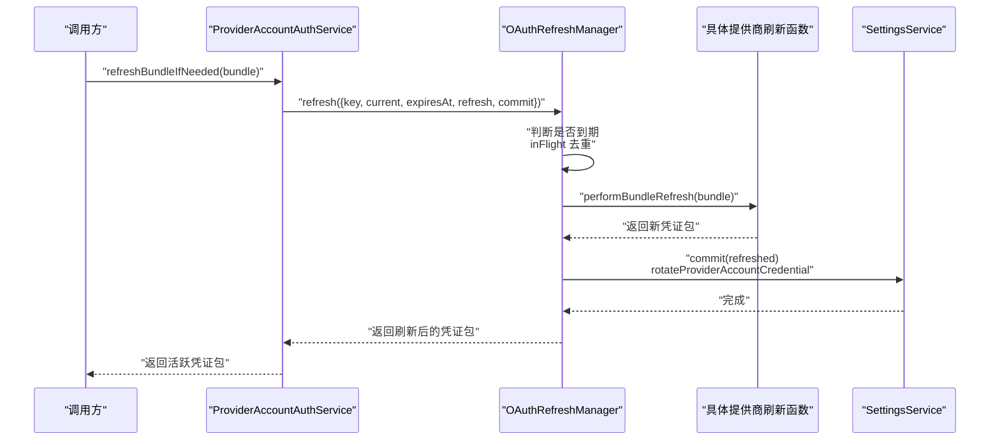
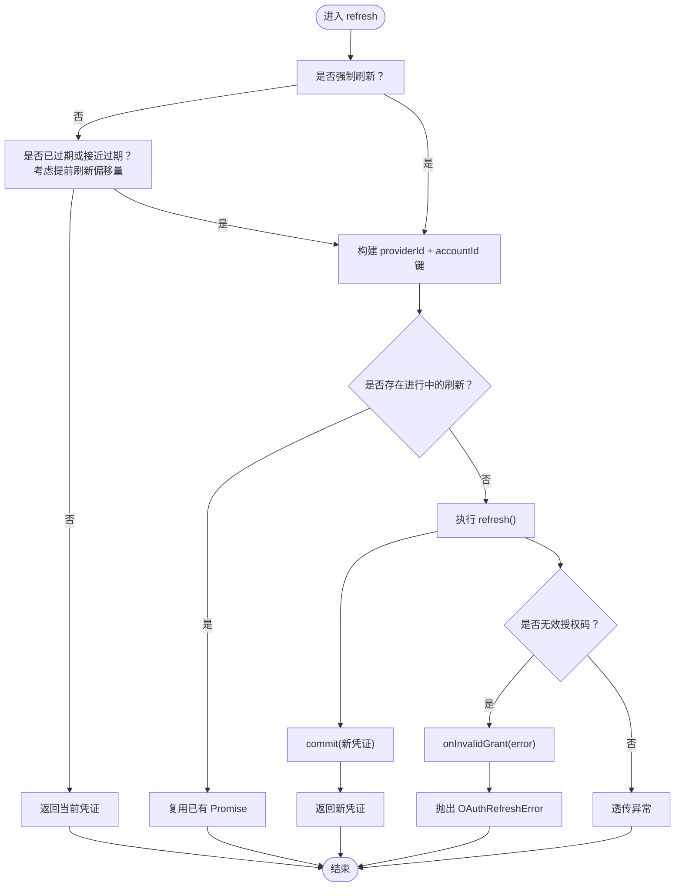
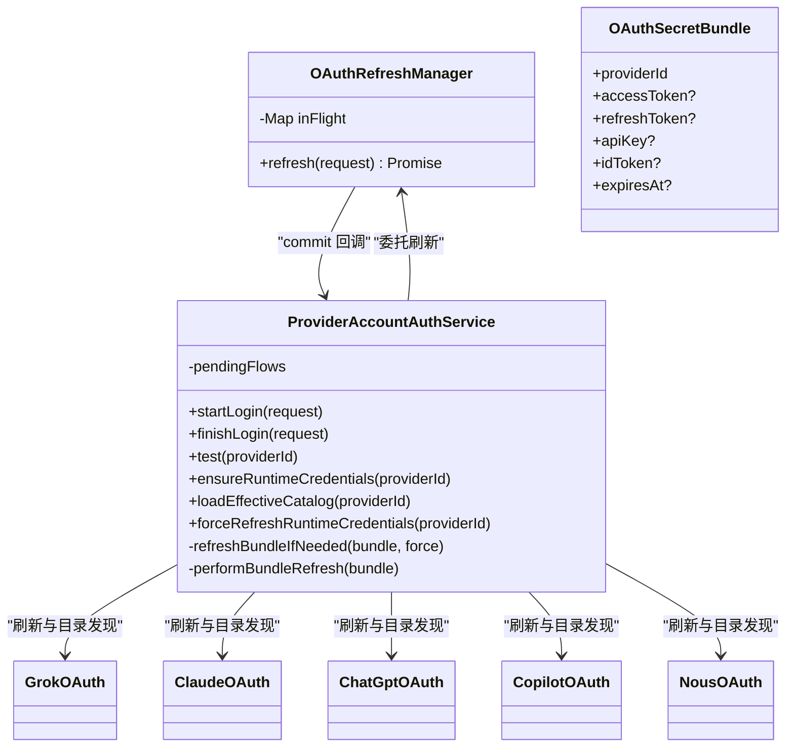
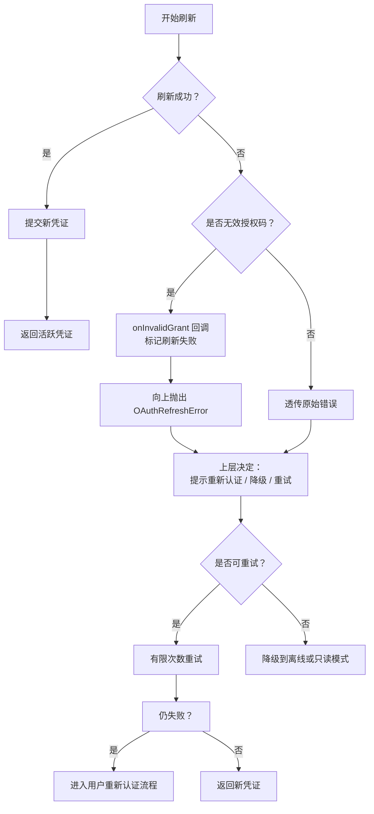

# OAuth 刷新机制

<cite>
**本文引用的文件**   
- [OAuthRefreshManager.ts](file://src/main/settings/OAuthRefreshManager.ts)
- [ProviderAccountAuthService.ts](file://src/main/settings/ProviderAccountAuthService.ts)
- [oauthTypes.ts](file://src/main/settings/oauth/oauthTypes.ts)
- [oauthHttp.ts](file://src/main/settings/oauth/oauthHttp.ts)
- [grokAccountOAuth.ts](file://src/main/settings/oauth/grokAccountOAuth.ts)
- [claudeAccountOAuth.ts](file://src/main/settings/oauth/claudeAccountOAuth.ts)
- [chatGptAccountOAuth.ts](file://src/main/settings/oauth/chatGptAccountOAuth.ts)
- [copilotAccountOAuth.ts](file://src/main/settings/oauth/copilotAccountOAuth.ts)
- [nousAccountOAuth.ts](file://src/main/settings/oauth/nousAccountOAuth.ts)
</cite>

## 目录
1. [引言](#引言)
2. [项目结构](#项目结构)
3. [核心组件](#核心组件)
4. [架构总览](#架构总览)
5. [详细组件分析](#详细组件分析)
6. [依赖关系分析](#依赖关系分析)
7. [性能与并发特性](#性能与并发特性)
8. [错误处理与恢复](#错误处理与恢复)
9. [配置与扩展指南](#配置与扩展指南)
10. [故障排查](#故障排查)
11. [结论](#结论)

## 引言
本文件围绕 OAuth 刷新机制展开，重点解释 `OAuthRefreshManager` 的设计、刷新策略、并发保护、重试与错误恢复流程，并说明其在不同 OAuth 提供商（Claude、ChatGPT、GitHub Copilot、Grok、Nous、OpenRouter）中的使用方式。文档还包含：
- 刷新触发条件、过期时间计算和提前刷新偏移量；
- 401 Unauthorized 或无效授权码场景的处理路径；
- refresh token 的存储、轮换和安全更新；
- 自动刷新、用户重新认证与降级策略；
- 时序图、流程图和决策树；
- 可扩展的自定义刷新逻辑示例。

## 项目结构
OAuth 刷新能力由主进程设置模块提供，主要涉及以下文件：
- 刷新管理器：负责去重、过期判断、刷新执行与失效回调；
- 账户认证服务：负责登录流程、证书包刷新、目录发现与持久化；
- 各提供商 OAuth 实现：封装登录、交换授权码、刷新、撤销与模型目录发现；
- 通用工具类型与 HTTP 辅助：定义凭证包结构、PKCE、请求超时与错误解析。

**图表来源**
- [OAuthRefreshManager.ts:49-85](file://src/main/settings/OAuthRefreshManager.ts#L49-L85)
- [ProviderAccountAuthService.ts:201-534](file://src/main/settings/ProviderAccountAuthService.ts#L201-L534)
- [oauthTypes.ts:1-82](file://src/main/settings/oauth/oauthTypes.ts#L1-L82)
- [oauthHttp.ts:1-127](file://src/main/settings/oauth/oauthHttp.ts#L1-L127)

**章节来源**
- [OAuthRefreshManager.ts:1-85](file://src/main/settings/OAuthRefreshManager.ts#L1-L85)
- [ProviderAccountAuthService.ts:1-534](file://src/main/settings/ProviderAccountAuthService.ts#L1-L534)
- [oauthTypes.ts:1-82](file://src/main/settings/oauth/oauthTypes.ts#L1-L82)
- [oauthHttp.ts:1-127](file://src/main/settings/oauth/oauthHttp.ts#L1-L127)

## 核心组件
### OAuthRefreshManager
该组件是刷新机制的核心，承担以下职责：
- 根据当前时间、过期时间和提前刷新偏移量决定是否刷新；
- 对同一 providerId 与 accountId 组合进行并发刷新保护；
- 捕获“无效授权码”错误，触发外部回调以标记失败；
- 在刷新成功后调用 commit 持久化新凭证。

关键设计点：
- 默认提前刷新偏移量为 60 秒，避免刚好到期时发起请求；
- 通过 Map 维护正在进行的刷新 Promise，后续相同 key 的请求直接复用；
- 无论成功或失败，finally 中都会清理 inFlight 条目；
- 支持强制刷新 force 参数绕过过期检查。

**章节来源**
- [OAuthRefreshManager.ts:1-85](file://src/main/settings/OAuthRefreshManager.ts#L1-L85)

### ProviderAccountAuthService
该服务协调账户登录、刷新与模型目录发现，并与 `OAuthRefreshManager` 协作：
- 启动各类提供商的登录流程；
- 将刷新委托给 `oauthRefreshManager.refresh`；
- 刷新成功后调用设置服务旋转凭证并保存新的过期时间与可用性标志；
- 刷新失败时记录刷新失败信息；
- 对外暴露测试连接、确保运行时凭据、加载有效目录等接口。

**章节来源**
- [ProviderAccountAuthService.ts:1-534](file://src/main/settings/ProviderAccountAuthService.ts#L1-L534)

### OAuth 类型与 HTTP 工具
- `OAuthSecretBundle`：统一表示访问令牌、刷新令牌、API Key、ID Token、过期时间、账户标签等；
- `OAuthFlowState`：表示登录流程的状态，包括设备码、验证 URI、回调服务器等；
- `oauthHttp`：提供 PKCE、URL 拼接、JSON 请求、JWT 载荷解析、错误消息提取等能力。

**章节来源**
- [oauthTypes.ts:1-82](file://src/main/settings/oauth/oauthTypes.ts#L1-L82)
- [oauthHttp.ts:1-127](file://src/main/settings/oauth/oauthHttp.ts#L1-L127)

## 架构总览
下面的序列图展示了一次典型刷新调用从业务层到提供商端点的过程：

**图表来源**
- [ProviderAccountAuthService.ts:430-498](file://src/main/settings/ProviderAccountAuthService.ts#L430-L498)
- [OAuthRefreshManager.ts:49-85](file://src/main/settings/OAuthRefreshManager.ts#L49-L85)

## 详细组件分析

### 刷新策略与过期判断
刷新管理器根据以下规则决定是否刷新：
- 若未强制刷新且 `expiresAt` 未到（考虑提前刷新偏移量），直接返回当前凭证；
- 否则构造 providerId 与 accountId 的复合键，检查是否有正在进行中的刷新；
- 若无进行中任务，则执行刷新并缓存 Promise；
- 刷新成功后调用 commit 持久化；
- 刷新失败时检测是否为“无效授权码”，若是则调用 onInvalidGrant 回调并抛出结构化错误。

**图表来源**
- [OAuthRefreshManager.ts:49-85](file://src/main/settings/OAuthRefreshManager.ts#L49-L85)

**章节来源**
- [OAuthRefreshManager.ts:1-85](file://src/main/settings/OAuthRefreshManager.ts#L1-L85)

### 并发刷新保护
- 使用 `Map<string, Promise<unknown>>` 维护正在执行的刷新操作；
- 键为 `providerId + null 分隔符 + accountId`；
- 同一键的重复请求会等待同一个 Promise，避免多个线程同时刷新；
- finally 块保证无论成功或失败都删除键，释放并发槽位。

风险与限制：
- 仅按 providerId 与 accountId 维度去重，不同账户不会互相阻塞；
- 如果刷新长时间卡住，其他请求也会等待；建议结合网络超时与业务超时；
- 对于需要严格幂等的刷新逻辑，应确保刷新函数本身可安全重试。

**章节来源**
- [OAuthRefreshManager.ts:49-85](file://src/main/settings/OAuthRefreshManager.ts#L49-L85)

### 401 Unauthorized 与无效授权码处理
代码中对“无效授权码”的判断采用宽松匹配：
- 显式识别 `invalid_grant` 或 `INVALID_GRANT`；
- 也兼容消息中包含 “invalid grant”、“invalid-grant”、“invalid_grant” 等变体；
- 当检测到无效授权码时，抛出 `OAuthRefreshError`，并在外部通过 `onInvalidGrant` 回调记录失败；
- `ProviderAccountAuthService` 在回调中调用设置服务标记刷新失败，便于上层 UI 提示用户重新认证。

注意：
- 该实现并不直接拦截 HTTP 401 状态码；HTTP 层会将非 2xx 响应转换为错误对象；
- 是否需要把 401 视为必须刷新，取决于提供商返回的错误结构与业务策略；
- 对于不支持刷新令牌的提供商，刷新可能直接返回原凭证或抛错，由调用方决定降级。

**章节来源**
- [OAuthRefreshManager.ts:17-47](file://src/main/settings/OAuthRefreshManager.ts#L17-L47)
- [ProviderAccountAuthService.ts:430-498](file://src/main/settings/ProviderAccountAuthService.ts#L430-L498)

### Refresh Token 存储、轮换与安全更新
凭证包通过 `OAuthSecretBundle` 表达，字段包括：
- accessToken、refreshToken、apiKey、idToken；
- copilotToken、copilotApiBaseUrl、copilotModelBilling；
- expiresAt、accountLabel、planLabel、resourceUrl、requestedScopes、redirectUri、authorizationMode 等。

刷新成功后，`ProviderAccountAuthService` 调用设置服务的旋转方法，写入：
- 新的凭证 JSON；
- accountLabel、planLabel、oauthExpiresAt、oauthRefreshAvailable。

安全性要点：
- refresh token 不应被随意打印或上报；
- 刷新失败应记录诊断信息但不泄露敏感内容；
- 撤销流程应优先尝试远程撤销，即使失败也应允许本地登出继续完成；
- 对于不支持刷新令牌的提供商，应谨慎处理降级与用户提示。

**章节来源**
- [oauthTypes.ts:34-62](file://src/main/settings/oauth/oauthTypes.ts#L34-L62)
- [ProviderAccountAuthService.ts:378-428](file://src/main/settings/ProviderAccountAuthService.ts#L378-L428)
- [ProviderAccountAuthService.ts:430-498](file://src/main/settings/ProviderAccountAuthService.ts#L430-L498)

### 不同 OAuth 提供商的特殊处理

#### Claude Account
- 使用 PKCE 与平台 OAuth 端点；
- 刷新时调用平台 token 端点，获取新的 access_token、可选 refresh_token 与 expires_in；
- 模型目录通过 Anthropic API 获取，需携带 API Key 与版本头。

**章节来源**
- [claudeAccountOAuth.ts:1-100](file://src/main/settings/oauth/claudeAccountOAuth.ts#L1-L100)

#### ChatGPT Account
- 使用 OpenAI 授权端点，本地回调服务器接收 code；
- 刷新时使用 `offline_access` 相关流程，返回 id_token 并解析账户 ID；
- 模型目录通过 ChatGPT Codex 模型端点拉取，可能需要传入账户 ID。

**章节来源**
- [chatGptAccountOAuth.ts:1-146](file://src/main/settings/oauth/chatGptAccountOAuth.ts#L1-L146)

#### GitHub Copilot
- 使用设备授权流程，轮询 device_code；
- 刷新不依赖 refresh token，而是用 access_token 再次获取 Copilot 内部 token；
- 模型目录通过 Copilot 内部 models 端点拉取，并进行模型过滤与计费信息保留。

**章节来源**
- [copilotAccountOAuth.ts:1-117](file://src/main/settings/oauth/copilotAccountOAuth.ts#L1-L117)

#### Grok
- 使用浏览器登录、PKCE、token exchange、userinfo 与 JWKS 校验；
- 刷新失败会包装为诊断错误，便于前端展示；
- 撤销支持 refresh_token 或 access_token 回退；
- 模型目录通过 Grok Builder API 获取，并应用 surface routes 的头信息。

**章节来源**
- [grokAccountOAuth.ts:1-194](file://src/main/settings/oauth/grokAccountOAuth.ts#L1-L194)

#### Nous Portal
- 使用设备码授权，轮询 token 端点；
- 刷新通过自定义头 `x-nous-refresh-token` 发送；
- 模型目录从推断基础 URL 拉取，并进行去重与白名单过滤。

**章节来源**
- [nousAccountOAuth.ts:1-134](file://src/main/settings/oauth/nousAccountOAuth.ts#L1-L134)

#### OpenRouter
- 支持账号模式登录与回调服务器；
- 刷新逻辑由 `ProviderAccountAuthService.performBundleRefresh` 路由，但当前仓库片段未显示 OpenRouter 刷新函数；
- 目录发现通过 OpenRouter 专用实现。

**章节来源**
- [ProviderAccountAuthService.ts:201-534](file://src/main/settings/ProviderAccountAuthService.ts#L201-L534)

## 依赖关系分析

**图表来源**
- [OAuthRefreshManager.ts:49-85](file://src/main/settings/OAuthRefreshManager.ts#L49-L85)
- [ProviderAccountAuthService.ts:201-534](file://src/main/settings/ProviderAccountAuthService.ts#L201-L534)
- [grokAccountOAuth.ts:1-194](file://src/main/settings/oauth/grokAccountOAuth.ts#L1-L194)
- [claudeAccountOAuth.ts:1-100](file://src/main/settings/oauth/claudeAccountOAuth.ts#L1-L100)
- [chatGptAccountOAuth.ts:1-146](file://src/main/settings/oauth/chatGptAccountOAuth.ts#L1-L146)
- [copilotAccountOAuth.ts:1-117](file://src/main/settings/oauth/copilotAccountOAuth.ts#L1-L117)
- [nousAccountOAuth.ts:1-134](file://src/main/settings/oauth/nousAccountOAuth.ts#L1-L134)

**章节来源**
- [OAuthRefreshManager.ts:1-85](file://src/main/settings/OAuthRefreshManager.ts#L1-L85)
- [ProviderAccountAuthService.ts:1-534](file://src/main/settings/ProviderAccountAuthService.ts#L1-L534)

## 性能与并发特性
- 并发去重：同一 providerId 与 accountId 的刷新请求共享 Promise，减少网络与 I/O 压力；
- 提前刷新偏移：默认 60 秒，降低到期边缘抖动导致的频繁刷新；
- 强制刷新：用于测试、手动刷新或某些提供商特殊场景；
- 网络超时：HTTP 工具统一使用 `REQUEST_TIMEOUT_MS`，避免长尾请求占用资源；
- 设备授权轮询：GitHub Copilot 与 Nous 使用指数或固定间隔轮询，应避免过短间隔导致限流；
- 目录发现缓存：服务层会根据 lastModelRefreshAt 判断目录缓存是否新鲜，减少不必要的目录拉取。

优化建议：
- 对高频调用的刷新接口增加短期内存缓存，配合 expiresAt 控制；
- 对提供商限流错误实现退避重试；
- 对刷新失败做分级告警，区分暂时性错误与永久失效；
- 对大型目录发现结果做增量更新与变更检测。

[本节为通用性能讨论，不直接分析具体代码行]

## 错误处理与恢复

### 刷新失败决策树

**图表来源**
- [OAuthRefreshManager.ts:17-47](file://src/main/settings/OAuthRefreshManager.ts#L17-L47)
- [ProviderAccountAuthService.ts:430-498](file://src/main/settings/ProviderAccountAuthService.ts#L430-L498)

### 401 Unauthorized 处理策略
- 若提供商返回明确“无效授权码”，刷新管理器会抛出结构化错误，供上层引导用户重新登录；
- 若只是普通网络错误或非授权错误，刷新管理器会透传异常，由调用方决定重试或降级；
- 对不支持 refresh token 的提供商，刷新函数可能返回原凭证或直接失败，调用方应据此选择重新认证；
- 对于 Grok，刷新失败会被包装为诊断错误，便于展示更友好的错误信息。

**章节来源**
- [OAuthRefreshManager.ts:17-47](file://src/main/settings/OAuthRefreshManager.ts#L17-L47)
- [grokAccountOAuth.ts:127-158](file://src/main/settings/oauth/grokAccountOAuth.ts#L127-L158)

## 配置与扩展指南

### 如何设置 OAuth 提供商
- 通过 `ProviderAccountAuthService.startLogin` 启动对应提供商的登录流程；
- 登录完成后，服务会持久化凭证包并发现模型目录；
- 可通过 `test`、`ensureRuntimeCredentials`、`loadEffectiveCatalog` 验证连接与刷新能力；
- 对 Grok，还支持浏览器登录与回调；对 ChatGPT，使用本地回调服务器。

**章节来源**
- [ProviderAccountAuthService.ts:201-534](file://src/main/settings/ProviderAccountAuthService.ts#L201-L534)

### 如何处理刷新失败
- 刷新失败后，服务会调用 `markProviderAccountRefreshFailure`；
- 上层可根据该状态提示用户重新认证；
- 对于 Grok，可使用诊断信息渲染更详细的错误原因；
- 对于不支持刷新的提供商，应引导用户重新走登录流程。

**章节来源**
- [ProviderAccountAuthService.ts:430-498](file://src/main/settings/ProviderAccountAuthService.ts#L430-L498)

### 如何实现自定义刷新逻辑
可在 `performBundleRefresh` 中添加新分支，调用自定义刷新函数；同时在 `canRefreshBundle` 中声明是否支持刷新。

参考步骤：
1. 新增提供商刷新函数，遵循 `refreshXxxBundle(bundle)` 签名；
2. 在 `performBundleRefresh` 中增加 providerId 分支；
3. 在 `canRefreshBundle` 中声明该提供商是否支持刷新；
4. 在 `discoverXxxCatalog` 中实现模型目录发现；
5. 如需自定义错误诊断，包装为诊断错误类并注入诊断上下文。

**章节来源**
- [ProviderAccountAuthService.ts:430-498](file://src/main/settings/ProviderAccountAuthService.ts#L430-L498)

### 配置示例
以下为概念性配置说明，不展示具体代码内容：
- 提供商清单：列出支持的 providerId、授权模式、回调地址、scope；
- 刷新策略：定义是否支持刷新、刷新超时、最大重试次数；
- 错误处理：定义无效授权码时的用户提示、日志级别、诊断信息收集；
- 自定义刷新：提供刷新函数入口、失败回调、成功提交钩子。

[本节为概念性配置说明，不直接分析具体代码行]

## 故障排查
常见问题与建议：
- 刷新始终失败：检查 refresh token 是否存在、是否被撤销、是否过期；查看 `onInvalidGrant` 回调是否被调用；
- 401 但未刷新：确认提供商返回的错误是否被识别为“无效授权码”，或是否需要额外处理；
- 并发刷新过多：检查是否在多处同时调用刷新，利用 `OAuthRefreshManager` 的去重能力；
- 目录发现为空：检查模型端点是否返回可用模型，或是否因权限不足被拒绝；
- Grok 登录失败：查看诊断信息，确认 scope、redirectUri、JWKS 与 token endpoint 是否正确；
- ChatGPT 回调失败：检查本地回调端口是否被占用、state 是否一致、是否启用回调服务器。

**章节来源**
- [oauthHttp.ts:1-127](file://src/main/settings/oauth/oauthHttp.ts#L1-L127)
- [grokAccountOAuth.ts:1-194](file://src/main/settings/oauth/grokAccountOAuth.ts#L1-L194)
- [chatGptAccountOAuth.ts:1-146](file://src/main/settings/oauth/chatGptAccountOAuth.ts#L1-L146)
- [ProviderAccountAuthService.ts:201-534](file://src/main/settings/ProviderAccountAuthService.ts#L201-L534)

## 结论
`OAuthRefreshManager` 提供了简洁可靠的刷新抽象，配合 `ProviderAccountAuthService` 实现了多提供商的统一刷新、持久化与目录发现。其并发保护、提前刷新偏移、无效授权码识别与错误回调机制，使得系统在面对 401 或 token 失效时具备较强的自愈能力。对于不同提供商，系统在登录、刷新、撤销与目录发现层面做了差异化适配，并通过统一的凭证包类型与 HTTP 工具降低集成成本。实际使用中，应重点关注 refresh token 的安全管理、刷新失败的诊断与用户引导，以及在高并发场景下的去重与超时控制。