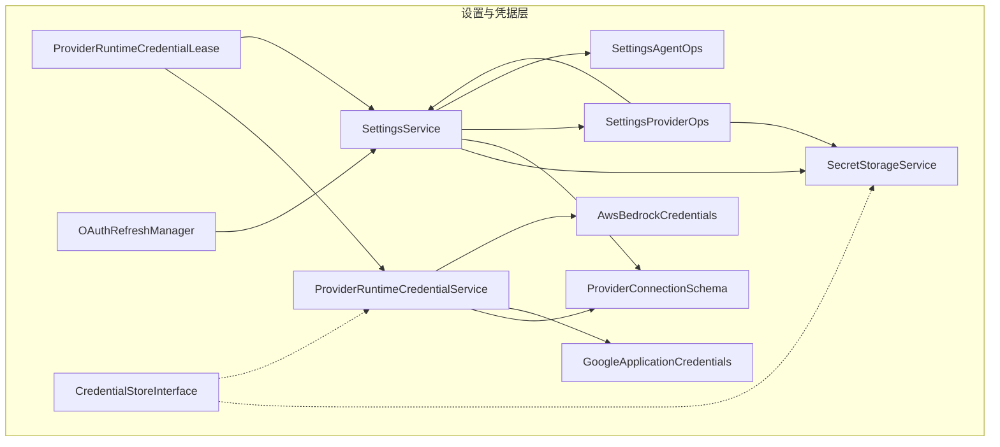
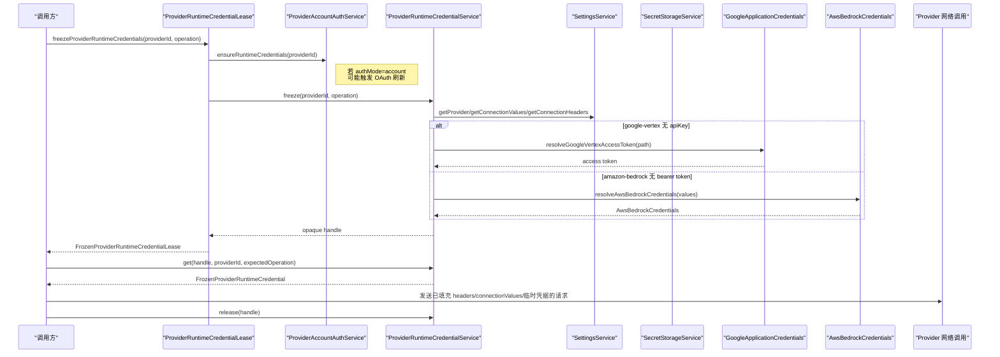
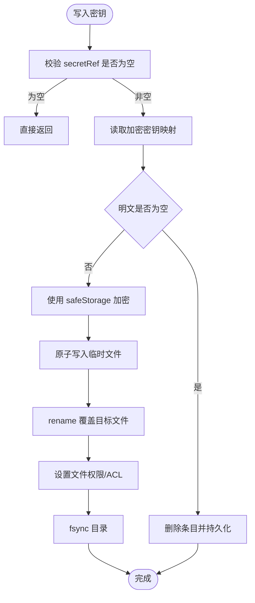
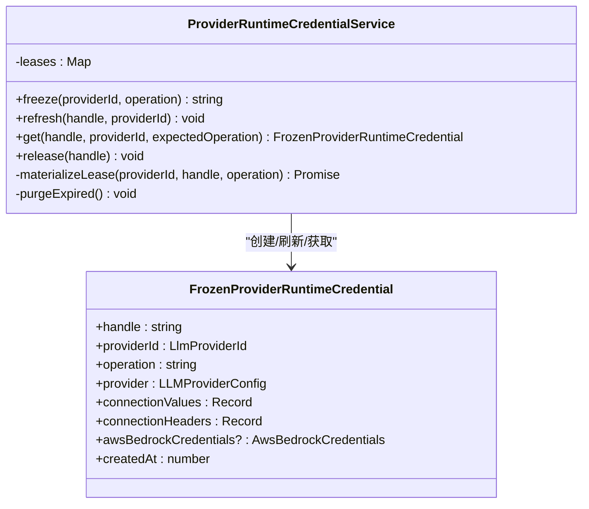
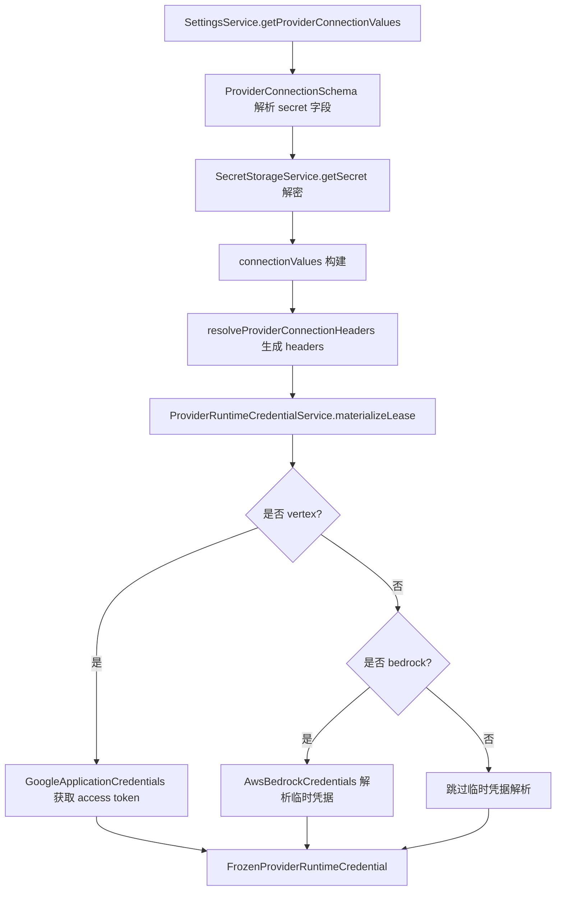
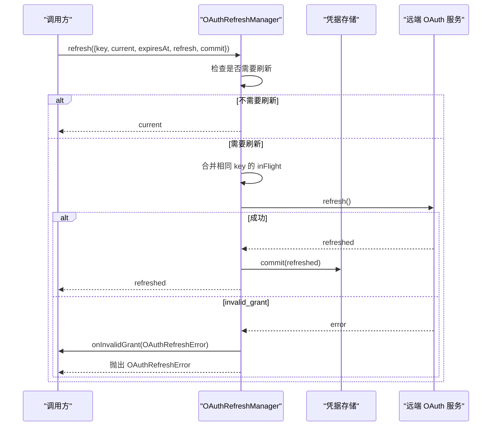
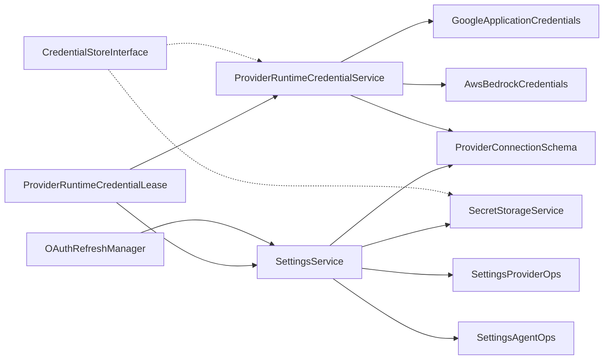
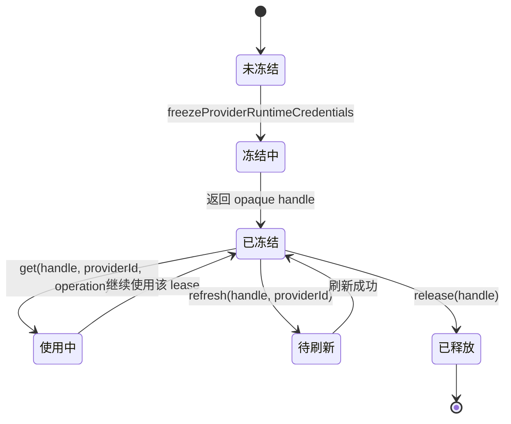
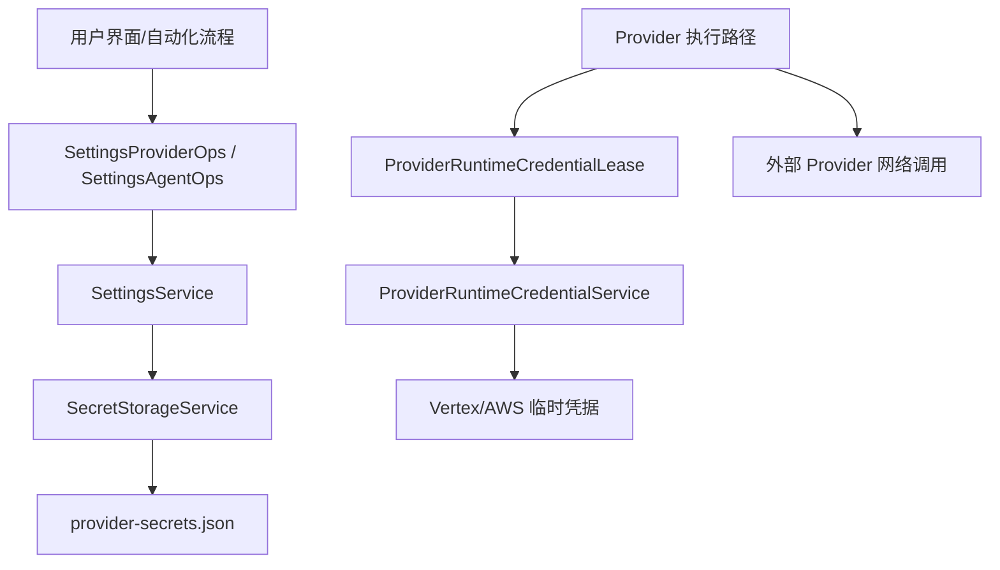

# 凭据与安全模型

<cite>
**本文引用的文件**   
- [SecretStorageService.ts](file://src/main/settings/SecretStorageService.ts)
- [SettingsService.ts](file://src/main/settings/SettingsService.ts)
- [ProviderRuntimeCredentialService.ts](file://src/main/settings/ProviderRuntimeCredentialService.ts)
- [ProviderRuntimeCredentialLease.ts](file://src/main/settings/ProviderRuntimeCredentialLease.ts)
- [CredentialStoreInterface.ts](file://src/main/settings/CredentialStoreInterface.ts)
- [OAuthRefreshManager.ts](file://src/main/settings/OAuthRefreshManager.ts)
- [SettingsAgentOps.ts](file://src/main/settings/SettingsAgentOps.ts)
- [SettingsProviderOps.ts](file://src/main/settings/SettingsProviderOps.ts)
- [ProviderConnectionSchema.ts](file://src/main/settings/ProviderConnectionSchema.ts)
- [GoogleApplicationCredentials.ts](file://src/main/settings/GoogleApplicationCredentials.ts)
- [AwsBedrockCredentials.ts](file://src/main/settings/AwsBedrockCredentials.ts)
</cite>

## 目录
1. [引言](#引言)
2. [项目结构](#项目结构)
3. [核心组件](#核心组件)
4. [架构总览](#架构总览)
5. [详细组件分析](#详细组件分析)
6. [依赖关系分析](#依赖关系分析)
7. [性能与可靠性](#性能与可靠性)
8. [故障排查指南](#故障排查指南)
9. [结论](#结论)
10. [附录：生命周期图、安全边界图与常见问题](#附录生命周期图安全边界图与常见问题)

## 引言
本文聚焦 RDC Agent 主进程中的凭据与安全模型，目标是解释以下问题：
- fail-closed 安全策略如何在凭据管理中被实现。
- SecretStorageService 为什么是主进程专属的凭据存储边界。
- SettingsService 如何通过该服务解析 provider 凭据。
- ProviderRuntimeCredentialService 与 ProviderRuntimeCredentialLease 如何创建、使用、刷新、过期和销毁 opaque lease。
- typed connection secret、认证 header、Vertex/AWS 临时凭据如何在 lease 内流转。
- 为什么 Adapter 没有 lease handle 时必须 fail-closed。
- OAuth 刷新机制中 OAuthRefreshManager 如何处理 token 刷新、401 语义和并发保护。
- CredentialStoreInterface 的设计意图。
- SettingsAgentOps 与 SettingsProviderOps 如何为 Agent 操作提供安全的凭据访问。

## 项目结构
凭据相关代码集中在 `src/main/settings` 下，属于主进程配置与运行时凭据层；Google 与 AWS 凭据解析逻辑位于同目录下独立模块；共享类型来自 `@shared/types`，不在本仓库源码树内展开。

**图表来源**
- [SettingsService.ts:1-120](file://src/main/settings/SettingsService.ts#L1-L120)
- [SecretStorageService.ts:1-60](file://src/main/settings/SecretStorageService.ts#L1-L60)
- [ProviderRuntimeCredentialService.ts:1-40](file://src/main/settings/ProviderRuntimeCredentialService.ts#L1-L40)
- [ProviderRuntimeCredentialLease.ts:1-42](file://src/main/settings/ProviderRuntimeCredentialLease.ts#L1-L42)
- [ProviderConnectionSchema.ts:1-85](file://src/main/settings/ProviderConnectionSchema.ts#L1-L85)
- [GoogleApplicationCredentials.ts:1-40](file://src/main/settings/GoogleApplicationCredentials.ts#L1-L40)
- [AwsBedrockCredentials.ts:1-40](file://src/main/settings/AwsBedrockCredentials.ts#L1-L40)
- [OAuthRefreshManager.ts:1-30](file://src/main/settings/OAuthRefreshManager.ts#L1-L30)
- [CredentialStoreInterface.ts:1-57](file://src/main/settings/CredentialStoreInterface.ts#L1-L57)

**章节来源**
- [SettingsService.ts:1-120](file://src/main/settings/SettingsService.ts#L1-L120)
- [SecretStorageService.ts:1-60](file://src/main/settings/SecretStorageService.ts#L1-L60)
- [ProviderRuntimeCredentialService.ts:1-40](file://src/main/settings/ProviderRuntimeCredentialService.ts#L1-L40)

## 核心组件
本节概述各组件的职责与安全边界：

| 组件 | 职责 | 安全要点 |
|---|---|---|
| SecretStorageService | 基于 Electron safeStorage 加密存储 provider 密钥与 OAuth 数据；维护 `provider-secrets.json` | 仅主进程可用；不可用或损坏时拒绝写入并 quarantine |
| SettingsService | 持久化应用设置；读取 provider 配置；按 schema 解析 connection values 与 OAuth 凭据引用 | 暴露只读凭据解析接口；不直接泄露明文给调用方 |
| ProviderRuntimeCredentialService | 将 provider 配置、connection values、headers 与临时凭据冻结为带 handle 的 lease | 内存 Map；有最大租期；校验 providerId 与 operation |
| ProviderRuntimeCredentialLease | 在真实 provider 执行前冻结凭据，必要时先刷新账户凭据 | 返回 opaque handle；必须由调用方释放 |
| OAuthRefreshManager | 统一处理 OAuth refresh 前置条件、失效 grant 错误与并发刷新 | 同一 key 合并请求；支持 skew 提前刷新 |
| SettingsProviderOps / SettingsAgentOps | 对 provider 定义与 agent 定义的读写加锁、冲突检测、审计快照 | 避免并发写覆盖；对外暴露最小必要能力 |
| ProviderConnectionSchema | 解析连接字段、primary secret field、endpoint 模板与认证 header 映射 | 强制 HTTPS；缺失必填字段时报错 |
| GoogleApplicationCredentials | 从 ADC 文件或元数据服务器获取 Vertex 访问令牌 | 短期缓存；失败时抛出明确错误 |
| AwsBedrockCredentials | 从环境变量、profile 或显式连接值解析 AWS 临时凭据并签名请求 | 要求 region；未解析到有效密钥时报错 |
| CredentialStoreInterface | 面向未来的 HAL-compatible 凭据存储契约 | 当前为形式化接口，实际实现仍由上述类承担 |

**章节来源**
- [SecretStorageService.ts:1-60](file://src/main/settings/SecretStorageService.ts#L1-L60)
- [SettingsService.ts:1-120](file://src/main/settings/SettingsService.ts#L1-L120)
- [ProviderRuntimeCredentialService.ts:1-40](file://src/main/settings/ProviderRuntimeCredentialService.ts#L1-L40)
- [ProviderRuntimeCredentialLease.ts:1-42](file://src/main/settings/ProviderRuntimeCredentialLease.ts#L1-L42)
- [OAuthRefreshManager.ts:1-30](file://src/main/settings/OAuthRefreshManager.ts#L1-L30)
- [SettingsProviderOps.ts:1-60](file://src/main/settings/SettingsProviderOps.ts#L1-L60)
- [SettingsAgentOps.ts:1-40](file://src/main/settings/SettingsAgentOps.ts#L1-L40)
- [ProviderConnectionSchema.ts:1-85](file://src/main/settings/ProviderConnectionSchema.ts#L1-L85)
- [GoogleApplicationCredentials.ts:1-40](file://src/main/settings/GoogleApplicationCredentials.ts#L1-L40)
- [AwsBedrockCredentials.ts:1-40](file://src/main/settings/AwsBedrockCredentials.ts#L1-L40)
- [CredentialStoreInterface.ts:1-57](file://src/main/settings/CredentialStoreInterface.ts#L1-L57)

## 架构总览
下图展示凭据从“设置 → 加密存储 → 运行时冻结 → provider 调用”的主流程，以及 OAuth 刷新与临时凭据注入路径。

**图表来源**
- [ProviderRuntimeCredentialLease.ts:1-42](file://src/main/settings/ProviderRuntimeCredentialLease.ts#L1-L42)
- [ProviderRuntimeCredentialService.ts:40-145](file://src/main/settings/ProviderRuntimeCredentialService.ts#L40-L145)
- [SettingsService.ts:120-220](file://src/main/settings/SettingsService.ts#L120-L220)
- [GoogleApplicationCredentials.ts:120-175](file://src/main/settings/GoogleApplicationCredentials.ts#L120-L175)
- [AwsBedrockCredentials.ts:40-122](file://src/main/settings/AwsBedrockCredentials.ts#L40-L122)

## 详细组件分析

### SecretStorageService：主进程专属凭据存储
SecretStorageService 是凭据落盘的唯一入口。它通过 Electron 的 `safeStorage` 加密存储，并以 `provider-secrets.json` 作为持久化载体。关键特性包括：
- 启动时检查 `safeStorage.isEncryptionAvailable()`；不可用时抛出 `SecretStorageUnavailableError`。
- 文件写入采用原子 temp + rename + fsync；Windows 上尝试限制 ACL。
- 解析 JSON 失败或结构异常时 quarantine 为 `.corrupt-*` 文件，防止损坏状态扩散。
- 提供 `createProviderSecretRef`、`createProviderOAuthSecretRef`、`createProviderAccountSecretRef`、`createProviderConnectionSecretRef` 等稳定 key 生成方法。
- `getSecret` 返回空字符串而不是抛错，配合上层 fail-closed 策略。
- `maskSecretPreview` 用于 UI 脱敏预览。

**图表来源**
- [SecretStorageService.ts:60-120](file://src/main/settings/SecretStorageService.ts#L60-L120)
- [SecretStorageService.ts:201-267](file://src/main/settings/SecretStorageService.ts#L201-L267)

**章节来源**
- [SecretStorageService.ts:1-60](file://src/main/settings/SecretStorageService.ts#L1-L60)
- [SecretStorageService.ts:60-120](file://src/main/settings/SecretStorageService.ts#L60-L120)
- [SecretStorageService.ts:201-267](file://src/main/settings/SecretStorageService.ts#L201-L267)

### SettingsService：凭据解析入口
SettingsService 负责加载、归一化并暴露设置。与凭据相关的重点：
- `getProviderSecret`：仅在 provider 允许 api-key 模式时解析 primary secret ref。
- `hasProviderSecret`：借助 SecretStorageService 做存在性判断和脱敏预览。
- `getProviderConnectionValues`：根据 connectionSchema 的 secret 字段，把 primary secret 和其他 secret refs 解密后注入 values。
- `getProviderOAuthSecret`：按 provider 与 active account 解析 OAuth 凭据引用。

这意味着 SettingsService 并不持有明文密钥，而是按需从 SecretStorageService 解密，并把结果交给上层调用者。

**章节来源**
- [SettingsService.ts:120-220](file://src/main/settings/SettingsService.ts#L120-L220)
- [SecretStorageService.ts:201-267](file://src/main/settings/SecretStorageService.ts#L201-L267)

### ProviderRuntimeCredentialService：运行时凭据冻结服务
该类维护一个内存 Map，保存以随机 UUID 为 key 的 `FrozenProviderRuntimeCredential`。主要行为：
- `freeze`：清理过期项，生成 handle，materialize 一次性的 frozen credential。
- `refresh`：校验 handle 与 providerId，重新 materialize 并替换敏感字段。
- `get`：严格校验 handle、providerId、operation，否则抛错。
- `release`：释放 handle。
- 内部 `materializeLease`：
  - 读取 provider 配置、connection values、connection headers。
  - 对 `google-vertex*`：若无 apiKey，则调用 Google ADC 解析 access token。
  - 对 `amazon-bedrock`：若无 bearer token，则解析 AWS 临时凭据。
  - 最终冻结 provider、connectionValues、connectionHeaders 与可选 awsBedrockCredentials。

**图表来源**
- [ProviderRuntimeCredentialService.ts:1-145](file://src/main/settings/ProviderRuntimeCredentialService.ts#L1-L145)

**章节来源**
- [ProviderRuntimeCredentialService.ts:1-145](file://src/main/settings/ProviderRuntimeCredentialService.ts#L1-L145)

### ProviderRuntimeCredentialLease：opaque lease 边界
`freezeProviderRuntimeCredentials` 是所有真实 provider 执行路径的共同屏障：
1. 验证 provider catalog surface 可用。
2. 若 provider 的 authMode 为 account，先调用 `ProviderAccountAuthService.ensureRuntimeCredentials` 确保账户凭据处于可运行状态。
3. 调用 `ProviderRuntimeCredentialService.freeze` 获取 opaque handle。
4. 返回包含 handle、operation、accountCredentialsRefreshed 标记的 lease。
5. 调用方必须调用 `releaseProviderRuntimeCredentials` 释放 handle。

这种设计使“凭据冻结”和“具体 provider 调用”解耦：调用方只需携带 handle，而不必理解底层如何解析 Vertex 或 Bedrock 临时凭据。

**章节来源**
- [ProviderRuntimeCredentialLease.ts:1-42](file://src/main/settings/ProviderRuntimeCredentialLease.ts#L1-L42)
- [ProviderRuntimeCredentialService.ts:40-145](file://src/main/settings/ProviderRuntimeCredentialService.ts#L40-L145)

### typed connection secret、认证 header、Vertex/AWS 临时凭据的流转
- **typed connection secret**：由 `SettingsService.getProviderConnectionValues` 根据 connectionSchema 的 secret 字段解析；primary secret 优先走 `secretRef`，其他 secret 走 `secretRefs[fieldId]`。
- **认证 header**：由 `resolveProviderConnectionHeaders` 根据 schema 的 `headerMappings` 将 connection values 映射为 HTTP header。
- **Vertex 临时凭据**：当 providerId 为 `google-vertex` 或 `google-vertex-anthropic` 且未提供 apiKey 时，`ProviderRuntimeCredentialService.materializeLease` 调用 `resolveGoogleVertexAccessToken`，从 ADC 文件或 GCP 元数据服务器获取 access token。
- **AWS 临时凭据**：当 providerId 为 `amazon-bedrock` 且未提供 bearer token 时，调用 `resolveAwsBedrockCredentials`，从环境变量、AWS profile 链解析 region 与访问密钥，并可进一步签名 Bedrock 请求。

**图表来源**
- [SettingsService.ts:160-220](file://src/main/settings/SettingsService.ts#L160-L220)
- [ProviderConnectionSchema.ts:1-85](file://src/main/settings/ProviderConnectionSchema.ts#L1-L85)
- [ProviderRuntimeCredentialService.ts:60-120](file://src/main/settings/ProviderRuntimeCredentialService.ts#L60-L120)
- [GoogleApplicationCredentials.ts:120-175](file://src/main/settings/GoogleApplicationCredentials.ts#L120-L175)
- [AwsBedrockCredentials.ts:40-122](file://src/main/settings/AwsBedrockCredentials.ts#L40-L122)

**章节来源**
- [SettingsService.ts:160-220](file://src/main/settings/SettingsService.ts#L160-L220)
- [ProviderConnectionSchema.ts:1-85](file://src/main/settings/ProviderConnectionSchema.ts#L1-L85)
- [ProviderRuntimeCredentialService.ts:60-120](file://src/main/settings/ProviderRuntimeCredentialService.ts#L60-L120)
- [GoogleApplicationCredentials.ts:120-175](file://src/main/settings/GoogleApplicationCredentials.ts#L120-L175)
- [AwsBedrockCredentials.ts:40-122](file://src/main/settings/AwsBedrockCredentials.ts#L40-L122)

### 为什么 Adapter 没有 lease handle 必须 fail-closed
Adapter 若没有有效的 opaque lease handle，意味着它无法证明调用上下文已通过凭据冻结屏障。此时系统不应猜测 providerId、operation 或凭据来源，而应直接拒绝访问。ProviderRuntimeCredentialService.get 的行为体现了这一点：
- handle 为空直接返回 null。
- handle 存在但 providerId 不匹配抛错。
- operation 不匹配抛错。

因此，任何没有拿到 lease handle 的调用路径都应视为凭据未就绪，fail-closed 地返回错误或空结果。

**章节来源**
- [ProviderRuntimeCredentialService.ts:100-145](file://src/main/settings/ProviderRuntimeCredentialService.ts#L100-L145)

### OAuth 刷新机制与 401 语义
OAuthRefreshManager 提供统一的 refresh 门面：
- 如果 expiresAt 未到且非 force，直接返回 current，不触发刷新。
- 同一 providerId/accountId 组合会合并并发请求，避免重复刷新。
- refresh 成功后 commit 新凭据；失败时识别 invalid_grant，构造 OAuthRefreshError 并回调 onInvalidGrant。
- finally 块中移除 inFlight 任务，保证后续重试可用。

结合 ProviderAccountAuthService，账户凭据刷新通常发生在：
- 登录完成后持久化 bundle。
- 需要 model discovery 或运行时 credential 时触发 refresh。
- 遇到无效 grant 时提示用户重新登录。

需要注意：当前 OAuthRefreshManager 本身并不直接识别 HTTP 401；401 语义应由上层（如 ProviderAccountAuthService 或调用方）根据业务错误映射为 invalid grant 或需要重新登录。

**图表来源**
- [OAuthRefreshManager.ts:1-85](file://src/main/settings/OAuthRefreshManager.ts#L1-L85)

**章节来源**
- [OAuthRefreshManager.ts:1-85](file://src/main/settings/OAuthRefreshManager.ts#L1-L85)

### CredentialStoreInterface：未来凭据存储契约
CredentialStoreInterface 是一个形式化契约，定义了：
- ProviderCredential：apiKey、baseUrl、oauthToken、updatedAt、metadata。
- CredentialStore：read、modify、delete，要求 modify 具备原子性。
- ApiKeyAuth / OAuthAuth：抽象 API Key 与 OAuth 认证表面。
- ProviderAuth：组合 apiKey 与 oauth。

注释明确指出，当前实际实现仍在 SecretStorageService 与 ProviderRuntimeCredentialService 中；该文件主要用于规范未来 HAL-compatible 凭据存储层的接口。

**章节来源**
- [CredentialStoreInterface.ts:1-57](file://src/main/settings/CredentialStoreInterface.ts#L1-L57)

### SettingsAgentOps：Agent 定义的安全写入
SettingsAgentOps 关注 agent manifest 的定义读取、缓存与串行写入：
- 使用 laneKey 隔离不同 scope/project/agent 的写序列。
- 使用 clientRevision 做乐观冲突检测。
- withAgentDefinitionWriteLock 保证同一 lane 上的写操作串行化。
- 失败时回滚客户端期望版本，避免后续请求被误判为 superseded。

虽然它不直接持有凭据，但它为 Agent 操作提供了安全的配置写入通道，确保 Agent 定义变更不会因并发写导致不一致。

**章节来源**
- [SettingsAgentOps.ts:1-191](file://src/main/settings/SettingsAgentOps.ts#L1-L191)

### SettingsProviderOps：Provider 定义的安全写入
SettingsProviderOps 关注 provider 配置的持久化：
- 同样使用 clientRevision 与 write lock 串行化写。
- 写入 settings 文件时会清空 apiKey 等敏感字段，仅保留 metadata 与引用。
- 使用 sanitizeUserProvider 与 normalizeUserProviders 确保凭证视图一致。
- 通过 host.getAll/setAll/getProviderConnectionValues 与 SettingsService 协作。

这保证了用户界面或自动化流程修改 provider 配置时，不会意外泄露或持久化明文密钥。

**章节来源**
- [SettingsProviderOps.ts:1-120](file://src/main/settings/SettingsProviderOps.ts#L1-L120)

## 依赖关系分析

**图表来源**
- [SettingsService.ts:1-120](file://src/main/settings/SettingsService.ts#L1-L120)
- [ProviderRuntimeCredentialLease.ts:1-42](file://src/main/settings/ProviderRuntimeCredentialLease.ts#L1-L42)
- [ProviderRuntimeCredentialService.ts:1-40](file://src/main/settings/ProviderRuntimeCredentialService.ts#L1-L40)
- [OAuthRefreshManager.ts:1-30](file://src/main/settings/OAuthRefreshManager.ts#L1-L30)
- [CredentialStoreInterface.ts:1-57](file://src/main/settings/CredentialStoreInterface.ts#L1-L57)

**章节来源**
- [SettingsService.ts:1-120](file://src/main/settings/SettingsService.ts#L1-L120)
- [ProviderRuntimeCredentialService.ts:1-40](file://src/main/settings/ProviderRuntimeCredentialService.ts#L1-L40)
- [ProviderRuntimeCredentialLease.ts:1-42](file://src/main/settings/ProviderRuntimeCredentialLease.ts#L1-L42)
- [OAuthRefreshManager.ts:1-30](file://src/main/settings/OAuthRefreshManager.ts#L1-L30)

## 性能与可靠性
- SecretStorageService 的文件写入使用原子 temp+rename 和 fsync，降低部分写入导致的状态损坏风险。
- ProviderRuntimeCredentialService 使用内存 Map 存储 lease，避免每次调用都重复解析凭据；同时通过 MAX_LEASE_AGE_MS 自动清理过期项。
- GoogleApplicationCredentials 对 ADC 文件和元数据 token 做短期缓存，减少频繁网络请求。
- AwsBedrockCredentials 对 AWS profile 的 provider chain 做按 profile 缓存，避免重复初始化。
- OAuthRefreshManager 合并相同 key 的刷新请求，降低并发刷新风暴。

建议：
- 对高频 provider 调用复用 lease handle，避免频繁 freeze/release。
- 对长生命周期的 Adapter 对象，应在其生命周期开始时获取 lease，结束时释放。
- 对 Google/AWS 临时凭据，不要长期缓存于日志或远程遥测中。

[本节为通用指导，不直接分析具体文件]

## 故障排查指南
| 现象 | 可能原因 | 处理建议 |
|---|---|---|
| 无法写入 provider-secrets.json | OS safeStorage 不可用或磁盘权限不足 | 检查 Electron safeStorage 可用性、文件 ACL 与目录权限 |
| 加密密钥文件损坏 | JSON 解析失败或结构异常 | 查看 quarantined `.corrupt-*` 文件，恢复备份后重启 |
| 调用 get(handle,...) 报错 | handle 无效、providerId 不匹配或 operation 不匹配 | 确认 handle 来源与预期 operation 一致 |
| Vertex 调用缺少访问令牌 | ADC 文件缺失或 GCP 元数据不可达 | 检查 GOOGLE_APPLICATION_CREDENTIALS 与 GCP 环境 |
| Bedrock 调用缺少区域或密钥 | 未设置 AWS_REGION 或 AWS_PROFILE/credentials 不可用 | 补充环境变量或 AWS profile |
| OAuth 刷新无效 | refresh_token 失效或 grant 无效 | 捕获 OAuthRefreshError，提示用户重新登录 |
| Adapter 调用被拒绝 | 没有 lease handle 或 handle 已释放 | 在调用前调用 freezeProviderRuntimeCredentials，并在结束后 release |

**章节来源**
- [SecretStorageService.ts:1-120](file://src/main/settings/SecretStorageService.ts#L1-L120)
- [ProviderRuntimeCredentialService.ts:100-145](file://src/main/settings/ProviderRuntimeCredentialService.ts#L100-L145)
- [GoogleApplicationCredentials.ts:120-175](file://src/main/settings/GoogleApplicationCredentials.ts#L120-L175)
- [AwsBedrockCredentials.ts:40-122](file://src/main/settings/AwsBedrockCredentials.ts#L40-L122)
- [OAuthRefreshManager.ts:1-85](file://src/main/settings/OAuthRefreshManager.ts#L1-L85)

## 结论
RDC Agent 的凭据模型围绕三个层次组织：
1. **持久层**：SecretStorageService 通过 Electron safeStorage 加密存储密钥，提供 fail-closed 的读取语义。
2. **配置层**：SettingsService 与 ProviderConnectionSchema 负责将设置归一化为 typed connection secret 和认证 header。
3. **运行时层**：ProviderRuntimeCredentialLease 与 ProviderRuntimeCredentialService 在真实调用前冻结凭据，注入 Vertex/AWS 临时凭据，并通过 opaque lease handle 限制凭据传播范围。

fail-closed 策略贯穿整个链路：未知 handle、无效 providerId、非法 operation、不可用 safeStorage、无效 OAuth grant 都会导致拒绝而非猜测。Adapter 如果没有 lease handle，就绝对不能绕过这一边界。

## 附录：生命周期图、安全边界图与常见问题

### 凭据生命周期图

**图表来源**
- [ProviderRuntimeCredentialLease.ts:1-42](file://src/main/settings/ProviderRuntimeCredentialLease.ts#L1-L42)
- [ProviderRuntimeCredentialService.ts:40-145](file://src/main/settings/ProviderRuntimeCredentialService.ts#L40-L145)

### 安全边界图

**图表来源**
- [SettingsProviderOps.ts:1-120](file://src/main/settings/SettingsProviderOps.ts#L1-L120)
- [SettingsAgentOps.ts:1-191](file://src/main/settings/SettingsAgentOps.ts#L1-L191)
- [SettingsService.ts:120-220](file://src/main/settings/SettingsService.ts#L120-L220)
- [SecretStorageService.ts:1-60](file://src/main/settings/SecretStorageService.ts#L1-L60)
- [ProviderRuntimeCredentialLease.ts:1-42](file://src/main/settings/ProviderRuntimeCredentialLease.ts#L1-L42)
- [ProviderRuntimeCredentialService.ts:60-120](file://src/main/settings/ProviderRuntimeCredentialService.ts#L60-L120)

### 常见问题速查
- **Adapter 没有 lease handle**：立即 fail-closed，不尝试推断凭据。
- **handle 过期**：重新调用 freeze；内部 purgeExpired 会清理超过一天的 lease。
- **OAuth 刷新失败**：区分普通网络错误与 invalid_grant；后者需要引导重新登录。
- **AWS 调用缺少区域**：补充 AWS_REGION 或 AWS_PROFILE。
- **Vertex 调用缺少 token**：检查 ADC 文件路径、内容类型与 GCP 元数据可达性。

[本节为概念性总结，不直接分析具体文件]