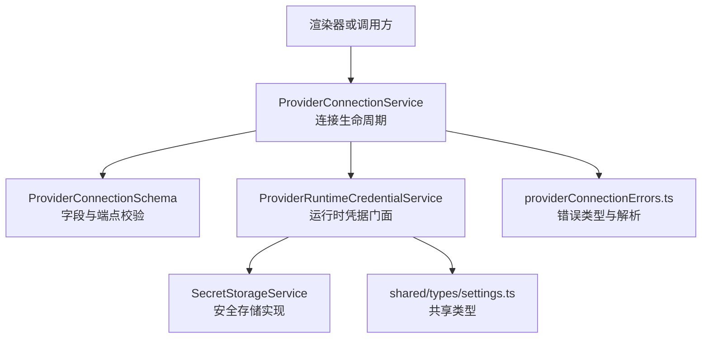
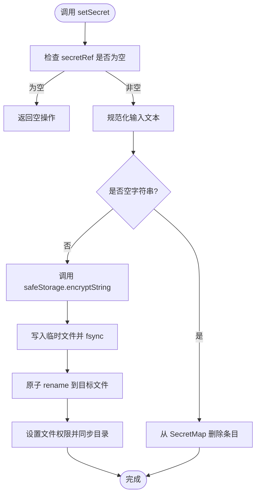
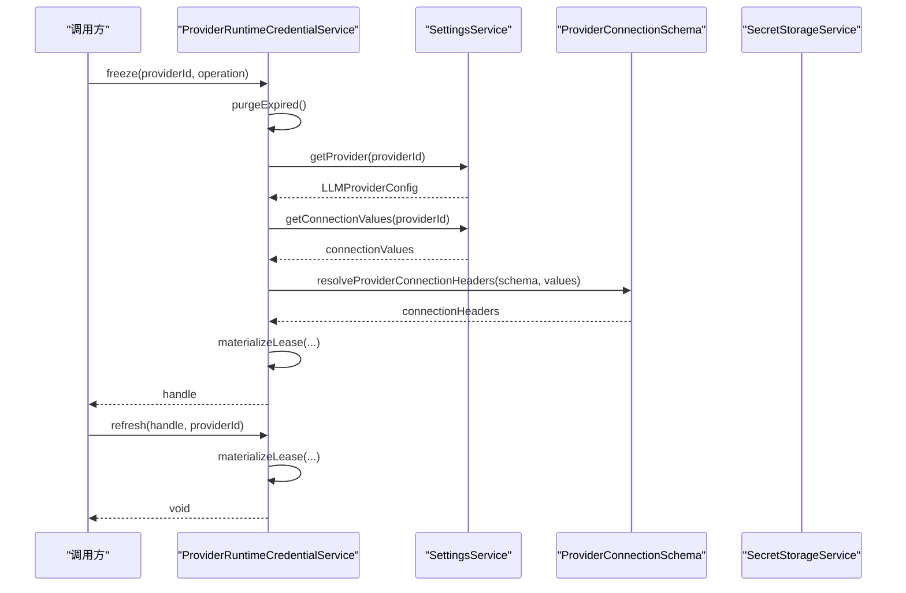
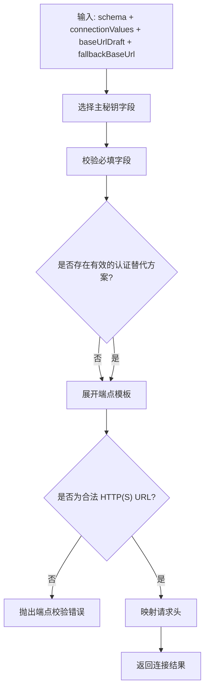
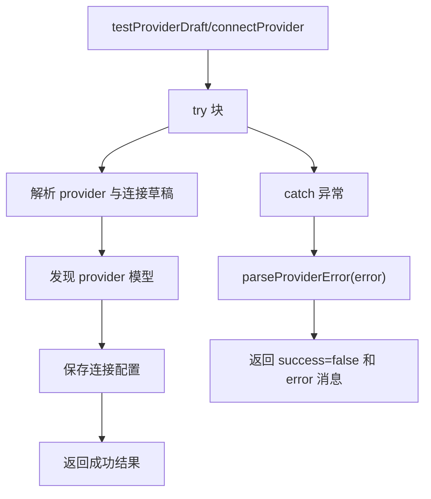
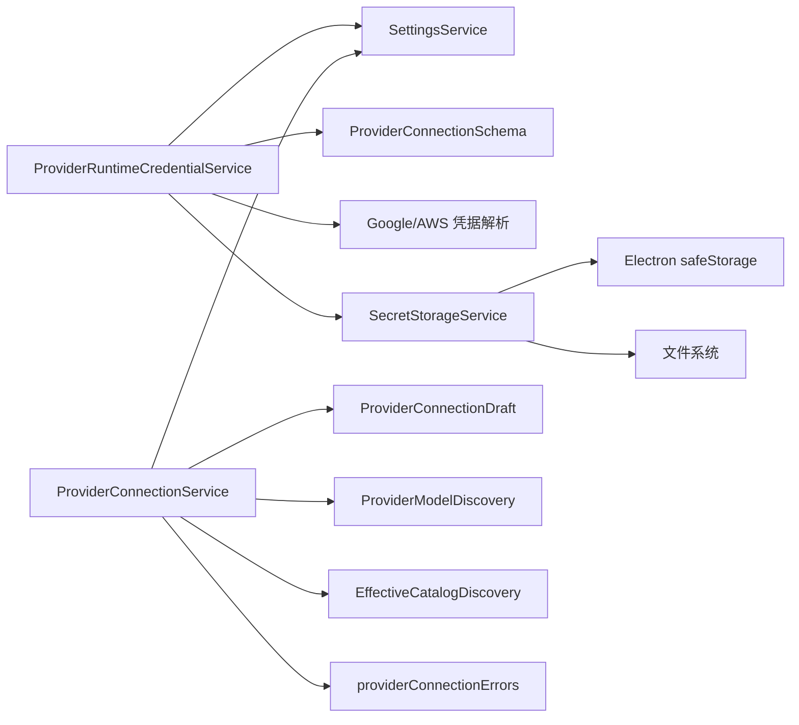
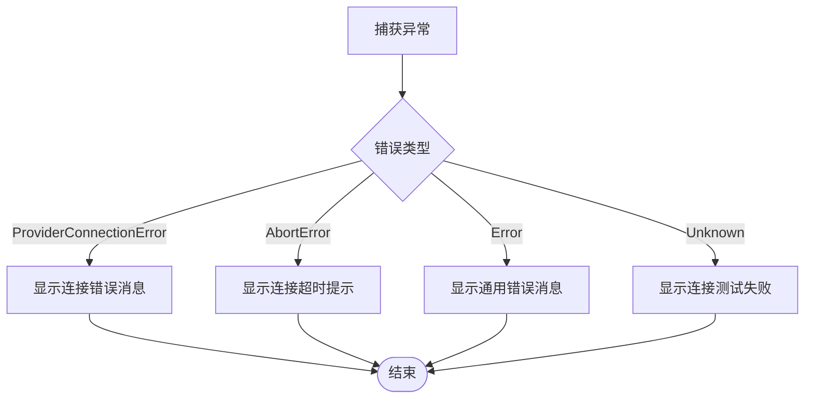

# 凭据存储架构

<cite>
**本文引用的文件**   
- [CredentialStoreInterface.ts](file://src/main/settings/CredentialStoreInterface.ts)
- [SecretStorageService.ts](file://src/main/settings/SecretStorageService.ts)
- [ProviderRuntimeCredentialService.ts](file://src/main/settings/ProviderRuntimeCredentialService.ts)
- [providerConnectionErrors.ts](file://src/main/settings/providerConnectionErrors.ts)
- [ProviderConnectionSchema.ts](file://src/main/settings/ProviderConnectionSchema.ts)
- [ProviderConnectionService.ts](file://src/main/settings/ProviderConnectionService.ts)
- [settings.ts](file://src/shared/types/settings.ts)
</cite>

## 目录
1. [引言](#引言)
2. [项目结构定位](#项目结构定位)
3. [核心组件总览](#核心组件总览)
4. [架构总览](#架构总览)
5. [详细组件分析](#详细组件分析)
6. [依赖关系分析](#依赖关系分析)
7. [性能与安全性特征](#性能与安全性特征)
8. [故障排查指南](#故障排查指南)
9. [结论](#结论)
10. [附录：扩展与示例指引](#附录扩展与示例指引)

## 引言
本文件面向主进程凭据存储体系，围绕以下目标展开：
- 解释 `CredentialStoreInterface` 接口的设计层次和抽象边界。
- 说明 `SecretStorageService` 如何作为 Electron 主进程专属的凭据持久化实现。
- 说明 `ProviderRuntimeCredentialService` 如何作为凭据服务的门面，封装底层存储、加密、环境凭据解析和访问控制。
- 解释 typed connection secret 的结构设计、不同 provider 类型的字段语义、验证规则与默认值处理。
- 梳理 `providerConnectionErrors.ts` 中的错误类型与错误传播机制。
- 提供架构图、数据流图和错误流程图，并给出注册新凭据类型、实现自定义存储后端和处理存储异常的可操作指引。

## 项目结构定位
凭据相关代码集中在主进程设置子系统中，并通过共享类型定义对外暴露契约：
- 接口契约层：`CredentialStoreInterface.ts` 定义 HAL 兼容的凭据存储接口。
- 主进程存储实现：`SecretStorageService.ts` 使用 Electron `safeStorage` 和 JSON 文件管理加密凭据。
- 运行时凭据门面：`ProviderRuntimeCredentialService.ts` 负责冻结、刷新、校验和释放运行期凭据句柄。
- 连接模式与 schema 校验：`ProviderConnectionSchema.ts` 定义连接字段、端点模板、头部映射和认证替代方案。
- Provider 连接服务：`ProviderConnectionService.ts` 负责测试连接、保存连接、模型发现等上层流程。
- 错误定义：`providerConnectionErrors.ts` 统一连接错误的类型化和消息解析。
- 共享类型：`settings.ts` 定义 LLM provider 配置、连接 schema、连接值和状态等跨模块类型。



**图表来源**
- [ProviderConnectionService.ts:1-200](file://src/main/settings/ProviderConnectionService.ts#L1-L200)
- [ProviderConnectionSchema.ts:1-85](file://src/main/settings/ProviderConnectionSchema.ts#L1-L85)
- [ProviderRuntimeCredentialService.ts:1-145](file://src/main/settings/ProviderRuntimeCredentialService.ts#L1-L145)
- [SecretStorageService.ts:1-267](file://src/main/settings/SecretStorageService.ts#L1-L267)
- [settings.ts:180-260](file://src/shared/types/settings.ts#L180-L260)
- [providerConnectionErrors.ts:1-14](file://src/main/settings/providerConnectionErrors.ts#L1-L14)

**章节来源**
- [ProviderConnectionService.ts:1-200](file://src/main/settings/ProviderConnectionService.ts#L1-L200)
- [ProviderConnectionSchema.ts:1-85](file://src/main/settings/ProviderConnectionSchema.ts#L1-L85)
- [ProviderRuntimeCredentialService.ts:1-145](file://src/main/settings/ProviderRuntimeCredentialService.ts#L1-L145)
- [SecretStorageService.ts:1-267](file://src/main/settings/SecretStorageService.ts#L1-L267)
- [settings.ts:180-260](file://src/shared/types/settings.ts#L180-L260)
- [providerConnectionErrors.ts:1-14](file://src/main/settings/providerConnectionErrors.ts#L1-L14)

## 核心组件总览
- `CredentialStoreInterface.ts`：声明凭据记录、通用凭据存储、API Key 认证解析器和 OAuth 认证流的抽象契约。它不绑定具体实现，是未来扩展多存储后端的契约层。
- `SecretStorageService.ts`：主进程专用实现，负责将敏感字段以 base64 + safeStorage 方式写入 JSON 文件；提供引用生成、复制、读取、写入、删除、存在性检查和掩码预览能力。
- `ProviderRuntimeCredentialService.ts`：门面服务，根据 providerId 和 operation 冻结凭据，支持刷新、获取和释放；内部维护短期租赁表并自动清理过期条目。
- `ProviderConnectionSchema.ts`：对 typed connection secret 做结构化校验，包括必填字段、认证替代方案、端点模板展开、HTTP 头部映射等。
- `ProviderConnectionService.ts`：连接测试、连接保存、模型发现和有效目录刷新，统一捕获错误并通过 `parseProviderError` 转换为用户可读消息。
- `providerConnectionErrors.ts`：定义 `ProviderConnectionError` 及 `parseProviderError`，用于将系统异常、中断异常和通用错误统一为字符串错误信息。
- `settings.ts`：定义 `LlmProviderConnectionSchema`、`LlmProviderEntry`、`connectionValues`、`connectionHeaders` 等共享类型，是 typed connection secret 的数据契约基础。

**章节来源**
- [CredentialStoreInterface.ts:1-57](file://src/main/settings/CredentialStoreInterface.ts#L1-L57)
- [SecretStorageService.ts:1-267](file://src/main/settings/SecretStorageService.ts#L1-L267)
- [ProviderRuntimeCredentialService.ts:1-145](file://src/main/settings/ProviderRuntimeCredentialService.ts#L1-L145)
- [ProviderConnectionSchema.ts:1-85](file://src/main/settings/ProviderConnectionSchema.ts#L1-L85)
- [ProviderConnectionService.ts:1-200](file://src/main/settings/ProviderConnectionService.ts#L1-L200)
- [providerConnectionErrors.ts:1-14](file://src/main/settings/providerConnectionErrors.ts#L1-L14)
- [settings.ts:180-260](file://src/shared/types/settings.ts#L180-L260)

## 架构总览
凭据存储体系分为三层：
1. **契约层**：`CredentialStoreInterface` 定义 provider 凭据、通用存储、API Key 和 OAuth 认证抽象。
2. **存储层**：`SecretStorageService` 使用 Electron `safeStorage` 加密敏感字段，并以 JSON 文件索引引用键。
3. **门面层**：`ProviderRuntimeCredentialService` 封装 provider 配置、连接值、环境凭据（如 Google Vertex、AWS Bedrock）和 HTTP 头，输出只读的运行时凭据句柄。

```mermaid
classDiagram
    class CredentialStore {
        +read(providerId) Promise~ProviderCredential|undefined~
        +modify(providerId, fn) Promise~ProviderCredential|undefined~
        +delete(providerId) Promise~void~
    }

    class ApiKeyAuth {
        +name string
        +resolve(input) Promise~{apiKey; baseUrl?}|undefined~
    }

    class OAuthAuth {
        +name string
        +login(callbacks) Promise~{token}~
        +refresh(credential) Promise~{token}~
        +toAuth(credential) Promise~{apiKey; headers?}~
    }

    class ProviderAuth {
        +apiKey ApiKeyAuth
        +oauth OAuthAuth
    }

    class SecretStorageService {
        +createProviderSecretRef(providerId) string
        +createProviderOAuthSecretRef(providerId) string
        +createProviderAccountSecretRef(providerId, accountId, kind) string
        +createProviderConnectionSecretRef(providerId, accountId, fieldId) string
        +copySecret(sourceRef, targetRef, workspaceRoot) boolean
        +getSecret(secretRef, workspaceRoot) string
        +setSecret(secretRef, plaintext, workspaceRoot) void
        +deleteSecret(secretRef, workspaceRoot) void
        +hasSecret(secretRef, workspaceRoot) boolean
        +maskSecretPreview(plaintext) string|undefined
    }

    class ProviderRuntimeCredentialService {
        +freeze(providerId, operation) Promise~string~
        +refresh(handle, providerId) Promise~void~
        +get(handle, providerId, expectedOperation) FrozenProviderRuntimeCredential|null
        +release(handle) void
    }

    CredentialStore <|.. SecretStorageService : "抽象契约"
    ProviderRuntimeCredentialService --> SecretStorageService : "通过依赖注入使用"
    ProviderRuntimeCredentialService --> ProviderAuth : "使用认证抽象"
```

**图表来源**
- [CredentialStoreInterface.ts:1-57](file://src/main/settings/CredentialStoreInterface.ts#L1-L57)
- [SecretStorageService.ts:1-267](file://src/main/settings/SecretStorageService.ts#L1-L267)
- [ProviderRuntimeCredentialService.ts:1-145](file://src/main/settings/ProviderRuntimeCredentialService.ts#L1-L145)

**章节来源**
- [CredentialStoreInterface.ts:1-57](file://src/main/settings/CredentialStoreInterface.ts#L1-L57)
- [SecretStorageService.ts:1-267](file://src/main/settings/SecretStorageService.ts#L1-L267)
- [ProviderRuntimeCredentialService.ts:1-145](file://src/main/settings/ProviderRuntimeCredentialService.ts#L1-L145)

## 详细组件分析

### 凭据存储契约层：CredentialStoreInterface
该模块是“形式化契约层”，不直接实现业务逻辑，而是定义未来可替换存储后端必须满足的接口：
- `ProviderCredential`：每个 provider 的凭据记录，包含可选 API Key、可选 Base URL、OAuth Token、更新时间戳和任意 provider 元数据。
- `CredentialStore`：基于 providerId 的读、原子修改、删除接口。`modify` 要求实现者保证读-改-写的原子性。
- `ApiKeyAuth`：按 modelId 和 providerId 解析出 API Key 和可选 Base URL。
- `OAuthAuth`：登录、刷新、将 token 转换为 API Key 和请求头的完整 OAuth 流程。
- `ProviderAuth`：组合 API Key 与 OAuth 两种认证方式的复合表面。

设计要点：
- 解耦具体存储实现，允许后续引入数据库、云密钥管理服务或多工作区存储。
- 明确区分“凭据记录”和“认证解析器”，避免把网络认证流程混入本地存储。
- 通过 `metadata` 字段保留扩展性，使不同 provider 可以携带额外上下文。

**章节来源**
- [CredentialStoreInterface.ts:1-57](file://src/main/settings/CredentialStoreInterface.ts#L1-L57)

### 主进程凭据存储实现：SecretStorageService
`SecretStorageService` 是主进程专属的安全存储实现，承担以下职责：
- 安全检测：在读写前检查 Electron `safeStorage.isEncryptionAvailable()`，不可用时抛出 `SecretStorageUnavailableError`。
- 文件布局：将加密后的凭据以 JSON 文件持久化，文件名固定，路径由应用路径服务决定。
- 损坏保护：JSON 解析失败或非对象结构时，将原文件重命名为 `.corrupt-时间戳` 备份，并抛出 `SecretStoreCorruptError`。
- 写安全：使用临时文件写入、fsync、原子 rename、权限设置，Windows 下尝试收紧 ACL。
- 引用命名：为 API Key、OAuth、账户级凭据和 connection 字段提供稳定的引用键生成方法。
- 查询与掩码：提供空引用容错读取、存在性判断、以及用于 UI 预览的掩码函数。

关键数据结构：
- `SecretRecord`：包含编码方式、base64 payload 和更新时间。
- `SecretMap`：以引用键为 key 的 map，对应磁盘上的 JSON 结构。



**图表来源**
- [SecretStorageService.ts:120-200](file://src/main/settings/SecretStorageService.ts#L120-L200)
- [SecretStorageService.ts:201-267](file://src/main/settings/SecretStorageService.ts#L201-L267)

**章节来源**
- [SecretStorageService.ts:1-267](file://src/main/settings/SecretStorageService.ts#L1-L267)

### 运行时凭据门面：ProviderRuntimeCredentialService
该服务是外部调用方访问 provider 凭据的统一入口，主要行为如下：
- `freeze`：根据 providerId 和 operation 创建临时凭据句柄，并将凭据冻结为只读对象。
- `refresh`：根据 handle 和 providerId 刷新凭据，仅更新必要字段，保持其他内容不变。
- `get`：按 handle、providerId 和预期 operation 校验并返回冻结凭据；若句柄无效或 operation 不匹配则抛错。
- `release`：释放句柄并从内存租赁表中删除。
- 自动清理：超过最大租期（默认一天）的凭据会被清理。

依赖注入设计：
- `getProvider`：从 settings 获取 provider 配置。
- `getConnectionValues`：获取连接值。
- `getConnectionHeaders`：根据 schema 和连接值计算请求头。
- `resolveGoogleVertex` / `resolveAwsBedrock`：解析云平台环境凭据。
- `now` / `createHandle`：便于测试时注入时间和随机句柄。



**图表来源**
- [ProviderRuntimeCredentialService.ts:1-145](file://src/main/settings/ProviderRuntimeCredentialService.ts#L1-L145)
- [ProviderConnectionSchema.ts:1-85](file://src/main/settings/ProviderConnectionSchema.ts#L1-L85)

**章节来源**
- [ProviderRuntimeCredentialService.ts:1-145](file://src/main/settings/ProviderRuntimeCredentialService.ts#L1-L145)

### Typed Connection Secret 与 ProviderConnectionSchema
typed connection secret 的核心不是单一字段，而是一组由 provider schema 描述的连接字段。其结构设计如下：

- 字段定义：`LlmProviderConnectionField` 包含 id、label、kind、required、环境变量名和占位符。
- 连接 schema：`LlmProviderConnectionSchema` 描述 fields、主秘钥字段、认证替代方案、header 映射和 endpointTemplate。
- provider 配置：`LlmProviderEntry` 中包含 `connectionValues`、`connectionSchema`、`hasStoredConnectionSecrets` 等字段，表示非秘钥连接值及其存在性投影。
- 主秘钥字段选择：`resolvePrimaryConnectionSecretFieldId` 优先使用显式 `primarySecretFieldId`，其次回退到 `apiKey`，再按正则匹配常见 token 字段，最后取第一个 secret 字段。
- 必填字段与认证替代：`isProviderConnectionSchemaSatisfied` 校验所有 required 字段是否填充，同时支持 credentialAlternatives：要么至少一个 alternative 的所有字段都存在，要么是 ambient 模式。
- 端点模板：`resolveProviderEndpointTemplate` 用 `${FIELD_ID}` 展开变量，要求最终结果为绝对 HTTP(S) URL，且不允许未支持的模板变量。
- 请求头映射：`resolveProviderConnectionHeaders` 根据 headerMappings 将连接字段映射为 HTTP 头部，支持可选 prefix。



**图表来源**
- [ProviderConnectionSchema.ts:1-85](file://src/main/settings/ProviderConnectionSchema.ts#L1-L85)
- [settings.ts:180-260](file://src/shared/types/settings.ts#L180-L260)

**章节来源**
- [ProviderConnectionSchema.ts:1-85](file://src/main/settings/ProviderConnectionSchema.ts#L1-L85)
- [settings.ts:180-260](file://src/shared/types/settings.ts#L180-L260)

### 连接服务与错误传播：ProviderConnectionService 与 providerConnectionErrors
`ProviderConnectionService` 负责：
- 解析请求协议和 authMode。
- 构造连接草稿。
- 执行模型发现。
- 保存连接配置并刷新有效目录。
- 捕获异常并转为 `LlmProviderConnectionResult.error`。

`providerConnectionErrors.ts` 提供：
- `ProviderConnectionError`：连接领域错误基类。
- `parseProviderError`：将 `ProviderConnectionError`、`AbortError`、普通 `Error` 和未知错误分别映射为用户可读消息。



**图表来源**
- [ProviderConnectionService.ts:1-200](file://src/main/settings/ProviderConnectionService.ts#L1-L200)
- [providerConnectionErrors.ts:1-14](file://src/main/settings/providerConnectionErrors.ts#L1-L14)

**章节来源**
- [ProviderConnectionService.ts:1-200](file://src/main/settings/ProviderConnectionService.ts#L1-L200)
- [providerConnectionErrors.ts:1-14](file://src/main/settings/providerConnectionErrors.ts#L1-L14)

## 依赖关系分析
组件之间的耦合关系如下：
- `ProviderRuntimeCredentialService` 依赖 `SettingsService`、`ProviderConnectionSchema`、云平台凭据解析器和 `SecretStorageService`。
- `ProviderConnectionService` 依赖 `SettingsService`、`ProviderConnectionDraft`、`ProviderModelDiscovery`、`EffectiveCatalogDiscovery`、`ProviderAccountAuthService` 和 `providerConnectionErrors`。
- `SecretStorageService` 依赖 Electron `safeStorage`、文件系统和应用路径服务。
- `CredentialStoreInterface` 被用作抽象契约，当前实际实现由 `SecretStorageService` 和 `ProviderRuntimeCredentialService` 共同体现。



**图表来源**
- [ProviderRuntimeCredentialService.ts:1-145](file://src/main/settings/ProviderRuntimeCredentialService.ts#L1-L145)
- [ProviderConnectionService.ts:1-200](file://src/main/settings/ProviderConnectionService.ts#L1-L200)
- [SecretStorageService.ts:1-267](file://src/main/settings/SecretStorageService.ts#L1-L267)

**章节来源**
- [ProviderRuntimeCredentialService.ts:1-145](file://src/main/settings/ProviderRuntimeCredentialService.ts#L1-L145)
- [ProviderConnectionService.ts:1-200](file://src/main/settings/ProviderConnectionService.ts#L1-L200)
- [SecretStorageService.ts:1-267](file://src/main/settings/SecretStorageService.ts#L1-L267)

## 性能与安全性特征
- 安全性
  - 敏感字段通过 `safeStorage` 加密，不在 JSON 中明文存储。
  - JSON 文件采用临时写入加原子 rename，降低并发写入导致的不一致风险。
  - Windows 下尝试收紧文件 ACL，限制当前用户访问。
  - UI 侧仅提供掩码预览，不展示真实敏感值。
- 性能
  - 运行时凭据使用内存 Map 缓存，减少频繁解密和解析开销。
  - 凭据句柄带过期时间，定期清理，防止长期持有敏感数据。
  - 连接 schema 校验和端点模板展开在连接测试和保存时执行，避免每次请求重复解析。
- 可扩展性
  - `CredentialStoreInterface` 为多存储后端预留扩展点。
  - `ProviderRuntimeCredentialService` 通过依赖注入替换 provider 查询、连接值、请求头和环境凭据解析逻辑。

[本节为一般性指导，不直接分析具体文件]

## 故障排查指南
常见问题与处理建议：

1. **安全存储不可用**
   - 现象：读取或写入凭据时报错或静默失败。
   - 原因：Electron `safeStorage` 不可用。
   - 处理：确认主进程可用 `safeStorage`；若不可用，应拒绝写入凭据并提示用户。
   - 相关错误类型：`SecretStorageUnavailableError`。

2. **凭据文件损坏**
   - 现象：启动或读取凭据时报错。
   - 原因：JSON 文件格式错误或不是对象。
   - 处理：系统会将原文件隔离为 `.corrupt-时间戳` 备份，并抛出 `SecretStoreCorruptError`；需要检查备份文件并重建凭据。
   - 相关错误类型：`SecretStoreCorruptError`。

3. **连接测试失败**
   - 现象：UI 显示连接失败。
   - 原因：网络错误、超时、认证失败或参数校验失败。
   - 处理：使用 `parseProviderError` 获取用户可读消息；检查必填字段、endpoint 模板和请求头映射。
   - 相关错误类型：`ProviderConnectionError`、`AbortError`。

4. **运行时凭据句柄无效**
   - 现象：调用 `refresh` 或 `get` 时报错。
   - 原因：句柄不存在、providerId 不匹配或 operation 不一致。
   - 处理：重新 `freeze` 凭据句柄，确保调用方正确传递 providerId 和 operation。



**图表来源**
- [providerConnectionErrors.ts:1-14](file://src/main/settings/providerConnectionErrors.ts#L1-L14)

**章节来源**
- [SecretStorageService.ts:1-267](file://src/main/settings/SecretStorageService.ts#L1-L267)
- [providerConnectionErrors.ts:1-14](file://src/main/settings/providerConnectionErrors.ts#L1-L14)

## 结论
凭据存储架构通过分层设计实现了清晰的边界：
- 契约层定义稳定接口，便于替换存储后端和扩展认证方式。
- 主进程存储实现专注安全与持久化，严格区分明文与密文。
- 门面层聚合 provider 配置、连接 schema、环境凭据和请求头，输出安全的运行时凭据句柄。
- typed connection secret 以 schema 为中心，支持多种 provider 类型、灵活认证方案和严格的端点校验。
- 错误处理通过统一类型和解析函数，将底层异常转化为上层可用的用户消息。

该架构适合继续扩展新的 provider 类型、新的认证流程和新的存储后端，同时保持主进程凭据边界的清晰和安全。

[本节为总结性内容，不直接分析具体文件]

## 附录：扩展与示例指引

### 注册新的凭据类型
步骤：
1. 在共享类型中新增 provider 的连接字段，例如增加新的 `LlmProviderConnectionField`。
2. 在 provider 配置中补充 `connectionSchema`，包括 fields、optional primarySecretFieldId、credentialAlternatives、headerMappings 和 endpointTemplate。
3. 在 `ProviderConnectionSchema.ts` 中扩展字段校验、端点模板或请求头映射逻辑。
4. 在 `ProviderRuntimeCredentialService.ts` 中按需添加新 provider 的环境凭据解析分支。
5. 在 `ProviderConnectionService.ts` 中确保连接测试和保存流程能处理新字段。

参考路径：
- [settings.ts:180-260](file://src/shared/types/settings.ts#L180-L260)
- [ProviderConnectionSchema.ts:1-85](file://src/main/settings/ProviderConnectionSchema.ts#L1-L85)
- [ProviderRuntimeCredentialService.ts:1-145](file://src/main/settings/ProviderRuntimeCredentialService.ts#L1-L145)
- [ProviderConnectionService.ts:1-200](file://src/main/settings/ProviderConnectionService.ts#L1-L200)

### 实现自定义存储后端
步骤：
1. 实现 `CredentialStore` 接口，保证 `modify` 的原子性。
2. 如需 API Key 或 OAuth 能力，实现 `ApiKeyAuth` 或 `OAuthAuth`。
3. 在 `ProviderRuntimeCredentialService` 中通过依赖注入替换 provider 查询、连接值、请求头和环境凭据解析逻辑。
4. 若需要持久化策略变更，可在门面层封装新的存储适配器，并保持 `secretStorageService` 原有引用命名约定。

参考路径：
- [CredentialStoreInterface.ts:1-57](file://src/main/settings/CredentialStoreInterface.ts#L1-L57)
- [ProviderRuntimeCredentialService.ts:1-145](file://src/main/settings/ProviderRuntimeCredentialService.ts#L1-L145)

### 处理存储异常
步骤：
1. 捕获 `SecretStorageUnavailableError`，提示用户安全存储不可用。
2. 捕获 `SecretStoreCorruptError`，检查隔离文件并重建凭据。
3. 对于连接错误，使用 `parseProviderError` 将异常转换为用户可读消息。
4. 对运行时凭据句柄无效的情况，重新获取新的凭据句柄。

参考路径：
- [SecretStorageService.ts:1-267](file://src/main/settings/SecretStorageService.ts#L1-L267)
- [providerConnectionErrors.ts:1-14](file://src/main/settings/providerConnectionErrors.ts#L1-L14)
- [ProviderRuntimeCredentialService.ts:1-145](file://src/main/settings/ProviderRuntimeCredentialService.ts#L1-L145)