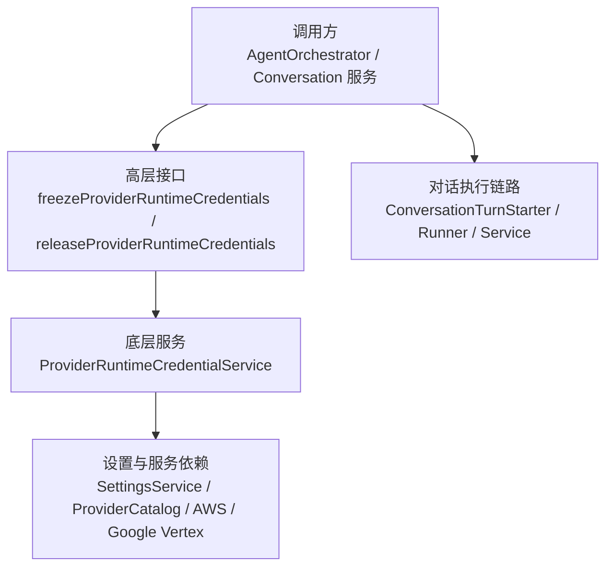
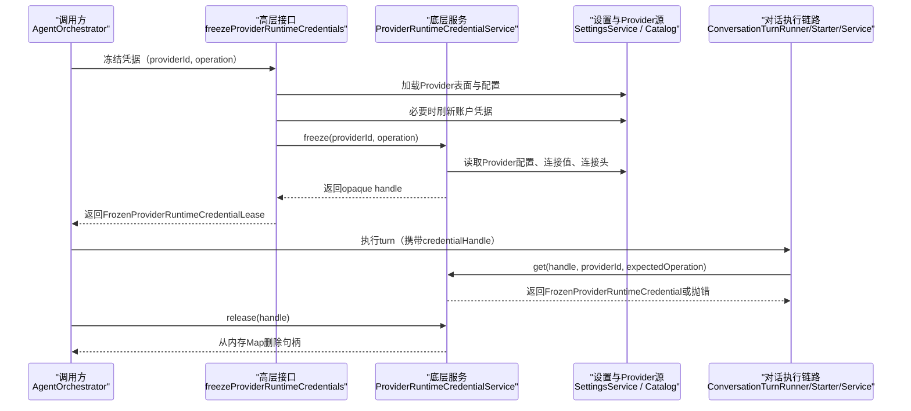
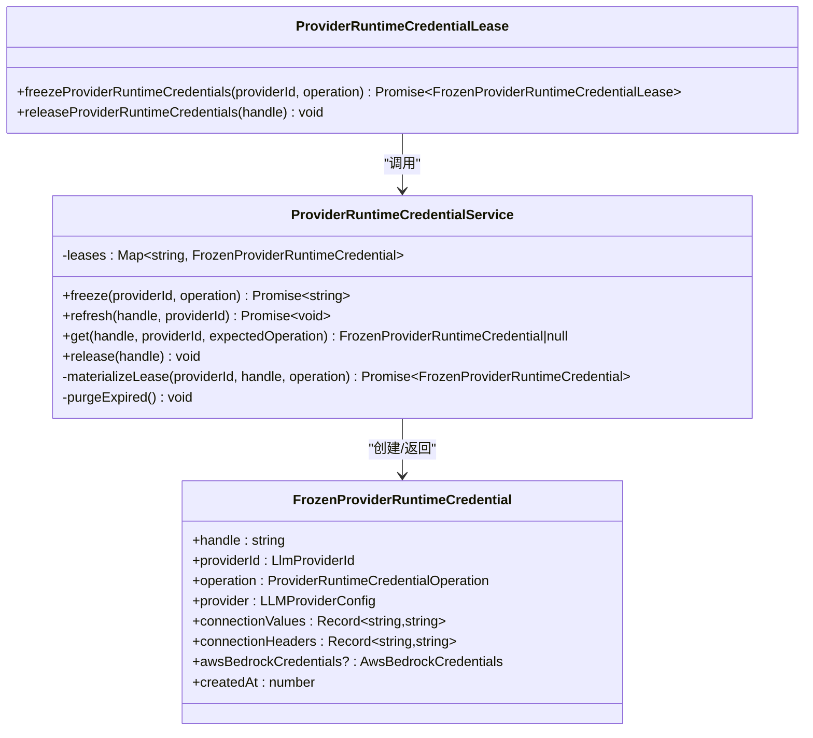
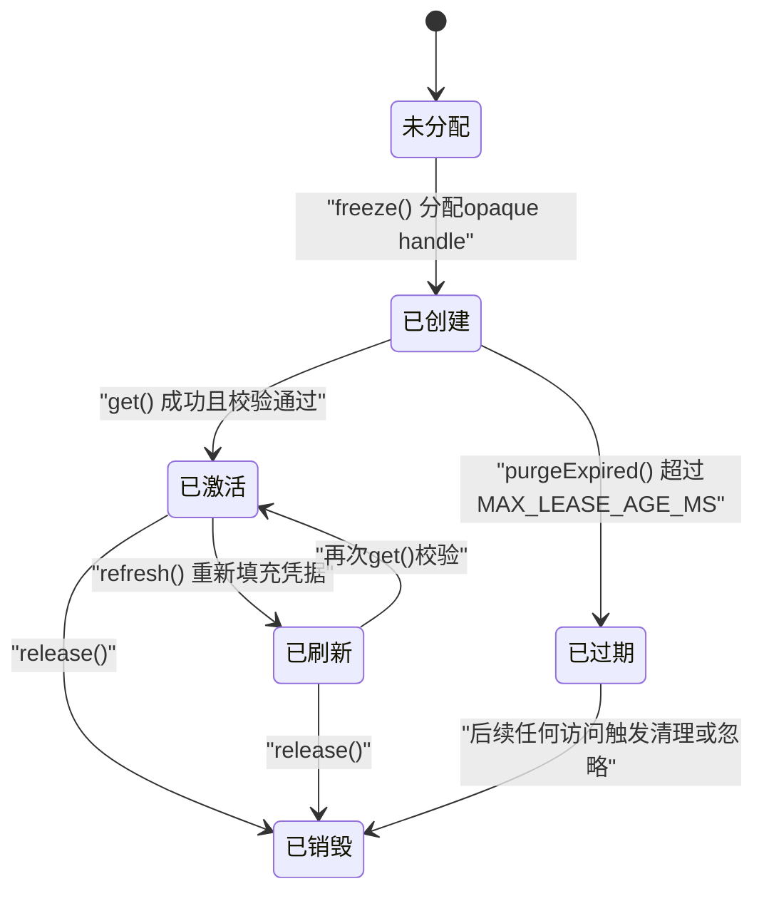
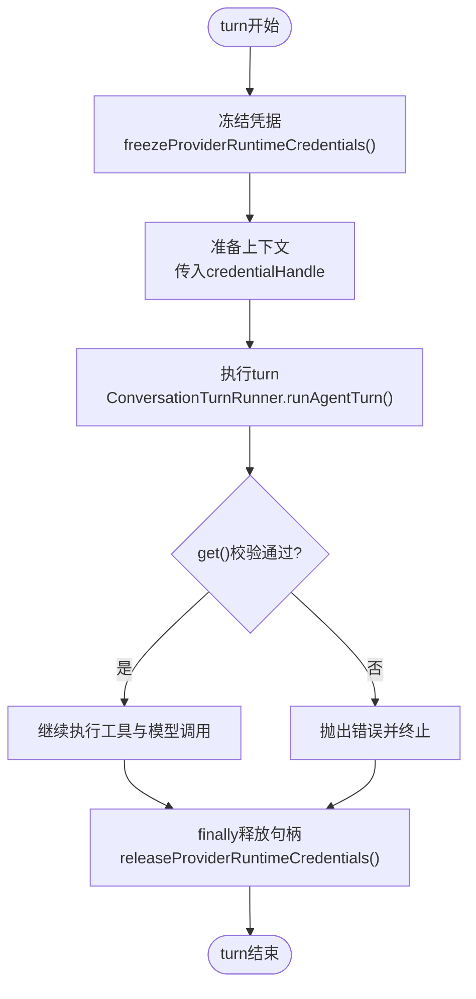
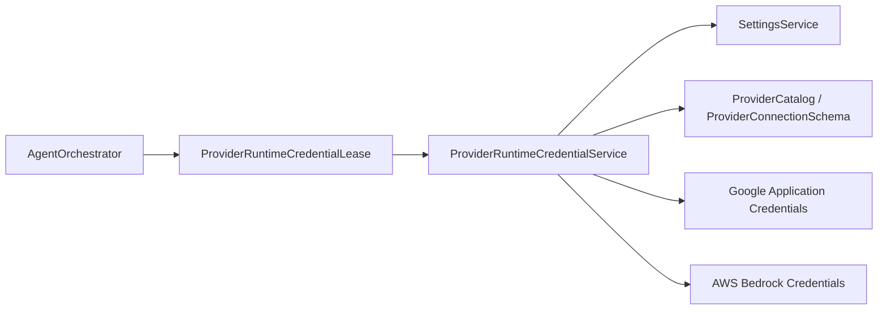

# 租约生命周期管理

<cite>
**本文引用的文件**
- [ProviderRuntimeCredentialLease.ts](file://src/main/settings/ProviderRuntimeCredentialLease.ts)
- [ProviderRuntimeCredentialService.ts](file://src/main/settings/ProviderRuntimeCredentialService.ts)
- [ProviderRuntimeCredentialService.test.ts](file://src/main/settings/ProviderRuntimeCredentialService.test.ts)
- [AgentOrchestrator.ts](file://src/main/workflow/debugger/AgentOrchestrator.ts)
- [ConversationTurnStarter.ts](file://src/main/conversation/ConversationTurnStarter.ts)
- [ConversationTurnRunner.ts](file://src/main/conversation/ConversationTurnRunner.ts)
- [ConversationService.ts](file://src/main/conversation/ConversationService.ts)
</cite>

## 目录
1. [引言](#引言)
2. [项目结构定位](#项目结构定位)
3. [核心组件](#核心组件)
4. [架构总览](#架构总览)
5. [详细组件分析](#详细组件分析)
6. [依赖关系分析](#依赖关系分析)
7. [性能与资源特征](#性能与资源特征)
8. [故障排查指南](#故障排查指南)
9. [结论](#结论)

## 引言
本文聚焦 Provider 运行期凭据的“租约”机制，系统性解释 `ProviderRuntimeCredentialLease` 对外暴露的冻结接口、底层 `ProviderRuntimeCredentialService` 的句柄与租约存储、以及调用方在 Agent 编排和对话执行中的持有与释放路径。文档重点覆盖：
- opaque lease token 的生成、序列化形态、反序列化语义；
- 租约的生命周期阶段：创建、激活、使用、刷新、过期、销毁；
- 并发安全假设与边界；
- 租约与 Provider 凭据的绑定关系及校验；
- 超时清理与资源回收策略；
- 状态转换图、时间线图和内存布局说明；
- 典型使用示例：获取租约、在 turn 期间持有、正确处理过期场景。

## 项目结构定位
该能力位于主进程的设置与 Provider 集成层，由两个紧密协作的文件组成：
- 高层冻结与释放接口：`src/main/settings/ProviderRuntimeCredentialLease.ts`；
- 低层句柄、快照、校验与清理实现：`src/main/settings/ProviderRuntimeCredentialService.ts`；
- 上层编排器通过注入方式消费该能力：`src/main/workflow/debugger/AgentOrchestrator.ts`；
- 对话执行链路在关键退出点释放句柄：`ConversationTurnStarter.ts`、`ConversationTurnRunner.ts`、`ConversationService.ts`。

**图示来源**
- [ProviderRuntimeCredentialLease.ts:1-42](file://src/main/settings/ProviderRuntimeCredentialLease.ts#L1-L42)
- [ProviderRuntimeCredentialService.ts:1-145](file://src/main/settings/ProviderRuntimeCredentialService.ts#L1-L145)
- [AgentOrchestrator.ts:350-420](file://src/main/workflow/debugger/AgentOrchestrator.ts#L350-L420)

**章节来源**
- [ProviderRuntimeCredentialLease.ts:1-42](file://src/main/settings/ProviderRuntimeCredentialLease.ts#L1-L42)
- [ProviderRuntimeCredentialService.ts:1-145](file://src/main/settings/ProviderRuntimeCredentialService.ts#L1-L145)
- [AgentOrchestrator.ts:350-420](file://src/main/workflow/debugger/AgentOrchestrator.ts#L350-L420)

## 核心组件
### 高层冻结接口：ProviderRuntimeCredentialLease
- `freezeProviderRuntimeCredentials(providerId, operation)`：加载 Provider Catalog 表面，按账户模式触发运行时凭据刷新，最终返回一个包含 opaque handle 的冻结租约对象。
- `releaseProviderRuntimeCredentials(handle)`：委托底层服务释放句柄。

关键点：
- 返回的 `handle` 是 opaque 字符串，调用方不应解析其内容，只负责持有并在适当时机释放。
- 当 Provider 使用账户认证时，冻结前会先确保运行时凭据已刷新。

**章节来源**
- [ProviderRuntimeCredentialLease.ts:1-42](file://src/main/settings/ProviderRuntimeCredentialLease.ts#L1-L42)

### 底层租约服务：ProviderRuntimeCredentialService
主要职责：
- 生成并分配 opaque 句柄；
- 将 Provider 配置、连接值、连接头、云凭证等合并为不可变快照；
- 提供按 providerId 与 operation 的严格访问校验；
- 支持同句柄刷新凭据而不改变已冻结的路由；
- 基于创建时间的过期清理。

核心类型：
- `FrozenProviderRuntimeCredential`：表示一次冻结后的凭据快照，包含 handle、providerId、operation、provider、connectionValues、connectionHeaders、可选 awsBedrockCredentials、createdAt。
- `ProviderRuntimeCredentialOperation`：当前限定为 `'chat' | 'embed'`，用于限制句柄的使用范围。

**章节来源**
- [ProviderRuntimeCredentialService.ts:1-145](file://src/main/settings/ProviderRuntimeCredentialService.ts#L1-L145)

## 架构总览
下面的序列图展示一次完整 turn 中租约的创建、传递与释放流程。

**图示来源**
- [AgentOrchestrator.ts:350-420](file://src/main/workflow/debugger/AgentOrchestrator.ts#L350-L420)
- [AgentOrchestrator.ts:560-720](file://src/main/workflow/debugger/AgentOrchestrator.ts#L560-L720)
- [ProviderRuntimeCredentialLease.ts:1-42](file://src/main/settings/ProviderRuntimeCredentialLease.ts#L1-L42)
- [ProviderRuntimeCredentialService.ts:1-145](file://src/main/settings/ProviderRuntimeCredentialService.ts#L1-L145)

## 详细组件分析

### 类与依赖关系

**图示来源**
- [ProviderRuntimeCredentialService.ts:1-145](file://src/main/settings/ProviderRuntimeCredentialService.ts#L1-L145)
- [ProviderRuntimeCredentialLease.ts:1-42](file://src/main/settings/ProviderRuntimeCredentialLease.ts#L1-L42)

### 数据模型与内存布局
- `leases`：以 opaque handle 为键、`FrozenProviderRuntimeCredential` 为值的内存 Map。
- `FrozenProviderRuntimeCredential`：
  - `handle`：唯一句柄，由 `randomUUID()` 生成。
  - `providerId`：绑定的 Provider 标识。
  - `operation`：限定用途，如 `'chat'` 或 `'embed'`。
  - `provider`：不可变的 Provider 配置快照，可能包含 apiKey、accountId 等敏感字段。
  - `connectionValues`：连接参数快照。
  - `connectionHeaders`：连接请求头快照。
  - `awsBedrockCredentials`：可选的 AWS Bedrock 凭据快照。
  - `createdAt`：创建时间戳，用于过期清理。

复杂度与空间特征：
- 单次 `freeze` 操作的时间复杂度取决于 Provider 配置读取、连接头计算与可能的云凭证解析；整体为 O(1) 次 I/O 与 O(n) 配置拷贝，n 为配置字段数量。
- `leases` Map 的插入、查找、删除平均为 O(1)。
- `purgeExpired` 遍历所有条目，最坏 O(m)，m 为活跃租约数。

**章节来源**
- [ProviderRuntimeCredentialService.ts:1-145](file://src/main/settings/ProviderRuntimeCredentialService.ts#L1-L145)

### 租约生命周期与状态转换
租约的状态不是显式枚举，而是由句柄是否存在、是否匹配 providerId 与 operation、以及 createdAt 是否超过最大租约年龄共同决定。

- **创建**：`freeze` 生成 handle，写入 `leases`，记录 `createdAt`。
- **激活**：`get` 校验 handle 存在、providerId 匹配、operation 一致。
- **使用**：调用方在 turn 执行期间持有句柄，并通过 `credentialHandle` 传递给下游。
- **刷新**：`refresh` 在同一 handle 下重新解析凭据，同时保留已冻结路由。
- **过期**：`purgeExpired` 基于 `createdAt` 与 `MAX_LEASE_AGE_MS` 清理。
- **销毁**：`release` 直接删除句柄。

**图示来源**
- [ProviderRuntimeCredentialService.ts:1-145](file://src/main/settings/ProviderRuntimeCredentialService.ts#L1-L145)

### 时间线：一次 Agent turn 中的租约流转

**图示来源**
- [AgentOrchestrator.ts:350-420](file://src/main/workflow/debugger/AgentOrchestrator.ts#L350-L420)
- [AgentOrchestrator.ts:560-720](file://src/main/workflow/debugger/AgentOrchestrator.ts#L560-L720)
- [ConversationTurnRunner.ts:691](file://src/main/conversation/ConversationTurnRunner.ts#L691)
- [ConversationTurnStarter.ts:565](file://src/main/conversation/ConversationTurnStarter.ts#L565)
- [ConversationService.ts:446](file://src/main/conversation/ConversationService.ts#L446)

### 并发安全机制
- 单进程内：`ProviderRuntimeCredentialService` 使用 Node.js 的 `Map` 维护句柄到快照的映射。由于 JavaScript 事件循环是单线程的，同步读写 Map 不存在竞争条件。
- 异步边界：`freeze`、`refresh`、`materializeLease` 可能涉及异步 I/O，但在本实现中，这些方法不会与其他方法共享可变状态之外的竞态变量；每次操作要么成功写入新快照，要么抛错。
- 互斥访问：代码未引入额外锁；依靠事件循环串行化访问。若未来引入多线程或多 worker 环境，需引入显式互斥或无锁数据结构。
- 原子性：Map 的 set/get/delete 在 JS 引擎层面是原子的，但业务级一致性依赖于调用方正确释放句柄。
- 状态检查：`get` 严格校验 handle 存在、providerId 一致、operation 一致；不满足则抛错。
- 原子更新：`refresh` 先 materialize 新快照，再替换 Map 中同一 handle 的值，保证旧快照与新快照之间的切换是完整的。

**章节来源**
- [ProviderRuntimeCredentialService.ts:1-145](file://src/main/settings/ProviderRuntimeCredentialService.ts#L1-L145)

### 与 Provider 凭据的绑定关系
- `handle` 仅作为引用标识，本身不包含凭据。
- 实际凭据被封装在 `FrozenProviderRuntimeCredential.provider`、`connectionValues`、`connectionHeaders`、`awsBedrockCredentials` 中。
- `get` 要求调用方同时提供 `providerId` 与 `expectedOperation`，从而确保：
  - 句柄必须属于对应 Provider；
  - 句柄只能用于授权的操作类型。
- 这样设计避免不同 Provider 之间误用句柄，也防止 chat 句柄被用于 embed 场景。

**章节来源**
- [ProviderRuntimeCredentialService.ts:1-145](file://src/main/settings/ProviderRuntimeCredentialService.ts#L1-L145)

### 超时机制、自动清理与资源回收
- 最大租约年龄：`MAX_LEASE_AGE_MS = 24 * 60 * 60 * 1000`，即 24 小时。
- 清理时机：每次 `freeze` 与 `refresh` 之前都会调用 `purgeExpired`，扫描并删除超时的租约。
- 清理策略：基于 `createdAt < now - MAX_LEASE_AGE_MS` 判定过期。
- 资源回收：`release` 立即从 Map 删除句柄；如果调用方忘记释放，租约最多在 24 小时后被自动清理。
- 注意：当前实现没有独立的后台定时任务；过期清理发生在写操作的前置步骤。

**章节来源**
- [ProviderRuntimeCredentialService.ts:1-145](file://src/main/settings/ProviderRuntimeCredentialService.ts#L1-L145)

### 使用示例与最佳实践

#### 示例一：获取并使用租约
适用场景：Agent 编排器在执行 turn 前需要冻结 Provider 凭据，并将句柄传递给下游执行链路。

推荐流程：
1. 调用 `freezeProviderRuntimeCredentials(providerId, operation)` 获取租约。
2. 将 `lease.handle` 作为 `credentialHandle` 传递给 `prepareTurnContext` 或 `runAgentTurn`。
3. 在 finally 块中调用 `releaseProviderRuntimeCredentials(lease.handle)`。

参考路径：
- [AgentOrchestrator.ts:350-420](file://src/main/workflow/debugger/AgentOrchestrator.ts#L350-L420)
- [AgentOrchestrator.ts:560-720](file://src/main/workflow/debugger/AgentOrchestrator.ts#L560-L720)

#### 示例二：在 turn 期间持有租约
适用场景：对话执行链路在执行工具调用、模型调用期间需要持续持有凭据。

推荐流程：
1. 上层编排器持有 `ownedCredentialHandle`。
2. 将 `credentialHandle` 传给 `runAgentTurn`。
3. 执行链路内部通过 `providerRuntimeCredentialService.get(handle, providerId, expectedOperation)` 获取快照。
4. 在 finally 或统一释放点调用 `releaseProviderRuntimeCredentials`。

参考路径：
- [ConversationTurnRunner.ts:691](file://src/main/conversation/ConversationTurnRunner.ts#L691)
- [ConversationTurnStarter.ts:565](file://src/main/conversation/ConversationTurnStarter.ts#L565)
- [ConversationService.ts:446](file://src/main/conversation/ConversationService.ts#L446)

#### 示例三：正确处理租约过期与无效句柄
可能出现的情况：
- 句柄已被释放：`get` 找不到句柄。
- 句柄属于其他 Provider：`providerId` 不匹配。
- 句柄操作类型不符：`operation` 不匹配。
- 句柄超过 24 小时：可能被 `purgeExpired` 清理。

处理建议：
- 捕获底层抛出的错误信息，例如“句柄无效”或“句柄未针对期望操作签发”。
- 不要重试使用同一句柄；应重新调用 `freezeProviderRuntimeCredentials` 获取新句柄。
- 在异常分支中也确保释放已持有的句柄。

参考路径：
- [ProviderRuntimeCredentialService.ts:1-145](file://src/main/settings/ProviderRuntimeCredentialService.ts#L1-L145)
- [ProviderRuntimeCredentialService.test.ts:1-125](file://src/main/settings/ProviderRuntimeCredentialService.test.ts#L1-L125)

### 序列化与反序列化说明
- 当前实现中，lease token 是 opaque 字符串，由 `randomUUID()` 生成，不包含结构化数据，因此不存在传统意义上的“序列化/反序列化”过程。
- 句柄仅作为内存 Map 的键；真正的凭据数据保存在 `FrozenProviderRuntimeCredential` 对象中。
- 如果需要跨进程或持久化句柄，应将其视为普通字符串传输，但不应依赖其内容语义。
- 对凭据数据的序列化应由更上层的持久化机制完成，而不是通过句柄本身。

**章节来源**
- [ProviderRuntimeCredentialService.ts:1-145](file://src/main/settings/ProviderRuntimeCredentialService.ts#L1-L145)

## 依赖关系分析

- `AgentOrchestrator` 通过高层接口获取句柄，并在 finally 中释放。
- `ProviderRuntimeCredentialLease` 负责 Provider Catalog 表面加载与账户凭据刷新前置条件。
- `ProviderRuntimeCredentialService` 负责句柄分配、凭据快照构建、校验与清理。
- 云服务相关逻辑通过依赖注入方式解耦，便于测试与扩展。

**图示来源**
- [AgentOrchestrator.ts:350-420](file://src/main/workflow/debugger/AgentOrchestrator.ts#L350-L420)
- [ProviderRuntimeCredentialLease.ts:1-42](file://src/main/settings/ProviderRuntimeCredentialLease.ts#L1-L42)
- [ProviderRuntimeCredentialService.ts:1-145](file://src/main/settings/ProviderRuntimeCredentialService.ts#L1-L145)

**章节来源**
- [AgentOrchestrator.ts:350-420](file://src/main/workflow/debugger/AgentOrchestrator.ts#L350-L420)
- [ProviderRuntimeCredentialLease.ts:1-42](file://src/main/settings/ProviderRuntimeCredentialLease.ts#L1-L42)
- [ProviderRuntimeCredentialService.ts:1-145](file://src/main/settings/ProviderRuntimeCredentialService.ts#L1-L145)

## 性能与资源特征
- 优点：
  - 句柄生成简单高效；
  - 凭据快照一次性构建，减少重复解析；
  - 通过 `Object.freeze` 降低意外修改风险；
  - 基于时间戳的批量清理避免复杂调度。
- 潜在优化点：
  - 当前 `purgeExpired` 每次写操作都全量扫描，可考虑惰性清理或分段清理；
  - 如需长期存活租约，可增加 TTL 缓存或后台清理任务；
  - 可添加句柄使用计数，辅助诊断泄漏。

[本节为通用性能讨论，不直接分析具体文件]

## 故障排查指南
常见问题与定位思路：
- “句柄无效”：
  - 检查是否在 `get` 时传入了错误的 `providerId`；
  - 确认句柄是否已被释放；
  - 确认句柄是否超过 24 小时并被清理。
- “句柄未针对期望操作签发”：
  - 检查调用 `freeze` 时传入的 `operation` 是否与使用方期望一致；
  - chat 句柄不能用于 embed，反之亦然。
- 凭据刷新后仍使用旧值：
  - 确认是否调用了 `refresh`；
  - 确认刷新后是否重新获取快照；
  - 注意 `refresh` 保留已冻结路由，只更新凭据部分。
- 资源泄漏：
  - 检查所有调用路径是否在 finally 中调用 `releaseProviderRuntimeCredentials`；
  - 检查测试与调试路径是否正确模拟释放。

**章节来源**
- [ProviderRuntimeCredentialService.test.ts:1-125](file://src/main/settings/ProviderRuntimeCredentialService.test.ts#L1-L125)
- [AgentOrchestrator.ts:560-720](file://src/main/workflow/debugger/AgentOrchestrator.ts#L560-L720)
- [ConversationTurnStarter.ts:565](file://src/main/conversation/ConversationTurnStarter.ts#L565)
- [ConversationTurnRunner.ts:691](file://src/main/conversation/ConversationTurnRunner.ts#L691)
- [ConversationService.ts:446](file://src/main/conversation/ConversationService.ts#L446)

## 结论
`ProviderRuntimeCredentialLease` 与 `ProviderRuntimeCredentialService` 共同实现了 Provider 运行期凭据的安全冻结、句柄化访问与生命周期管理。其核心优势在于：
- 使用 opaque handle 隔离凭据数据与调用方；
- 通过 providerId 与 operation 双重校验提升安全性；
- 通过快照与冻结减少凭据变更带来的不一致；
- 通过 24 小时最大租约年龄提供兜底资源回收；
- 通过清晰的创建、激活、使用、刷新、过期、销毁阶段简化调用方心智模型。

在实际使用中，调用方应始终遵循“谁创建、谁释放”的原则，并在异常路径也确保释放句柄，以避免内存泄漏与凭据残留。对于跨进程或持久化需求，应将句柄视为透明字符串，而不应尝试解析其内容。

[本节为总结性内容，不直接分析具体文件]