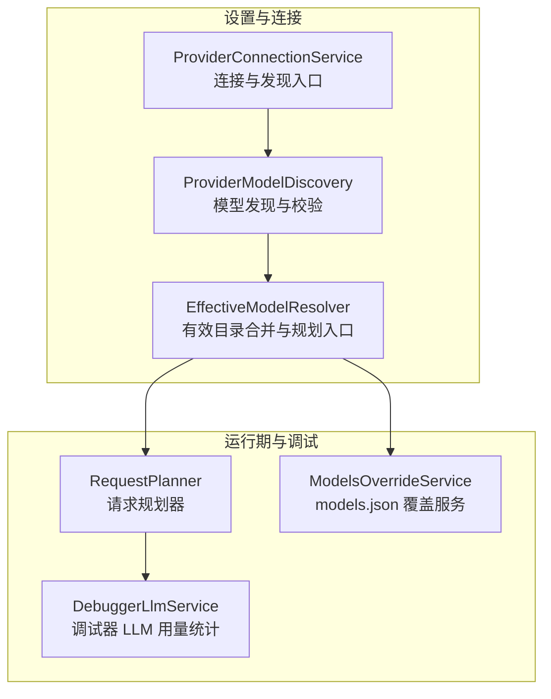
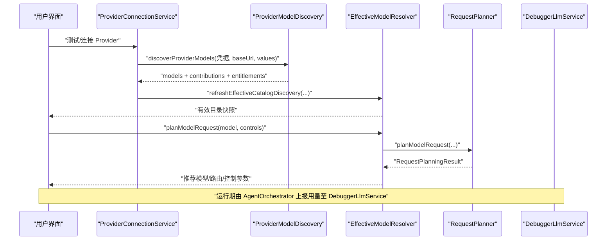
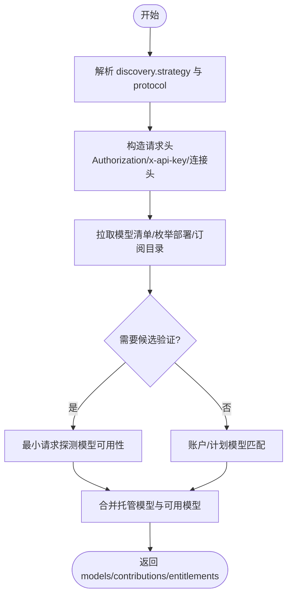
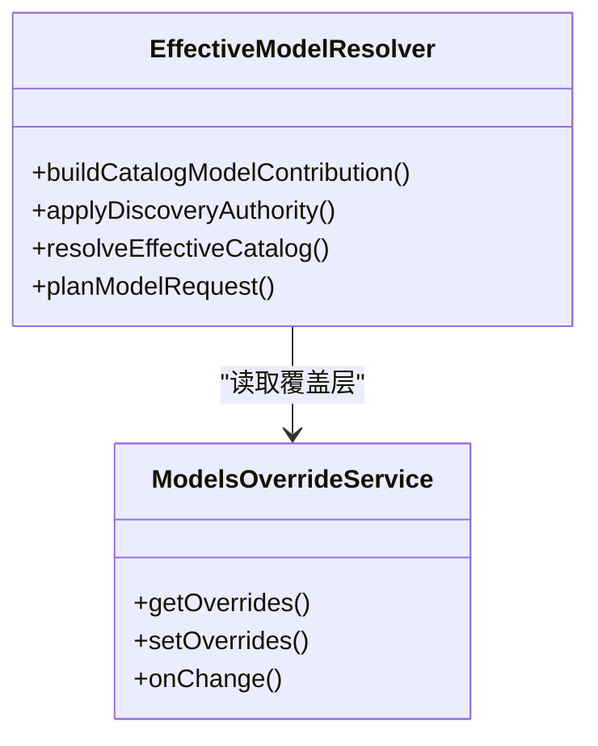
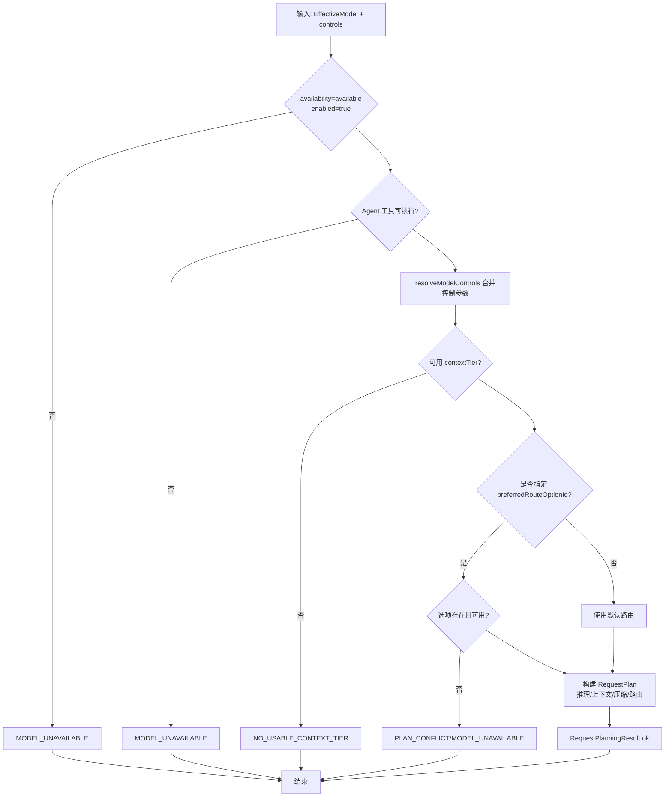
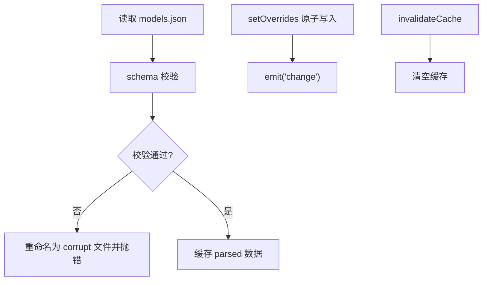
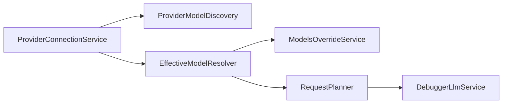

# 模型发现与路由

<cite>
**本文引用的文件**
- [src/main/settings/ProviderModelDiscovery.ts](file://src/main/settings/ProviderModelDiscovery.ts)
- [src/main/settings/EffectiveModelResolver.ts](file://src/main/settings/EffectiveModelResolver.ts)
- [src/main/settings/RequestPlanner.ts](file://src/main/settings/RequestPlanner.ts)
- [src/main/settings/ModelsOverrideService.ts](file://src/main/settings/ModelsOverrideService.ts)
- [src/main/settings/DebuggerLlmService.ts](file://src/main/settings/DebuggerLlmService.ts)
- [src/main/settings/ProviderConnectionService.ts](file://src/main/settings/ProviderConnectionService.ts)
</cite>

## 目录
1. [引言](#引言)
2. [项目结构](#项目结构)
3. [核心组件](#核心组件)
4. [架构总览](#架构总览)
5. [详细组件分析](#详细组件分析)
6. [依赖关系分析](#依赖关系分析)
7. [性能考量](#性能考量)
8. [故障排查指南](#故障排查指南)
9. [结论](#结论)
10. [附录：配置示例与路由规则](#附录配置示例与路由规则)

## 引言
本文件围绕“模型发现与路由”这一主题，系统化说明以下能力：
- ProviderModelDiscovery：如何从 Provider API、声明式目录、账户权限等来源动态发现可用模型。
- EffectiveModelResolver：如何将目录、用户配置、覆盖层、能力探测结果合并为“有效模型”，并给出请求规划建议。
- RequestPlanner：如何根据上下文窗口、推理模式、工具调用能力、路由选项等生成可执行的请求计划，支持负载均衡、故障转移和成本优化。
- ModelsOverrideService：如何通过 models.json 提供模型覆盖、自定义模型映射及路由改写。
- DebuggerLlmService：如何在调试器场景聚合 LLM 使用量、成本、缓存命中与上下文占用，用于诊断与可视化。

文档同时包含流程图、决策树、性能指标建议、调优策略以及配置示例，帮助不同技术背景的读者理解系统行为。

## 项目结构
与模型发现与路由相关的代码主要位于主进程设置子系统：
- ProviderModelDiscovery：负责按协议/解析器策略拉取或校验模型列表，输出结构化模型贡献。
- EffectiveModelResolver：将目录、用户配置、覆盖层、权限、账户范围等合并为“有效目录快照”，并提供 planModelRequest。
- RequestPlanner：将有效模型与对话控制参数转换为 RequestPlan，包括上下文分层、预算、路由选择等。
- ModelsOverrideService：持久化并热更新 models.json，暴露变更事件。
- DebuggerLlmService：收集 Agent 运行时上报的用量与成本，供调试器展示。
- ProviderConnectionService：连接入口，驱动 discoverProviderModels 与 refreshEffectiveCatalogDiscovery。



**图表来源**
- [src/main/settings/ProviderConnectionService.ts:1-120](file://src/main/settings/ProviderConnectionService.ts#L1-L120)
- [src/main/settings/ProviderModelDiscovery.ts:1-120](file://src/main/settings/ProviderModelDiscovery.ts#L1-L120)
- [src/main/settings/EffectiveModelResolver.ts:201-330](file://src/main/settings/EffectiveModelResolver.ts#L201-L330)
- [src/main/settings/RequestPlanner.ts:1-120](file://src/main/settings/RequestPlanner.ts#L1-L120)
- [src/main/settings/ModelsOverrideService.ts:1-117](file://src/main/settings/ModelsOverrideService.ts#L1-L117)
- [src/main/settings/DebuggerLlmService.ts:1-120](file://src/main/settings/DebuggerLlmService.ts#L1-L120)

**章节来源**
- [src/main/settings/ProviderConnectionService.ts:1-200](file://src/main/settings/ProviderConnectionService.ts#L1-L200)
- [src/main/settings/ProviderModelDiscovery.ts:1-200](file://src/main/settings/ProviderModelDiscovery.ts#L1-L200)
- [src/main/settings/EffectiveModelResolver.ts:201-450](file://src/main/settings/EffectiveModelResolver.ts#L201-L450)
- [src/main/settings/RequestPlanner.ts:1-200](file://src/main/settings/RequestPlanner.ts#L1-L200)
- [src/main/settings/ModelsOverrideService.ts:1-117](file://src/main/settings/ModelsOverrideService.ts#L1-L117)
- [src/main/settings/DebuggerLlmService.ts:1-200](file://src/main/settings/DebuggerLlmService.ts#L1-L200)

## 核心组件
- ProviderModelDiscovery：按协议与解析器策略拉取模型清单，执行轻量探针（如 Anthropic 候选验证）与账户目录匹配，返回模型列表、贡献与权限扩展。
- EffectiveModelResolver：构建目录贡献、用户贡献、覆盖贡献、权限贡献，合并为 EffectiveCatalogSnapshot；对外暴露 planModelRequest 作为统一规划入口。
- RequestPlanner：对有效模型做可用性检查、Agent 工具可执行性检查、上下文分层选择、推理开关/级别规范化、温度/压缩阈值计算、路由选项选择与冲突处理，最终产出 RequestPlanningResult。
- ModelsOverrideService：以原子写入方式维护 models.json，支持 schema 校验、损坏隔离、变更事件通知。
- DebuggerLlmService：汇总 runId/sessionId 维度的调用次数、输入/输出 token、缓存读写/命中、推理 token、成本明细、最近一轮 prompt 分解与占用估算。

**章节来源**
- [src/main/settings/ProviderModelDiscovery.ts:1-200](file://src/main/settings/ProviderModelDiscovery.ts#L1-L200)
- [src/main/settings/EffectiveModelResolver.ts:201-450](file://src/main/settings/EffectiveModelResolver.ts#L201-L450)
- [src/main/settings/RequestPlanner.ts:1-200](file://src/main/settings/RequestPlanner.ts#L1-L200)
- [src/main/settings/ModelsOverrideService.ts:1-117](file://src/main/settings/ModelsOverrideService.ts#L1-L117)
- [src/main/settings/DebuggerLlmService.ts:1-200](file://src/main/settings/DebuggerLlmService.ts#L1-L200)

## 架构总览
下图展示了从用户连接 Provider 到最终请求落地的完整链路：



**图表来源**
- [src/main/settings/ProviderConnectionService.ts:120-200](file://src/main/settings/ProviderConnectionService.ts#L120-L200)
- [src/main/settings/ProviderModelDiscovery.ts:120-200](file://src/main/settings/ProviderModelDiscovery.ts#L120-L200)
- [src/main/settings/EffectiveModelResolver.ts:201-330](file://src/main/settings/EffectiveModelResolver.ts#L201-L330)
- [src/main/settings/RequestPlanner.ts:120-200](file://src/main/settings/RequestPlanner.ts#L120-L200)
- [src/main/settings/DebuggerLlmService.ts:120-200](file://src/main/settings/DebuggerLlmService.ts#L120-L200)

## 详细组件分析

### ProviderModelDiscovery：动态模型发现
- 解析策略：通过解析器标识（parserId）与协议组合决定发现策略，例如 OpenAI 兼容、Anthropic 候选验证、Ollama 标签、Cline/OpenRouter/Kimi 等。
- 头部构造：根据 authMode 与协议注入 Authorization、x-api-key、anthropic-version 等头，并合并连接 Schema 中的自定义头。
- 候选验证：对部分协议进行最小请求探测（如 Anthropic /messages），仅保留可响应的 modelId，再与托管模型合并。
- 编码计划模型匹配：对特定计费计划（如 Volcengine Coding Plan）拉取账号可用模型集，并与本地候选进行别名/归一键匹配，优先返回完整 discovered payload。
- 结果封装：返回 models、contributions、entitlementContributions，供上层刷新有效目录。



**图表来源**
- [src/main/settings/ProviderModelDiscovery.ts:1-200](file://src/main/settings/ProviderModelDiscovery.ts#L1-L200)

**章节来源**
- [src/main/settings/ProviderModelDiscovery.ts:1-200](file://src/main/settings/ProviderModelDiscovery.ts#L1-L200)

### EffectiveModelResolver：有效目录与规划入口
- 目录贡献：从编译型 Provider Catalog 清单中提取模型定义，结合 fact source 元信息构建 CatalogModelContribution。
- 用户贡献：读取用户配置的 models 字段，区分 user-managed 与非 user-managed 的路由选项暴露策略。
- 覆盖贡献：读取 modelsOverrideService.getOverrides()，将 modelOverrides 与 custom models 转为贡献层。
- 权限贡献：根据 GitHub Copilot 等账户账单/权限数据，补充 entitlement 维度。
- 权威列表：当 surface.discovery.authority 为 authoritative-list 时，若发现清单缺失某已定义模型，会将其标记为 unavailable。
- 规划入口：planModelRequest 委托 RequestPlanner，并基于 effectiveCatalogService 缓存获取快照。



**图表来源**
- [src/main/settings/EffectiveModelResolver.ts:201-450](file://src/main/settings/EffectiveModelResolver.ts#L201-L450)
- [src/main/settings/ModelsOverrideService.ts:1-117](file://src/main/settings/ModelsOverrideService.ts#L1-L117)

**章节来源**
- [src/main/settings/EffectiveModelResolver.ts:201-450](file://src/main/settings/EffectiveModelResolver.ts#L201-L450)
- [src/main/settings/ModelsOverrideService.ts:1-117](file://src/main/settings/ModelsOverrideService.ts#L1-L117)

### RequestPlanner：请求规划逻辑
- 可用性检查：模型 availability 非 available 或 enabled=false 直接失败。
- Agent 工具可执行性：若非显式允许，则检查 isAgentToolExecutableModel，不可用则拒绝。
- 能力评估：调用 resolveModelControls 合并模型默认值与传入 controls，识别 PLAN_CONFLICT、MAX_CONTEXT_BLOCKED 等错误。
- 上下文分层：基于 contextTiers 选择 activeTier（normal 或 maxContext），若无可用层级则失败。
- 路由选择：
  - 支持 preferredRouteOptionId 精确指定路由选项；
  - 校验该选项存在且 availability=available；
  - 生成 routeRevision 以稳定缓存键。
- 控制参数：推理开关/级别、fast mode、maxContext、temperature、compactionThresholdPercent 等经标准化后进入 RequestPlan。
- 返回值：成功返回 RequestPlanningResult，失败返回带 code/message 的计划错误，并附带 controls 以便 UI 提示。



**图表来源**
- [src/main/settings/RequestPlanner.ts:1-200](file://src/main/settings/RequestPlanner.ts#L1-L200)

**章节来源**
- [src/main/settings/RequestPlanner.ts:1-200](file://src/main/settings/RequestPlanner.ts#L1-L200)

### ModelsOverrideService：模型覆盖与自定义映射
- 存储位置：用户 RDC 根目录下的 models.json。
- 安全与一致性：
  - JSON 解析前走 schema 校验；
  - 损坏文件自动重命名为 *.corrupt-时间戳，并抛出 ModelsOverrideCorruptError；
  - setOverrides 采用原子写入（临时文件+fsync+rename）。
- 事件机制：变更时 emit('change')，携带 overrides 与 updatedAt。
- 缓存策略：内存中缓存 parsed 结果，invalidateCache 可主动失效。



**图表来源**
- [src/main/settings/ModelsOverrideService.ts:1-117](file://src/main/settings/ModelsOverrideService.ts#L1-L117)

**章节来源**
- [src/main/settings/ModelsOverrideService.ts:1-117](file://src/main/settings/ModelsOverrideService.ts#L1-L117)

### DebuggerLlmService：调试器专用 LLM 服务
- 聚合维度：runId/turnId/sessionId，排除子代理会话。
- 统计项：成功/失败调用次数、input/output/cacheread/cachewrite/cachehit/cachemiss/reasoning tokens、cost.total、最近一轮 cost 明细、routesUsed 记录。
- 上下文占用估算：对 provider 上报的 breakdown 做缩放，追加 free 槽位，便于可视化。
- 存储：内存 Map 为主，必要时持久化，查询时判断 stale。
- 设计约束：不直接实现 Provider 调用，所有调用必须经过 AgentOrchestrator -> PromptPlan -> RequestEnvelope -> RequestPlan 管线。

```mermaid
sequenceDiagram
  participant AR as "AgentRuntime"
  participant DLS as "DebuggerLlmService"
  AR->>DLS: "recordAgentTurnUsage(params)"
  DLS->>DLS: "聚合 tokens/cost/routesUsed"
  DLS->>DLS: "buildScaledBreakdown(上下文占用估算)"
  DLS--AR: "getRunSummary()/getSessionContextUsage()"
```

**图表来源**
- [src/main/settings/DebuggerLlmService.ts:1-200](file://src/main/settings/DebuggerLlmService.ts#L1-L200)

**章节来源**
- [src/main/settings/DebuggerLlmService.ts:1-200](file://src/main/settings/DebuggerLlmService.ts#L1-L200)

## 依赖关系分析
- ProviderConnectionService 依赖 ProviderModelDiscovery 进行实际发现，并通过 EffectiveModelResolver.refreshEffectiveCatalogDiscovery 将发现结果融入有效目录。
- EffectiveModelResolver 依赖 ModelsOverrideService 读取覆盖层，依赖 catalog registry 与 settings service 完成多源合并。
- RequestPlanner 依赖 shared 类型与 utils，对 EffectiveModel 与控制参数做确定性规划。
- DebuggerLlmService 依赖 storageAdapter、workflowProjectionPublisher 与 settingsService，但不直接访问 Provider。



**图表来源**
- [src/main/settings/ProviderConnectionService.ts:1-200](file://src/main/settings/ProviderConnectionService.ts#L1-L200)
- [src/main/settings/EffectiveModelResolver.ts:201-450](file://src/main/settings/EffectiveModelResolver.ts#L201-L450)
- [src/main/settings/RequestPlanner.ts:1-200](file://src/main/settings/RequestPlanner.ts#L1-L200)
- [src/main/settings/DebuggerLlmService.ts:1-200](file://src/main/settings/DebuggerLlmService.ts#L1-L200)

**章节来源**
- [src/main/settings/ProviderConnectionService.ts:1-200](file://src/main/settings/ProviderConnectionService.ts#L1-L200)
- [src/main/settings/EffectiveModelResolver.ts:201-450](file://src/main/settings/EffectiveModelResolver.ts#L201-L450)
- [src/main/settings/RequestPlanner.ts:1-200](file://src/main/settings/RequestPlanner.ts#L1-L200)
- [src/main/settings/DebuggerLlmService.ts:1-200](file://src/main/settings/DebuggerLlmService.ts#L1-L200)

## 性能考量
- 发现阶段
  - 按需探测：仅在必要协议下进行最小请求探测，避免全量验证带来的延迟。
  - 批量处理：对候选模型遍历探测时使用独立超时与异常隔离，单个失败不影响其他模型。
- 规划阶段
  - 稳定性：routeRevision 使用稳定序列化与哈希，减少无效重建。
  - 控制参数合并：resolveModelControls 集中处理默认值与冲突，避免重复分支判断。
- 覆盖层
  - 原子写入：避免并发写入导致 models.json 损坏；损坏自动隔离。
  - 内存缓存：降低频繁读取开销。
- 调试器统计
  - 增量聚合：按 runId/turnId 增量累加，避免全量扫描。
  - 子代理过滤：跳过非占用型 breakdown 与子代理会话，降低噪声。

调优建议
- 合理设置 REQUEST_TIMEOUT_MS，平衡发现速度与稳定性。
- 在高频场景中启用 effectiveCatalogService 缓存，避免重复构建快照。
- 对大模型任务启用 maxContext 与合适的 compactionThresholdPercent，降低首包延迟。
- 通过 preferredRouteOptionId 固定高可用路由，配合 cost 字段进行成本优化。
- 定期清理 models.json 中废弃模型，保持覆盖层精简。

[本节为通用性能指导，无需源码引用]

## 故障排查指南
- 连接测试失败
  - 现象：testProviderDraft/connectProvider 返回 error。
  - 排查：确认 apiKey/baseUrl/connectionValues 是否正确；检查网络与鉴权头；查看 ProviderConnectionService 的错误解析。
- 模型发现为空或部分缺失
  - 现象：discoverProviderModels 返回空或受限模型集。
  - 排查：检查 discovery.strategy 与 parserId 是否匹配协议；确认账户权限/编码计划是否包含目标模型；关注权威列表（authoritative-list）导致的 unavailable 标记。
- 规划失败
  - 现象：planModelRequest 返回 MODEL_UNAVAILABLE、PLAN_CONFLICT、NO_USABLE_CONTEXT_TIER。
  - 排查：检查模型 availability/enabled、preferredRouteOptionId 是否存在且可用、contextTiers 是否有可用层级。
- models.json 损坏
  - 现象：ModelsOverrideCorruptError 抛出。
  - 排查：查看 quarantined corrupt 文件内容；修正后重新 setOverrides。
- 调试器用量不准确
  - 现象：DebuggerLlmService 未显示预期成本或 token。
  - 排查：确认 recordAgentTurnUsage 被调用；检查 sessionId 是否为子代理；核对 hasMaterialProviderUsageTelemetry 条件。

**章节来源**
- [src/main/settings/ProviderConnectionService.ts:120-200](file://src/main/settings/ProviderConnectionService.ts#L120-L200)
- [src/main/settings/ProviderModelDiscovery.ts:120-200](file://src/main/settings/ProviderModelDiscovery.ts#L120-L200)
- [src/main/settings/RequestPlanner.ts:120-200](file://src/main/settings/RequestPlanner.ts#L120-L200)
- [src/main/settings/ModelsOverrideService.ts:1-117](file://src/main/settings/ModelsOverrideService.ts#L1-L117)
- [src/main/settings/DebuggerLlmService.ts:120-200](file://src/main/settings/DebuggerLlmService.ts#L120-L200)

## 结论
本方案通过 ProviderModelDiscovery、EffectiveModelResolver、RequestPlanner、ModelsOverrideService 与 DebuggerLlmService 形成端到端的“发现—合并—规划—观测”闭环。它既支持多协议与多来源的动态模型发现，又能在运行期基于能力、配额与成本进行稳健的请求规划，并为调试与优化提供精细的用量与成本观测。

[本节为总结性内容，无需源码引用]

## 附录：配置示例与路由规则

### 模型覆盖配置（models.json）
- 文件位置：用户 RDC 根目录下 models.json。
- 典型字段
  - schemaVersion：配置文件版本。
  - providers：按 providerId 分组。
  - providers[].modelOverrides：针对已有模型的覆盖，例如：
    - contextWindow：覆盖上下文窗口。
    - maxTokens：覆盖最大输出 token。
    - cost：覆盖定价。
    - status：状态（如 retiring）。
    - reasoning：强制推理开关。
    - input：声明图像输入支持。
  - providers[].models：自定义模型，例如：
    - id/name：自定义模型标识与名称。
    - baseUrl：自定义端点。
    - contextWindow/maxTokens：上下文与输出限制。
    - reasoning/input/cost：能力与成本。

注意：修改后需调用 setOverrides 或重启应用以使覆盖生效；损坏文件将被自动隔离。

**章节来源**
- [src/main/settings/ModelsOverrideService.ts:1-117](file://src/main/settings/ModelsOverrideService.ts#L1-L117)
- [src/main/settings/EffectiveModelResolver.ts:330-450](file://src/main/settings/EffectiveModelResolver.ts#L330-L450)

### 路由规则与优先级
- 路由来源优先级
  - 用户指定 preferredRouteOptionId：最高优先级，需存在且可用。
  - 目录定义 route/routeOptions：来自编译型目录或用户 managed 表面。
  - 提供者默认：回退到 provider.baseUrl 与默认协议。
- 权威列表（authoritative-list）
  - 若发现清单缺少已定义模型，则标记 unavailable，避免隐藏模型。
- 路由选项暴露
  - 仅 user-managed 且 additive 授权的表面暴露完整路由矩阵作为 per-model routeOptions。

**章节来源**
- [src/main/settings/EffectiveModelResolver.ts:201-330](file://src/main/settings/EffectiveModelResolver.ts#L201-L330)
- [src/main/settings/RequestPlanner.ts:120-200](file://src/main/settings/RequestPlanner.ts#L120-L200)

### 请求规划关键参数
- 上下文分层
  - normalTier 与 maxTier：根据 maxContext 能力选择。
- 推理控制
  - kind/supportsOff/levels/defaultSelection/wireProfile：统一收敛至 wire profile。
- 压缩阈值
  - compactionThresholdPercent：默认 80%，可通过设置或服务传入覆盖。
- 温度与工具调用
  - requestedTemperature：由调用方传入；isAgentToolExecutableModel 决定是否允许 Agent 工具路径。

**章节来源**
- [src/main/settings/RequestPlanner.ts:1-200](file://src/main/settings/RequestPlanner.ts#L1-L200)