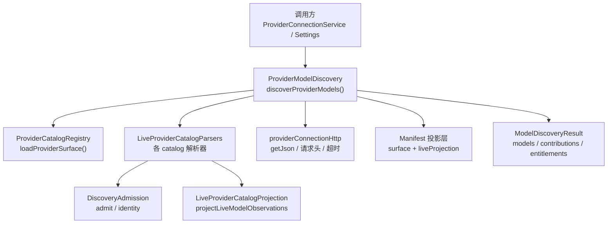
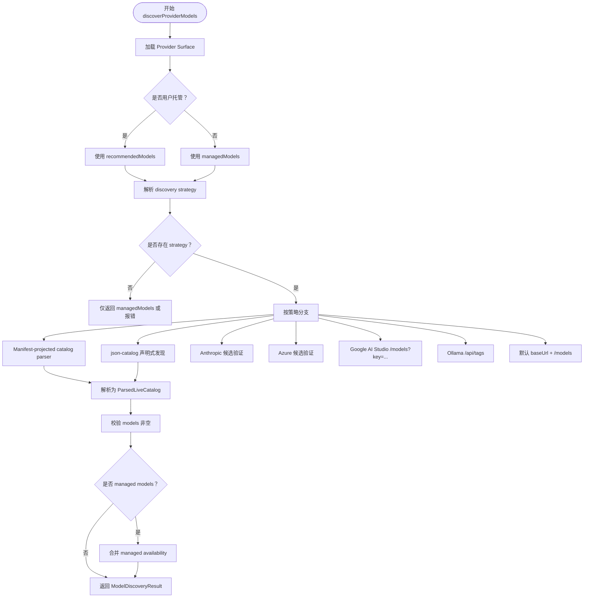
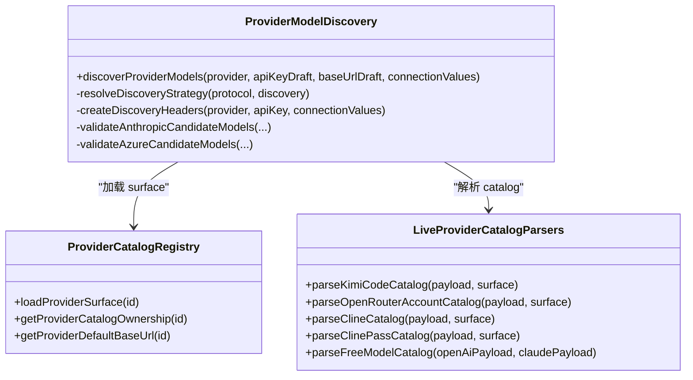
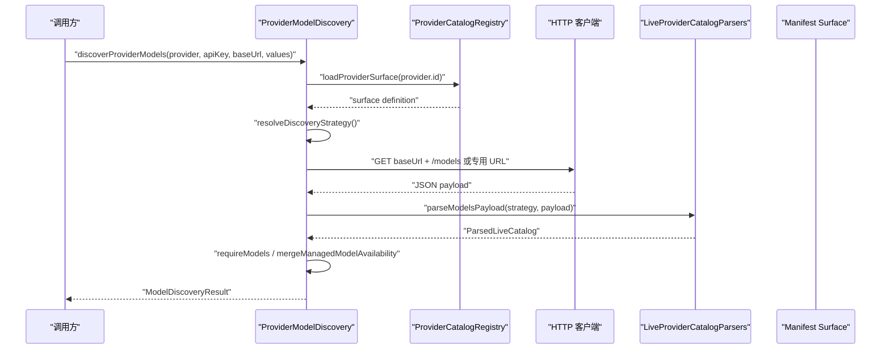
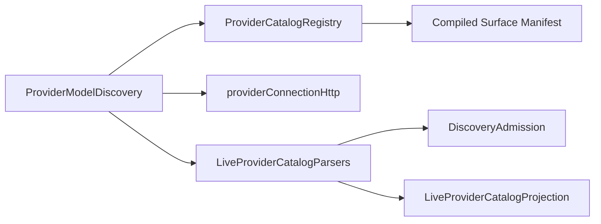

# 模型发现机制

<cite>
**本文引用的文件**   
- [ProviderModelDiscovery.ts](file://src/main/settings/ProviderModelDiscovery.ts)
- [LiveProviderCatalogParsers.ts](file://src/main/settings/LiveProviderCatalogParsers.ts)
- [provider-architecture.md](file://docs/architecture/provider-architecture.md)
- [provider-model-catalog.md](file://docs/product/provider-model-catalog.md)
- [LiveProviderCatalogParsers.test.ts](file://src/main/settings/LiveProviderCatalogParsers.test.ts)
- [DeclarativeCatalogDiscovery.test.ts](file://src/main/settings/DeclarativeCatalogDiscovery.test.ts)
</cite>

## 目录
1. [引言](#引言)
2. [项目结构定位](#项目结构定位)
3. [核心组件](#核心组件)
4. [架构总览](#架构总览)
5. [详细组件分析](#详细组件分析)
6. [依赖关系分析](#依赖关系分析)
7. [性能与超时重试](#性能与超时重试)
8. [错误处理策略](#错误处理策略)
9. [配置示例与调试技巧](#配置示例与调试技巧)
10. [结论](#结论)

## 引言
本文说明 RDC-Agent 的模型发现机制，重点解释：
- `ProviderModelDiscovery` 如何根据 Provider 协议与 manifest 中的 discovery 配置，动态发现可用模型。
- 从 provider API 拉取、本地静态清单、增量观察与账户权限覆盖之间的关系。
- 不同 discovery strategy 的工作流程，包括 `openai-compatible`、`anthropic-candidate-validation`、`ollama-tags`、`kimi-code-catalog`、`openrouter-catalog`、`cline-catalog` 等。
- `LiveProviderCatalogParsers` 解析器系统如何处理不同 provider 的原始响应，并产出 `ParsedLiveCatalog`。
- 模型发现的流程图、错误处理、超时控制、重试边界，以及面向用户的配置与调试建议。

该机制遵循“声明优先、运行时只投影证据”的原则：manifest 决定产品身份、路由、控件与执行绑定；live discovery 仅补充上游可见性、上下文窗口、推理能力等观察事实，不发明协议或能力。

**章节来源**
- [provider-architecture.md:1-138](file://docs/architecture/provider-architecture.md#L1-L138)
- [provider-model-catalog.md:1-159](file://docs/product/provider-model-catalog.md#L1-L159)

## 项目结构定位
模型发现相关代码集中在主进程 settings 层，并与 shared provider catalog 编译产物交互：

**图表来源**
- [ProviderModelDiscovery.ts:1-200](file://src/main/settings/ProviderModelDiscovery.ts#L1-L200)
- [ProviderModelDiscovery.ts:201-524](file://src/main/settings/ProviderModelDiscovery.ts#L201-L524)
- [LiveProviderCatalogParsers.ts:1-120](file://src/main/settings/LiveProviderCatalogParsers.ts#L1-L120)

**章节来源**
- [ProviderModelDiscovery.ts:1-200](file://src/main/settings/ProviderModelDiscovery.ts#L1-L200)
- [LiveProviderCatalogParsers.ts:1-120](file://src/main/settings/LiveProviderCatalogParsers.ts#L1-L120)

## 核心组件
- **`discoverProviderModels`**：统一入口，负责加载 surface、选择 discovery strategy、组装请求头、拉取数据、调用解析器、合并受管模型、返回模型列表与贡献元数据。
- **`resolveDiscoveryStrategy`**：将 provider protocol 与 manifest 中 `discovery.strategy.parserId` 映射为内部策略字符串。
- **`LiveProviderCatalogParsers`**：一组解析器，把不同 provider 的原始 JSON 转换为统一的 `ParsedLiveCatalog`，再经 manifest 投影生成 `CatalogModelContribution`。
- **`ParsedLiveCatalog`**：包含 `models`、`contributions`、可选 `entitlementContributions` 和诊断信息。
- **`ModelDiscoveryResult`**：对外暴露模型数组、贡献、权限贡献及 discovery 诊断字段。

关键类型与职责划分：
- `models`：最终可选择的模型 ID 列表。
- `contributions`：来自 live catalog 的结构化贡献，如上下文窗口、推理等级、工具调用、视觉输入等。
- `entitlementContributions`：账号或订阅维度的额外贡献，例如 ClinePass、Kimi Coding Plan 的内部 Fast target。
- `diagnostic`：用于诊断解析结果，如 Grok Builder Catalog 的 envelope 类型、候选数、过滤原因计数。

**章节来源**
- [ProviderModelDiscovery.ts:201-524](file://src/main/settings/ProviderModelDiscovery.ts#L201-L524)
- [LiveProviderCatalogParsers.ts:1-120](file://src/main/settings/LiveProviderCatalogParsers.ts#L1-L120)

## 架构总览
模型发现的整体流程如下：

**图表来源**
- [ProviderModelDiscovery.ts:201-524](file://src/main/settings/ProviderModelDiscovery.ts#L201-L524)

**章节来源**
- [ProviderModelDiscovery.ts:201-524](file://src/main/settings/ProviderModelDiscovery.ts#L201-L524)

## 详细组件分析

### ProviderModelDiscovery 与策略路由
`discoverProviderModels` 是模型发现的中心协调器。它按以下顺序工作：
1. 拒绝 account 模式直接测试；account 必须走登录流程。
2. 通过 `loadProviderSurface` 加载 manifest 中的 surface 定义。
3. 根据 `catalogOwnership` 决定是否使用 managed models（如 OpenCode Go、Cline Pass、Volcengine Coding Plan 等）。
4. 校验必要配置：未提供 Base URL 或缺少 discovery 配置会报错。
5. 对特殊 provider 走专用路径：Amazon Bedrock、GitLab Duo、SAP AI Core。
6. 对其他路径，先判断是否为 manifest-projected catalog parser；若是，则按策略解析对应 URL 并调用对应 parser。
7. 否则按策略进入声明式 json-catalog、Google Vertex、Volcengine Coding Plan、Anthropic/Azure probe、Google AI Studio、Ollama tags 或默认 `/models`。

**图表来源**
- [ProviderModelDiscovery.ts:1-200](file://src/main/settings/ProviderModelDiscovery.ts#L1-L200)
- [ProviderModelDiscovery.ts:201-524](file://src/main/settings/ProviderModelDiscovery.ts#L201-L524)
- [LiveProviderCatalogParsers.ts:380-648](file://src/main/settings/LiveProviderCatalogParsers.ts#L380-L648)

**章节来源**
- [ProviderModelDiscovery.ts:201-524](file://src/main/settings/ProviderModelDiscovery.ts#L201-L524)

### Discovery Strategy 映射
`resolveDiscoveryStrategy` 将外部配置映射为内部策略键，支持以下行为：
- 精确 parserId：如 `kimi-code-catalog`、`opencode-go-catalog`、`openrouter-catalog`、`cline-catalog`、`cline-pass-catalog`、`google-vertex-models`、`gitlab-duo-direct-access`、`sap-ai-core-deployments`、`freemodel-catalog`、`google-ai-studio`、`azure-deployment`、`ollama-tags`。
- 协议回退：
  - `OpenAICompatibleChatCompletions`、`OpenAIResponses`、`OpenRouterChatCompletions` → `openai-compatible`。
  - `AnthropicMessages` → `anthropic-candidate-validation`。
  - `OllamaOpenAICompatibleChatCompletions` → `ollama-tags`。
- 若找不到 strategy 且不是 user-managed，则仅返回 managed models；若是 user-managed，则抛出缺少 discovery 配置的错误。

**章节来源**
- [ProviderModelDiscovery.ts:1-200](file://src/main/settings/ProviderModelDiscovery.ts#L1-L200)

### Manifest-projected Catalog Parser 路径
当 strategy 命中 `MANIFEST_PROJECTED_CATALOG_PARSERS` 时，调用对应 parser：
- `kimi-code-catalog`：Kimi Coding Plan 账号目录。
- `opencode-go-catalog`：OpenCode Go 动态 admitted models。
- `openrouter-catalog`：OpenRouter PKCE 账号可见模型。
- `cline-catalog`：Cline usage 目录。
- `cline-pass-catalog`：ClinePass plan 目录。

这些 parser 会先构造请求头，必要时先做凭据探测，再拉取 `/models` 或特定目录 URL，然后调用解析器生成 `ParsedLiveCatalog`。

**章节来源**
- [ProviderModelDiscovery.ts:201-524](file://src/main/settings/ProviderModelDiscovery.ts#L201-L524)

### 声明式 json-catalog 发现
如果 surface 的 discovery 配置为 `json-catalog`，则：
1. 通过 `resolveDeclarativeDiscoveryUrl` 计算 URL。
2. 按声明的方法与额外 headers 发起请求。
3. 通过 `parseDeclarativeCatalog` 解析模型。
4. 转为静态模型列表与 contributions。
5. 若 authority 不是 `authoritative-list`，且存在 managed models，则合并 managed availability。

**章节来源**
- [ProviderModelDiscovery.ts:201-524](file://src/main/settings/ProviderModelDiscovery.ts#L201-L524)

### Anthropic 候选验证
对于 `anthropic-candidate-validation`：
1. 对每个 candidate model id 向 `/messages` 发送极小探测请求。
2. 成功则保留该 model id。
3. 若有 managed models，则合并 managed availability。
4. 最终返回有效模型列表。

该策略适合“已知候选列表 + 服务端可用性验证”的场景。

**章节来源**
- [ProviderModelDiscovery.ts:1-200](file://src/main/settings/ProviderModelDiscovery.ts#L1-L200)

### Azure 候选验证
对于 `azure-deployment`：
1. 构造 Azure `/chat/completions?api-version=2024-10-21`。
2. 对每个 candidate model id 发送探测请求。
3. 成功后保留该 model id。
4. 与 managed models 合并 availability。

**章节来源**
- [ProviderModelDiscovery.ts:201-524](file://src/main/settings/ProviderModelDiscovery.ts#L201-L524)

### Google AI Studio、Vertex、Bedrock、Ollama
- **Google AI Studio**：通过 `/models?key=apiKey` 获取模型列表。
- **Google Vertex**：
  - Anthropic route：从 Publisher Models 地址拉取 Anthropic 模型。
  - Gemini route：从 OpenAI-compatible `/models` 拉取，并按协议过滤含 `gemini` 的模型。
- **Amazon Bedrock**：从 `/models` 拉取并使用 `projectBedrockMantleModelRoutes` 生成 route。
- **Ollama**：从 origin 下的 `/api/tags` 拉取标签，而非 `baseUrl + /models`。
- **默认路径**：其他情况访问 `baseUrl + /models`，并用通用 `parseModelsPayload` 解析。

**章节来源**
- [ProviderModelDiscovery.ts:201-524](file://src/main/settings/ProviderModelDiscovery.ts#L201-L524)

### LiveProviderCatalogParsers 解析器系统
解析器的共同目标是：
1. 从原始 payload 中提取候选记录。
2. 标准化模型 identity、label、上下文窗口、输出 token、推理等级、工具调用、视觉、结构化输出等。
3. 通过 `asResult` 合并贡献、排序模型。
4. 通过 `projectLiveModelObservations` 将 live observation 投影到 manifest 定义的 `liveProjection` 上。

关键解析器：
- `parseKimiCodeCatalog`：严格要求 data/models 数组，按 exact product id 过滤，保留 manifest 拥有的 label 与 controls。
- `parseChatGptAccountCatalog`：从 ChatGPT Account `/models` 提取 slug/id，构建 Codex context tiers。
- `parseClaudeAccountCatalog`：从 Anthropic `/models` 提取 account-visible ids。
- `parseOpenCodeGoCatalog`：按 admission 规则过滤，保留 per-model protocol。
- `parseClineCatalog`：排除 ClinePass 行，仅 admit 非 ClinePass 模型。
- `parseClinePassCatalog`：规范化 `cline-pass/...` id，并通过 manifest 匹配准入。
- `parseFreeModelCatalog`：分别处理 OpenAI 与 Claude 两个 host，避免跨协议混用。
- `parseOpenRouterAccountCatalog`：解析 OpenRouter PKCE 账号目录，推断 toolCalling、visionInput、structuredOutput。
- `parseGrokBuilderCatalog`：兼容多种 envelope 形状，统计 invalidIdentity、hidden、unsupportedInApi。

**章节来源**
- [LiveProviderCatalogParsers.ts:1-379](file://src/main/settings/LiveProviderCatalogParsers.ts#L1-L379)
- [LiveProviderCatalogParsers.ts:380-648](file://src/main/settings/LiveProviderCatalogParsers.ts#L380-L648)

### 模型发现主流程时序图

**图表来源**
- [ProviderModelDiscovery.ts:201-524](file://src/main/settings/ProviderModelDiscovery.ts#L201-L524)
- [LiveProviderCatalogParsers.ts:1-120](file://src/main/settings/LiveProviderCatalogParsers.ts#L1-L120)

## 依赖关系分析
- `ProviderModelDiscovery` 依赖 `ProviderCatalogRegistry` 获取 surface、ownership、default base url。
- `ProviderModelDiscovery` 依赖 `providerConnectionHttp` 进行网络请求、header 构造、超时常量。
- `ProviderModelDiscovery` 依赖 `LiveProviderCatalogParsers` 将原始响应转为结构化贡献。
- `LiveProviderCatalogParsers` 依赖 `DiscoveryAdmission` 与 `LiveProviderCatalogProjection` 完成准入与投影。
- 所有 manifest 相关事实由 shared provider catalog 编译产物提供，TS 层不硬编码产品语义。

**图表来源**
- [ProviderModelDiscovery.ts:1-200](file://src/main/settings/ProviderModelDiscovery.ts#L1-L200)
- [LiveProviderCatalogParsers.ts:1-120](file://src/main/settings/LiveProviderCatalogParsers.ts#L1-L120)

**章节来源**
- [ProviderModelDiscovery.ts:1-200](file://src/main/settings/ProviderModelDiscovery.ts#L1-L200)
- [LiveProviderCatalogParsers.ts:1-120](file://src/main/settings/LiveProviderCatalogParsers.ts#L1-L120)

## 性能与超时重试
- **超时**：网络请求使用 `REQUEST_TIMEOUT_MS`，并在 Anthropic/Azure probe 中通过 `AbortController` 中断长连接。
- **重试边界**：
  - 文档明确提到账号请求在尚未输出 stream 内容的 401 上最多重试一次，先刷新上游凭据再原位替换 credential material。
  - Discovery 阶段本身没有显式指数退避重试循环；失败通常直接抛出连接错误或返回空结果。
- **并发**：FreeModel 同时并行拉取 OpenAI 与 Claude 两个 hosts 的 models，减少等待时间。
- **缓存**：surface 加载与 catalog revision 由 catalog registry 管理，变化才失效对应缓存，不广播完整 catalog。

建议：
- 对高频 discovery 场景，应复用已加载 surface 与 cached catalog projection。
- 对第三方 provider 不稳定接口，应在上层实现有限次重试与降级策略，而不是在 parser 内重试。
- 注意 Ollama `/api/tags` 与默认 `/models` 的区别，避免无效请求。

**章节来源**
- [ProviderModelDiscovery.ts:1-200](file://src/main/settings/ProviderModelDiscovery.ts#L1-L200)
- [ProviderModelDiscovery.ts:201-524](file://src/main/settings/ProviderModelDiscovery.ts#L201-L524)
- [provider-architecture.md:100-138](file://docs/architecture/provider-architecture.md#L100-L138)

## 错误处理策略
- **缺少 discovery 配置**：user-managed provider 若无 strategy，抛出“Provider 缺少模型发现配置”。
- **Base URL 为空**：抛出“请填写 Provider Base URL”。
- **API Key 缺失**：对 api-key provider 无 key 且无法自动解析 Vertex credentials 时，抛出“请输入 API Key”。
- **Provider 不在内置 catalog**：抛出“Provider 不在内置 catalog 中”。
- **Account 模式误用**：直接抛出“Account providers must be tested through the account login flow.”。
- **模型结果为空**：部分路径如 Volcengine Coding Plan 会在无可用模型时抛出“Provider 暂未返回可用于 Agent 路由的模型”。
- **Catalog 格式错误**：parser 中对缺失 data/models 数组、非 object entry、缺失 id 等情况抛出错误，保证 fail-closed。
- **401/403 与配额**：文档明确 HTTP 401/403 不等同于订阅证据；只有 strict manifest matcher 才可分类为 entitlement denial。HTTP 429 是瞬态配额，HTTP 402 仅在明确标识 quota exhaustion 时视为瞬态配额。

**章节来源**
- [ProviderModelDiscovery.ts:201-524](file://src/main/settings/ProviderModelDiscovery.ts#L201-L524)
- [LiveProviderCatalogParsers.ts:120-379](file://src/main/settings/LiveProviderCatalogParsers.ts#L120-L379)
- [provider-architecture.md:100-138](file://docs/architecture/provider-architecture.md#L100-L138)

## 配置示例与调试技巧

### discovery strategy 配置要点
- 若 manifest 中 discovery.strategy.kind 为 `custom-parser`，parserId 决定具体解析逻辑。
- 常见 parserId 与策略：
  - `openai-compatible`：适用于 OpenAI Compatible Chat Completions、OpenAI Responses、OpenRouter Chat Completions。
  - `anthropic-candidate-validation`：适用于 Anthropic Messages，并对候选 model id 发探测请求。
  - `ollama-tags`：适用于 Ollama，从 `/api/tags` 拉取。
  - `kimi-code-catalog`：Kimi Coding Plan 账号目录。
  - `openrouter-catalog`：OpenRouter 账号目录。
  - `cline-catalog`：Cline usage 目录。
  - `cline-pass-catalog`：ClinePass plan 目录。
  - `google-vertex-models`：Google Vertex Publisher Models 或 OpenAI-compatible models。
  - `google-ai-studio`：Google AI Studio `/models?key=...`。
  - `azure-deployment`：Azure deployment candidate validation。
  - `gitlab-duo-direct-access`：GitLab Duo direct access。
  - `sap-ai-core-deployments`：SAP AI Core deployments。
  - `freemodel-catalog`：FreeModel 双 host catalog。
  - `json-catalog`：声明式 catalog，需配合 `resolveDeclarativeDiscoveryUrl` 与 `parseDeclarativeCatalog`。

参考测试中使用的 custom-parser 配置：
- [DeclarativeCatalogDiscovery.test.ts:60](file://src/main/settings/DeclarativeCatalogDiscovery.test.ts#L60)

### 调试技巧
- **检查 surface 是否加载**：确认 `loadProviderSurface` 能返回 expected surface，特别是 `discovery.strategy` 与 `models[].liveProjection`。
- **打印 raw payload**：对 `parseKimiCodeCatalog`、`parseOpenRouterAccountCatalog`、`parseClineCatalog`、`parseClinePassCatalog`、`parseFreeModelCatalog`、`parseGrokBuilderCatalog` 的输入进行快照比对。
- **验证 admission 与 projection**：使用 `LiveProviderCatalogParsers.test.ts` 中的 fixture 与 compiled catalog surface，确认 live observation 是否正确投影为 contribution。
- **区分 structural capability 与 observed evidence**：manifest 决定结构性能力；live discovery 只能收窄或补充证据，不能把 unknown 变成 supported。
- **检查 managed models 合并**：对 OpenCode Go、Cline Pass、Volcengine Coding Plan 等，确认 `mergeManagedModelAvailability` 与 alias index 是否正确。
- **关注 diagnostic**：Grok Builder Catalog 返回 `envelopeKind`、`candidateCount`、`admittedCount`、`filtered.invalidIdentity`、`filtered.hidden`、`filtered.unsupportedInApi`，有助于定位上游响应结构问题。

**章节来源**
- [LiveProviderCatalogParsers.test.ts:1-200](file://src/main/settings/LiveProviderCatalogParsers.test.ts#L1-L200)
- [LiveProviderCatalogParsers.ts:380-648](file://src/main/settings/LiveProviderCatalogParsers.ts#L380-L648)
- [DeclarativeCatalogDiscovery.test.ts:60](file://src/main/settings/DeclarativeCatalogDiscovery.test.ts#L60)

## 结论
RDC-Agent 的模型发现机制以 manifest 为权威事实源，以 discovery strategy 为路由开关，以 `LiveProviderCatalogParsers` 为多 provider 解析适配层，最终产出 `ModelDiscoveryResult`。其设计强调：
- 不猜测协议、不伪造能力、不跨 surface 共享能力。
- live discovery 只报告上游可见性与观察证据。
- 对异常、缺失配置、空结果采取 fail-closed 策略。
- 对认证、配额、超时有明确边界，避免无限重试或静默降级。

在实际使用中，应优先确保 manifest 中 surface 的 discovery 配置正确，再通过测试 fixture 与 diagnostic 字段验证解析结果，最后结合 Effective Catalog 与 RequestPlan 确认最终执行真值。