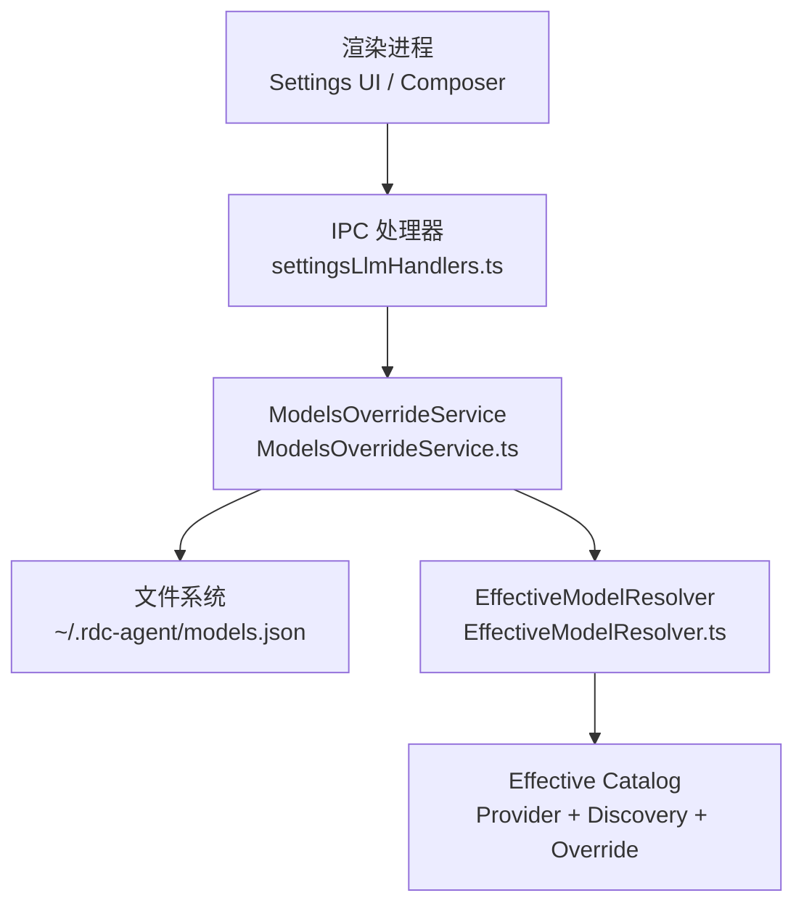
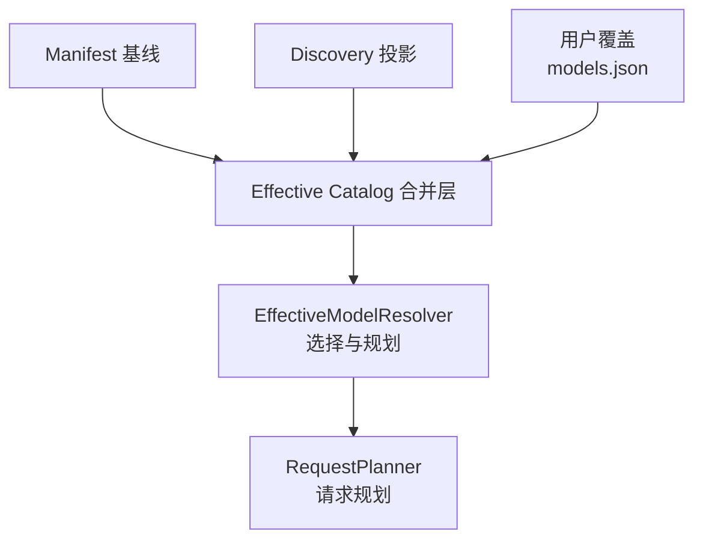
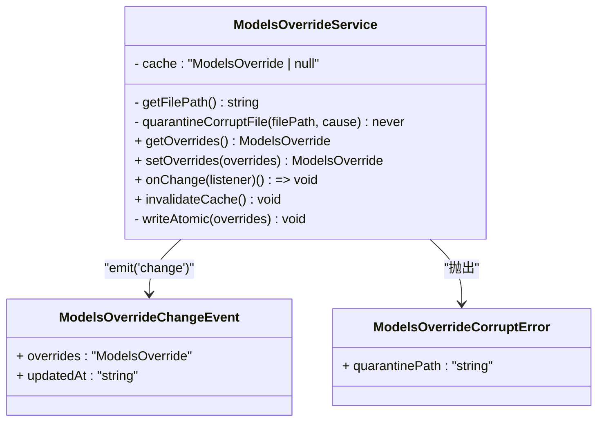
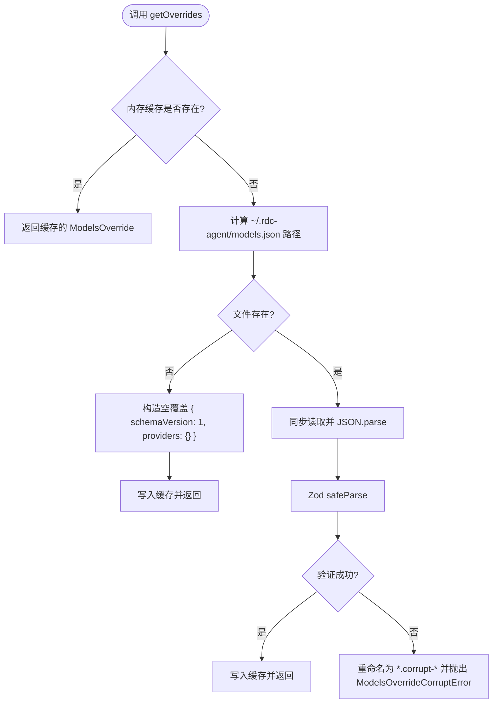
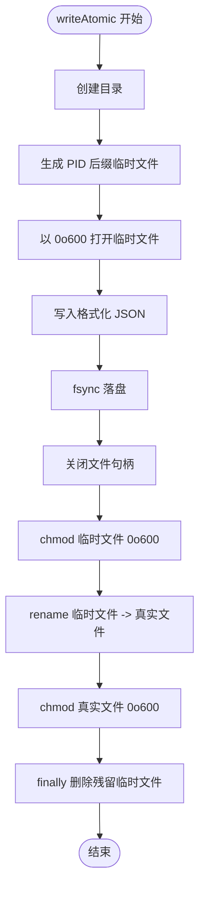
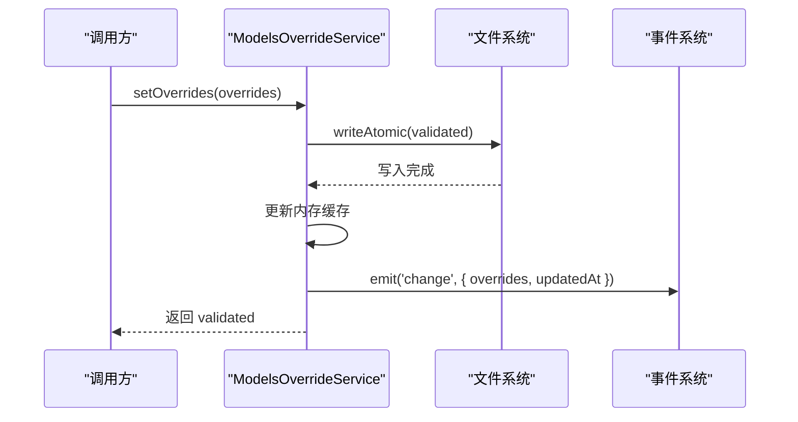
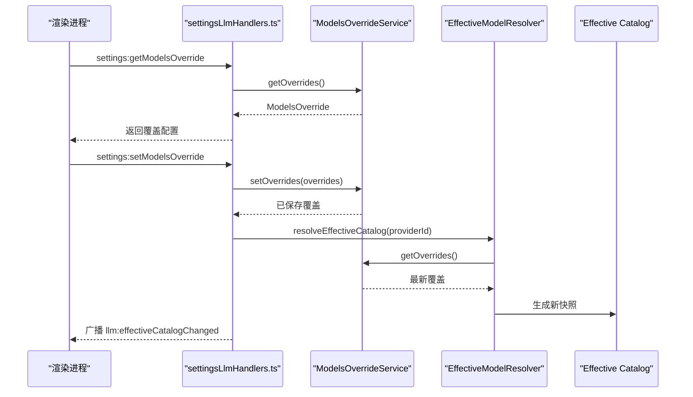
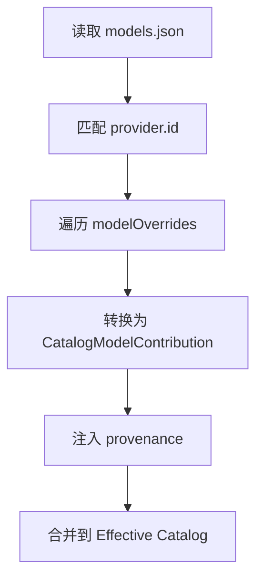
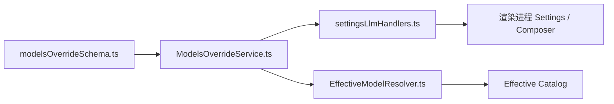
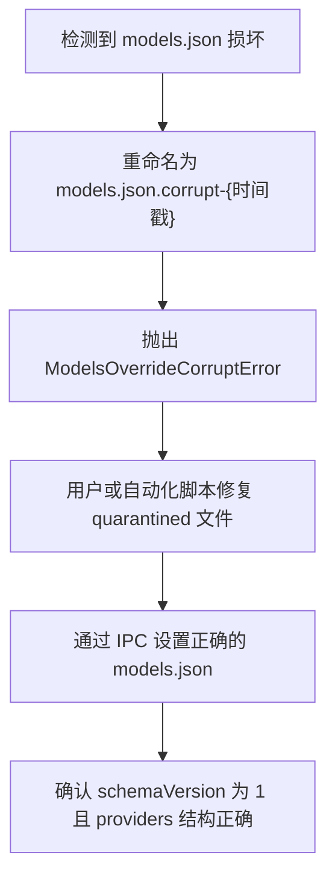

# 模型覆盖管理

<cite>
**本文引用的文件**   
- [ModelsOverrideService.ts](file://src/main/settings/ModelsOverrideService.ts)
- [modelsOverrideSchema.ts](file://src/shared/provider-catalog/modelsOverrideSchema.ts)
- [EffectiveModelResolver.ts](file://src/main/settings/EffectiveModelResolver.ts)
- [settingsLlmHandlers.ts](file://src/main/ipc/settingsLlmHandlers.ts)
- [provider-architecture.md](file://docs/architecture/provider-architecture.md)
</cite>

## 目录
1. [简介](#简介)
2. [项目结构定位](#项目结构定位)
3. [核心组件](#核心组件)
4. [架构总览](#架构总览)
5. [详细组件分析](#详细组件分析)
6. [依赖关系分析](#依赖关系分析)
7. [性能与一致性特性](#性能与一致性特性)
8. [故障排除指南](#故障排除指南)
9. [最佳实践](#最佳实践)
10. [结论](#结论)

## 简介
本文件面向需要理解并维护“模型覆盖管理”功能的开发者与维护者，重点说明 `ModelsOverrideService` 如何加载、校验、持久化并广播 `models.json`，以及该配置如何进入 Effective Catalog 的最终模型真值。文档还解释 `models.json` 的语法、安全边界、原子写入机制、事件监听与缓存失效策略，并提供配置文件示例、Schema 验证规则及排障建议。

## 项目结构定位
模型覆盖能力由主进程中的设置模块提供，并通过 IPC 暴露给渲染进程：

- 服务实现：`src/main/settings/ModelsOverrideService.ts`
- Schema 定义：`src/shared/provider-catalog/modelsOverrideSchema.ts`
- 有效模型解析：`src/main/settings/EffectiveModelResolver.ts`
- IPC 入口：`src/main/ipc/settingsLlmHandlers.ts`
- 架构背景：`docs/architecture/provider-architecture.md`

**图示来源**
- [settingsLlmHandlers.ts:260-395](file://src/main/ipc/settingsLlmHandlers.ts#L260-L395)
- [ModelsOverrideService.ts:1-117](file://src/main/settings/ModelsOverrideService.ts#L1-L117)
- [EffectiveModelResolver.ts:319-376](file://src/main/settings/EffectiveModelResolver.ts#L319-L376)

**章节来源**
- [ModelsOverrideService.ts:1-117](file://src/main/settings/ModelsOverrideService.ts#L1-L117)
- [settingsLlmHandlers.ts:260-395](file://src/main/ipc/settingsLlmHandlers.ts#L260-L395)

## 核心组件
- `ModelsOverrideService`：负责读取、校验、原子写入和广播 `models.json`，并提供内存缓存和变更监听。
- `ModelsOverrideSchema`：基于 Zod 的 JSON Schema，定义 `schemaVersion`、`providers`、`modelOverrides`、`custom models` 等字段类型和安全约束。
- `EffectiveModelResolver.userOverrideContribution()`：将用户覆盖合并进 Effective Catalog，成为最高优先级的贡献层。
- `settingsLlmHandlers.ts`：暴露 `settings:getModelsOverride` 与 `settings:setModelsOverride` 两个 IPC 通道。

**章节来源**
- [ModelsOverrideService.ts:1-117](file://src/main/settings/ModelsOverrideService.ts#L1-L117)
- [modelsOverrideSchema.ts:1-57](file://src/shared/provider-catalog/modelsOverrideSchema.ts#L1-L57)
- [EffectiveModelResolver.ts:319-376](file://src/main/settings/EffectiveModelResolver.ts#L319-L376)
- [settingsLlmHandlers.ts:260-395](file://src/main/ipc/settingsLlmHandlers.ts#L260-L395)

## 架构总览
模型覆盖在 Effective Catalog 三层合并中处于最高优先级：

1. **Manifest 基线**：编译期确定的 Provider 结构能力、协议、路由、控件、绑定等。
2. **Discovery 投影**：账号级 live discovery 补充可用性、上下文窗口、推理元数据等。
3. **用户覆盖（`models.json`）**：由 `ModelsOverrideService` 管理，可覆盖定价、上下文窗口、显示名等非安全字段，并自带 provenance。

**图示来源**
- [provider-architecture.md:235-274](file://docs/architecture/provider-architecture.md#L235-L274)
- [EffectiveModelResolver.ts:319-376](file://src/main/settings/EffectiveModelResolver.ts#L319-L376)

**章节来源**
- [provider-architecture.md:235-274](file://docs/architecture/provider-architecture.md#L235-L274)

## 详细组件分析

### ModelsOverrideService：读取、校验、持久化与事件
`ModelsOverrideService` 是一个带内存缓存的 `EventEmitter`，职责包括：

- 获取覆盖配置：`getOverrides()`
- 设置覆盖配置：`setOverrides()`
- 订阅变更：`onChange()`
- 失效缓存：`invalidateCache()`
- 原子写入：`writeAtomic()`
- 损坏恢复：`quarantineCorruptFile()`

**图示来源**
- [ModelsOverrideService.ts:1-117](file://src/main/settings/ModelsOverrideService.ts#L1-L117)

#### 读取流程与损坏隔离
`getOverrides()` 的流程如下：

**图示来源**
- [ModelsOverrideService.ts:27-73](file://src/main/settings/ModelsOverrideService.ts#L27-L73)

#### 原子写入与权限控制
`writeAtomic()` 保证写入的原子性，避免部分写入导致 `models.json` 损坏：

1. 确保目标目录存在。
2. 使用当前进程 PID 生成临时文件 `${filePath}.${process.pid}.tmp`。
3. 以只读权限掩码 `0o600` 打开临时文件句柄并写入格式化 JSON。
4. 强制同步到磁盘 `fs.fsyncSync`。
5. 关闭句柄后尝试设置文件权限；Windows 忽略 POSIX 模式时不报错。
6. 原子重命名临时文件为真实文件名。
7. 最后清理残留临时文件。

**图示来源**
- [ModelsOverrideService.ts:89-116](file://src/main/settings/ModelsOverrideService.ts#L89-L116)

#### 事件与缓存失效
`setOverrides()` 会在持久化成功后：

- 更新内存缓存。
- 触发 `change` 事件，携带 `overrides` 与 `updatedAt`。
- 通过 `onChange()` 注册监听器，返回取消函数。
- 外部可通过 `invalidateCache()` 清空缓存，使下次读取重新从磁盘解析。

**图示来源**
- [ModelsOverrideService.ts:75-88](file://src/main/settings/ModelsOverrideService.ts#L75-L88)

**章节来源**
- [ModelsOverrideService.ts:1-117](file://src/main/settings/ModelsOverrideService.ts#L1-L117)

### models.json 结构与语法
`models.json` 的结构由 `ModelsOverrideSchema` 定义，核心要点如下：

| 顶层字段 | 类型 | 必填 | 说明 |
|---|---|---:|---|
| `schemaVersion` | 字面量 `1` | 是 | 当前支持的 schema 版本 |
| `providers` | 对象 | 是 | 按 Provider ID 组织的覆盖配置 |

每个 Provider 覆盖对象支持：

| 字段 | 类型 | 说明 |
|---|---|---|
| `baseUrl` | URL 字符串 | 可选，覆盖 Provider 基础地址 |
| `modelOverrides` | 映射表 | 可选，键为模型 ID，值为模型覆盖对象 |
| `models` | 数组 | 可选，声明自定义模型 |

模型覆盖对象允许覆盖非安全字段：

| 字段 | 类型 | 说明 |
|---|---|---|
| `contextWindow` | 正整数 | 上下文窗口大小 |
| `maxTokens` | 正整数 | 最大输出 token 数 |
| `reasoning` | 布尔值 | 是否启用推理能力 |
| `input` | 枚举数组 | 输入模态，如 `"text"`、`"image"` |
| `cost` | 对象 | 定价信息，包含 `input`、`output` 及可选 `cacheRead`、`cacheWrite` |
| `status` | 枚举 | `"active"` 或 `"retiring"` |

自定义模型对象要求显式声明协议相关字段：

| 字段 | 类型 | 说明 |
|---|---|---|
| `id` | 非空字符串 | 自定义模型标识 |
| `name` | 非空字符串 | 显示名称 |
| `api` | 非空字符串 | API 标识 |
| `baseUrl` | URL 字符串 | 服务地址 |
| `contextWindow` | 正整数 | 上下文窗口 |
| `maxTokens` | 正整数 | 最大输出 token |
| `reasoning` | 布尔值 | 默认 `false` |
| `input` | 枚举数组 | 默认 `["text"]` |
| `cost` | 对象 | 可选定价结构 |

#### 安全边界
Schema 使用 `.strict()` 拒绝未知字段，因此以下安全/延续性字段禁止被用户覆盖：

- `route.protocol`
- `authSchemaId`
- `adapterId`
- `endpointClass`
- `catalogOwnership`
- `compatibilityGroup`
- `artifactFormat`
- `carrier`

这些限制由共享 Schema 在解析层强制执行。

**章节来源**
- [modelsOverrideSchema.ts:1-57](file://src/shared/provider-catalog/modelsOverrideSchema.ts#L1-L57)
- [provider-architecture.md:235-274](file://docs/architecture/provider-architecture.md#L235-L274)

### 事件监听机制与缓存失效处理
IPC 层暴露两个关键接口：

- `settings:getModelsOverride`：调用 `modelsOverrideService.getOverrides()` 返回当前覆盖配置。
- `settings:setModelsOverride`：调用 `modelsOverrideService.setOverrides()` 保存新配置，并根据受影响 Provider 广播 Effective Catalog 更新。

**图示来源**
- [settingsLlmHandlers.ts:330-395](file://src/main/ipc/settingsLlmHandlers.ts#L330-L395)
- [ModelsOverrideService.ts:75-88](file://src/main/settings/ModelsOverrideService.ts#L75-L88)

渲染进程侧通常通过 `effectiveCatalogStore` 消费 `llm:effectiveCatalogChanged` 事件，从而感知模型覆盖变化并刷新 UI。虽然该 Store 未直接调用 `modelsOverrideService.invalidateCache()`，但每次 IPC 设置成功后，IPC 会重新计算并广播新的 Effective Catalog 快照，确保 UI 始终反映最新状态。

**章节来源**
- [settingsLlmHandlers.ts:330-395](file://src/main/ipc/settingsLlmHandlers.ts#L330-L395)
- [provider-architecture.md:235-274](file://docs/architecture/provider-architecture.md#L235-L274)

### 用户覆盖如何进入最终模型
`EffectiveModelResolver.userOverrideContribution()` 会：

1. 从 `modelsOverrideService.getOverrides()` 读取覆盖。
2. 查找对应 Provider 的覆盖。
3. 遍历 `modelOverrides`，将每个模型覆盖转换为 `CatalogModelContribution`。
4. 注入 provenance 信息，标记来源为“用户模型覆盖”。
5. 在 Effective Catalog 合并阶段作为最高优先级层参与合并。

覆盖转换规则摘要：

| 覆盖字段 | 最终效果 |
|---|---|
| `contextWindow` | 影响默认预算 token 与提示词上限 |
| `maxTokens` | 影响最大输出 token |
| `cost` | 传入最终 cost 结构 |
| `status === 'retiring'` | 标记为不可用并附带原因 |
| `reasoning` | 控制推理能力状态 |
| `input` | 控制视觉输入支持状态 |

**图示来源**
- [EffectiveModelResolver.ts:319-376](file://src/main/settings/EffectiveModelResolver.ts#L319-L376)

**章节来源**
- [EffectiveModelResolver.ts:319-376](file://src/main/settings/EffectiveModelResolver.ts#L319-L376)

## 依赖关系分析

**图示来源**
- [modelsOverrideSchema.ts:1-57](file://src/shared/provider-catalog/modelsOverrideSchema.ts#L1-L57)
- [ModelsOverrideService.ts:1-117](file://src/main/settings/ModelsOverrideService.ts#L1-L117)
- [settingsLlmHandlers.ts:260-395](file://src/main/ipc/settingsLlmHandlers.ts#L260-L395)
- [EffectiveModelResolver.ts:319-376](file://src/main/settings/EffectiveModelResolver.ts#L319-L376)

耦合与内聚特点：

- `ModelsOverrideService` 仅依赖文件系统、应用路径服务和 Zod Schema，职责单一。
- IPC 层仅做参数校验与广播协调，不直接操作磁盘。
- `EffectiveModelResolver` 将覆盖作为独立贡献层注入，避免紧耦合。
- 安全字段禁止覆盖由共享 Schema 统一约束，降低多实现不一致风险。

潜在风险点：

- 如果 `models.json` 所在目录不存在且无法创建，原子写入可能失败。
- 多进程同时写入同一文件仍可能竞争；当前实现依赖单主进程语义，外部编辑器修改不会自动刷新内存缓存。
- 损坏文件隔离路径依赖时间戳，若多次快速损坏可能产生多个 quarantined 文件。

**章节来源**
- [ModelsOverrideService.ts:1-117](file://src/main/settings/ModelsOverrideService.ts#L1-L117)
- [modelsOverrideSchema.ts:1-57](file://src/shared/provider-catalog/modelsOverrideSchema.ts#L1-L57)

## 性能与一致性特性

### 性能特性
- 读取采用同步文件读取，但配合内存缓存，避免重复解析。
- Schema 校验发生在读取和写入两处，保证真值一致性。
- IPC 广播仅在受影响 Provider 上触发，避免全量刷新。

### 一致性特性
- 原子写入通过临时文件 + `renameSync` 保证要么完整写入，要么保留旧文件。
- 权限设置为 `0o600`，尽量缩小文件访问范围。
- 损坏文件会被重命名为 `.corrupt-{timestamp}` 形式，便于人工排查。
- 事件驱动使 UI 与主进程状态保持一致。

**章节来源**
- [ModelsOverrideService.ts:27-116](file://src/main/settings/ModelsOverrideService.ts#L27-L116)

## 故障排除指南

### 常见问题与定位方式

| 现象 | 可能原因 | 处理建议 |
|---|---|---|
| 修改 `models.json` 后 UI 未更新 | 外部编辑器修改未触发 IPC 设置流程 | 通过 `settings:setModelsOverride` 写入，或重启应用 |
| 启动时报 `models.json is corrupt` | JSON 格式错误或字段不符合 Schema | 查看 quarantined 文件，修复后重新提交 |
| 覆盖字段无效 | 触发了安全字段限制 | 检查是否误写 `route.protocol`、`authSchemaId` 等受保护字段 |
| 自定义模型不出现 | `baseUrl` 不是合法 URL 或必填字段缺失 | 根据 Schema 补全 `id`、`name`、`api`、`baseUrl`、`contextWindow`、`maxTokens` |
| 模型被标记为不可用 | 覆盖中设置了 `status: 'retiring'` | 移除或改为 `active` |
| 缓存未失效 | 直接修改磁盘但未调用 `invalidateCache()` | 通过 IPC 设置或使用 `invalidateCache()` |

### 损坏文件恢复流程

**图示来源**
- [ModelsOverrideService.ts:27-73](file://src/main/settings/ModelsOverrideService.ts#L27-L73)

### 调试建议
- 优先通过 IPC 接口读写覆盖，而不是直接编辑文件。
- 若需手动修复，先复制 quarantined 文件，再替换 `models.json`。
- 检查 `providers` 中是否存在对应 Provider ID。
- 检查 `modelOverrides` 中模型 ID 是否与 Effective Catalog 中一致。
- 检查 `cost` 字段是否为非负数。
- 检查 `baseUrl` 是否符合 URL 语法。

**章节来源**
- [ModelsOverrideService.ts:27-116](file://src/main/settings/ModelsOverrideService.ts#L27-L116)
- [modelsOverrideSchema.ts:1-57](file://src/shared/provider-catalog/modelsOverrideSchema.ts#L1-L57)

## 最佳实践

### 配置文件示例
一个最小可用的 `models.json` 应满足：

- `schemaVersion` 为 `1`
- `providers` 至少包含一个 Provider ID
- 若只需覆盖某个模型，可使用 `modelOverrides`
- 若要新增本地或第三方模型，可使用 `models`

推荐结构：

- 顶层：`schemaVersion`、`providers`
- Provider 层：`baseUrl`、`modelOverrides`、`models`
- 模型覆盖层：`contextWindow`、`maxTokens`、`reasoning`、`input`、`cost`、`status`
- 自定义模型层：`id`、`name`、`api`、`baseUrl`、`contextWindow`、`maxTokens`、`reasoning`、`input`、`cost`

### Schema 验证规则清单
- 必须使用 `schemaVersion: 1`。
- `providers` 必须是对象。
- `baseUrl` 必须是合法 URL。
- `contextWindow` 和 `maxTokens` 必须是正整数。
- `cost.input` 和 `cost.output` 必须是非负数。
- `cost.cacheRead` 和 `cost.cacheWrite` 可选但必须为非负数。
- `input` 只能是 `"text"` 或 `"image"`。
- `status` 只能是 `"active"` 或 `"retiring"`。
- 禁止覆盖安全字段。

### 自定义模型映射建议
- 明确区分“覆盖已有模型”和“新增自定义模型”。
- 优先使用 `modelOverrides` 调整现有模型的上下文、token、成本和状态。
- 只在确实需要额外模型时使用 `models`。
- 自定义模型必须提供完整的 `baseUrl` 和 `api`，否则无法接入适配层。
- 不要尝试通过覆盖改变协议、认证方案或适配器类型。
- 对即将下线模型使用 `status: 'retiring'`，以便 UI 和用户感知。
- 谨慎修改 `input`，因为视觉输入能力会影响下游适配器和工具调用。
- 记录覆盖原因，尤其是修改 `cost` 和 `contextWindow` 时，便于审计。

**章节来源**
- [modelsOverrideSchema.ts:1-57](file://src/shared/provider-catalog/modelsOverrideSchema.ts#L1-L57)
- [EffectiveModelResolver.ts:319-376](file://src/main/settings/EffectiveModelResolver.ts#L319-L376)

## 结论
`ModelsOverrideService` 是模型覆盖管理的核心服务：它提供安全的 Schema 校验、原子持久化、内存缓存、错误隔离和事件广播。配合 `EffectiveModelResolver`，用户覆盖成为 Effective Catalog 的最高优先级层，既保持灵活性，又守住安全边界。对于使用者而言，最可靠的方式是通过 IPC 接口设置覆盖；对于维护者而言，应重点关注 Schema 安全字段、原子写入路径、损坏恢复流程和广播一致性。