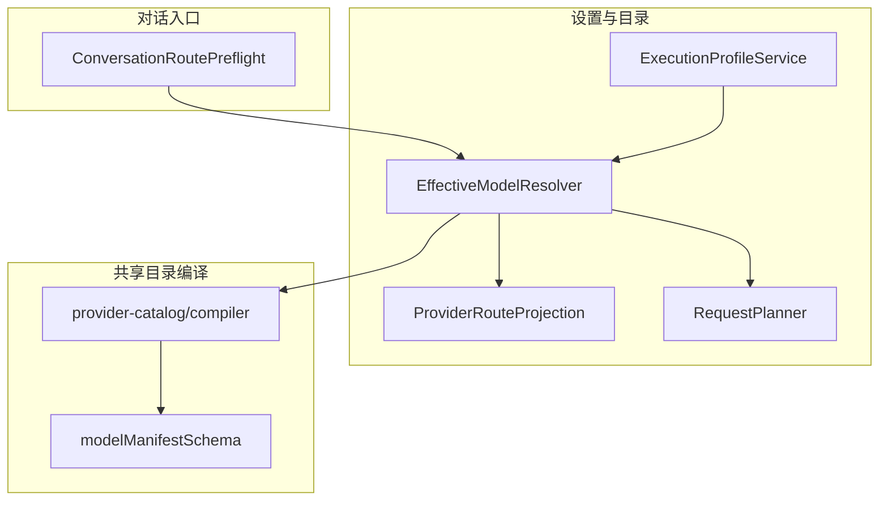
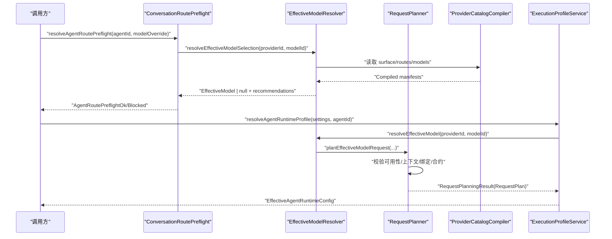
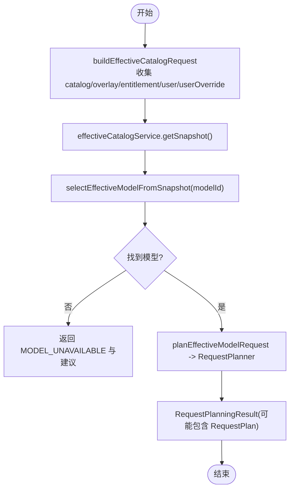
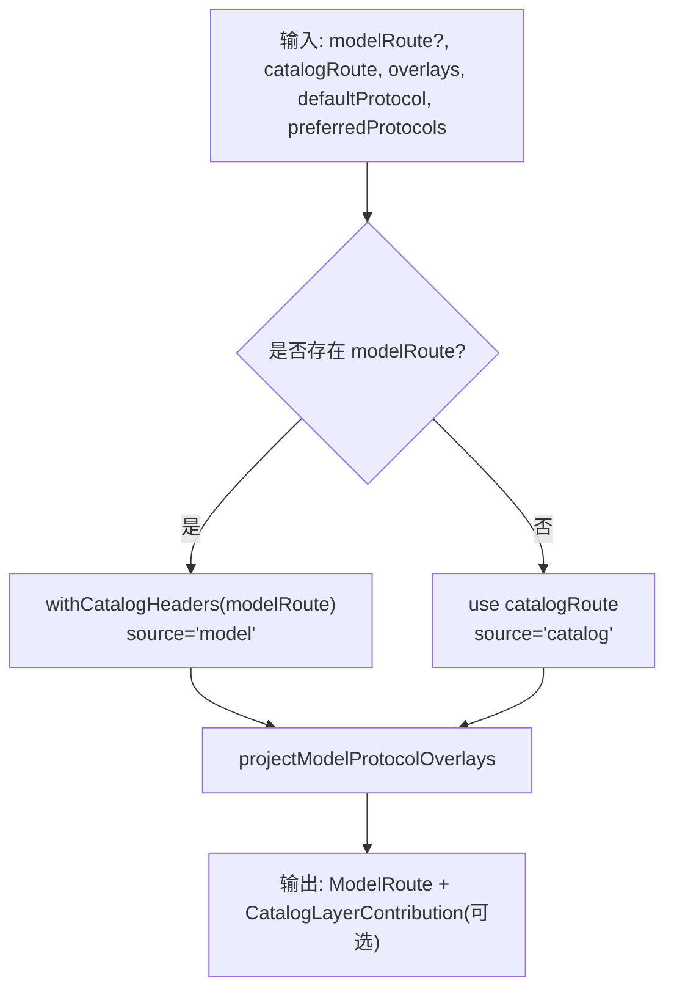
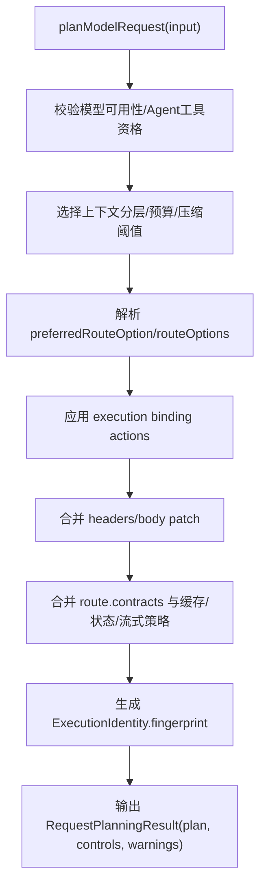
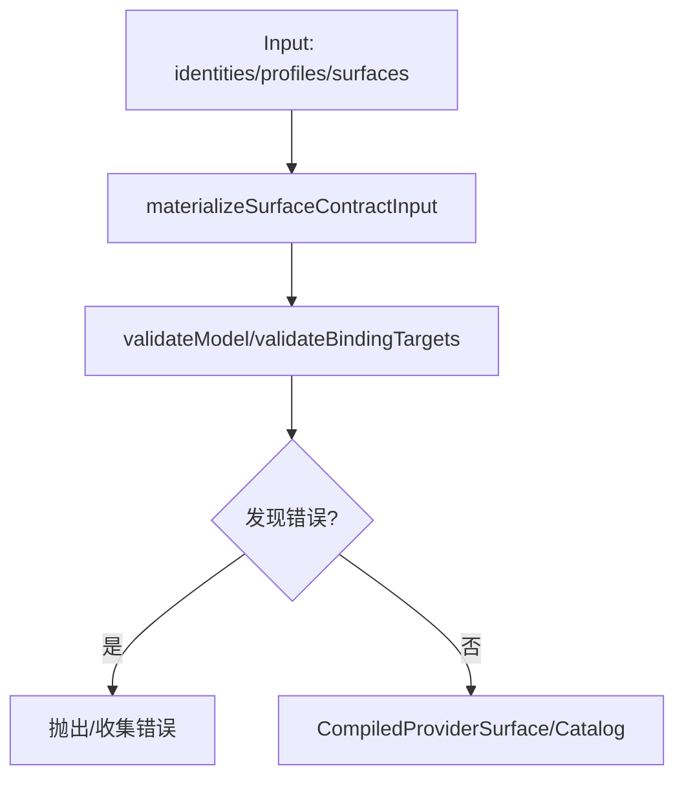
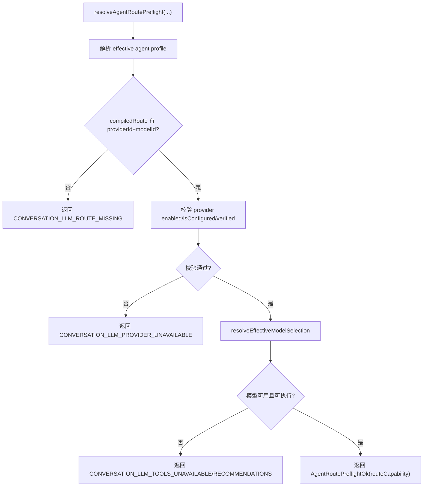
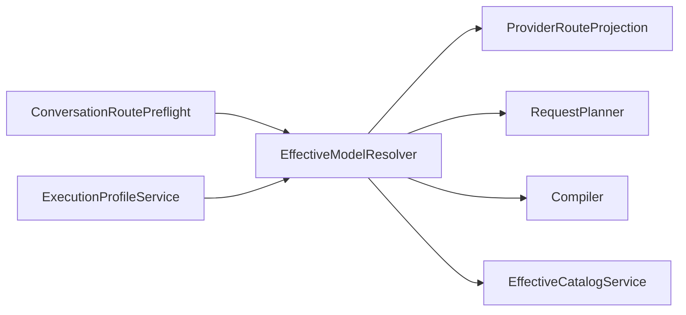

# 模型选择与路由

<cite>
**本文引用的文件**   
- [EffectiveModelResolver.ts](file://src/main/settings/EffectiveModelResolver.ts)
- [ProviderRouteProjection.ts](file://src/main/settings/ProviderRouteProjection.ts)
- [RequestPlanner.ts](file://src/main/settings/RequestPlanner.ts)
- [compiler.ts](file://src/shared/provider-catalog/compiler.ts)
- [ExecutionProfileService.ts](file://src/main/settings/ExecutionProfileService.ts)
- [ConversationRoutePreflight.ts](file://src/main/conversation/ConversationRoutePreflight.ts)
- [modelManifestSchema.ts](file://src/shared/provider-catalog/modelManifestSchema.ts)
</cite>

## 目录
1. [引言](#引言)
2. [项目结构](#项目结构)
3. [核心组件](#核心组件)
4. [架构总览](#架构总览)
5. [详细组件分析](#详细组件分析)
6. [依赖关系分析](#依赖关系分析)
7. [性能考量](#性能考量)
8. [故障排查指南](#故障排查指南)
9. [结论](#结论)
10. [附录：配置与规则示例](#附录配置与规则示例)

## 引言
本文面向“模型选择与路由”这一核心子系统，说明系统如何从用户设置、目录清单、能力探测、配额与执行绑定等多源信息中，选出最终可执行的模型和请求计划。重点覆盖：
- EffectiveModelResolver 如何组装有效目录并选择最终模型。
- 路由优先级：catalog route、user route、model route。
- ProviderRouteProjection 如何处理协议覆盖、头部合并与 URL 重写。
- Execution binding 的匹配、冲突与执行计划生成。
- 对话前置校验与执行配置落点。

## 项目结构
围绕模型选择与路由的代码分布在以下模块：
- settings 层：EffectiveModelResolver、ProviderRouteProjection、RequestPlanner、ExecutionProfileService。
- shared provider-catalog：编译与校验 Provider 清单，定义 execution binding 和上下文分层等类型。
- conversation 层：ConversationRoutePreflight 负责会话级 Agent 路由与可用性诊断。

**图表来源**
- [EffectiveModelResolver.ts:1-200](file://src/main/settings/EffectiveModelResolver.ts#L1-L200)
- [ProviderRouteProjection.ts:1-52](file://src/main/settings/ProviderRouteProjection.ts#L1-L52)
- [RequestPlanner.ts:1-200](file://src/main/settings/RequestPlanner.ts#L1-L200)
- [compiler.ts:1-200](file://src/shared/provider-catalog/compiler.ts#L1-L200)
- [ExecutionProfileService.ts:1-68](file://src/main/settings/ExecutionProfileService.ts#L1-L68)
- [ConversationRoutePreflight.ts:200-582](file://src/main/conversation/ConversationRoutePreflight.ts#L200-L582)

**章节来源**
- [EffectiveModelResolver.ts:1-200](file://src/main/settings/EffectiveModelResolver.ts#L1-L200)
- [ProviderRouteProjection.ts:1-52](file://src/main/settings/ProviderRouteProjection.ts#L1-L52)
- [RequestPlanner.ts:1-200](file://src/main/settings/RequestPlanner.ts#L1-L200)
- [compiler.ts:1-200](file://src/shared/provider-catalog/compiler.ts#L1-L200)
- [ExecutionProfileService.ts:1-68](file://src/main/settings/ExecutionProfileService.ts#L1-L68)
- [ConversationRoutePreflight.ts:200-582](file://src/main/conversation/ConversationRoutePreflight.ts#L200-L582)

## 核心组件
- EffectiveModelResolver：聚合 catalog、overlay、entitlement、user、userOverride 五层贡献，解析出 EffectiveCatalogSnapshot；按 modelId 或别名选择最终 EffectiveModel；进一步调用 RequestPlanner 生成 RequestPlan。
- ProviderRouteProjection：合并 catalog route 与 model route 的 headers 与 contracts，决定 source 为 catalog 或 model；按 selected protocol 过滤协议覆盖 overlay。
- RequestPlanner：校验模型可用性、Agent 工具可执行性、上下文分层、执行绑定、状态模式、缓存策略、流式策略等，输出稳定 fingerprint 的执行身份与完整计划。
- compiler（shared）：编译 Provider 清单，校验 execution binding、route matrix、context tier、协议兼容性等，保证运行时数据契约正确。
- ExecutionProfileService：将 Agent profile 与 compiled route 映射到运行时配置，内部再次调用 resolveEffectiveModel 做最终模型确认。
- ConversationRoutePreflight：在对话开始前检查 Agent、Provider、模型是否可用，并返回诊断与建议。

**章节来源**
- [EffectiveModelResolver.ts:201-450](file://src/main/settings/EffectiveModelResolver.ts#L201-L450)
- [EffectiveModelResolver.ts:450-788](file://src/main/settings/EffectiveModelResolver.ts#L450-L788)
- [ProviderRouteProjection.ts:1-52](file://src/main/settings/ProviderRouteProjection.ts#L1-L52)
- [RequestPlanner.ts:1-539](file://src/main/settings/RequestPlanner.ts#L1-L539)
- [compiler.ts:200-511](file://src/shared/provider-catalog/compiler.ts#L200-L511)
- [ExecutionProfileService.ts:1-68](file://src/main/settings/ExecutionProfileService.ts#L1-L68)
- [ConversationRoutePreflight.ts:200-582](file://src/main/conversation/ConversationRoutePreflight.ts#L200-L582)

## 架构总览
下面的序列图展示了从对话触发到最终请求计划的完整流程：

**图表来源**
- [ConversationRoutePreflight.ts:200-582](file://src/main/conversation/ConversationRoutePreflight.ts#L200-L582)
- [EffectiveModelResolver.ts:450-788](file://src/main/settings/EffectiveModelResolver.ts#L450-L788)
- [RequestPlanner.ts:1-539](file://src/main/settings/RequestPlanner.ts#L1-L539)
- [ExecutionProfileService.ts:1-68](file://src/main/settings/ExecutionProfileService.ts#L1-L68)

## 详细组件分析

### EffectiveModelResolver：多源目录合成与模型选择
该组件是“模型选择”的主控制器，职责包括：
- 构建 EffectiveCatalogRequest，汇总以下贡献层：
  - catalog：来自编译后的 Provider 清单。
  - overlay：按 selected protocol 过滤后的协议覆盖。
  - entitlement：如 GitHub Copilot 账户计费层级。
  - user：用户配置的 models.json 或 Provider.models。
  - userOverride：models.json 中的 override 与自定义 CustomModel。
- 根据 discovery authority 注入 unavailable 条目。
- 通过 selectEffectiveModelFromSnapshot 选择 exact match 或 alias，并生成推荐候选。
- planEffectiveModelRequest 委托 RequestPlanner 生成最终 RequestPlan，并在 alias remap 时附加警告。

**图表来源**
- [EffectiveModelResolver.ts:201-450](file://src/main/settings/EffectiveModelResolver.ts#L201-L450)
- [EffectiveModelResolver.ts:450-788](file://src/main/settings/EffectiveModelResolver.ts#L450-L788)

**章节来源**
- [EffectiveModelResolver.ts:201-450](file://src/main/settings/EffectiveModelResolver.ts#L201-L450)
- [EffectiveModelResolver.ts:450-788](file://src/main/settings/EffectiveModelResolver.ts#L450-L788)

### ProviderRouteProjection：协议覆盖与 URL 重写
该模块负责两类关键任务：
- resolveModelRoutePrecedence：当存在 model route 时使用它并标记 source=model；否则使用 catalog route 并标记 source=catalog。无论哪种情况，都会合并 catalog route 的 headers 与 contracts，确保下游请求头一致。
- projectModelProtocolOverlays：对 ProviderProtocolOverride 列表按 preferredProtocols/defaultProtocol 过滤后，转换为 CatalogLayerContribution，仅影响 capability overlay，不改变已选 route 的 baseUrl。

**图表来源**
- [ProviderRouteProjection.ts:1-52](file://src/main/settings/ProviderRouteProjection.ts#L1-L52)

**章节来源**
- [ProviderRouteProjection.ts:1-52](file://src/main/settings/ProviderRouteProjection.ts#L1-L52)

### RequestPlanner：请求计划与执行绑定
RequestPlanner 是“执行计划”的核心：
- 基础校验：模型 availability/enabled、Agent 工具可执行性、控制项冲突。
- 上下文分层：根据 maxContext、默认预算、compaction 阈值计算 contextBudgetTokens、maxOutputTokens。
- 路由选项：支持 preferredRouteOptionId 与 routeOptions 匹配；若指定不可用则失败。
- 执行绑定：根据 evaluation.binding 的 actions 应用 request-patch、request-headers、client-tier、model-switch；处理冲突与约束拒绝。
- 合约与状态：基于 route.contracts 确定 stateMode、cachePlan、toolLoopPlan、streamingPlan、reasoning wire 等。
- 输出：稳定的 ExecutionIdentity fingerprint、RequestPlan，以及 warnings。

**图表来源**
- [RequestPlanner.ts:1-539](file://src/main/settings/RequestPlanner.ts#L1-L539)

**章节来源**
- [RequestPlanner.ts:1-539](file://src/main/settings/RequestPlanner.ts#L1-L539)

### Compiler：清单编译与执行绑定校验
compiler 的职责在于确保 Provider 清单的正确性与一致性：
- 合并 profile 与 surface 的 contracts，避免 route 直接声明 contracts。
- 计算 binding dimensions/specificity，检测冲突与重叠。
- 校验 execution binding 的目标模型、route option、context tier、协议兼容性与公开字段安全。
- 校验 route matrix、protocolOwner、connection required fields。
- 校验 context tier 的 Max mode 与 live projection 的一致性。

**图表来源**
- [compiler.ts:1-200](file://src/shared/provider-catalog/compiler.ts#L1-L200)
- [compiler.ts:200-511](file://src/shared/provider-catalog/compiler.ts#L200-L511)

**章节来源**
- [compiler.ts:1-200](file://src/shared/provider-catalog/compiler.ts#L1-L200)
- [compiler.ts:200-511](file://src/shared/provider-catalog/compiler.ts#L200-L511)

### ConversationRoutePreflight：对话前置路由校验
对话路径在进入实际 LLM 调用前进行强校验：
- 解析 effective agent profile 与 compiled route。
- 校验 provider 是否 enabled、isConfigured、status=verified。
- 通过 EffectiveModelResolver.resolveEffectiveModelSelection 获取有效模型。
- 校验 isAgentToolExecutableModel，并提供推荐模型。
- 成功时返回 routeCapability，失败时生成带建议的诊断消息。

**图表来源**
- [ConversationRoutePreflight.ts:200-582](file://src/main/conversation/ConversationRoutePreflight.ts#L200-L582)
- [EffectiveModelResolver.ts:450-788](file://src/main/settings/EffectiveModelResolver.ts#L450-L788)

**章节来源**
- [ConversationRoutePreflight.ts:200-582](file://src/main/conversation/ConversationRoutePreflight.ts#L200-L582)

### ExecutionProfileService：执行配置落点
该服务将 Agent manifest 的 compiled route 转化为运行时配置：
- 从 AppSettings.agents.definitions 查找启用的 agent。
- 通过 compiledRoute 取 providerId 与 modelId。
- 再次调用 resolveEffectiveModel 确保最终模型有效。
- 输出 EffectiveAgentRuntimeConfig，包含 systemPrompt、temperature、toolAllowlist、skillIds、mcpServerIds 等。

**章节来源**
- [ExecutionProfileService.ts:1-68](file://src/main/settings/ExecutionProfileService.ts#L1-L68)

## 依赖关系分析
- EffectiveModelResolver 依赖：
  - ProviderCatalogRegistry（surface、routes、factSources、model definitions）。
  - ProviderRouteProjection（协议覆盖与路由优先级）。
  - ModelsOverrideService（用户 override）。
  - EffectiveCatalogService（快照与观察记录）。
  - RequestPlanner（生成最终请求计划）。
- RequestPlanner 依赖：
  - modelControls/contextTiers/agentToolCapability 等共享工具。
  - Provider contract 与 adapter 注册表。
- compiler 依赖：
  - catalogManifestSchema、implementationRegistry、modelManifestSchema。
- ConversationRoutePreflight 依赖：
  - EffectiveModelResolver、AgentManifestService、RouteCapabilityResolver。
- ExecutionProfileService 依赖：
  - EffectiveModelResolver、AgentRuntimeConfigService。

**图表来源**
- [EffectiveModelResolver.ts:1-200](file://src/main/settings/EffectiveModelResolver.ts#L1-L200)
- [ProviderRouteProjection.ts:1-52](file://src/main/settings/ProviderRouteProjection.ts#L1-L52)
- [RequestPlanner.ts:1-200](file://src/main/settings/RequestPlanner.ts#L1-L200)
- [compiler.ts:1-200](file://src/shared/provider-catalog/compiler.ts#L1-L200)
- [ExecutionProfileService.ts:1-68](file://src/main/settings/ExecutionProfileService.ts#L1-L68)
- [ConversationRoutePreflight.ts:200-582](file://src/main/conversation/ConversationRoutePreflight.ts#L200-L582)

**章节来源**
- [EffectiveModelResolver.ts:1-200](file://src/main/settings/EffectiveModelResolver.ts#L1-L200)
- [ProviderRouteProjection.ts:1-52](file://src/main/settings/ProviderRouteProjection.ts#L1-L52)
- [RequestPlanner.ts:1-200](file://src/main/settings/RequestPlanner.ts#L1-L200)
- [compiler.ts:1-200](file://src/shared/provider-catalog/compiler.ts#L1-L200)
- [ExecutionProfileService.ts:1-68](file://src/main/settings/ExecutionProfileService.ts#L1-L68)
- [ConversationRoutePreflight.ts:200-582](file://src/main/conversation/ConversationRoutePreflight.ts#L200-L582)

## 性能考量
- 目录快照与观察记录：EffectiveModelResolver 通过 effectiveCatalogService 缓存 snapshot，并根据 observedAt/refreshedAt 区分刷新频率，减少重复计算。
- 路由 revision 与 fingerprint：RequestPlanner 对 route、contracts、executionIdentity 计算稳定 hash，有利于结果缓存与复用。
- 绑定维度与特异性：compiler 使用 bindingDimensions 与 bindingSpecificity 快速判断 binding 冲突，避免运行时歧义。
- 协议覆盖过滤：projectModelProtocolOverlays 按 preferredProtocols 过滤，降低无效 overlay 处理成本。
- 上下文预算计算：contextTierBudgetTokens 与 compactionThresholdTokens 预计算，避免每次请求重复估算。
- 推荐模型排序：selectEffectiveModelFromSnapshot 使用 recommendedModels 的优先顺序，减少 UI 或上层决策开销。

[本节为通用性能建议，不直接分析具体代码行]

## 故障排查指南
常见错误与定位要点：
- MODEL_UNAVAILABLE：模型不存在、被禁用、availability=unavailable 或不可执行。检查 EffectiveModelResolver 的选择逻辑与 ConversationRoutePreflight 的诊断。
- PLAN_CONFLICT：preferredRouteOptionId 不存在、binding 冲突、header 或 body patch 冲突、执行目标模型不一致。检查 RequestPlanner 的 conflict 路径。
- NO_USABLE_CONTEXT_TIER：无可用上下文分层或缺少正数默认预算。检查 contextTiers、defaultBudgetTokens、Max mode 配置。
- CONSTRAINT_REJECTED：stateMode 不被支持、binding action=unsupported。检查 provider contracts 与 execution binding。
- 协议覆盖异常：overlay 未生效或覆盖错协议。检查 projectModelProtocolOverlays 的 preferredProtocols 与 defaultProtocol。
- 路由优先级异常：model route 未生效或 catalog route 覆盖了预期值。检查 resolveModelRoutePrecedence 的 source 与 headers/contracts 合并。

**章节来源**
- [RequestPlanner.ts:1-539](file://src/main/settings/RequestPlanner.ts#L1-L539)
- [ConversationRoutePreflight.ts:200-582](file://src/main/conversation/ConversationRoutePreflight.ts#L200-L582)
- [ProviderRouteProjection.ts:1-52](file://src/main/settings/ProviderRouteProjection.ts#L1-L52)

## 结论
本系统的模型选择与路由由 EffectiveModelResolver 统一编排，结合 ProviderRouteProjection 的路由优先级与协议覆盖、RequestPlanner 的请求计划与执行绑定、compiler 的清单校验，形成“声明式清单 + 动态能力 + 用户策略”的多层决策体系。对话前置校验与执行配置服务分别承担“可用性断言”和“运行时落地”，共同保障请求可预测、可解释、可缓存。

[本节为总结，不直接分析具体代码行]

## 附录：配置与规则示例

### 路由优先级与协议覆盖
- catalog route：来自 surface.routes 的默认路由或指定协议路由。
- user route：用户管理的 Provider 可为每个 model 提供 routeOptions，但权威目录不会继承整个 surface 协议枚举。
- model route：显式 model route 具有最高优先级，会被标记 source=model。
- 协议覆盖 overlay：仅按 selected protocol 过滤，不影响已选 route 的 baseUrl。

参考实现位置：
- [EffectiveModelResolver.ts:1-200](file://src/main/settings/EffectiveModelResolver.ts#L1-L200)
- [EffectiveModelResolver.ts:201-450](file://src/main/settings/EffectiveModelResolver.ts#L201-L450)
- [ProviderRouteProjection.ts:1-52](file://src/main/settings/ProviderRouteProjection.ts#L1-L52)

### 执行绑定条件与动作
- when 维度：fast、maxContext、reasoning。
- actions：request-patch、request-headers、client-tier、model-switch、unsupported。
- 冲突检测：相同维度与特异性下的 binding 不得重复或矛盾；目标模型需协议兼容。
- 运行期匹配：RequestPlanner 会按 evaluation.binding 应用动作并合并 headers/body patch。

参考实现位置：
- [compiler.ts:200-511](file://src/shared/provider-catalog/compiler.ts#L200-L511)
- [RequestPlanner.ts:201-539](file://src/main/settings/RequestPlanner.ts#L201-L539)

### 上下文分层与预算
- contextTiers：default 与可选 Max tier，支持 implicit/header/body 激活方式。
- budget 计算：contextTierBudgetTokens、maxOutputTokens、compactionThresholdTokens。
- Max mode：需要更大的 context window 与对应 binding。

参考实现位置：
- [RequestPlanner.ts:1-539](file://src/main/settings/RequestPlanner.ts#L1-L539)
- [modelManifestSchema.ts:1-260](file://src/shared/provider-catalog/modelManifestSchema.ts#L1-L260)

### 对话前置路由规则
- 必须存在 effective agent profile 且启用。
- provider 必须 enabled、isConfigured、status=verified。
- 模型必须 available、enabled、可执行。
- 失败时返回诊断与建议模型。

参考实现位置：
- [ConversationRoutePreflight.ts:200-582](file://src/main/conversation/ConversationRoutePreflight.ts#L200-L582)