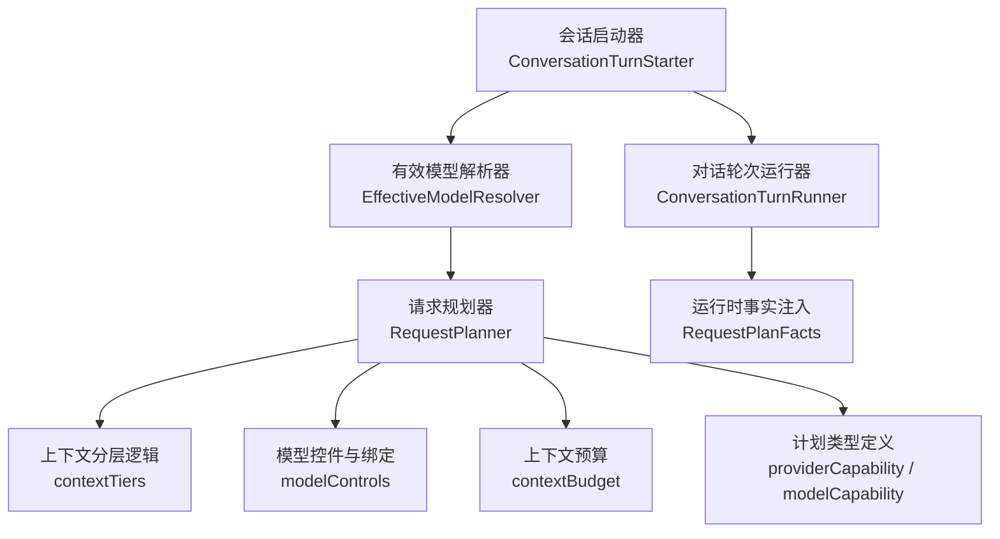
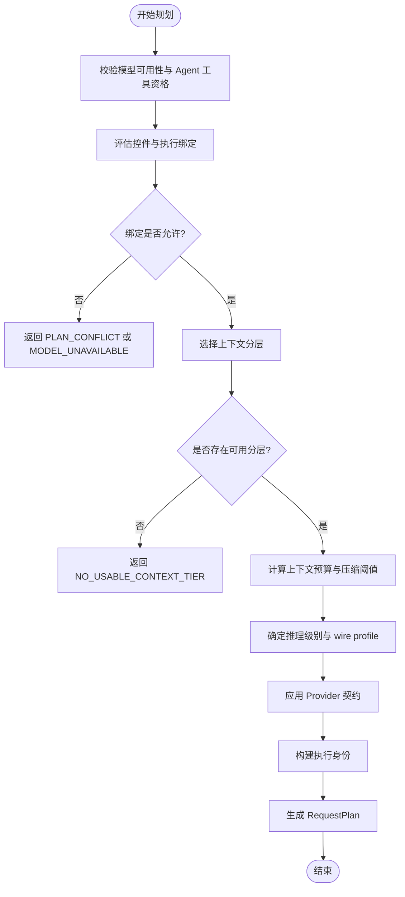
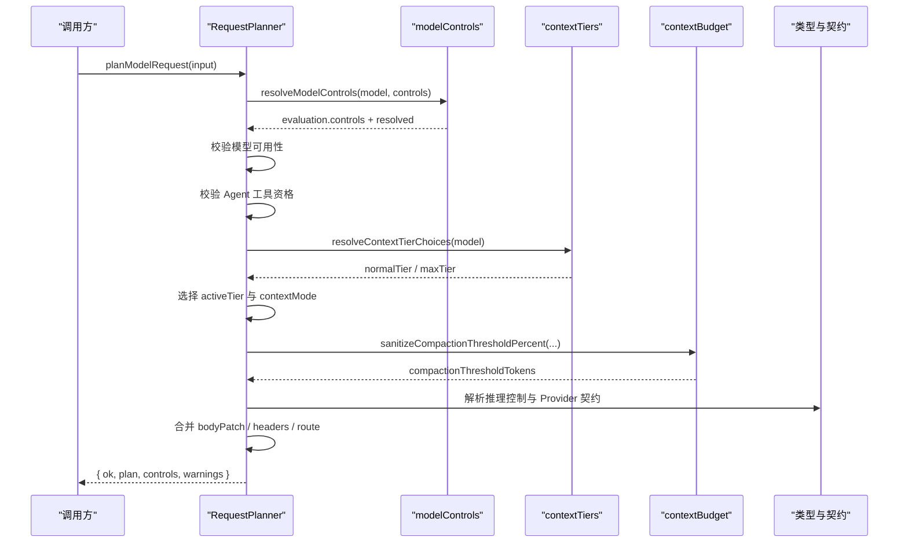
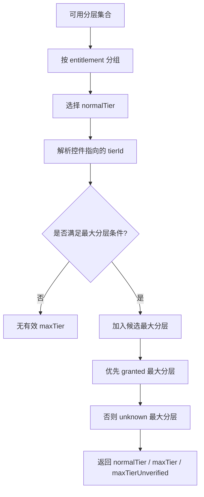
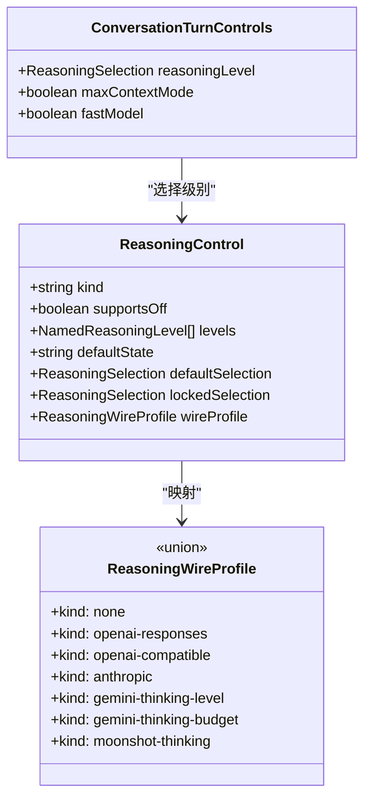
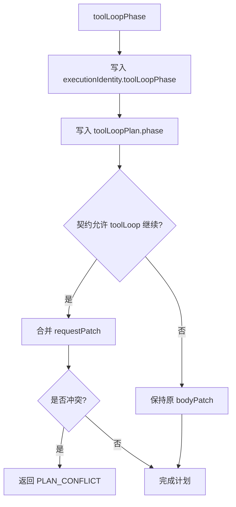
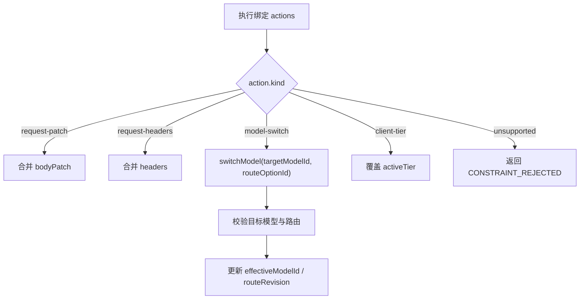
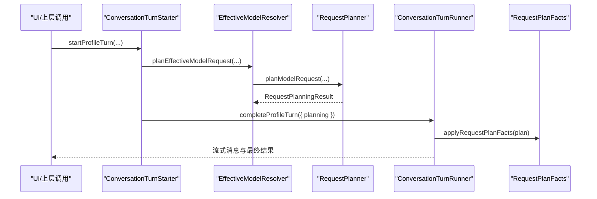
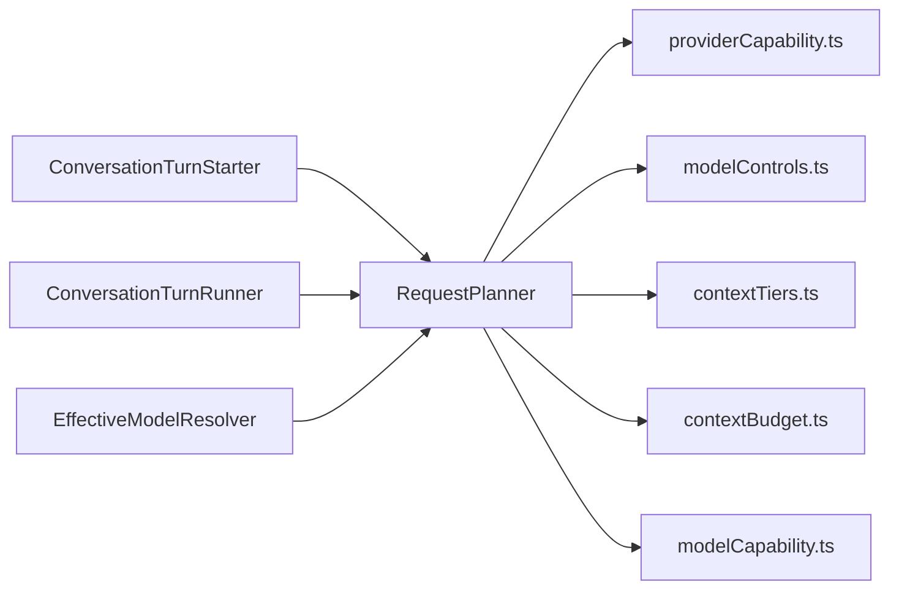

# 请求规划策略

<cite>
**本文引用的文件**
- [RequestPlanner.ts](file://src/main/settings/RequestPlanner.ts)
- [contextTiers.ts](file://src/shared/utils/contextTiers.ts)
- [modelControls.ts](file://src/shared/utils/modelControls.ts)
- [providerCapability.ts](file://src/shared/types/providerCapability.ts)
- [modelCapability.ts](file://src/shared/types/modelCapability.ts)
- [contextBudget.ts](file://src/shared/utils/contextBudget.ts)
- [EffectiveModelResolver.ts](file://src/main/settings/EffectiveModelResolver.ts)
- [ConversationTurnStarter.ts](file://src/main/conversation/ConversationTurnStarter.ts)
- [ConversationTurnRunner.ts](file://src/main/conversation/ConversationTurnRunner.ts)
- [RequestPlanFacts.ts](file://src/main/agent-runtime/prompt/RequestPlanFacts.ts)
</cite>

## 目录
1. [引言](#引言)
2. [项目结构定位](#项目结构定位)
3. [核心组件](#核心组件)
4. [架构总览](#架构总览)
5. [详细组件分析](#详细组件分析)
6. [依赖关系分析](#依赖关系分析)
7. [性能与调优参数](#性能与调优参数)
8. [故障转移与负载均衡说明](#故障转移与负载均衡说明)
9. [错误码说明](#错误码说明)
10. [配置示例与最佳实践](#配置示例与最佳实践)
11. [结论](#结论)

## 引言
本文面向希望理解“请求规划”行为的开发者与配置维护者，重点解释 `RequestPlanner` 如何将模型能力、上下文分层、推理控制、执行绑定、Provider 契约和工具循环阶段统一成一个不可变、可复用的 `RequestPlan`。文档不直接粘贴源码，而是通过路径引用和图示表达实现细节。

## 项目结构定位
请求规划的核心位于主进程设置层：
- `src/main/settings/RequestPlanner.ts`：规划入口，产出 `RequestPlan`。
- `src/shared/utils/contextTiers.ts`：上下文分层选择与容量计算。
- `src/shared/utils/modelControls.ts`：模型控件评估与执行绑定选择。
- `src/shared/types/providerCapability.ts`：`RequestPlan`、`ToolLoopPhase`、错误码等类型。
- `src/shared/types/modelCapability.ts`：推理控制、推理级别、压缩阈值常量。
- `src/shared/utils/contextBudget.ts`：上下文压缩阈值与输出预算计算。
- `src/main/settings/EffectiveModelResolver.ts`：在会话启动前调用规划器并参与路由/绑定验证。
- `src/main/conversation/ConversationTurnStarter.ts`：会话准备流程中发起请求规划。
- `src/main/conversation/ConversationTurnRunner.ts`：使用已规划的请求执行对话轮次。
- `src/main/agent-runtime/prompt/RequestPlanFacts.ts`：将冻结的 `RequestPlan` 注入运行时事实。

**图表来源**
- [ConversationTurnStarter.ts:120-180](file://src/main/conversation/ConversationTurnStarter.ts#L120-L180)
- [EffectiveModelResolver.ts:1-120](file://src/main/settings/EffectiveModelResolver.ts#L1-L120)
- [RequestPlanner.ts:1-60](file://src/main/settings/RequestPlanner.ts#L1-L60)
- [RequestPlanFacts.ts:1-22](file://src/main/agent-runtime/prompt/RequestPlanFacts.ts#L1-L22)

**章节来源**
- [ConversationTurnStarter.ts:120-180](file://src/main/conversation/ConversationTurnStarter.ts#L120-L180)
- [RequestPlanner.ts:1-60](file://src/main/settings/RequestPlanner.ts#L1-L60)

## 核心组件
- **请求规划器**：根据 `EffectiveModel`、用户或会话控制的 `ConversationTurnControls`、可选的 `catalogModels`、`toolLoopPhase`、`stateMode` 等输入，生成一次执行的冻结计划。
- **上下文分层选择器**：决定当前请求使用哪个 `ContextTier`，以及是否启用最大上下文模式。
- **模型控件评估器**：解析 fast、maxContext、reasoning 控件，选择执行绑定，并处理冲突。
- **上下文预算计算器**：根据上下文窗口、压缩百分比、最大输出上限计算 prompt 预算与 compaction threshold。
- **推理控制映射器**：把用户选择的推理级别映射为 wire profile，支持多 Provider 协议。
- **执行身份与计划元数据**：记录 provider、协议、路由、契约、状态模式、缓存模式、工具循环阶段、成本与兼容性组等。

**章节来源**
- [RequestPlanner.ts:60-120](file://src/main/settings/RequestPlanner.ts#L60-L120)
- [contextTiers.ts:1-60](file://src/shared/utils/contextTiers.ts#L1-L60)
- [modelControls.ts:1-80](file://src/shared/utils/modelControls.ts#L1-L80)
- [contextBudget.ts:1-40](file://src/shared/utils/contextBudget.ts#L1-L40)
- [modelCapability.ts:1-120](file://src/shared/types/modelCapability.ts#L1-L120)

## 架构总览
请求规划不是简单“选模型”，而是一次从“可见模型”到“可执行计划”的约束求解过程：
1. 校验模型可用性、Agent 工具可执行性。
2. 评估控件与执行绑定，必要时切换目标模型、补丁请求体、追加请求头。
3. 选择上下文分层，计算 prompt 预算、最大输出、压缩阈值。
4. 确定推理选择与 wire profile。
5. 应用 Provider 契约中的工具循环、状态、缓存、流式传输约定。
6. 生成包含执行身份、适配器、路由、契约、计划的完整 `RequestPlan`。

**图表来源**
- [RequestPlanner.ts:60-120](file://src/main/settings/RequestPlanner.ts#L60-L120)
- [RequestPlanner.ts:201-539](file://src/main/settings/RequestPlanner.ts#L201-L539)
- [contextTiers.ts:60-149](file://src/shared/utils/contextTiers.ts#L60-L149)
- [modelCapability.ts:1-120](file://src/shared/types/modelCapability.ts#L1-L120)

## 详细组件分析

### 请求规划主流程
`planModelRequest` 是请求规划的主入口。其关键步骤包括：
- 调用 `resolveModelControls` 得到最终 `controls` 与控件评估结果。
- 若模型不可用或被禁用，返回 `MODEL_UNAVAILABLE`。
- 若非显式关闭 `requireAgentToolEligibility`，则检查模型是否可用于 Agent 工具执行。
- 解析上下文分层选择结果，并根据 maxContext 控件决定 activeTier。
- 处理首选路由选项、执行绑定、body patch、headers patch、模型切换、客户端分层强制。
- 计算上下文窗口、prompt 预算、最大输出、压缩阈值。
- 计算推理选择、wire profile，并按 Provider 契约合并 tool-loop continuation 请求补丁。
- 校验 state mode，构造 execution identity，最后输出 `RequestPlan`。

**图表来源**
- [RequestPlanner.ts:60-120](file://src/main/settings/RequestPlanner.ts#L60-L120)
- [RequestPlanner.ts:201-539](file://src/main/settings/RequestPlanner.ts#L201-L539)
- [modelCapability.ts:1-120](file://src/shared/types/modelCapability.ts#L1-L120)

**章节来源**
- [RequestPlanner.ts:60-120](file://src/main/settings/RequestPlanner.ts#L60-L120)
- [RequestPlanner.ts:201-539](file://src/main/settings/RequestPlanner.ts#L201-L539)

### 上下文分层选择逻辑：normalTier 与 maxTier
上下文分层由 `resolveContextTierChoices` 决定：
- 过滤掉 `entitlement === 'denied'` 的分层。
- 优先从 `granted` 中选择 `id === 'default'`，否则取第一个 granted。
- 如果存在 unknown 分层，也保留 default 或第一个 unknown 作为回退。
- 如果控件指向某个 tierId，并且该 tier 满足“最大分层条件”，则纳入候选。
- “最大分层条件”要求：非 denied、两侧都有数值窗口、且最大窗口严格大于正常窗口；或者控件固定点唯一分层时视为始终最大。
- 最终 `maxTier` 优先来自 granted，其次 unknown。
- `normalTier` 是默认分层；`maxTier` 用于 `contextMode === 'one-million'`。

**图表来源**
- [contextTiers.ts:60-149](file://src/shared/utils/contextTiers.ts#L60-L149)

**章节来源**
- [contextTiers.ts:1-149](file://src/shared/utils/contextTiers.ts#L1-L149)
- [RequestPlanner.ts:120-180](file://src/main/settings/RequestPlanner.ts#L120-L180)

### 推理控制处理机制
推理控制由 `modelCapability` 中的 `ReasoningControl` 描述，并在规划阶段被转换为 `reasoningWire`：
- 当推理控制为 `unknown`，或未提供 `reasoningLevel` 且默认状态不为 known 时，推理选择标记为 `unknown`。
- 否则对 `controls.reasoningLevel` 做 `clampReasoningSelection`，得到稳定选择。
- 使用 `createReasoningControl` 克隆推理控制，避免污染上游对象。
- 如果执行绑定设置了 `suppressReasoningWire`，wire profile 会被强制设为 `none`。
- `ReasoningWireProfile` 支持多种 Provider 协议映射，例如 OpenAI Responses、OpenAI Compatible、Anthropic、Gemini thinking level/budget、Moonshot thinking。

**图表来源**
- [modelCapability.ts:1-120](file://src/shared/types/modelCapability.ts#L1-L120)
- [RequestPlanner.ts:400-539](file://src/main/settings/RequestPlanner.ts#L400-L539)

**章节来源**
- [modelCapability.ts:1-120](file://src/shared/types/modelCapability.ts#L1-L120)
- [RequestPlanner.ts:400-539](file://src/main/settings/RequestPlanner.ts#L400-L539)

### 工具循环阶段对请求规划的影响
`ToolLoopPhase` 表示请求处于工具循环的哪个阶段：
- `top-level`：顶层对话请求。
- `assistant-tool-call`：助手调用工具。
- `tool-result`：工具返回结果。
- `terminal`：终端阶段。

规划器接收 `toolLoopPhase` 并将其写入 `executionIdentity.toolLoopPhase`，同时影响工具循环计划：
- `toolLoopPlan.phase = toolLoopPhase`。
- `toolLoopPlan.pinned = true`。
- 如果 Provider 契约允许继续并声明 `toolLoop.requestPatch`，规划器会将其合并到 `bodyPatch`。
- 若合并冲突，返回 `PLAN_CONFLICT`。

**图表来源**
- [providerCapability.ts:217-240](file://src/shared/types/providerCapability.ts#L217-L240)
- [RequestPlanner.ts:430-539](file://src/main/settings/RequestPlanner.ts#L430-L539)

**章节来源**
- [providerCapability.ts:217-240](file://src/shared/types/providerCapability.ts#L217-L240)
- [RequestPlanner.ts:430-539](file://src/main/settings/RequestPlanner.ts#L430-L539)

### 执行绑定与模型切换
执行绑定允许 Provider 根据 fast、maxContext、reasoning、routeOption 等条件改变实际执行行为：
- 支持 `request-patch`：合并请求体。
- 支持 `request-headers`：合并请求头。
- 支持 `model-switch`：切换到隐藏目标模型。
- 支持 `client-tier`：强制使用指定上下文分层。
- 支持 `unsupported`：拒绝组合。

模型切换时，规划器会：
- 查找目标模型或其别名。
- 校验目标模型可用性。
- 选择目标路由选项，并保证协议一致。
- 更新 `effectiveModelId`、`routeRevision`、`selectedRouteOptionId`。
- 如果目标模型本身需要 suppression，可能关闭 reasoning wire。

**图表来源**
- [RequestPlanner.ts:201-320](file://src/main/settings/RequestPlanner.ts#L201-L320)
- [modelControls.ts:80-200](file://src/shared/utils/modelControls.ts#L80-L200)

**章节来源**
- [RequestPlanner.ts:201-320](file://src/main/settings/RequestPlanner.ts#L201-L320)
- [modelControls.ts:80-200](file://src/shared/utils/modelControls.ts#L80-L200)

### 会话启动与运行中的请求规划
会话启动流程负责：
- 解析 Agent 路由与 Provider。
- 加载 Provider surface。
- 刷新 Provider 凭证。
- 解析 `effectiveModel`。
- 调用 `planEffectiveModelRequest`，传入会话 turn controls 与压缩百分比。
- 校验规划结果的 catalog revision、route revision。
- 调用 `resolveAgentRouteCapability` 进行能力预检。
- 将 planning 结果传递给 `completeProfileTurn`。

运行器接收已规划的 `RequestPlan`，并负责消息持久化、事件发布、trace 输出，以及将冻结的计划事实注入运行时。

**图表来源**
- [ConversationTurnStarter.ts:120-180](file://src/main/conversation/ConversationTurnStarter.ts#L120-L180)
- [ConversationTurnRunner.ts:1-120](file://src/main/conversation/ConversationTurnRunner.ts#L1-L120)
- [RequestPlanFacts.ts:1-22](file://src/main/agent-runtime/prompt/RequestPlanFacts.ts#L1-L22)

**章节来源**
- [ConversationTurnStarter.ts:120-180](file://src/main/conversation/ConversationTurnStarter.ts#L120-L180)
- [ConversationTurnRunner.ts:1-120](file://src/main/conversation/ConversationTurnRunner.ts#L1-L120)
- [RequestPlanFacts.ts:1-22](file://src/main/agent-runtime/prompt/RequestPlanFacts.ts#L1-L22)

## 依赖关系分析
请求规划依赖多个共享类型与工具模块：
- `providerCapability.ts`：定义 `RequestPlan`、`ToolLoopPhase`、`RequestPlanningErrorCode`、`ContextTier`、`ModelRoute`、`ExecutionBinding` 等。
- `modelCapability.ts`：定义推理控制、推理级别、压缩阈值常量。
- `contextTiers.ts`：计算上下文窗口、提示上限、输出上限、分层选择。
- `modelControls.ts`：评估 fast/maxContext/reasoning，选择执行绑定。
- `contextBudget.ts`：规范化压缩百分比、计算压缩阈值与输出安全余量。
- `EffectiveModelResolver.ts`：构建 catalog model contribution，并在会话启动中调用规划器。

**图表来源**
- [RequestPlanner.ts:1-60](file://src/main/settings/RequestPlanner.ts#L1-L60)
- [providerCapability.ts:1-240](file://src/shared/types/providerCapability.ts#L1-L240)
- [modelCapability.ts:1-120](file://src/shared/types/modelCapability.ts#L1-L120)

**章节来源**
- [providerCapability.ts:1-240](file://src/shared/types/providerCapability.ts#L1-L240)
- [modelCapability.ts:1-120](file://src/shared/types/modelCapability.ts#L1-L120)
- [RequestPlanner.ts:1-60](file://src/main/settings/RequestPlanner.ts#L1-L60)

## 性能与调优参数
- **上下文压缩阈值百分比**：默认 `DEFAULT_CONTEXT_COMPACTION_PERCENT`，范围 50–90，步长 5。可通过 `sanitizeCompactionThresholdPercent` 规范化，再乘以 prompt budget 得到 `compactionThresholdTokens`。
- **上下文窗口**：优先使用 `tier.maxTotalTokens`，否则根据 `maxPromptTokens` 与 `maxOutputTokens` 推导窗口。
- **最大输出令牌数**：优先使用 `tier.maxOutputTokens`，否则使用派生输出上限，最后回退到完整窗口。
- **状态模式**：由 Provider 契约决定，默认 `state.defaultMode`，不支持则返回 `CONSTRAINT_REJECTED`。
- **缓存计划**：由 `contracts.cache.mode` 决定是否启用缓存、key carrier、breakpoint carrier、telemetry 与 TTL。
- **流式传输计划**：直接透传 Provider 契约中的 streaming 配置。
- **执行身份指纹**：基于 providerId、credentialScopeHash、endpointHash、protocolFamily、protocolDialect、protocolVersion、catalogRevision、routeRevision、selectedModelId、effectiveModelId、canonicalModelId、compatibilityGroup、bindingIds、variantKey、reasoningMode、contextMode、stateMode、artifactFormat、artifactVersion、contractHash、toolLoopPhase 等字段哈希生成，确保相同逻辑输入产生相同 fingerprint。

调优建议：
- 若频繁出现上下文截断，应提高 `defaultBudgetTokens` 或启用更大 `ContextTier`。
- 若输出不稳定，应明确 `maxOutputTokens`，并让 `resolvePlanningOutputTokens` 有明确上限。
- 若不同 Provider 间行为不一致，应检查 `contracts.reasoning.continuation` 与 `toolLoop.requestPatch`。
- 若调试困难，应关注 `executionIdentity.fingerprint` 与 `RequestPlanFacts` 中的 frozen provider request 事实。

**章节来源**
- [contextBudget.ts:1-68](file://src/shared/utils/contextBudget.ts#L1-L68)
- [contextTiers.ts:1-60](file://src/shared/utils/contextTiers.ts#L1-L60)
- [RequestPlanner.ts:320-539](file://src/main/settings/RequestPlanner.ts#L320-L539)
- [RequestPlanFacts.ts:1-22](file://src/main/agent-runtime/prompt/RequestPlanFacts.ts#L1-L22)

## 故障转移与负载均衡说明
从现有代码看，`RequestPlanner` 并不实现传统意义上的“多模型负载均衡”或“自动故障转移重试”。它的职责是：
- 在单次请求规划阶段，根据模型能力、绑定、契约、分层、推理控制生成一个确定性计划。
- 通过执行绑定和路由选项支持“静态重定向”，例如 fast 模式切换到隐藏 highspeed 模型。
- 通过 Provider 契约限制 continuation、state、cache、streaming 等行为。

真正的负载均衡或失败重试通常发生在更上层的调度层或 Provider 适配层，而不是 `planModelRequest`。因此：
- 不要把 `preferredRouteOptionId` 理解为运行时动态负载均衡。
- 不要把 `executionBindings.model-switch` 理解为异常重试。
- 如果要实现故障转移，应在调用规划器后，依据 `RequestPlan` 的 adapter、route、contracts 选择重试策略。

**章节来源**
- [RequestPlanner.ts:201-320](file://src/main/settings/RequestPlanner.ts#L201-L320)
- [providerCapability.ts:217-240](file://src/shared/types/providerCapability.ts#L217-L240)

## 错误码说明
请求规划主要返回以下错误类型：
- `MODEL_UNAVAILABLE`：模型不可用、未验证、被禁用、目标模型不可用、目标路由不可用、执行绑定拒绝。
- `PLAN_CONFLICT`：首选路由不存在、执行绑定冲突、路由协议不匹配、header 冲突、body patch 冲突、tool-loop continuation 冲突、state mode 不支持。
- `NO_USABLE_CONTEXT_TIER`：没有可用的上下文分层、没有已知完整上下文窗口、没有正数默认上下文预算。
- `CONSTRAINT_REJECTED`：执行绑定声明 unsupported、state mode 不被支持。

这些错误会在 `planningError` 中统一封装，并携带最终 `controls`，便于 UI 展示。

**章节来源**
- [RequestPlanner.ts:60-120](file://src/main/settings/RequestPlanner.ts#L60-L120)
- [RequestPlanner.ts:201-539](file://src/main/settings/RequestPlanner.ts#L201-L539)
- [providerCapability.ts:323-344](file://src/shared/types/providerCapability.ts#L323-L344)

## 配置示例与最佳实践

### 规划配置要点
- **模型选择**：
  - 使用 `providerId` 与 `modelId` 定位基础模型。
  - 使用 `preferredRouteOptionId` 指定首选路由，但必须存在于 `routeOptions` 且可用。
- **上下文分层**：
  - 至少有一个 `entitlement !== 'denied'` 的分层。
  - 若启用 maxContext，需确保 maxTier 与 normalTier 都有数值窗口，且 maxTier 窗口更大。
- **推理控制**：
  - 如果 Provider 支持多级别推理，应提供 `levels` 与 `wireProfile`。
  - 如果不需要推理输出，可使用 `wireProfile.kind === 'none'`。
- **执行绑定**：
  - 使用 `when.fast`、`when.maxContext`、`when.reasoning` 精确限定绑定生效条件。
  - 使用 `actions.request-patch` 修改请求体，`actions.request-headers` 修改请求头。
  - 使用 `actions.model-switch` 切换到隐藏目标模型，并确保协议一致。
- **Provider 契约**：
  - 检查 `contracts.reasoning.continuation` 与 `toolLoop.requestPatch`。
  - 检查 `contracts.state.supportedModes`。
  - 检查 `contracts.cache.mode`。

### 推荐实践
- **明确上下文预算**：不要依赖 undefined 的 `maxTotalTokens`，尽量在 catalog 中声明 `maxPromptTokens`、`maxOutputTokens` 或 `maxTotalTokens`。
- **区分用户可见模型与内部执行模型**：通过 `ModelSelection.pickerVisibility` 控制 UI 可见性，允许内部模型作为执行目标。
- **保守推理配置**：当无法确认 Provider 推理能力时，使用 `kind === 'unknown'`，避免误发推理字段。
- **固化计划**：将 `RequestPlan` 冻结并注入运行时事实，便于审计与回放。
- **谨慎使用 state mode**：仅在 Provider 明确支持时使用 `provider-managed`，否则使用本地无状态语义回放。

### 配置参考路径
- 请求规划入口与错误处理：[RequestPlanner.ts:60-120](file://src/main/settings/RequestPlanner.ts#L60-L120)
- 上下文分层选择：[contextTiers.ts:60-149](file://src/shared/utils/contextTiers.ts#L60-L149)
- 推理控制定义：[modelCapability.ts:1-120](file://src/shared/types/modelCapability.ts#L1-L120)
- 执行绑定与控件评估：[modelControls.ts:80-200](file://src/shared/utils/modelControls.ts#L80-L200)
- 工具循环阶段类型：[providerCapability.ts:217-240](file://src/shared/types/providerCapability.ts#L217-L240)
- 会话启动规划调用：[ConversationTurnStarter.ts:120-180](file://src/main/conversation/ConversationTurnStarter.ts#L120-L180)

**章节来源**
- [RequestPlanner.ts:60-120](file://src/main/settings/RequestPlanner.ts#L60-L120)
- [contextTiers.ts:60-149](file://src/shared/utils/contextTiers.ts#L60-L149)
- [modelCapability.ts:1-120](file://src/shared/types/modelCapability.ts#L1-L120)
- [modelControls.ts:80-200](file://src/shared/utils/modelControls.ts#L80-L200)
- [providerCapability.ts:217-240](file://src/shared/types/providerCapability.ts#L217-L240)
- [ConversationTurnStarter.ts:120-180](file://src/main/conversation/ConversationTurnStarter.ts#L120-L180)

## 结论
`RequestPlanner` 是一个以“确定性计划”为核心的请求编排组件。它不负责动态负载均衡或异常重试，而是通过模型能力、上下文分层、推理控制、执行绑定、Provider 契约与工具循环阶段，生成一次可审计、可复现、可冻结的 `RequestPlan`。理解该组件的关键在于：
- 把“用户选择的模型”与“实际执行的目标模型”分开。
- 把“上下文分层”与“prompt 预算”分开。
- 把“推理级别”与“wire profile”分开。
- 把“执行绑定”与“运行时重试”分开。
- 把“会话启动前的规划”与“会话运行时的执行”分开。

通过这些边界，系统可以在多 Provider、多协议、多能力的复杂环境中，给出稳定、可调试、可优化的请求规划结果。