# 调试器 LLM 服务

<cite>
**本文引用的文件**   
- [DebuggerLlmService.ts](file://src/main/settings/DebuggerLlmService.ts)
- [AgentTurnRunner.ts](file://src/main/workflow/debugger/AgentTurnRunner.ts)
- [runContextUsageBoundary.ts](file://src/main/ipc/runContextUsageBoundary.ts)
- [workflowHandlers.usage.test.ts](file://src/main/ipc/workflowHandlers.usage.test.ts)
- [session.ts](file://src/shared/types/session.ts)
- [normalizeCacheUsage.ts](file://src/main/agent-runtime/providers/internal/normalizeCacheUsage.ts)
</cite>

## 目录
1. [引言](#引言)
2. [项目结构与定位](#项目结构与定位)
3. [核心组件与职责](#核心组件与职责)
4. [架构总览](#架构总览)
5. [详细组件分析](#详细组件分析)
6. [使用统计数据结构](#使用统计数据结构)
7. [上下文使用统计收集机制](#上下文使用统计收集机制)
8. [会话级与 run 级统计区分](#会话级与-run-级统计区分)
9. [缓存命中率、成本与性能指标](#缓存命中率成本与性能指标)
10. [调试器集成示例](#调试器集成示例)
11. [数据分析方法](#数据分析方法)
12. [依赖关系分析](#依赖关系分析)
13. [性能与可靠性建议](#性能与可靠性建议)
14. [故障排查指南](#故障排查指南)
15. [结论](#结论)

## 引言
本文聚焦调试器场景中的专用 LLM 服务：`DebuggerLlmService`。它负责把 Agent 运行时产生的 LLM 调用统计数据聚合为面向 UI 和持久化的 `RunContextUsageSummary`，同时维护“最近一次 run”“按 runId 查询”“从磁盘恢复快照”三类读取路径。本文还说明 `RunLlmExecutionSummary` 的内部结构、上下文 token 分类与缩放逻辑、缓存命中/未命中的聚合方式、成本累计策略，以及调试器工作流如何接入该服务。

## 项目结构与定位
调试器 LLM 服务位于主进程设置层，但它的输入来自调试器工作流（Agent 回合执行），输出则通过 IPC 边界暴露给渲染端或工作流消费者，并持久化到会话存储中。

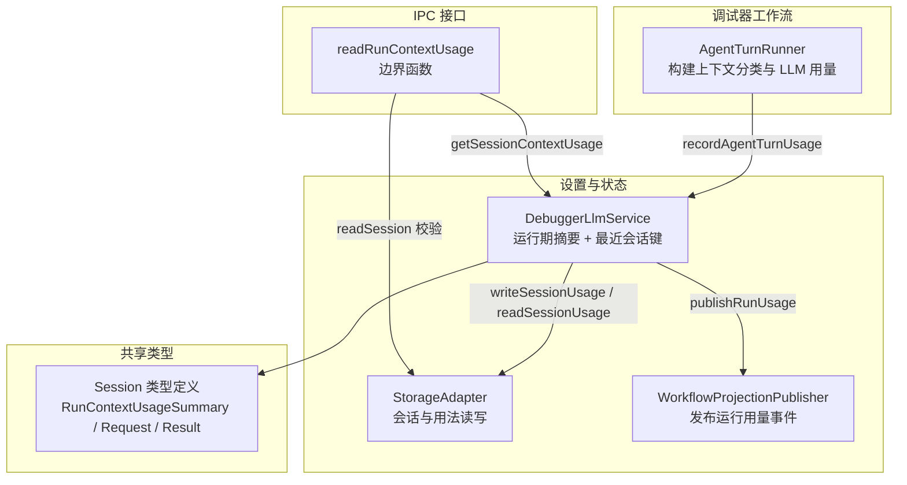

**图示来源**
- [AgentTurnRunner.ts:640-730](file://src/main/workflow/debugger/AgentTurnRunner.ts#L640-L730)
- [DebuggerLlmService.ts:168-345](file://src/main/settings/DebuggerLlmService.ts#L168-L345)
- [runContextUsageBoundary.ts:1-10](file://src/main/ipc/runContextUsageBoundary.ts#L1-L10)
- [session.ts:250-455](file://src/shared/types/session.ts#L250-L455)

**章节来源**
- [DebuggerLlmService.ts:1-345](file://src/main/settings/DebuggerLlmService.ts#L1-L345)
- [runContextUsageBoundary.ts:1-10](file://src/main/ipc/runContextUsageBoundary.ts#L1-L10)

## 核心组件与职责
- `DebuggerLlmService`：调试器专用的 LLM 使用统计服务。维护内存中的 run 摘要、每个会话的“最新 run 键”，并提供记录、查询、持久化和广播能力。
- `AgentTurnRunner`：调试器 Agent 回合执行器。在 provider 返回消息后，构造上下文 token 分类，并把 provider 用量写入 `DebuggerLlmService`。
- `readRunContextUsage`：IPC 边界函数。先校验 session 是否存在，再委托 `DebuggerLlmService` 返回标准结果。
- Session 类型：定义对外暴露的 `RunContextUsageSummary`、请求参数 `RunContextUsageRequest` 和读取结果 `RunContextUsageReadResult`。
- 归一化缓存工具：提供跨 provider 的缓存命中/未命中归一化及命中率计算。

**章节来源**
- [DebuggerLlmService.ts:1-167](file://src/main/settings/DebuggerLlmService.ts#L1-L167)
- [AgentTurnRunner.ts:640-730](file://src/main/workflow/debugger/AgentTurnRunner.ts#L640-L730)
- [runContextUsageBoundary.ts:1-10](file://src/main/ipc/runContextUsageBoundary.ts#L1-L10)
- [session.ts:250-455](file://src/shared/types/session.ts#L250-L455)
- [normalizeCacheUsage.ts:1-128](file://src/main/agent-runtime/providers/internal/normalizeCacheUsage.ts#L1-L128)

## 架构总览
调试器 LLM 服务不是直接调用 provider 的入口，而是消费由 Agent 运行时已经上报的 LLM usage。Provider 调用链路必须经过 AgentOrchestrator 及其 PromptPlan、RequestEnvelope、RequestPlan 管线；`DebuggerLlmService` 明确不实现 provider 请求路由。

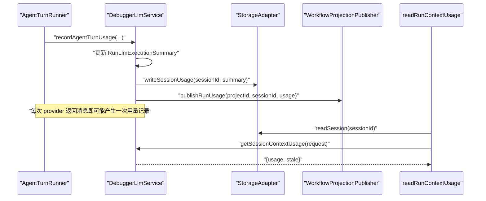

**图示来源**
- [AgentTurnRunner.ts:693-724](file://src/main/workflow/debugger/AgentTurnRunner.ts#L693-L724)
- [DebuggerLlmService.ts:168-345](file://src/main/settings/DebuggerLlmService.ts#L168-L345)
- [runContextUsageBoundary.ts:1-10](file://src/main/ipc/runContextUsageBoundary.ts#L1-L10)

## 详细组件分析

### DebuggerLlmService：调试器 LLM 统计中枢
`DebuggerLlmService` 的核心职责是：
1. 将 provider 上报的原始用量聚合成内部结构 `RunLlmExecutionSummary`。
2. 将内部摘要转换为对外暴露的 `RunContextUsageSummary`。
3. 维护每个会话的“最新 run 键”，以便无 `runId` 查询时返回最近一次 run。
4. 在记录用量时持久化到会话存储，并通过工作流投影发布用量事件。
5. 对子 agent 会话进行过滤，避免污染主会话统计。

关键成员与方法：
- `runSummaries`：按 runId 或 turnId 映射内部摘要。
- `latestUsageKeysBySession`：按 sessionId 映射“最新 run 键”。
- `resetRunSummary(runId)`：清理某个 run 的内存摘要及会话映射。
- `getRunSummary(runId)`：安全拷贝当前 run 摘要，避免外部修改内部状态。
- `getSessionContextUsage(request)`：统一查询入口，支持指定 runId 或按会话返回最新 run。
- `recordAgentTurnUsage(params)`：聚合 token、缓存、推理 token、成本、上下文分类和快照时间。
- `toContextUsageSummary(key, summary)`：生成最终 UI 可读摘要，包含预算、占用率、分类缩放、缓存命中率、成本和累计成本。

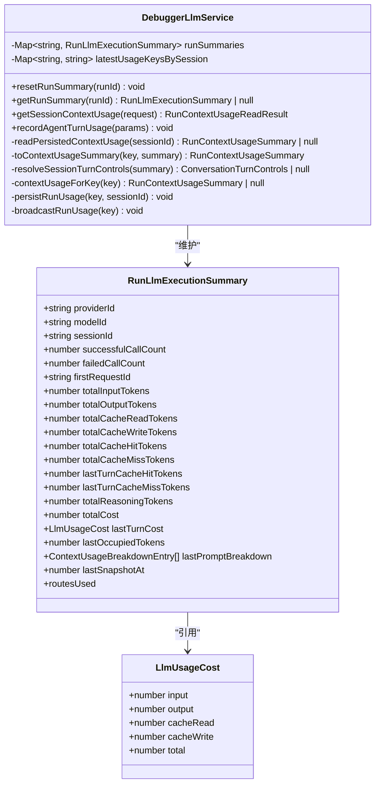

**图示来源**
- [DebuggerLlmService.ts:1-167](file://src/main/settings/DebuggerLlmService.ts#L1-L167)
- [DebuggerLlmService.ts:168-345](file://src/main/settings/DebuggerLlmService.ts#L168-L345)

**章节来源**
- [DebuggerLlmService.ts:1-345](file://src/main/settings/DebuggerLlmService.ts#L1-L345)

### AgentTurnRunner：调试器上下文与用量注入点
`AgentTurnRunner` 在 Agent 回合执行过程中完成两件事：
1. 根据 system prompt、规则、技能、工具定义、MCP 工具、子 agent 定义、压缩对话等，构造 `precomputedBreakdown`。
2. 在 provider 返回 assistant message 后，调用 `debuggerLlmService.recordAgentTurnUsage`，把 provider 用量与上下文分类一起写入。

上下文分类包括：
- `system_prompt`
- `memory_files`
- `skills`
- `system_tools`
- `mcp_tools`
- `mcp_tools_deferred`
- `builtin_tools_deferred`
- `subagent_definitions`
- `summarized_conversation`
- `conversation`

其中 `mcp_tools_deferred` 和 `builtin_tools_deferred` 被标记为非占用分类，用于后续缩放时保持直通。

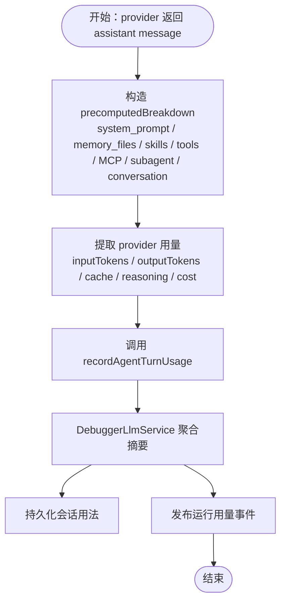

**图示来源**
- [AgentTurnRunner.ts:640-730](file://src/main/workflow/debugger/AgentTurnRunner.ts#L640-L730)
- [DebuggerLlmService.ts:168-345](file://src/main/settings/DebuggerLlmService.ts#L168-L345)

**章节来源**
- [AgentTurnRunner.ts:640-730](file://src/main/workflow/debugger/AgentTurnRunner.ts#L640-L730)

### IPC 边界：readRunContextUsage
`readRunContextUsage` 是一个薄边界：
- 若 `storageAdapter.readSession(sessionId)` 不存在，直接返回空结果且非陈旧。
- 否则委托 `debuggerLlmService.getSessionContextUsage(request)`。
- 测试保证返回的是标准的 `{usage, stale}`，不会再次包裹一层 usage。

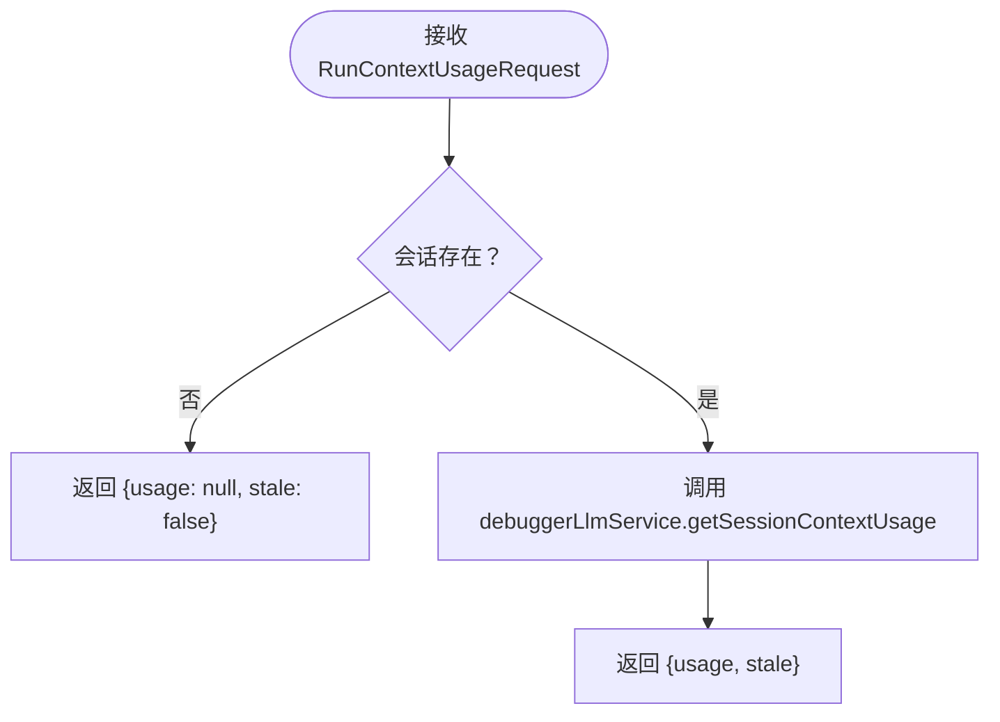

**图示来源**
- [runContextUsageBoundary.ts:1-10](file://src/main/ipc/runContextUsageBoundary.ts#L1-L10)
- [workflowHandlers.usage.test.ts:1-57](file://src/main/ipc/workflowHandlers.usage.test.ts#L1-L57)

**章节来源**
- [runContextUsageBoundary.ts:1-10](file://src/main/ipc/runContextUsageBoundary.ts#L1-L10)
- [workflowHandlers.usage.test.ts:1-57](file://src/main/ipc/workflowHandlers.usage.test.ts#L1-L57)

## 使用统计数据结构

### RunLlmExecutionSummary：内部运行摘要
`RunLlmExecutionSummary` 是 `DebuggerLlmService` 内部的聚合结构，描述一次或一轮 LLM 调用的完整运行状态。关键字段如下：
- `providerId`、`modelId`：最后使用的 provider 与模型。
- `sessionId`：关联的调试会话。
- `successfulCallCount`、`failedCallCount`：成功与失败调用计数。
- `totalInputTokens`、`totalOutputTokens`：累计输入与输出 token。
- `totalCacheReadTokens`、`totalCacheWriteTokens`：累计缓存读/写 token。
- `totalCacheHitTokens`、`totalCacheMissTokens`：累计缓存命中/未命中 token。
- `lastTurnCacheHitTokens`、`lastTurnCacheMissTokens`：最近一次调用的缓存命中/未命中。
- `totalReasoningTokens`：累计推理 token。
- `totalCost`、`lastTurnCost`：累计成本与最近一次成本明细。
- `lastOccupiedTokens`：最近一次占用的 token 数。
- `lastPromptBreakdown`：最近一次 prompt 的分类 token 估算。
- `lastSnapshotAt`：最近一次快照时间戳。
- `routesUsed`：本 run 使用的路由列表，含 agentId、providerId、modelId、requestId、状态。

**章节来源**
- [DebuggerLlmService.ts:1-167](file://src/main/settings/DebuggerLlmService.ts#L1-L167)

### RunContextUsageSummary：对外公开摘要
`RunContextUsageSummary` 是 UI 和 IPC 消费者看到的最终结构，主要字段包括：
- `runId`、`providerId`、`modelId`
- `inputTokens`、`outputTokens`、`totalTokens`
- `promptBudgetTokens`、`contextWindowTokens`、`maxOutputTokens`、`compactionThresholdTokens`
- `usagePercent`：基于 occupiedTokens 与 promptBudgetTokens 计算的占用百分比。
- `occupiedTokens`：最近一次 provider inputTokens。
- `breakdown`：按分类缩放的上下文 token 分布。
- `snapshotAt`：快照时间。
- `cacheReadTokens`、`cacheWriteTokens`、`cacheHitTokens`、`cacheMissTokens`、`cacheSavedTokens`
- `lastTurnCacheHitTokens`、`lastTurnCacheMissTokens`
- `lastTurnCacheHitRate`、`cumulativeCacheHitRate`
- `reasoningTokens`
- `cost`、`cumulativeCost`

**章节来源**
- [session.ts:250-455](file://src/shared/types/session.ts#L250-L455)

### ContextUsageBreakdownEntry：上下文分类条目
`ContextUsageBreakdownEntry` 表示一个上下文片段的 token 估算，可选附加 count。常见 id 包括系统提示、记忆文件、技能、系统工具、MCP 工具、延迟工具、子 agent 定义、压缩对话、对话本体和空闲空间。

**章节来源**
- [session.ts:250-455](file://src/shared/types/session.ts#L250-L455)

## 上下文使用统计收集机制

### 数据入口：recordAgentTurnUsage
`recordAgentTurnUsage` 是统计收集的入口。它要求：
- 提供 sessionId。
- 不是子 agent 会话。
- 至少包含一项有意义的 provider 用量指标，例如输入 token、输出 token、缓存 token、推理 token 或成本。

当条件满足时，它会：
1. 以 `runId` 或 `turnId` 作为 key。
2. 初始化或复用 `RunLlmExecutionSummary`。
3. 累计输入、输出、缓存读/写、命中/未命中、推理 token。
4. 更新最近一次的缓存命中/未命中、成本、占用 token、prompt 分类和时间戳。
5. 更新会话的最新 run 键。
6. 持久化并广播用量。

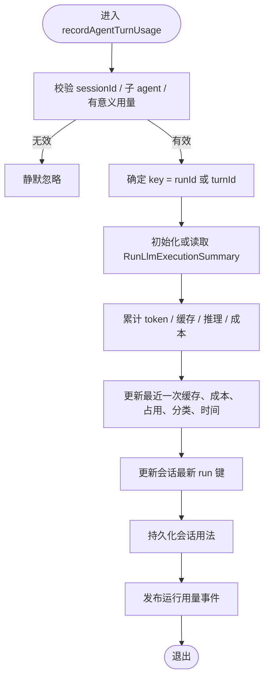

**图示来源**
- [DebuggerLlmService.ts:168-242](file://src/main/settings/DebuggerLlmService.ts#L168-L242)

**章节来源**
- [DebuggerLlmService.ts:168-242](file://src/main/settings/DebuggerLlmService.ts#L168-L242)

### 上下文分类与缩放：buildScaledBreakdown
`buildScaledBreakdown` 的作用是把 provider 上报的 prompt 分类 token 估算，对齐到实际占用的 `occupiedTokens`。其逻辑是：
1. 将分类分为“占用类”和“直通类”。直通类包括 `mcp_tools_deferred` 和 `builtin_tools_deferred`。
2. 计算占用类的 token 总和。
3. 如果占用类和 occupiedTokens 都大于 0，则计算缩放比例。
4. 对占用类条目按比例缩放，并对直通类条目保留原值。
5. 如果存在 promptBudgetTokens，追加一个 `free` 条目，表示剩余可用预算。

这种设计让 UI 能够展示“已占用 token 如何分布在 system prompt、工具、对话等部分”，而不是只看到一个模糊的 inputTokens。

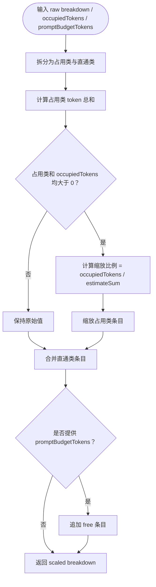

**图示来源**
- [DebuggerLlmService.ts:25-62](file://src/main/settings/DebuggerLlmService.ts#L25-L62)

**章节来源**
- [DebuggerLlmService.ts:25-62](file://src/main/settings/DebuggerLlmService.ts#L25-L62)

### 读取路径：getSessionContextUsage
`getSessionContextUsage` 支持三种查询模式：
1. 指定 `runId`：优先返回内存中对应 run 的摘要；否则回退到磁盘持久化快照，并根据 runId 判断是否陈旧。
2. 未指定 `runId`：优先返回会话对应的最新 run；否则回退到磁盘快照。
3. 子 agent 会话直接返回空结果。

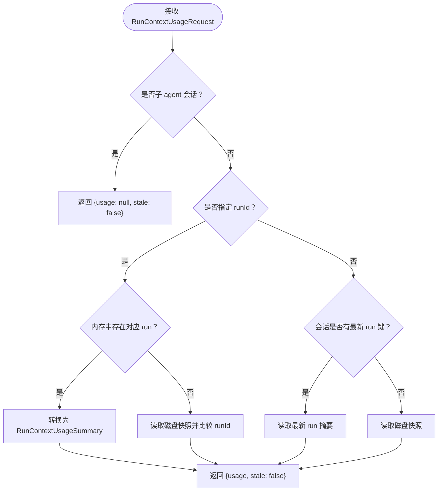

**图示来源**
- [DebuggerLlmService.ts:139-182](file://src/main/settings/DebuggerLlmService.ts#L139-L182)

**章节来源**
- [DebuggerLlmService.ts:139-182](file://src/main/settings/DebuggerLlmService.ts#L139-L182)

## 会话级与 run 级统计区分
调试器统计区分两个维度：
- **会话级**：通过 `latestUsageKeysBySession` 维护每个会话的“最新 run 键”，供无 `runId` 查询使用。
- **run 级**：通过 `runSummaries` 维护每个 runId 或 turnId 的完整摘要。

查询语义：
- 指定 `runId`：返回该 run 的统计；若内存中没有，则尝试从磁盘恢复，并用 `stale` 标识是否为旧快照。
- 不指定 `runId`：返回会话最近一次 run 的统计；若无内存数据，则返回磁盘快照。
- 子 agent 会话：始终返回空统计，避免子 agent 的 LLM 用量污染主会话。

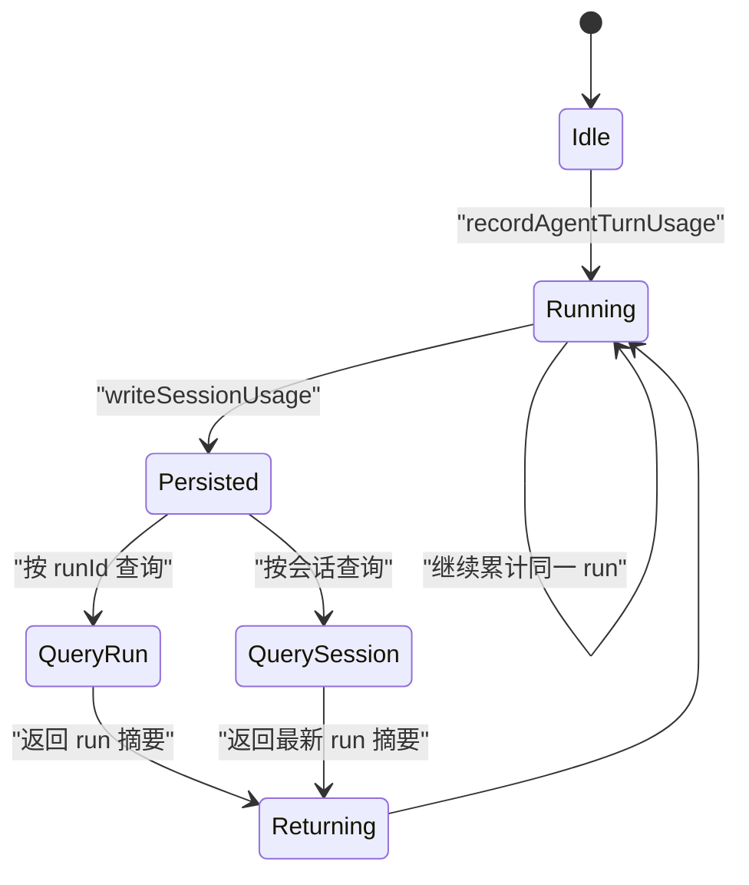

**图示来源**
- [DebuggerLlmService.ts:139-242](file://src/main/settings/DebuggerLlmService.ts#L139-L242)

**章节来源**
- [DebuggerLlmService.ts:139-242](file://src/main/settings/DebuggerLlmService.ts#L139-L242)

## 缓存命中率、成本与性能指标

### 缓存命中与未命中
缓存统计有两种来源：
1. Provider 原生字段：`promptCacheHitTokens`、`promptCacheMissTokens`。
2. 兼容字段：`cacheReadTokens`，此时命中等于缓存读，未命中等于 `inputTokens - cacheReadTokens`。

`normalizeCacheUsage` 的规则是：
- 优先使用原生命中/未命中字段。
- 如果没有原生字段但有缓存读字段，则推导命中与未命中。
- 如果两者都没有，则不报告缓存命中/未命中。

`DebuggerLlmService` 进一步区分：
- 累计命中/未命中：所有有缓存遥测的调用累加。
- 最近一次命中/未命中：仅反映最近一次 call；如果最近一次没有缓存遥测，则清空最近一次字段，但保留累计字段。

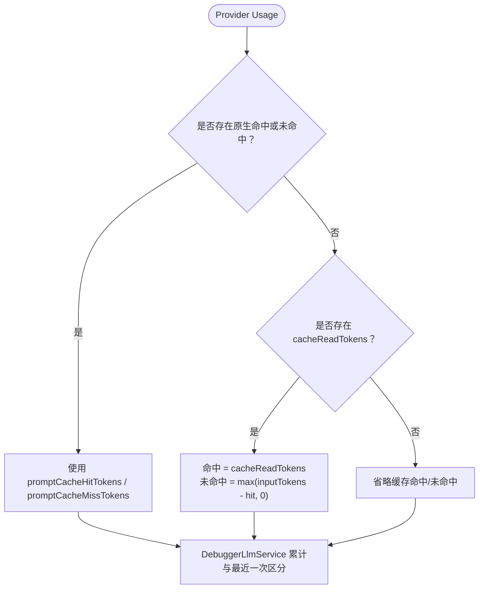

**图示来源**
- [normalizeCacheUsage.ts:1-128](file://src/main/agent-runtime/providers/internal/normalizeCacheUsage.ts#L1-L128)
- [DebuggerLlmService.ts:201-242](file://src/main/settings/DebuggerLlmService.ts#L201-L242)

**章节来源**
- [normalizeCacheUsage.ts:1-128](file://src/main/agent-runtime/providers/internal/normalizeCacheUsage.ts#L1-L128)
- [DebuggerLlmService.ts:201-242](file://src/main/settings/DebuggerLlmService.ts#L201-L242)

### 成本累计
成本结构 `LlmUsageCost` 包含输入成本、输出成本、缓存读成本、缓存写成本和总成本。`DebuggerLlmService` 的行为是：
- 如果 provider 提供了 cost，则累计 `totalCost`，并保存最近一次 `lastTurnCost`。
- 如果最近一次没有 cost，则清空 `lastTurnCost`，但不清空累计 `totalCost`。
- 对外暴露时，只有正数累计成本才会出现在 `cumulativeCost` 中。

**章节来源**
- [DebuggerLlmService.ts:1-167](file://src/main/settings/DebuggerLlmService.ts#L1-L167)
- [DebuggerLlmService.ts:201-242](file://src/main/settings/DebuggerLlmService.ts#L201-L242)

### 性能指标与监控
可观测指标包括：
- 输入 token、输出 token、总 token。
- 缓存读 token、缓存写 token。
- 缓存命中 token、缓存未命中 token。
- 最近一次缓存命中率、累计缓存命中率。
- 推理 token。
- 单次成本、累计成本。
- 上下文窗口占用百分比。
- 快照时间戳。

这些指标可用于：
- 监控 LLM 成本趋势。
- 评估 prompt 压缩和缓存效果。
- 分析不同 provider/model 的性价比。
- 检测异常高占用或低命中率场景。

**章节来源**
- [DebuggerLlmService.ts:246-345](file://src/main/settings/DebuggerLlmService.ts#L246-L345)
- [session.ts:250-455](file://src/shared/types/session.ts#L250-L455)

## 调试器集成示例
以下示例说明调试器如何集成 `DebuggerLlmService`：

### 示例一：Agent 回合完成后上报用量
`AgentTurnRunner` 在 provider 返回 assistant message 后，会：
1. 构造上下文分类。
2. 提取 provider 用量。
3. 调用 `debuggerLlmService.recordAgentTurnUsage`。

这使调试器能够在用户看到响应时，同步获得 token、缓存、成本和上下文分类统计。

**章节来源**
- [AgentTurnRunner.ts:640-730](file://src/main/workflow/debugger/AgentTurnRunner.ts#L640-L730)

### 示例二：UI 查询运行用量
渲染端或工作流可以通过 IPC 调用 `readRunContextUsage`：
- 传入 `sessionId`。
- 可选传入 `runId`。
- 得到 `{usage, stale}`。
- 如果 `stale` 为 true，表示返回的是磁盘旧快照，可能需要重新拉取内存最新数据。

**章节来源**
- [runContextUsageBoundary.ts:1-10](file://src/main/ipc/runContextUsageBoundary.ts#L1-L10)
- [workflowHandlers.usage.test.ts:1-57](file://src/main/ipc/workflowHandlers.usage.test.ts#L1-L57)

### 示例三：分析某次 run 的上下文分布
拿到 `breakdown` 后，可以：
- 查看 `system_prompt`、`memory_files`、`skills`、`system_tools`、`conversation` 等占比。
- 对比 `occupiedTokens` 与 `promptBudgetTokens`，判断是否接近压缩阈值。
- 结合 `usagePercent` 做阈值告警。

**章节来源**
- [DebuggerLlmService.ts:25-62](file://src/main/settings/DebuggerLlmService.ts#L25-L62)
- [session.ts:250-455](file://src/shared/types/session.ts#L250-L455)

## 数据分析方法

### 按 run 分析
适合分析单次调试任务的成本、token 使用和缓存效果：
- 关注 `runId`。
- 比较 `inputTokens`、`outputTokens`、`reasoningTokens`。
- 观察 `cacheHitTokens`、`cacheMissTokens`、`lastTurnCacheHitRate`、`cumulativeCacheHitRate`。
- 检查 `cost`、`cumulativeCost`。

### 按会话分析
适合分析整个调试会话的趋势：
- 使用不指定 `runId` 的查询获取最新 run。
- 观察 `usagePercent` 随时间上升情况。
- 观察 `breakdown` 中 `conversation` 增长趋势。
- 结合 `snapshotAt` 做时间序列分析。

### 按 provider/model 分析
适合评估不同 provider/model 的性价比：
- 对比 `providerId`、`modelId`。
- 对比 `totalCost` 与 `totalTokens`。
- 对比缓存命中率。
- 对比推理 token 占比。

### 按上下文分类分析
适合优化 prompt 和工具配置：
- 减少不必要的 `system_prompt`、`memory_files`、`skills`。
- 控制 `system_tools`、`mcp_tools`、`subagent_definitions` 的数量。
- 关注 `conversation` 增长，配合压缩阈值调整。

**章节来源**
- [DebuggerLlmService.ts:246-345](file://src/main/settings/DebuggerLlmService.ts#L246-L345)
- [session.ts:250-455](file://src/shared/types/session.ts#L250-L455)

## 依赖关系分析

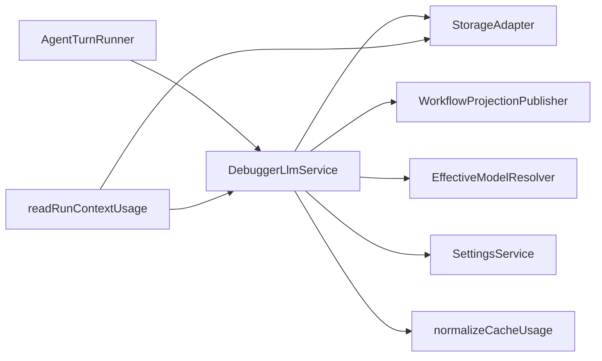

**图示来源**
- [AgentTurnRunner.ts:693-724](file://src/main/workflow/debugger/AgentTurnRunner.ts#L693-L724)
- [DebuggerLlmService.ts:1-345](file://src/main/settings/DebuggerLlmService.ts#L1-L345)
- [runContextUsageBoundary.ts:1-10](file://src/main/ipc/runContextUsageBoundary.ts#L1-L10)
- [normalizeCacheUsage.ts:1-128](file://src/main/agent-runtime/providers/internal/normalizeCacheUsage.ts#L1-L128)

耦合特点：
- `DebuggerLlmService` 与 `StorageAdapter` 解耦了持久化细节。
- 通过 `workflowProjectionPublisher` 将用量变化推送到工作流投影。
- 通过 `EffectiveModelResolver` 和 `SettingsService` 解析模型计划与设置。
- 通过 `normalizeCacheUsage` 统一跨 provider 的缓存语义。

**章节来源**
- [DebuggerLlmService.ts:1-345](file://src/main/settings/DebuggerLlmService.ts#L1-L345)
- [runContextUsageBoundary.ts:1-10](file://src/main/ipc/runContextUsageBoundary.ts#L1-L10)

## 性能与可靠性建议

### 性能建议
- 避免在无意义的零用量上重复持久化。代码已通过 `hasMaterialProviderUsageTelemetry` 过滤缺少实质用量的记录。
- 使用 `runId` 查询可获得精确的 run 级统计；使用会话级查询应理解其返回的是“最新 run”。
- 大量连续调用时，注意 `writeSessionUsage` 与 `publishRunUsage` 的频率，避免 UI 过度刷新。

### 可靠性建议
- 始终校验 session 是否存在后再查询用量。
- 对于 `stale: true` 的结果，应视为需要重新拉取最新内存数据的信号。
- 子 agent 会话不应参与主会话统计，避免误判上下文占用。

**章节来源**
- [DebuggerLlmService.ts:92-167](file://src/main/settings/DebuggerLlmService.ts#L92-L167)
- [DebuggerLlmService.ts:139-242](file://src/main/settings/DebuggerLlmService.ts#L139-L242)
- [workflowHandlers.usage.test.ts:1-57](file://src/main/ipc/workflowHandlers.usage.test.ts#L1-L57)

## 故障排查指南

### 问题一：查询不到任何用量
可能原因：
- session 不存在。
- 子 agent 会话。
- provider 未上报有意义的用量指标。
- 尚未执行过 LLM 调用。

排查步骤：
1. 确认 `readSession(sessionId)` 返回有效会话。
2. 确认不是子 agent 会话。
3. 确认 provider 返回了 inputTokens、outputTokens、cache 或 cost 等指标。
4. 检查是否已经触发过一次 Agent 回合。

**章节来源**
- [runContextUsageBoundary.ts:1-10](file://src/main/ipc/runContextUsageBoundary.ts#L1-L10)
- [DebuggerLlmService.ts:139-182](file://src/main/settings/DebuggerLlmService.ts#L139-L182)
- [DebuggerLlmService.ts:92-167](file://src/main/settings/DebuggerLlmService.ts#L92-L167)

### 问题二：缓存命中率缺失
可能原因：
- provider 没有上报 `promptCacheHitTokens`、`promptCacheMissTokens` 或 `cacheReadTokens`。
- 最近一次调用没有缓存遥测，导致 `lastTurnCacheHitTokens` 等字段为空。

排查步骤：
1. 检查 provider 是否正常上报缓存字段。
2. 确认累计命中/未命中字段是否存在。
3. 如果只有累计字段而没有最近一次字段，属于正常行为。

**章节来源**
- [normalizeCacheUsage.ts:1-128](file://src/main/agent-runtime/providers/internal/normalizeCacheUsage.ts#L1-L128)
- [DebuggerLlmService.ts:201-242](file://src/main/settings/DebuggerLlmService.ts#L201-L242)

### 问题三：成本累计异常
可能原因：
- 某些 provider 没有提供 cost。
- 最近一次调用没有 cost，导致 `lastTurnCost` 为空。

排查步骤：
1. 检查 provider manifest 或 models.json 是否包含定价信息。
2. 检查 `totalCost` 是否仍有累计值。
3. 确认 `lastTurnCost` 缺失不等于累计成本缺失。

**章节来源**
- [DebuggerLlmService.ts:201-242](file://src/main/settings/DebuggerLlmService.ts#L201-L242)

### 问题四：上下文占用百分比异常
可能原因：
- `promptBudgetTokens` 为 null 或 0。
- `occupiedTokens` 与 `breakdown` 缩放不一致。
- 使用了延迟工具或非占用分类。

排查步骤：
1. 检查模型计划是否能解析出 contextBudgetTokens。
2. 检查 `occupiedTokens` 是否为最近一次 inputTokens。
3. 检查 `breakdown` 中非占用分类是否被正确直通。

**章节来源**
- [DebuggerLlmService.ts:25-62](file://src/main/settings/DebuggerLlmService.ts#L25-L62)
- [DebuggerLlmService.ts:246-345](file://src/main/settings/DebuggerLlmService.ts#L246-L345)

## 结论
`DebuggerLlmService` 是调试器 LLM 统计的中枢组件。它不替代 provider 调用，而是把 Agent 运行时产生的用量标准化、聚合、持久化并广播。`RunLlmExecutionSummary` 是内部运行视图，`RunContextUsageSummary` 是对外公开视图。通过区分会话级与 run 级统计、累积与最近一次缓存命中、上下文分类与缩放，该服务为调试器的成本分析、上下文管理、缓存优化和 UI 展示提供了稳定基础。在实际使用中，应重点关注 session 有效性、provider 用量完整性、缓存遥测可用性、`stale` 标志和上下文占用百分比。