# 连接创建与初始化

<cite>
**本文引用的文件**   
- [ProviderConnectionService.ts](file://src/main/settings/ProviderConnectionService.ts)
- [ProviderConnectionSchema.ts](file://src/main/settings/ProviderConnectionSchema.ts)
- [ProviderConnectionDraft.ts](file://src/main/settings/ProviderConnectionDraft.ts)
- [settings.ts](file://src/shared/types/settings.ts)
- [providerConnectionErrors.ts](file://src/main/settings/providerConnectionErrors.ts)
- [SettingsService.ts](file://src/main/settings/SettingsService.ts)
- [SettingsProviderOps.ts](file://src/main/settings/SettingsProviderOps.ts)
- [providerConnectionState.ts](file://src/renderer/features/settings/SettingsModal/providerConnectionState.ts)
</cite>

## 目录
1. [引言](#引言)
2. [项目结构定位](#项目结构定位)
3. [核心组件](#核心组件)
4. [架构总览](#架构总览)
5. [详细组件分析](#详细组件分析)
6. [依赖关系分析](#依赖关系分析)
7. [性能考虑](#性能考虑)
8. [故障排查指南](#故障排查指南)
9. [结论](#结论)
10. [附录：连接配置示例与字段说明](#附录连接配置示例与字段说明)

## 引言
本文围绕 Provider 连接创建与初始化流程展开，重点解释以下主题：
- `ProviderConnectionService` 中连接创建的生命周期方法，包括草稿解析、模型发现、保存设置和有效目录刷新。
- `LlmProviderConnectionSchema` 的连接模式定义，包括协议类型、认证模式、必填字段、可选配置项和数据验证规则。
- `ProviderRouteUrl` 的路由 URL 解析与生成逻辑，包括路径模板、参数替换和 URL 规范化处理。
- 连接配置的完整示例、字段说明、默认值处理和错误消息映射。
- 连接创建过程中的安全考虑，包括敏感信息处理、环境变量注入和权限检查。
- 不同 provider 类型的连接配置最佳实践和常见问题解决方案。

本文所有实现细节均来自仓库源码，避免臆造；涉及具体代码片段的位置均以“章节来源”标注。

## 项目结构定位
与连接创建相关的主要模块集中在主进程设置子系统与共享类型定义中：
- 主进程连接服务：`src/main/settings/ProviderConnectionService.ts`
- 连接草稿解析：`src/main/settings/ProviderConnectionDraft.ts`
- 连接 schema 与模板解析：`src/main/settings/ProviderConnectionSchema.ts`
- 连接错误处理：`src/main/settings/providerConnectionErrors.ts`
- 设置持久化与凭据存储：`src/main/settings/SettingsService.ts`、`src/main/settings/SettingsProviderOps.ts`
- 共享类型定义：`src/shared/types/settings.ts`
- 渲染层连接状态投影：`src/renderer/features/settings/SettingsModal/providerConnectionState.ts`

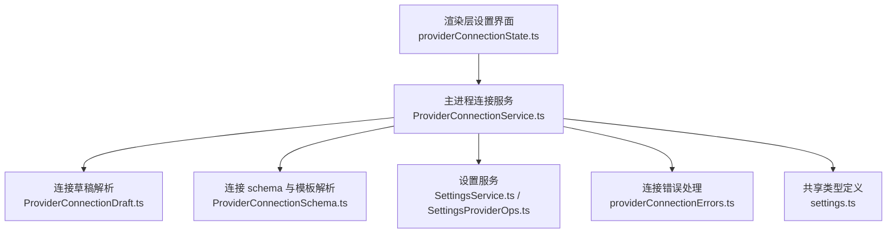

**图表来源**
- [ProviderConnectionService.ts:51-196](file://src/main/settings/ProviderConnectionService.ts#L51-L196)
- [ProviderConnectionDraft.ts:18-76](file://src/main/settings/ProviderConnectionDraft.ts#L18-L76)
- [ProviderConnectionSchema.ts:1-85](file://src/main/settings/ProviderConnectionSchema.ts#L1-L85)
- [SettingsService.ts:404-451](file://src/main/settings/SettingsService.ts#L404-L451)
- [providerConnectionErrors.ts:1-14](file://src/main/settings/providerConnectionErrors.ts#L1-L14)
- [settings.ts:201-683](file://src/shared/types/settings.ts#L201-L683)

**章节来源**
- [ProviderConnectionService.ts:51-196](file://src/main/settings/ProviderConnectionService.ts#L51-L196)
- [settings.ts:201-683](file://src/shared/types/settings.ts#L201-L683)

## 核心组件
- `ProviderConnectionService`：对外暴露连接测试与连接保存入口，协调草稿解析、模型发现、设置持久化和有效目录刷新。
- `ProviderConnectionDraft`：将用户输入、已存储连接值和 provider 定义合并为一次性的连接草稿，负责密钥字段映射与基础校验。
- `ProviderConnectionSchema`：提供连接 schema 的验证函数、主要密钥字段识别、端点模板解析与请求头映射。
- `SettingsService` 与 `SettingsProviderOps`：持久化连接设置、管理凭据存储引用、清理旧密钥并返回运行时设置。
- `providerConnectionErrors`：统一连接错误的消息解析。
- `settings.ts`：定义协议类型、认证模式、连接字段、连接 schema、提供者条目和连接结果等关键类型。
- `providerConnectionState.ts`（渲染层）：用于 UI 草稿签名、完整性判断、端点模板投影和连接提供者投影。

**章节来源**
- [ProviderConnectionService.ts:51-196](file://src/main/settings/ProviderConnectionService.ts#L51-L196)
- [ProviderConnectionDraft.ts:18-76](file://src/main/settings/ProviderConnectionDraft.ts#L18-L76)
- [ProviderConnectionSchema.ts:1-85](file://src/main/settings/ProviderConnectionSchema.ts#L1-L85)
- [SettingsService.ts:404-451](file://src/main/settings/SettingsService.ts#L404-L451)
- [settings.ts:201-683](file://src/shared/types/settings.ts#L201-L683)
- [providerConnectionState.ts:1-161](file://src/renderer/features/settings/SettingsModal/providerConnectionState.ts#L1-L161)

## 架构总览
连接创建的主流程分为三个阶段：
1. **草稿阶段**：渲染层收集用户输入，构造 `LlmProviderDraftRequest`，主进程通过 `resolveProviderConnectionDraft` 解析出 `apiKey`、`baseUrl` 和 `values`。
2. **发现阶段**：调用模型发现逻辑，根据 provider 协议选择不同策略进行模型列表拉取与校验。
3. **持久化阶段**：调用 `saveProviderConnection` 保存 provider、模型、baseUrl、协议、认证模式和连接值，并刷新有效目录缓存。

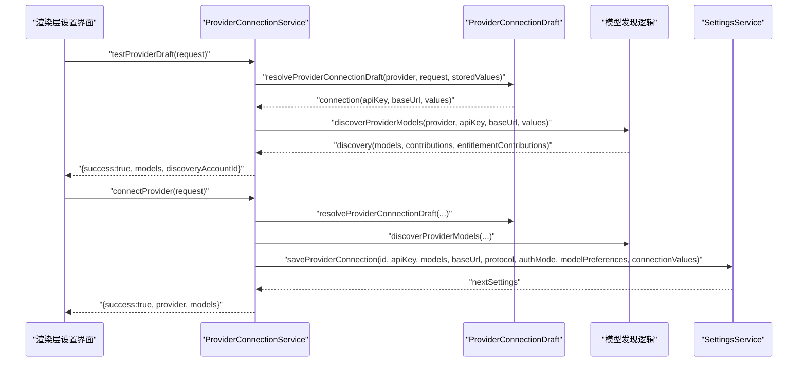

**图表来源**
- [ProviderConnectionService.ts:106-196](file://src/main/settings/ProviderConnectionService.ts#L106-L196)
- [ProviderConnectionDraft.ts:18-76](file://src/main/settings/ProviderConnectionDraft.ts#L18-L76)
- [SettingsService.ts:404-451](file://src/main/settings/SettingsService.ts#L404-L451)

**章节来源**
- [ProviderConnectionService.ts:106-196](file://src/main/settings/ProviderConnectionService.ts#L106-L196)
- [ProviderConnectionDraft.ts:18-76](file://src/main/settings/ProviderConnectionDraft.ts#L18-L76)

## 详细组件分析

### ProviderConnectionService：连接生命周期
`ProviderConnectionService` 是连接创建的核心编排者，提供以下关键能力：
- `createEffectiveCatalogDiscoveryLoader`：为有效目录加载器提供基于 provider 与账户的模型发现回调。
- `testProviderDraft`：仅测试连接可达性与模型发现，不写入设置。
- `connectProvider`：执行模型发现后保存连接配置并刷新有效目录。

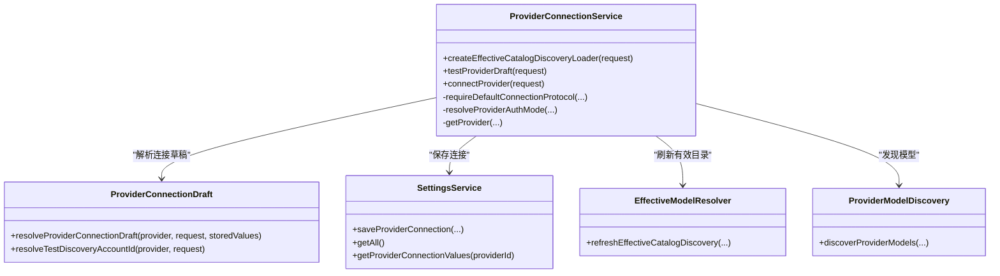

**图表来源**
- [ProviderConnectionService.ts:51-196](file://src/main/settings/ProviderConnectionService.ts#L51-L196)
- [ProviderConnectionDraft.ts:18-76](file://src/main/settings/ProviderConnectionDraft.ts#L18-L76)
- [SettingsService.ts:404-451](file://src/main/settings/SettingsService.ts#L404-L451)

#### testProviderDraft 流程
- 解析 provider 与认证模式，确保协议一致性。
- 通过 `resolveProviderConnectionDraft` 合并请求值与已存储连接值。
- 调用模型发现，复用已获取的发现负载更新有效目录。
- 返回成功或包含错误消息的结果对象。

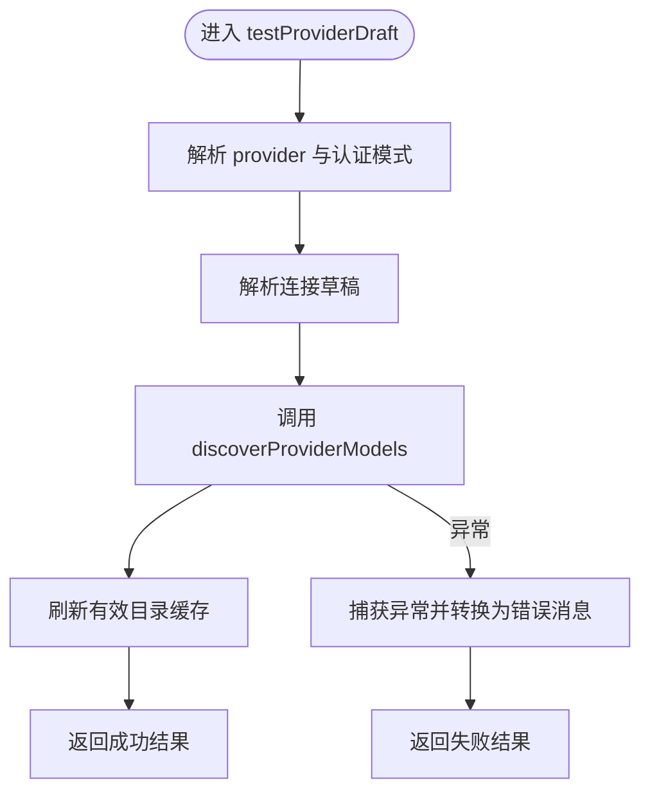

**图表来源**
- [ProviderConnectionService.ts:106-155](file://src/main/settings/ProviderConnectionService.ts#L106-L155)
- [ProviderConnectionDraft.ts:18-76](file://src/main/settings/ProviderConnectionDraft.ts#L18-L76)

**章节来源**
- [ProviderConnectionService.ts:106-155](file://src/main/settings/ProviderConnectionService.ts#L106-L155)

#### connectProvider 流程
- 与测试流程类似，但会在模型发现成功后调用 `settingsService.saveProviderConnection` 持久化连接。
- 随后刷新有效目录缓存，返回新的 provider 条目与模型列表。

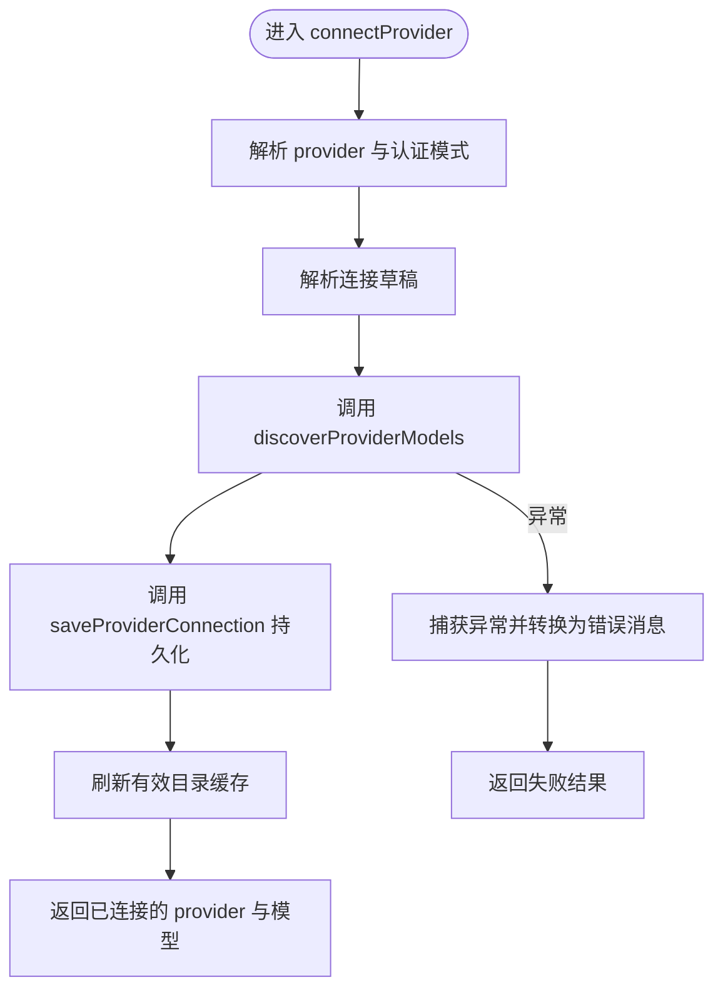

**图表来源**
- [ProviderConnectionService.ts:156-196](file://src/main/settings/ProviderConnectionService.ts#L156-L196)
- [SettingsService.ts:404-451](file://src/main/settings/SettingsService.ts#L404-L451)

**章节来源**
- [ProviderConnectionService.ts:156-196](file://src/main/settings/ProviderConnectionService.ts#L156-L196)

### ProviderConnectionSchema：连接模式与验证
`LlmProviderConnectionSchema` 描述一个 provider 的连接字段、主要密钥字段、凭证备选方案和端点模板。其关键职责包括：
- `resolvePrimaryConnectionSecretFieldId`：确定用于 HTTP 凭据的主要密钥字段 ID。
- `isProviderConnectionSchemaSatisfied`：判断连接 schema 是否满足必填字段与备选方案。
- `resolveProviderEndpointTemplate`：解析端点模板、参数替换与 URL 规范化。
- `resolveProviderConnectionHeaders`：将连接字段映射为请求头。

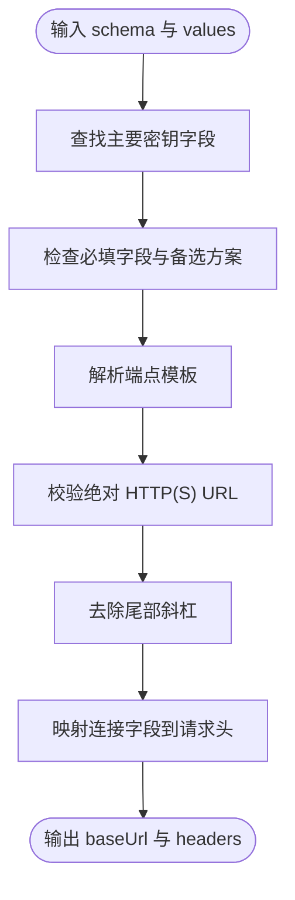

**图表来源**
- [ProviderConnectionSchema.ts:1-85](file://src/main/settings/ProviderConnectionSchema.ts#L1-L85)

#### 支持的协议类型
在共享类型中，协议类型包括 OpenAI 兼容、OpenAI Responses、Anthropic Messages、Azure OpenAI、Google Interactions、Google Gemini、Google Vertex Gemini、Google Vertex Anthropic、GitLab Duo、SAP AI Core、Ollama OpenAI Compatible、Mistral Conversations 和 Bedrock Converse Stream。这些协议驱动不同的模型发现策略与头部构造。

**章节来源**
- [settings.ts:201-280](file://src/shared/types/settings.ts#L201-L280)
- [ProviderConnectionSchema.ts:1-85](file://src/main/settings/ProviderConnectionSchema.ts#L1-L85)

### ProviderConnectionDraft：连接草稿解析
`resolveProviderConnectionDraft` 负责：
- 合并已存储连接值与请求中的连接值。
- 将请求中的 `apiKey` 映射到主要密钥字段。
- 对 `api-key` 认证模式执行 schema 校验，并对特定 provider（如 Google Vertex、Amazon Bedrock）允许空 API Key。
- 调用 `resolveProviderEndpointTemplate` 生成最终 baseUrl。

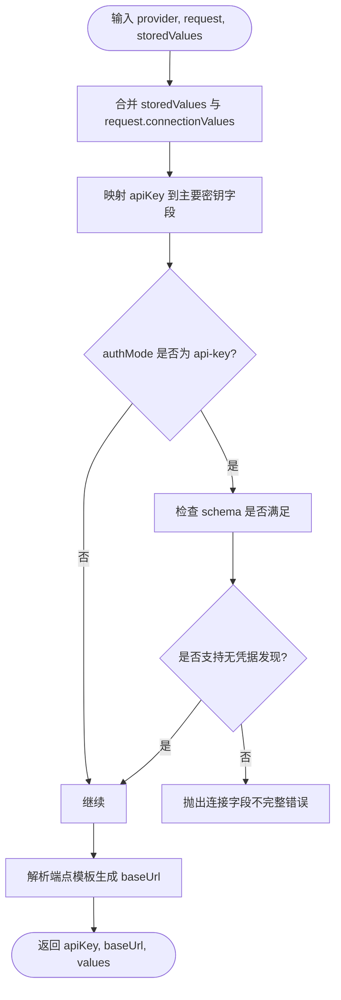

**图表来源**
- [ProviderConnectionDraft.ts:18-76](file://src/main/settings/ProviderConnectionDraft.ts#L18-L76)
- [ProviderConnectionSchema.ts:1-85](file://src/main/settings/ProviderConnectionSchema.ts#L1-L85)

**章节来源**
- [ProviderConnectionDraft.ts:18-76](file://src/main/settings/ProviderConnectionDraft.ts#L18-L76)

### SettingsService：连接保存与凭据处理
`saveProviderConnection` 委托给 `SettingsProviderOps`，并最终持久化 provider 条目、模型列表、baseUrl、协议、认证模式与连接值。设置服务还会：
- 管理 `secretRef` 与账户密钥轮换。
- 将明文 `apiKey` 写入密钥存储。
- 清理不再使用的旧密钥引用。
- 在返回前清空明文 `apiKey`，避免泄露。

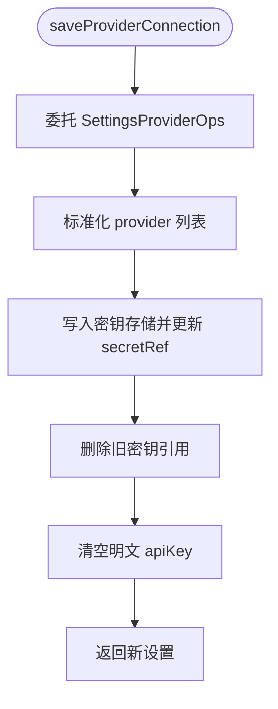

**图表来源**
- [SettingsService.ts:404-451](file://src/main/settings/SettingsService.ts#L404-L451)
- [SettingsService.ts:251-360](file://src/main/settings/SettingsService.ts#L251-L360)

**章节来源**
- [SettingsService.ts:251-451](file://src/main/settings/SettingsService.ts#L251-L451)

### 路由 URL 解析与生成
虽然仓库未直接出现名为 `ProviderRouteUrl` 的类，但连接 URL 的解析与生成主要由 `resolveProviderEndpointTemplate` 完成，并在 UI 侧通过 `projectEndpointTemplate` 进行预览投影。

关键点：
- 模板变量使用 `${FIELD_ID}` 形式，例如 `${DATABRICKS_HOST}`。
- 若字段缺失，抛出“缺少端点字段”的错误。
- 若存在不支持的模板变量，抛出“不支持的模板变量”错误。
- 必须解析为绝对 HTTP(S) URL，否则抛出“必须是绝对 HTTP(S) URL”错误。
- 最终 URL 去除尾部斜杠，保证规范化。

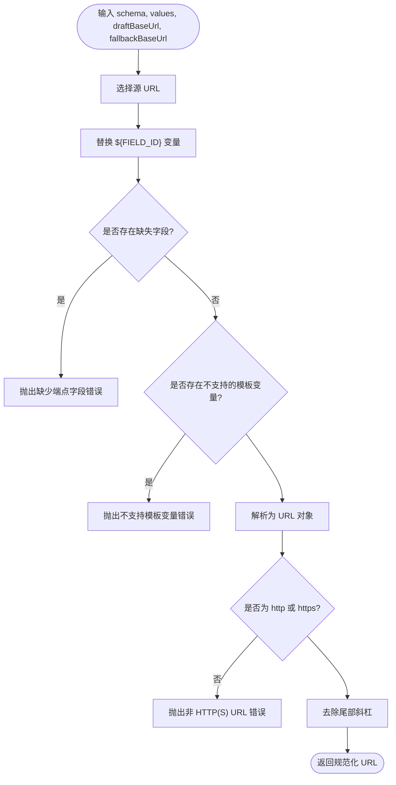

**图表来源**
- [ProviderConnectionSchema.ts:23-85](file://src/main/settings/ProviderConnectionSchema.ts#L23-L85)
- [providerConnectionState.ts:59-79](file://src/renderer/features/settings/SettingsModal/providerConnectionState.ts#L59-L79)

**章节来源**
- [ProviderConnectionSchema.ts:23-85](file://src/main/settings/ProviderConnectionSchema.ts#L23-L85)
- [providerConnectionState.ts:59-79](file://src/renderer/features/settings/SettingsModal/providerConnectionState.ts#L59-L79)

### 错误处理与消息映射
`parseProviderError` 将不同类型的异常转换为统一的错误消息字符串：
- `ProviderConnectionError`：直接使用错误消息。
- `DOMException` 且名称为 `AbortError`：返回“连接测试超时，请稍后重试”。
- 其他 `Error`：使用原始消息。
- 未知错误：返回“连接测试失败”。

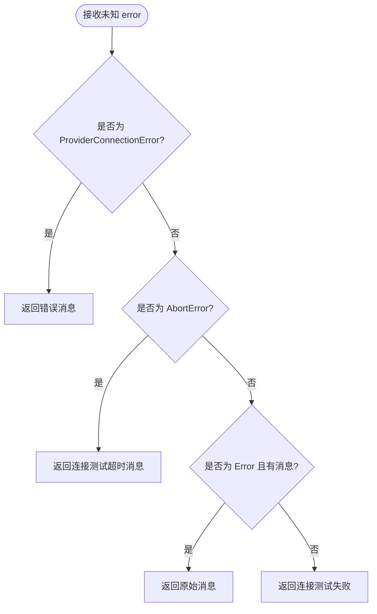

**图表来源**
- [providerConnectionErrors.ts:1-14](file://src/main/settings/providerConnectionErrors.ts#L1-L14)

**章节来源**
- [providerConnectionErrors.ts:1-14](file://src/main/settings/providerConnectionErrors.ts#L1-L14)

## 依赖关系分析
连接创建的关键依赖如下：
- `ProviderConnectionService` 依赖 `ProviderConnectionDraft`、`SettingsService`、`EffectiveModelResolver` 和模型发现逻辑。
- `ProviderConnectionDraft` 依赖 `ProviderConnectionSchema` 与错误类型。
- `ProviderConnectionSchema` 依赖共享类型 `LlmProviderConnectionSchema`。
- `SettingsService` 依赖 `SettingsProviderOps`、`SecretStorageService` 与设置工具函数。
- 渲染层 `providerConnectionState` 依赖共享类型，负责 UI 草稿投影与完整性判断。

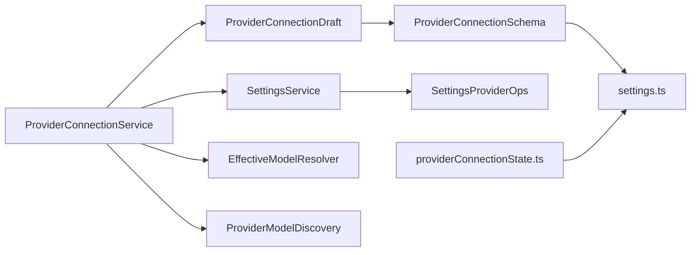

**图表来源**
- [ProviderConnectionService.ts:51-196](file://src/main/settings/ProviderConnectionService.ts#L51-L196)
- [ProviderConnectionDraft.ts:18-76](file://src/main/settings/ProviderConnectionDraft.ts#L18-L76)
- [ProviderConnectionSchema.ts:1-85](file://src/main/settings/ProviderConnectionSchema.ts#L1-L85)
- [SettingsService.ts:404-451](file://src/main/settings/SettingsService.ts#L404-L451)
- [providerConnectionState.ts:1-161](file://src/renderer/features/settings/SettingsModal/providerConnectionState.ts#L1-L161)

**章节来源**
- [ProviderConnectionService.ts:51-196](file://src/main/settings/ProviderConnectionService.ts#L51-L196)
- [SettingsService.ts:404-451](file://src/main/settings/SettingsService.ts#L404-L451)

## 性能考虑
- 模型发现采用超时控制，避免长时间阻塞连接测试。
- 有效目录缓存按账户维度区分，避免重复网络请求。
- 草稿测试不会覆盖已配置 provider 的账户缓存，减少误写风险。
- 连接保存时只持久化非秘密连接值，秘密字段进入密钥存储，降低 JSON 体积与泄露风险。

[本节为通用性能建议，不直接分析具体文件]

## 故障排查指南
常见问题与对应处理：
- **连接字段不完整**：当 `authMode` 为 `api-key` 且 schema 未满足时，会抛出“Provider connection fields are incomplete.”。请检查必填字段与备选方案。
- **端点模板缺失变量**：如果模板中存在未提供的字段，会抛出“Missing endpoint fields: ...”。请补充对应字段。
- **不支持的模板变量**：如果模板中存在未被 schema 定义的变量，会抛出“Provider endpoint contains an unsupported template variable.”。请修正模板。
- **非 HTTP(S) URL**：如果解析后的 URL 不是 http 或 https，会抛出“Provider endpoint must be an absolute HTTP(S) URL.”。请修正 baseUrl。
- **连接测试超时**：如果是 `AbortError`，会返回“连接测试超时，请稍后重试”。请检查网络与 provider 响应时间。
- **未知错误**：会返回“连接测试失败”。建议查看上游日志或 provider 文档。

**章节来源**
- [ProviderConnectionDraft.ts:18-76](file://src/main/settings/ProviderConnectionDraft.ts#L18-L76)
- [ProviderConnectionSchema.ts:23-85](file://src/main/settings/ProviderConnectionSchema.ts#L23-L85)
- [providerConnectionErrors.ts:1-14](file://src/main/settings/providerConnectionErrors.ts#L1-L14)

## 结论
连接创建与初始化是一个多阶段的协作过程：
- 渲染层收集输入并构造草稿。
- 主进程解析草稿、校验字段、生成 URL。
- 模型发现根据协议选择不同的策略。
- 设置服务持久化连接并管理凭据。
- 有效目录刷新确保模型列表准确。

该流程在保证安全性的同时，提供了灵活的连接模式与可扩展的协议支持。

[本节为总结性内容，不直接分析具体文件]

## 附录：连接配置示例与字段说明

### 连接字段类型
- `secret`：敏感字段，通常用于 API Key、Bearer Token 等，应进入密钥存储。
- `text`：普通文本字段。
- `url`：URL 字段，常用于 baseUrl 或端点模板变量。
- `region`：区域字段，常用于云厂商配置。
- `path`：路径字段，常用于 API 路径。

每个字段可声明：
- `id`：字段标识符。
- `label`：用户可见标签。
- `kind`：字段类型。
- `required`：是否必填。
- `environmentVariable`：环境变量名，用于从环境注入。
- `placeholder`：占位符提示。

**章节来源**
- [settings.ts:240-280](file://src/shared/types/settings.ts#L240-L280)

### 连接 schema 示例
以 OpenAI 为例，schema 可能包含：
- 主要密钥字段：`apiKey`。
- 可选字段：`baseUrl`、`organization`。
- 端点模板：`${BASE_URL}/chat/completions`。
- 请求头映射：将 `organization` 映射为 `OpenAI-Organization` 头。

以 Anthropic 为例，schema 可能包含：
- 主要密钥字段：`apiKey`。
- 可选字段：`baseUrl`。
- 请求头映射：`x-api-key` 与 `anthropic-version`。

以 Azure OpenAI 为例，schema 可能包含：
- 主要密钥字段：`apiKey`。
- 可选字段：`baseUrl`、`deploymentName`。
- 端点模板：`${BASE_URL}/openai/deployments/${DEPLOYMENT_NAME}/chat/completions`。

以 Google Vertex 为例，schema 可能包含：
- 主要密钥字段：`apiKey` 或云端凭据链。
- 可选字段：`project`、`location`、`endpoint`。
- 端点模板：`${ENDPOINT}/v1beta1/projects/${PROJECT}/locations/${LOCATION}/publishers/google/models/MODEL`。

以上示例用于说明字段组织方式；实际字段应以各 provider 的 catalog 定义为准。

**章节来源**
- [settings.ts:201-280](file://src/shared/types/settings.ts#L201-L280)
- [ProviderConnectionSchema.ts:1-85](file://src/main/settings/ProviderConnectionSchema.ts#L1-L85)

### 默认值处理
- 如果 provider 未定义 schema 或字段为空，则认为连接 schema 满足。
- 如果未提供 `baseUrl`，则优先使用请求中的 `baseUrl`，其次使用 provider 的 `baseUrl`，最后回退到 schema 的 `endpointTemplate`。
- 如果主要密钥字段不存在，则回退到第一个密钥字段。
- 如果连接值中某个字段为空，模板解析会报错，而不是静默跳过。

**章节来源**
- [ProviderConnectionSchema.ts:1-85](file://src/main/settings/ProviderConnectionSchema.ts#L1-L85)
- [ProviderConnectionDraft.ts:18-76](file://src/main/settings/ProviderConnectionDraft.ts#L18-L76)

### 安全考虑
- 主要密钥字段优先写入密钥存储，不在 settings JSON 中保留明文。
- `SettingsService` 在保存 provider 时旋转账户密钥并清理旧引用。
- 渲染层只展示是否存在存储密钥的布尔标记，不显示明文。
- 连接测试结果中的 `discoveryAccountId` 防止测试草稿覆盖已配置账户的有效目录缓存。

**章节来源**
- [SettingsService.ts:251-451](file://src/main/settings/SettingsService.ts#L251-L451)
- [ProviderConnectionDraft.ts:48-76](file://src/main/settings/ProviderConnectionDraft.ts#L48-L76)

### 不同 provider 类型的连接配置最佳实践
- **OpenAI 兼容**：优先填写 `apiKey` 与 `baseUrl`；如需组织级别访问，补充 `organization` 并映射为请求头。
- **Anthropic**：确保 `apiKey` 正确；如需自定义端点，使用 `baseUrl` 并保留 `anthropic-version` 头。
- **Azure OpenAI**：务必配置 `baseUrl` 与 `deploymentName`，避免路径拼接错误。
- **Google Vertex**：优先使用云端凭据链；如需本地测试，配置 `apiKey`、`project` 与 `location`。
- **Amazon Bedrock**：优先使用 AWS 凭据链；如需本地模拟，配置 `apiKey` 与 `region`。
- **Ollama**：通常为 `local` 认证模式，无需远程凭据，只需正确的 `baseUrl`。

### 常见问题解决方案
- **端点模板解析失败**：检查模板变量是否与 schema 字段一致，并确保所有必填字段已填充。
- **连接字段不完整**：确认 `authMode` 与 schema 匹配，必要时启用备选方案或使用云端凭据链。
- **模型发现为空**：检查 provider 协议是否正确，确认 baseUrl 可达且凭据有效。
- **缓存未刷新**：确认调用 `refreshEffectiveCatalogDiscovery`，并使用正确的 `discoveryAccountId`。

**章节来源**
- [ProviderConnectionSchema.ts:1-85](file://src/main/settings/ProviderConnectionSchema.ts#L1-L85)
- [ProviderConnectionDraft.ts:18-76](file://src/main/settings/ProviderConnectionDraft.ts#L18-L76)
- [ProviderConnectionService.ts:106-196](file://src/main/settings/ProviderConnectionService.ts#L106-L196)