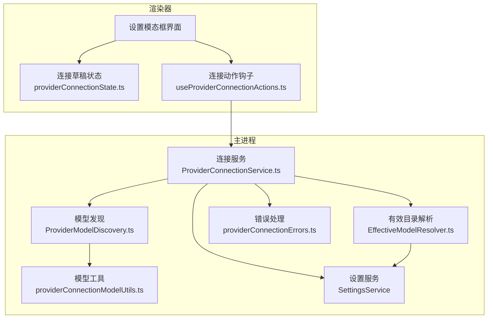
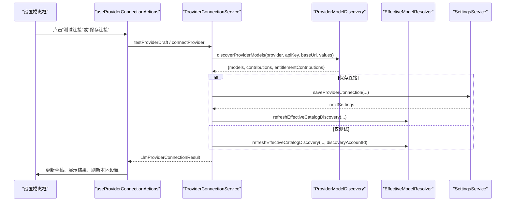
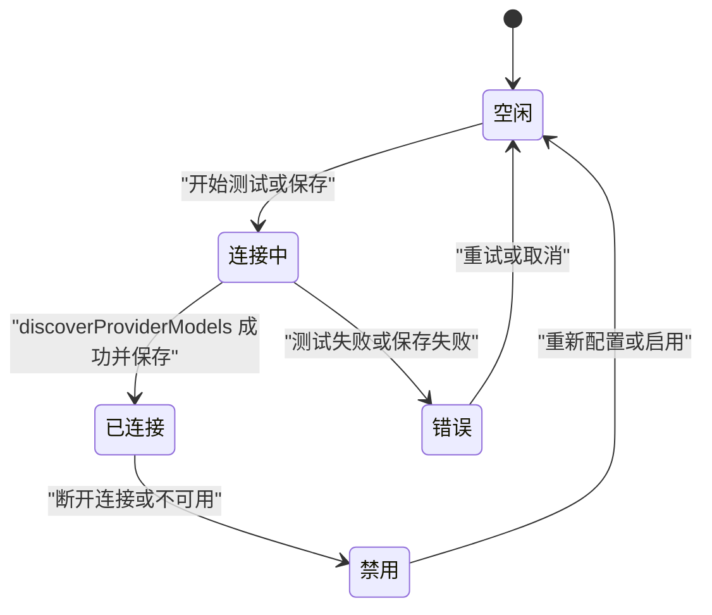
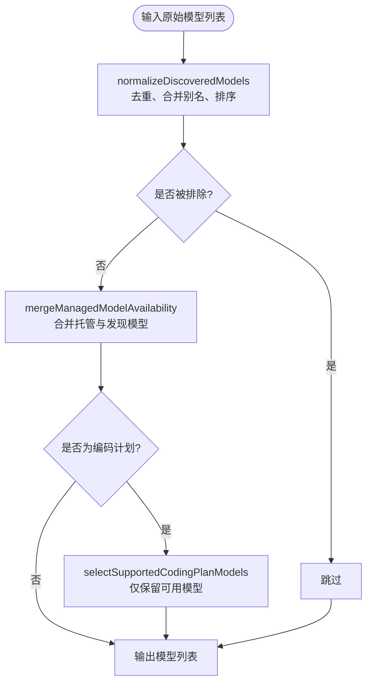
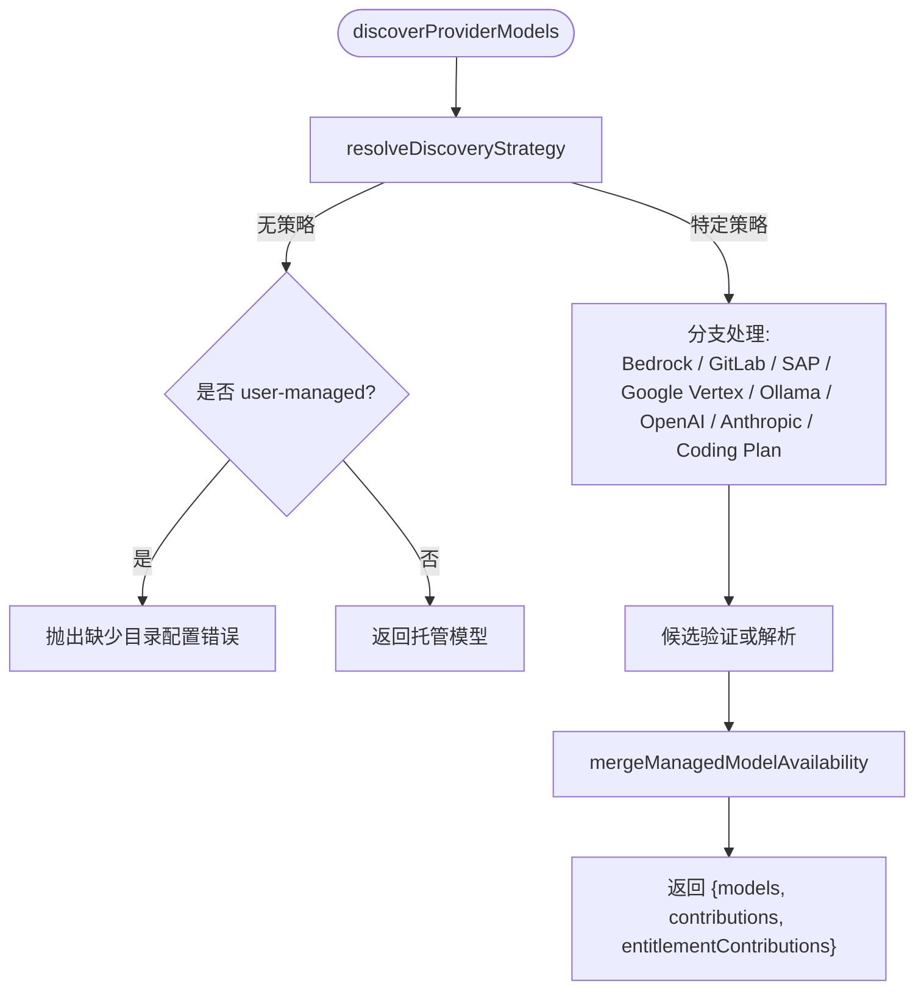
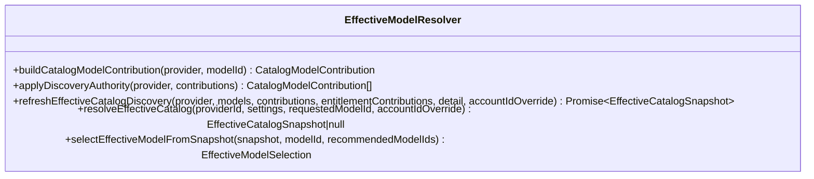
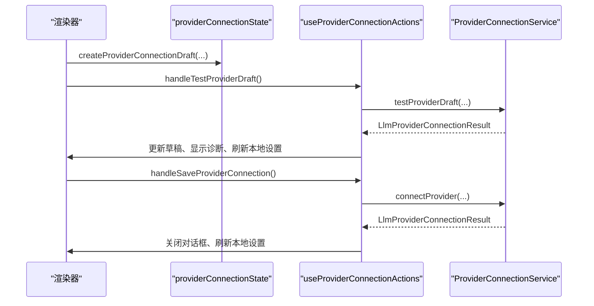

# 连接状态管理

<cite>
**本文引用的文件**
- [ProviderConnectionService.ts](file://src/main/settings/ProviderConnectionService.ts)
- [providerConnectionModelUtils.ts](file://src/main/settings/providerConnectionModelUtils.ts)
- [ProviderModelDiscovery.ts](file://src/main/settings/ProviderModelDiscovery.ts)
- [EffectiveModelResolver.ts](file://src/main/settings/EffectiveModelResolver.ts)
- [providerConnectionState.ts](file://src/renderer/features/settings/SettingsModal/providerConnectionState.ts)
- [useProviderConnectionActions.ts](file://src/renderer/features/settings/SettingsModal/useProviderConnectionActions.ts)
- [providerConnectionErrors.ts](file://src/main/settings/providerConnectionErrors.ts)
</cite>

## 目录
1. [引言](#引言)
2. [项目结构](#项目结构)
3. [核心组件](#核心组件)
4. [架构总览](#架构总览)
5. [详细组件分析](#详细组件分析)
6. [依赖关系分析](#依赖关系分析)
7. [性能与资源优化](#性能与资源优化)
8. [故障排查指南](#故障排查指南)
9. [结论](#结论)

## 引言
本文围绕 Provider 连接与模型能力发现子系统，系统性梳理连接状态机、启用/禁用/暂停/恢复流程、模型工具函数、连接池策略、事件监听机制、持久化存储以及监控与调优建议。该体系由主进程中的服务层（ProviderConnectionService、ProviderModelDiscovery、EffectiveModelResolver）和渲染器侧的表单状态与交互层（providerConnectionState、useProviderConnectionActions）共同组成，并通过 SettingsService 完成配置保存与有效目录刷新。

## 项目结构
连接状态管理主要分布在以下模块：
- 主进程设置服务层
  - ProviderConnectionService：对外暴露测试、连接、刷新、断开、账户登录等能力。
  - ProviderModelDiscovery：按 Provider 协议与目录策略进行模型发现、探测与合并。
  - EffectiveModelResolver：将用户配置、目录贡献、权限与覆盖规则组合为“有效目录快照”。
  - providerConnectionModelUtils：模型归一化、过滤、排序、别名索引与可用性合并。
  - providerConnectionErrors：统一错误类型与消息解析。
- 渲染器设置模态框
  - providerConnectionState：构建连接草稿、计算请求值、校验完整性和投影 Provider。
  - useProviderConnectionActions：处理测试、保存、账户登录、刷新本地设置等交互。



**图表来源**
- [ProviderConnectionService.ts:1-356](file://src/main/settings/ProviderConnectionService.ts#L1-L356)
- [ProviderModelDiscovery.ts:1-524](file://src/main/settings/ProviderModelDiscovery.ts#L1-L524)
- [EffectiveModelResolver.ts:1-788](file://src/main/settings/EffectiveModelResolver.ts#L1-L788)
- [providerConnectionModelUtils.ts:1-162](file://src/main/settings/providerConnectionModelUtils.ts#L1-L162)
- [providerConnectionState.ts:1-161](file://src/renderer/features/settings/SettingsModal/providerConnectionState.ts#L1-L161)
- [useProviderConnectionActions.ts:1-198](file://src/renderer/features/settings/SettingsModal/useProviderConnectionActions.ts#L1-L198)
- [providerConnectionErrors.ts:1-14](file://src/main/settings/providerConnectionErrors.ts#L1-L14)

**章节来源**
- [ProviderConnectionService.ts:1-356](file://src/main/settings/ProviderConnectionService.ts#L1-L356)
- [ProviderModelDiscovery.ts:1-524](file://src/main/settings/ProviderModelDiscovery.ts#L1-L524)
- [EffectiveModelResolver.ts:1-788](file://src/main/settings/EffectiveModelResolver.ts#L1-L788)
- [providerConnectionModelUtils.ts:1-162](file://src/main/settings/providerConnectionModelUtils.ts#L1-L162)
- [providerConnectionState.ts:1-161](file://src/renderer/features/settings/SettingsModal/providerConnectionState.ts#L1-L161)
- [useProviderConnectionActions.ts:1-198](file://src/renderer/features/settings/SettingsModal/useProviderConnectionActions.ts#L1-L198)
- [providerConnectionErrors.ts:1-14](file://src/main/settings/providerConnectionErrors.ts#L1-L14)

## 核心组件
- ProviderConnectionService
  - 提供测试连接、正式连接、刷新模型、断开连接、账户登录与登出、获取账户状态等方法。
  - 内部维护默认协议校验、认证模式选择与可用性注入。
- ProviderModelDiscovery
  - 根据 Provider 协议与目录声明决定发现策略，调用相应端点或外部库拉取模型列表，并进行候选验证、编码计划匹配、托管模型合并。
- EffectiveModelResolver
  - 聚合目录定义、用户选择、覆盖配置、权限贡献，生成“有效目录快照”，并提供刷新、选择与推荐逻辑。
- providerConnectionModelUtils
  - 实现模型归一化、排除规则、静态/托管模型转换、编码计划键标准化、可用性与别名索引构建。
- providerConnectionState
  - 渲染器侧连接草稿构建、字段完整性判断、端点模板投影、Provider 投影与账号状态初始化。
- useProviderConnectionActions
  - 封装测试、保存、账户登录等用户操作，协调主进程 API 与本地设置刷新。
- providerConnectionErrors
  - 统一异常类型与错误消息解析，包含超时、未知错误兜底。

**章节来源**
- [ProviderConnectionService.ts:1-356](file://src/main/settings/ProviderConnectionService.ts#L1-L356)
- [ProviderModelDiscovery.ts:1-524](file://src/main/settings/ProviderModelDiscovery.ts#L1-L524)
- [EffectiveModelResolver.ts:1-788](file://src/main/settings/EffectiveModelResolver.ts#L1-L788)
- [providerConnectionModelUtils.ts:1-162](file://src/main/settings/providerConnectionModelUtils.ts#L1-L162)
- [providerConnectionState.ts:1-161](file://src/renderer/features/settings/SettingsModal/providerConnectionState.ts#L1-L161)
- [useProviderConnectionActions.ts:1-198](file://src/renderer/features/settings/SettingsModal/useProviderConnectionActions.ts#L1-L198)
- [providerConnectionErrors.ts:1-14](file://src/main/settings/providerConnectionErrors.ts#L1-L14)

## 架构总览
连接生命周期由渲染器发起，经 IPC 进入主进程的 ProviderConnectionService，再由 ProviderModelDiscovery 完成模型发现，随后通过 EffectiveModelResolver 刷新有效目录，最终落盘到 SettingsService。



**图表来源**
- [useProviderConnectionActions.ts:1-198](file://src/renderer/features/settings/SettingsModal/useProviderConnectionActions.ts#L1-L198)
- [ProviderConnectionService.ts:1-356](file://src/main/settings/ProviderConnectionService.ts#L1-L356)
- [ProviderModelDiscovery.ts:1-524](file://src/main/settings/ProviderModelDiscovery.ts#L1-L524)
- [EffectiveModelResolver.ts:1-788](file://src/main/settings/EffectiveModelResolver.ts#L1-L788)

## 详细组件分析

### ProviderConnectionService 连接状态机
ProviderConnectionService 不直接维护一个显式“idle/connecting/connected/error/disabled”状态对象，而是通过方法返回结果与 SettingsService 中 ProviderEntry 的状态字段来表达连接状态。其状态语义如下：

- idle（空闲）
  - 未执行测试或保存；或上次操作已完成且无错误。
- connecting（连接中）
  - 测试或保存过程中；渲染器侧通过草稿 busy 字段表达，主进程以异步方法表示。
- connected（已连接）
  - 成功完成 discoverProviderModels 并写入 SettingsService，同时刷新有效目录。
- error（错误）
  - 抛出 ProviderConnectionError 或网络/超时异常；通过 parseProviderError 转为字符串错误。
- disabled（禁用）
  - 对应 Provider 未配置、不可用或 catalog 未启用；resolveProviderAuthMode 会注入 unavailableReason，disconnectProvider 可清空连接。



**图表来源**
- [ProviderConnectionService.ts:1-356](file://src/main/settings/ProviderConnectionService.ts#L1-L356)
- [providerConnectionErrors.ts:1-14](file://src/main/settings/providerConnectionErrors.ts#L1-L14)

#### 启用、禁用、暂停与恢复
- 启用
  - connectProvider：组装连接草稿、执行 discoverProviderModels、调用 settingsService.saveProviderConnection 写入模型与连接信息，再调用 refreshEffectiveCatalogDiscovery 刷新有效目录。
  - refreshProviderModels：对已配置 Provider 刷新模型；account 模式先检查账户连接状态。
- 禁用
  - disconnectProvider：调用 settingsService.disconnectProvider 清理连接，返回当前 Provider 条目。
- 暂停
  - 通过 ProviderEntry.enabled 或 authModeAvailability.state === 'unavailable' 表达；渲染器在 projectEndpointTemplate/projectConnectionProvider 中映射 status 与 enabled。
- 恢复
  - 修改草稿后再次执行测试或保存；account 模式下需完成 start/finish 登录流程。

**章节来源**
- [ProviderConnectionService.ts:100-356](file://src/main/settings/ProviderConnectionService.ts#L100-L356)
- [providerConnectionState.ts:1-161](file://src/renderer/features/settings/SettingsModal/providerConnectionState.ts#L1-L161)

### 模型工具函数（ProviderConnectionModelUtils）
- normalizeDiscoveredModels
  - 去重、合并别名、按 id 排序；忽略被排除的模型标识。
- isExcludedDiscoveredModel
  - 排除 deprecated、gpt-3.5、claude-2、claude-instant 等历史或废弃模型。
- requireModels / toStaticModels / requireManagedModels
  - 校验模型非空；从字符串数组构造静态模型；校验应用托管目录存在。
- normalizeCodingPlanModelMatchKey
  - 去除命名空间前缀、日期后缀、点号替换，并将 synonym（mini→lite）规范化，用于编码计划匹配。
- mergeManagedModelAvailability
  - 将托管模型与发现模型合并：若发现中存在则标记 available 并启用；否则标记 unavailable 并给出原因；支持别名索引。
- selectSupportedCodingPlanModels
  - 针对 volcengine-coding-plan 仅保留 enabled 且 availability 为 available 的模型。
- buildManagedAliasIndex
  - 从目录定义构建 modelId→aliases 的索引。



**图表来源**
- [providerConnectionModelUtils.ts:1-162](file://src/main/settings/providerConnectionModelUtils.ts#L1-L162)

**章节来源**
- [providerConnectionModelUtils.ts:1-162](file://src/main/settings/providerConnectionModelUtils.ts#L1-L162)

### 模型发现与缓存机制（ProviderModelDiscovery）
- 策略选择
  - resolveDiscoveryStrategy 根据 protocol 与 surface.discovery.strategy 确定具体发现方式，如 openai-compatible、anthropic-candidate-validation、google-vertex-models、ollama-tags、gitlab-duo-direct-access、sap-ai-core-deployments、freemodel-catalog、manifest-projected parsers 等。
- 凭证与头信息
  - createDiscoveryHeaders 根据 authMode 与 provider.id 注入 Authorization、x-api-key、anthropic-version 等头。
- 候选验证
  - validateAnthropicCandidateModels：逐个 POST /messages 探测，使用 AbortController 控制超时。
  - validateAzureCandidateModels：POST /chat/completions?api-version=... 探测。
  - validateCodingPlanModels：拉取编码计划 /models 列表，基于别名与规范化键匹配。
- 托管模型合并
  - 非 user-managed 时，优先使用 requireManagedModels 获取托管模型，并与发现结果 mergeManagedModelAvailability。
- 贡献与权限
  - 返回 models、contributions、entitlementContributions，供 EffectiveModelResolver 整合。
- 缓存
  - 未发现独立内存缓存；实际缓存位于 effectiveCatalogService 的“有效目录快照”中，refreshEffectiveCatalogDiscovery 触发增量刷新。



**图表来源**
- [ProviderModelDiscovery.ts:1-524](file://src/main/settings/ProviderModelDiscovery.ts#L1-L524)
- [providerConnectionModelUtils.ts:1-162](file://src/main/settings/providerConnectionModelUtils.ts#L1-L162)

**章节来源**
- [ProviderModelDiscovery.ts:1-524](file://src/main/settings/ProviderModelDiscovery.ts#L1-L524)

### 有效目录与状态同步（EffectiveModelResolver）
- 目录贡献
  - catalogContribution：从 ProviderCatalogRegistry 提取已编译目录定义。
  - userContribution：用户选择的模型、路由选项、预算与控制项。
  - userOverrideContribution：用户自定义 models.json 覆盖。
  - copilotEntitlementContribution：GitHub Copilot 账户计费上下文。
- 应用权威列表
  - applyDiscoveryAuthority：当 discovery.authority === 'authoritative-list' 时，未发现的定义会被标记 unavailable。
- 刷新与快照
  - refreshEffectiveCatalogDiscovery：基于 provider 与 discovered models 刷新 effectiveCatalogService 快照。
  - resolveEffectiveCatalog / selectEffectiveModelFromSnapshot：从快照中选择模型并生成推荐。



**图表来源**
- [EffectiveModelResolver.ts:1-788](file://src/main/settings/EffectiveModelResolver.ts#L1-L788)

**章节来源**
- [EffectiveModelResolver.ts:1-788](file://src/main/settings/EffectiveModelResolver.ts#L1-L788)

### 渲染器连接草稿与交互（providerConnectionState 与 useProviderConnectionActions）
- providerConnectionState
  - createProviderConnectionDraft：根据 Provider 定义与已有连接值创建草稿，包含 models、connectionValues、usingStoredConnectionSecrets、apiKey、baseUrl、busy、error、accountStatus 等。
  - isConnectionDraftComplete：校验必填字段与凭证备选方案。
  - projectConnectionProvider：根据草稿投影 Provider 的 authMode、status、enabled、isConfigured 等。
- useProviderConnectionActions
  - handleTestProviderDraft：测试连接，account 模式走 refreshProviderModels，非 account 模式调用 testProviderDraft，成功后合并模型并刷新本地设置。
  - handleSaveProviderConnection：保存连接，account 模式走 start/finish 登录流；非 account 模式调用 connectProvider 并保存模型偏好。
  - handleStartAccountLogin：启动账户登录流程，必要时刷新本地设置。



**图表来源**
- [providerConnectionState.ts:1-161](file://src/renderer/features/settings/SettingsModal/providerConnectionState.ts#L1-L161)
- [useProviderConnectionActions.ts:1-198](file://src/renderer/features/settings/SettingsModal/useProviderConnectionActions.ts#L1-L198)
- [ProviderConnectionService.ts:1-356](file://src/main/settings/ProviderConnectionService.ts#L1-L356)

**章节来源**
- [providerConnectionState.ts:1-161](file://src/renderer/features/settings/SettingsModal/providerConnectionState.ts#L1-L161)
- [useProviderConnectionActions.ts:1-198](file://src/renderer/features/settings/SettingsModal/useProviderConnectionActions.ts#L1-L198)

## 依赖关系分析
- ProviderConnectionService 依赖
  - SettingsService：读取/保存 Provider 配置。
  - ProviderAccountAuthService：账户登录、状态查询、目录发布。
  - EffectiveModelResolver：刷新有效目录。
  - ProviderModelDiscovery：模型发现。
  - ProviderConnectionDraft：草稿解析。
  - ProviderConnectionUrls / providerConnectionErrors：URL 解析与错误处理。
- ProviderModelDiscovery 依赖
  - ProviderCatalogRegistry：加载 surface、模型定义、默认 baseUrl。
  - DeclarativeCatalogDiscovery / LiveProviderCatalogParsers：声明式与实时目录解析。
  - ProviderConnectionSchema：动态头信息解析。
  - providerConnectionHttp：HTTP 工具与超时常量。
  - providerConnectionModelUtils：模型工具。
  - providerConnectionUrls：URL 解析。
- EffectiveModelResolver 依赖
  - EffectiveCatalogService：快照管理与刷新。
  - ModelsOverrideService：用户覆盖配置。
  - ProviderCatalogRegistry：目录定义与表面信息。
  - RequestPlanner：请求规划（与选择相关）。
  - SettingsService：读取 AppSettings。

```mermaid
graph LR
  PCS["ProviderConnectionService"] --> Svc["SettingsService"]
  PCS --> Auth["ProviderAccountAuthService"]
  PCS --> Res["EffectiveModelResolver"]
  PCS --> Disc["ProviderModelDiscovery"]
  Disc --> Cat["ProviderCatalogRegistry"]
  Disc --> Http["providerConnectionHttp"]
  Disc --> Utl["providerConnectionModelUtils"]
  Res --> Ecs["EffectiveCatalogService"]
  Res --> Mod["ModelsOverrideService"]
```

**图表来源**
- [ProviderConnectionService.ts:1-356](file://src/main/settings/ProviderConnectionService.ts#L1-L356)
- [ProviderModelDiscovery.ts:1-524](file://src/main/settings/ProviderModelDiscovery.ts#L1-L524)
- [EffectiveModelResolver.ts:1-788](file://src/main/settings/EffectiveModelResolver.ts#L1-L788)

**章节来源**
- [ProviderConnectionService.ts:1-356](file://src/main/settings/ProviderConnectionService.ts#L1-L356)
- [ProviderModelDiscovery.ts:1-524](file://src/main/settings/ProviderModelDiscovery.ts#L1-L524)
- [EffectiveModelResolver.ts:1-788](file://src/main/settings/EffectiveModelResolver.ts#L1-L788)

## 性能与资源优化
- 连接复用
  - 测试连接不会重复拉取目录 HTTP；connectProvider 复用 discoverProviderModels 的结果写入 SettingsService，避免重复网络开销。
- 资源清理
  - 候选模型探测使用 AbortController 与 REQUEST_TIMEOUT_MS 控制超时，避免悬挂请求。
- 内存优化
  - normalizeDiscoveredModels 使用 Map 去重并按 id 排序，避免冗余副本。
  - mergeManagedModelAvailability 仅在必要时合并托管模型，减少无效数据传播。
- 目录缓存
  - effectiveCatalogService 缓存有效目录快照；refreshEffectiveCatalogDiscovery 按需刷新，减少全量重建。
- 并发优化
  - freemodel-catalog 并行拉取两个源，缩短等待时间。
- 建议
  - 避免频繁触发 refreshProviderModels；批量更新模型偏好后再刷新。
  - 对大目录 Provider（如 openrouter、cline-pass）谨慎使用 authoritative-list，避免额外 unavailable 标记导致 UI 抖动。
  - 合理设置 REQUEST_TIMEOUT_MS，结合后端响应特征调整。

**章节来源**
- [ProviderConnectionService.ts:100-356](file://src/main/settings/ProviderConnectionService.ts#L100-L356)
- [ProviderModelDiscovery.ts:100-524](file://src/main/settings/ProviderModelDiscovery.ts#L100-L524)
- [providerConnectionModelUtils.ts:1-162](file://src/main/settings/providerConnectionModelUtils.ts#L1-L162)
- [EffectiveModelResolver.ts:600-788](file://src/main/settings/EffectiveModelResolver.ts#L600-L788)

## 故障排查指南
- 常见错误分类
  - 超时：DOMException AbortError → “连接测试超时，请稍后重试”。
  - 凭证缺失：缺少 apiKey 或未配置 Base URL。
  - 目录缺失：Provider 不在内置 catalog 或缺少 discovery 配置。
  - 账户未连接：account 模式未通过登录流程。
  - 权威列表不匹配：authoritative-list 下未出现的定义被标记 unavailable。
- 定位步骤
  - 查看 LlmProviderConnectionResult.success 与 error 字段。
  - 检查 ProviderEntry.status、authModeAvailability.state、unavailableReason。
  - 确认草稿完整性：isConnectionDraftComplete。
  - 核对 discover strategy 与 baseUrl、headers 是否正确。
  - 查看 effectiveCatalogService 快照中的 availability 与 unavailableReason。
- 处理建议
  - 修正 apiKey 或 Base URL；确保 endpoint 可达。
  - 对账户 Provider 完成 start/finish 登录流程。
  - 对编码计划 Provider 使用 normalizeCodingPlanModelMatchKey 与别名索引进行匹配。
  - 如需强制启用某模型，检查 presencePolicy 与 authority 配置。

**章节来源**
- [providerConnectionErrors.ts:1-14](file://src/main/settings/providerConnectionErrors.ts#L1-L14)
- [ProviderConnectionService.ts:200-356](file://src/main/settings/ProviderConnectionService.ts#L200-L356)
- [ProviderModelDiscovery.ts:200-524](file://src/main/settings/ProviderModelDiscovery.ts#L200-L524)
- [providerConnectionState.ts:1-161](file://src/renderer/features/settings/SettingsModal/providerConnectionState.ts#L1-L161)
- [EffectiveModelResolver.ts:200-609](file://src/main/settings/EffectiveModelResolver.ts#L200-L609)

## 结论
Provider 连接状态管理以 ProviderConnectionService 为中心，串联渲染器交互、模型发现、有效目录刷新与设置持久化。连接状态通过方法返回与 ProviderEntry 字段表达，模型工具函数负责归一化、过滤与合并，目录缓存与服务级刷新保障性能。账户登录与多协议策略扩展了系统能力，配合错误解析与诊断信息形成完整的故障排查路径。最佳实践强调避免重复网络请求、合理使用权威列表、规范别名与编码计划匹配，并借助有效目录快照进行稳定的状态监控与调优。