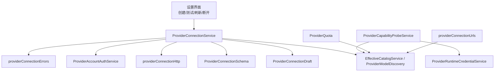
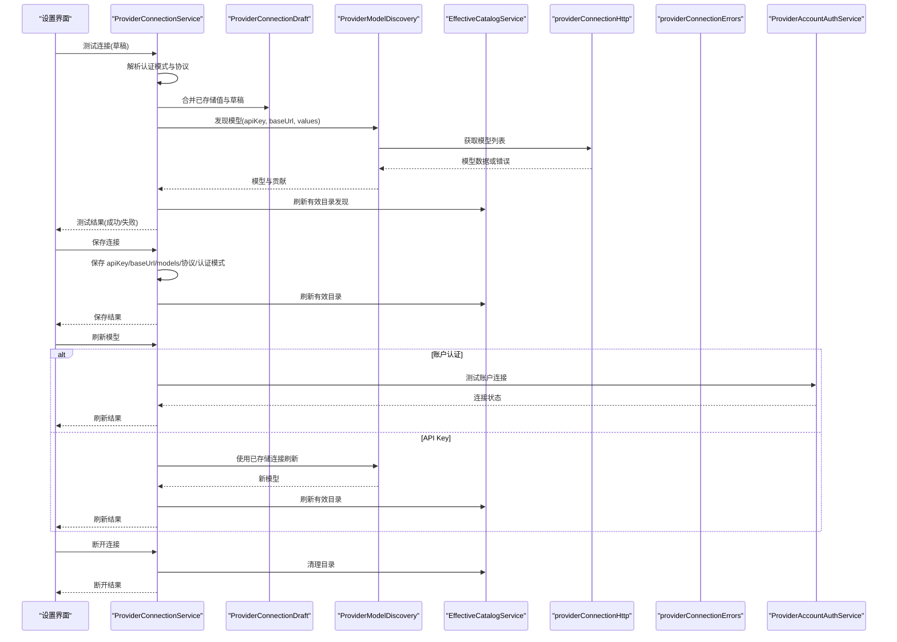
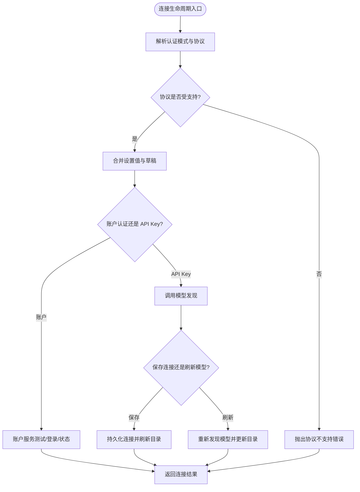
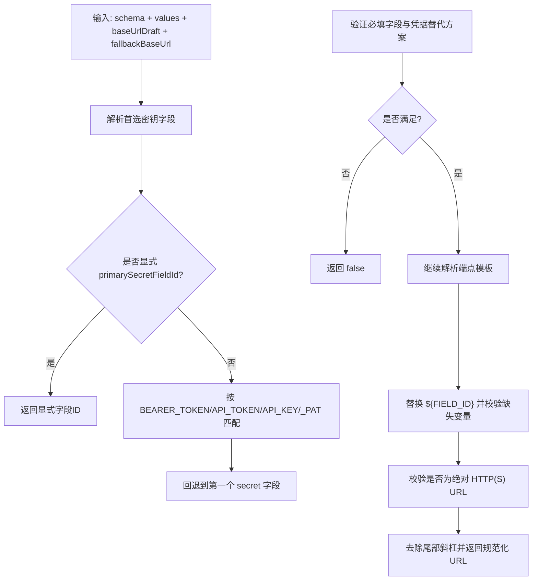
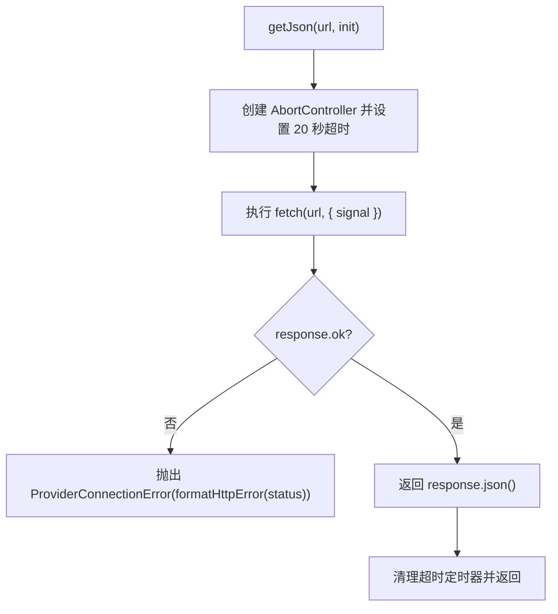
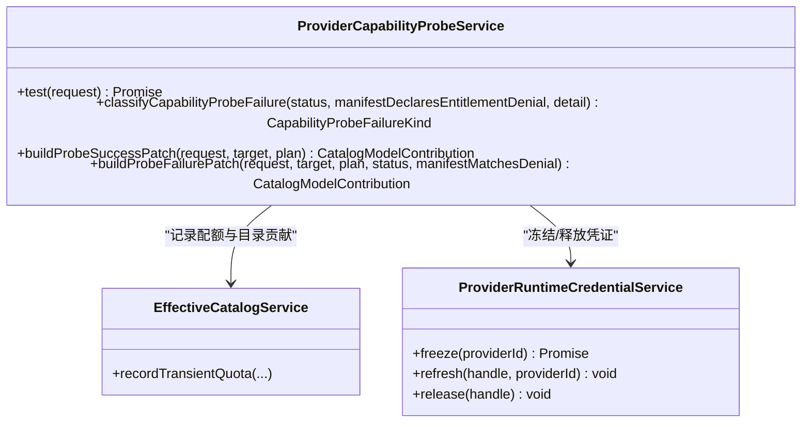
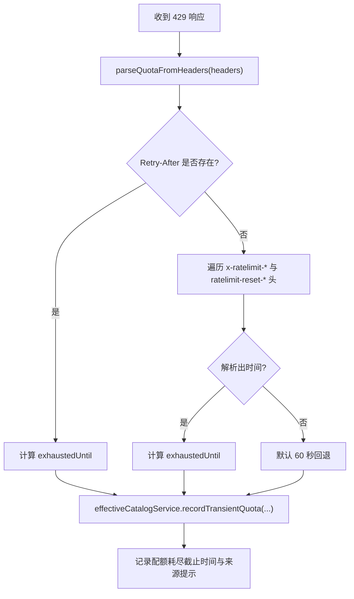
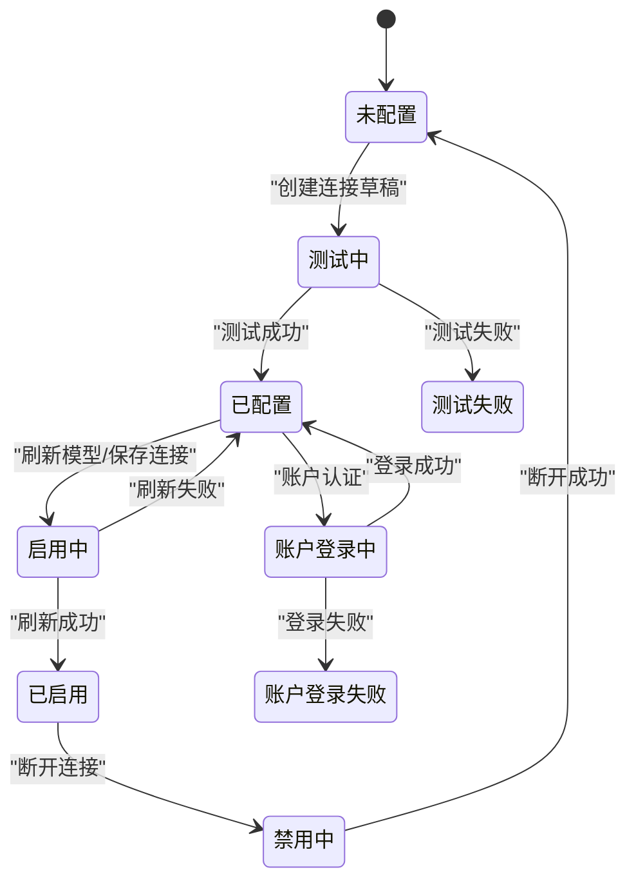
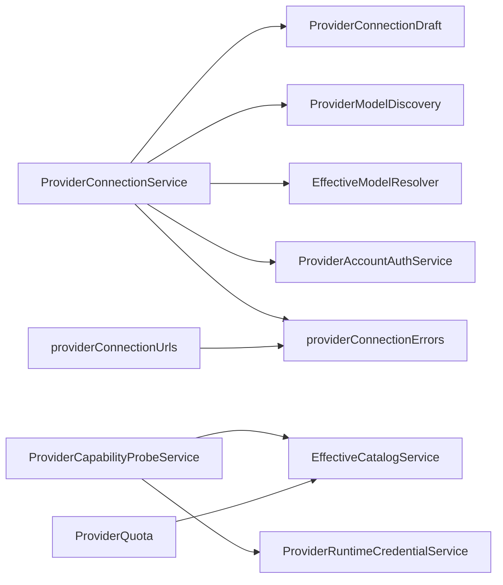

# 连接生命周期管理

<cite>
**本文引用的文件**   
- [ProviderConnectionService.ts](file://src/main/settings/ProviderConnectionService.ts)
- [ProviderConnectionSchema.ts](file://src/main/settings/ProviderConnectionSchema.ts)
- [providerConnectionHttp.ts](file://src/main/settings/providerConnectionHttp.ts)
- [ProviderCapabilityProbeService.ts](file://src/main/settings/ProviderCapabilityProbeService.ts)
- [ProviderQuota.ts](file://src/main/settings/ProviderQuota.ts)
- [ProviderQuota.test.ts](file://src/main/settings/ProviderQuota.test.ts)
- [providerConnectionUrls.ts](file://src/main/settings/providerConnectionUrls.ts)
- [providerConnectionErrors.ts](file://src/main/settings/providerConnectionErrors.ts)
- [ProviderRuntimeCredentialService.ts](file://src/main/settings/ProviderRuntimeCredentialService.ts)
- [settings.ts](file://src/shared/types/settings.ts)
</cite>

## 目录
1. [引言](#引言)
2. [项目结构](#项目结构)
3. [核心组件](#核心组件)
4. [架构总览](#架构总览)
5. [详细组件分析](#详细组件分析)
6. [依赖关系分析](#依赖关系分析)
7. [性能考虑](#性能考虑)
8. [故障排除指南](#故障排除指南)
9. [结论](#结论)

## 引言
本文围绕 Provider 连接的生命周期展开，系统性说明以下能力：
- 连接的创建、验证、测试、刷新、断开与账户登录流程。
- Provider 连接模式定义、协议约束、必填字段、模板端点解析和错误处理。
- HTTP 网络层实现，包括超时、错误分类、路径拼接和模型发现数据解析。
- 连接健康检查与能力探测，包括配额耗尽、认证失败、路由不可用等状态判定。
- 配额管理与限流恢复时间推断。
- ProviderRouteUrl 相关的路由 URL 解析与生成逻辑。
- 连接状态语义、错误码映射、运行时凭证租赁机制与连接池优化建议。
- 不同 provider 类型的配置示例及常见排障步骤。

## 项目结构
连接生命周期相关代码集中在主进程设置模块中，并按职责拆分为多个文件：
- 连接服务：协调连接测试、保存、刷新、断开与账户登录。
- 连接模式：声明字段、必填规则、凭据替代方案和端点模板。
- HTTP 工具：统一超时、错误格式化、URL 拼接与模型列表解析。
- 能力探测：对具体模型进行健康检查、能力确认与可用性更新。
- 配额管理：从响应头推断限流恢复时间并记录到有效目录。
- URL 解析：针对 Google Vertex、Bedrock、Cline、Volcengine 等协议的地址推导。
- 运行时凭证：在请求执行前冻结、刷新、校验并释放临时凭证句柄。
- 类型定义：Provider 条目、连接结果、连接模式等共享类型。

**图表来源**
- [ProviderConnectionService.ts:1-200](file://src/main/settings/ProviderConnectionService.ts#L1-L200)
- [ProviderConnectionSchema.ts:1-85](file://src/main/settings/ProviderConnectionSchema.ts#L1-L85)
- [providerConnectionHttp.ts:1-104](file://src/main/settings/providerConnectionHttp.ts#L1-L104)
- [ProviderCapabilityProbeService.ts:1-200](file://src/main/settings/ProviderCapabilityProbeService.ts#L1-L200)
- [ProviderQuota.ts:1-76](file://src/main/settings/ProviderQuota.ts#L1-L76)
- [providerConnectionUrls.ts:1-200](file://src/main/settings/providerConnectionUrls.ts#L1-L200)
- [ProviderRuntimeCredentialService.ts:1-145](file://src/main/settings/ProviderRuntimeCredentialService.ts#L1-L145)

**章节来源**
- [ProviderConnectionService.ts:1-200](file://src/main/settings/ProviderConnectionService.ts#L1-L200)
- [settings.ts:395-445](file://src/shared/types/settings.ts#L395-L445)

## 核心组件
- ProviderConnectionService：提供连接测试、连接保存、刷新模型、断开连接、账户登录启动/完成/状态查询等入口；负责选择认证模式、校验协议、调用目录发现并刷新有效目录。
- ProviderConnectionSchema：定义连接字段、首选密钥字段、凭据替代方案、端点模板解析、请求头映射。
- providerConnectionHttp：HTTP 获取封装、超时控制、HTTP 错误消息格式化、路径拼接、查询参数追加、模型负载解析。
- ProviderCapabilityProbeService：按模型维度探测能力、分类失败原因、更新目录中的权限与可用性贡献。
- ProviderQuota：解析 429 响应头，推断配额耗尽截止时间，并通过有效目录服务记录瞬时配额状态。
- providerConnectionUrls：为多种 provider 协议推导模型列表 URL、OpenAI 兼容 BaseUrl、Publisher 模型列表 URL 等。
- ProviderRuntimeCredentialService：冻结、刷新、获取、释放运行时凭证句柄，支持 Google Vertex 令牌与 AWS Bedrock 凭据。

**章节来源**
- [ProviderConnectionService.ts:1-356](file://src/main/settings/ProviderConnectionService.ts#L1-L356)
- [ProviderConnectionSchema.ts:1-85](file://src/main/settings/ProviderConnectionSchema.ts#L1-L85)
- [providerConnectionHttp.ts:1-104](file://src/main/settings/providerConnectionHttp.ts#L1-L104)
- [ProviderCapabilityProbeService.ts:1-200](file://src/main/settings/ProviderCapabilityProbeService.ts#L1-L200)
- [ProviderQuota.ts:1-76](file://src/main/settings/ProviderQuota.ts#L1-L76)
- [providerConnectionUrls.ts:1-200](file://src/main/settings/providerConnectionUrls.ts#L1-L200)
- [ProviderRuntimeCredentialService.ts:1-145](file://src/main/settings/ProviderRuntimeCredentialService.ts#L1-L145)

## 架构总览
连接生命周期涉及用户操作、连接服务、目录发现、HTTP 网络层、能力探测和配额管理。整体流程如下：

**图表来源**
- [ProviderConnectionService.ts:1-200](file://src/main/settings/ProviderConnectionService.ts#L1-L200)
- [providerConnectionHttp.ts:1-104](file://src/main/settings/providerConnectionHttp.ts#L1-L104)
- [providerConnectionErrors.ts:1-14](file://src/main/settings/providerConnectionErrors.ts#L1-L14)

**章节来源**
- [ProviderConnectionService.ts:1-200](file://src/main/settings/ProviderConnectionService.ts#L1-L200)

## 详细组件分析

### ProviderConnectionService：连接生命周期编排
主要职责：
- 解析并校验 provider 的认证模式与协议，阻止不支持的协议切换。
- 将设置中的连接值与用户草稿合并，构造连接上下文。
- 调用目录发现以测试或保存连接，并刷新有效目录。
- 对账户认证 provider，通过账户服务启动、完成登录并查询状态。
- 刷新模型时区分账户模式与 API Key 模式。
- 断开连接后返回最新 provider 条目。

关键流程要点：
- 测试草稿连接：先校验 provider 与协议，再合并连接值，调用模型发现，刷新有效目录，最后返回 discoveryAccountId 与模型列表。
- 保存连接：测试通过后持久化 apiKey、baseUrl、models、protocol、authMode 与模型偏好，并刷新有效目录。
- 刷新模型：账户模式需先验证账户连接；API Key 模式则基于已存储连接重新发现模型。
- 断开连接：调用设置服务断开，返回新的 provider 条目。
- 账户登录：校验是否支持账户登录、是否配置账号登录能力，然后委托账户服务处理开始、完成与状态查询。

**图表来源**
- [ProviderConnectionService.ts:1-356](file://src/main/settings/ProviderConnectionService.ts#L1-L356)

**章节来源**
- [ProviderConnectionService.ts:1-356](file://src/main/settings/ProviderConnectionService.ts#L1-L356)

### ProviderConnectionSchema：连接模式定义与验证
该模块定义了 LlmProviderConnectionSchema 的连接模式语义：
- fields：连接字段集合，支持普通字段与 secret 字段。
- primarySecretFieldId：可选的首选密钥字段 ID；未显式指定时按约定字段名优先级选择。
- credentialAlternatives：凭据替代方案，允许一组 fieldIds 同时满足，或接受环境变量（ambient）。
- isProviderConnectionSchemaSatisfied：判断必填字段是否齐全且至少一个凭据替代方案成立。
- resolvePrimaryConnectionSecretFieldId：优先使用显式首选字段，否则匹配 BEARER_TOKEN/API_TOKEN/API_KEY/_PAT 等命名约定，最后回退到第一个 secret 字段。
- resolveProviderEndpointTemplate：基于 baseUrlDraft、fallbackBaseUrl 与 schema.endpointTemplate 解析模板；校验缺失变量、非法模板变量、绝对 HTTP(S) URL 与协议白名单。
- resolveProviderConnectionHeaders：根据 headerMappings 把字段值转换为请求头，支持 prefix。

典型行为：
- 如果 schema 没有字段，则认为连接模式已满足。
- 必填字段不在 alternative 列表中时必须存在。
- endpointTemplate 支持 ${FIELD_ID} 占位符，缺失会抛出错误；最终 URL 必须合法且仅允许 http/https。
- headerMappings 为空或字段值为空时不会添加对应请求头。

**图表来源**
- [ProviderConnectionSchema.ts:1-85](file://src/main/settings/ProviderConnectionSchema.ts#L1-L85)

**章节来源**
- [ProviderConnectionSchema.ts:1-85](file://src/main/settings/ProviderConnectionSchema.ts#L1-L85)
- [settings.ts:187-192](file://src/shared/types/settings.ts#L187-L192)

### providerConnectionHttp：HTTP 连接与模型发现
该模块提供轻量 HTTP 工具，用于连接测试与模型发现：
- REQUEST_TIMEOUT_MS：固定 20 秒超时，通过 AbortController 取消请求。
- getJson：发送 fetch 请求，若 response.ok 为假则抛出 ProviderConnectionError；finally 中清理超时定时器。
- formatHttpError：将 HTTP 状态码转为中文错误消息，如 401/403 表示密钥无效或权限不足，404 表示模型发现端点不可用，5xx 表示服务暂时不可用。
- appendPath：安全拼接 base URL 与路径，避免重复斜杠。
- appendQueryParam：追加查询参数，自动处理 ? 与 &。
- parseModelsPayload：根据 DiscoveryStrategy 解析模型列表，支持 openai-compatible、ollama-tags、google-ai-studio 等策略，并对 google-ai-studio 过滤 supportedGenerationMethods 包含 generateContent 的模型。
- createTinyAnthropicProbeBody / createTinyOpenAiProbeBody：生成最小探针请求体，用于健康检查。

注意：当前实现未包含重试、代理与自定义 SSL 配置；如需扩展，可在 getJson 外层包装重试与代理转发逻辑。

**图表来源**
- [providerConnectionHttp.ts:1-104](file://src/main/settings/providerConnectionHttp.ts#L1-L104)

**章节来源**
- [providerConnectionHttp.ts:1-104](file://src/main/settings/providerConnectionHttp.ts#L1-L104)

### ProviderCapabilityProbeService：能力探测与健康检查
能力探测服务负责：
- 解析请求目标 provider 与 effective model。
- 规划探测请求，执行探测并记录成功或失败。
- 分类失败原因：权限拒绝、配额耗尽、认证失败、路由不可用、未知。
- 构建成功或失败的目录贡献补丁，更新 fast/max-context 模式与上下文分层的 entitlement。
- 使用运行时凭证服务冻结与释放凭证句柄。

失败分类规则：
- 清单声明权限拒绝时直接标记 entitlement-denied。
- 401 为 authentication-failed。
- 404 为 route-unavailable。
- 429 为 quota-exhausted。
- 402 且消息包含 quota_exceeded/quota exceeded/usage limit/out of budget 时也视为 quota-exhausted。

**图表来源**
- [ProviderCapabilityProbeService.ts:1-200](file://src/main/settings/ProviderCapabilityProbeService.ts#L1-L200)
- [ProviderRuntimeCredentialService.ts:1-145](file://src/main/settings/ProviderRuntimeCredentialService.ts#L1-L145)

**章节来源**
- [ProviderCapabilityProbeService.ts:1-200](file://src/main/settings/ProviderCapabilityProbeService.ts#L1-L200)

### ProviderQuota：配额管理与限流恢复
配额模块从 HTTP 429 响应头推断限流恢复时间：
- parseQuotaFromHeaders：优先读取 Retry-After；否则尝试 x-ratelimit-reset-requests/tokens/ratelimit-reset/x-ratelimit-reset-after 等头；若仍无信息，默认延迟 60 秒。
- 支持持续时间格式 ms/s/m/h，也支持 Unix 时间戳或日期字符串。
- recordQuotaFromResponse：当响应状态为 429 时，根据 RequestPlan 找到 provider，调用有效目录服务记录瞬时配额。

测试用例覆盖：
- Retry-After 优先。
- epoch reset 头解析。
- vendor duration reset 头解析。
- 缺少重置头时使用短瞬态回退。

**图表来源**
- [ProviderQuota.ts:1-76](file://src/main/settings/ProviderQuota.ts#L1-L76)
- [ProviderQuota.test.ts:1-34](file://src/main/settings/ProviderQuota.test.ts#L1-L34)

**章节来源**
- [ProviderQuota.ts:1-76](file://src/main/settings/ProviderQuota.ts#L1-L76)
- [ProviderQuota.test.ts:1-34](file://src/main/settings/ProviderQuota.test.ts#L1-L34)

### ProviderRouteUrl：路由 URL 解析与生成
providerConnectionUrls 提供多种 provider 的路由 URL 推导函数：
- projectGoogleVertexModelRoutes：为 Google Vertex Gemini 与 Anthropic 生成原生路由与 OpenAI 兼容路由选项。
- resolveBedrockResponsesBaseUrl：将 chat baseUrl 调整为 /openai/v1 结尾的 responses baseUrl。
- projectBedrockMantleModelRoutes：为 Bedrock Mantle 生成 OpenAI 兼容聊天路由与 Responses 路由选项。
- resolveVolcengineCodingPlanModelsUrl：适配火山引擎 Coding Plan 的 /api/coding/v3/models。
- resolveCodingPlanModelsUrl：确保 models 列表 URL 带 /v1/models。
- resolveClineCatalogUrl：根据 catalog 类型返回 usage 或 pass 模型列表 URL。
- resolveClineCredentialProbeUrl：Cline API Key 验证端点。
- resolveGoogleVertexOpenAiBaseUrl：将 publisher 地址转换为 OpenAI 兼容 endpoints/openapi。
- resolveGoogleVertexPublisherModelsUrl：校验 publisher 并返回列表所有版本模型的 URL。
- parseGoogleVertexPublisherModels：解析 publisherModels 列表并生成 LlmProviderModel。

这些函数主要用于连接测试与目录发现阶段，帮助不同 provider 暴露一致的模型列表接口。

**章节来源**
- [providerConnectionUrls.ts:1-200](file://src/main/settings/providerConnectionUrls.ts#L1-L200)

### 连接状态机、错误码与运行时凭证
连接状态语义：
- 连接服务返回的 LlmProviderConnectionResult 包含 success、provider、models 与可选 error。
- LlmProviderEntry 包含 enabled、isConfigured、connectionSchema、apiKey、baseUrl、models、recommendedModels 等字段。
- 账户登录状态由 LlmProviderAccountStatus 描述，包含 state、available、connected、error。

错误码与消息：
- ProviderConnectionError 用于业务错误；parseProviderError 将其转换为字符串。
- DOMException AbortError 被识别为连接测试超时。
- HTTP 错误通过 formatHttpError 转换为中文提示。

运行时凭证：
- ProviderRuntimeCredentialService 维护 leases Map，支持 freeze/refresh/get/release。
- 最大租期 MAX_LEASE_AGE_MS 为 24 小时，定期清理过期句柄。
- 支持 Google Vertex 应用凭据与 AWS Bedrock 凭据解析。

**图表来源**
- [settings.ts:395-445](file://src/shared/types/settings.ts#L395-L445)
- [ProviderConnectionService.ts:1-356](file://src/main/settings/ProviderConnectionService.ts#L1-L356)
- [providerConnectionErrors.ts:1-14](file://src/main/settings/providerConnectionErrors.ts#L1-L14)

**章节来源**
- [settings.ts:395-445](file://src/shared/types/settings.ts#L395-L445)
- [ProviderConnectionService.ts:1-356](file://src/main/settings/ProviderConnectionService.ts#L1-L356)
- [providerConnectionErrors.ts:1-14](file://src/main/settings/providerConnectionErrors.ts#L1-L14)
- [ProviderRuntimeCredentialService.ts:1-145](file://src/main/settings/ProviderRuntimeCredentialService.ts#L1-L145)

## 依赖关系分析
- ProviderConnectionService 依赖：
  - SettingsService：读写 provider 条目、连接值与保存连接。
  - ProviderConnectionDraft：合并设置值与草稿。
  - ProviderModelDiscovery：发现模型列表。
  - EffectiveModelResolver：刷新有效目录发现与应用授权贡献。
  - ProviderAccountAuthService：账户认证流程。
  - providerConnectionErrors：错误转换。
- ProviderCapabilityProbeService 依赖：
  - EffectiveCatalogService：记录配额与目录贡献。
  - ProviderRuntimeCredentialService：冻结与释放凭证。
  - settingsService：读取 provider 与 effective model。
- ProviderQuota 依赖：
  - EffectiveCatalogService：记录瞬时配额。
  - settingsService：查找 provider 与 activeAccountId。
- providerConnectionUrls 依赖：
  - ProviderConnectionError：抛出版本不匹配或路由不支持的错误。

**图表来源**
- [ProviderConnectionService.ts:1-356](file://src/main/settings/ProviderConnectionService.ts#L1-L356)
- [ProviderCapabilityProbeService.ts:1-200](file://src/main/settings/ProviderCapabilityProbeService.ts#L1-L200)
- [ProviderQuota.ts:1-76](file://src/main/settings/ProviderQuota.ts#L1-L76)
- [providerConnectionUrls.ts:1-200](file://src/main/settings/providerConnectionUrls.ts#L1-L200)

**章节来源**
- [ProviderConnectionService.ts:1-356](file://src/main/settings/ProviderConnectionService.ts#L1-L356)
- [ProviderCapabilityProbeService.ts:1-200](file://src/main/settings/ProviderCapabilityProbeService.ts#L1-L200)
- [ProviderQuota.ts:1-76](file://src/main/settings/ProviderQuota.ts#L1-L76)
- [providerConnectionUrls.ts:1-200](file://src/main/settings/providerConnectionUrls.ts#L1-L200)

## 性能考虑
- 超时控制：HTTP 请求统一 20 秒超时，避免长时间阻塞。
- 目录刷新：连接测试成功后立即刷新有效目录，减少后续模型发现开销。
- 凭证租赁：运行时凭证采用内存 Map 缓存，24 小时自动过期，避免频繁解析敏感凭据。
- 模型发现策略：针对不同 provider 使用专用解析器，减少不必要的数据处理。
- 配额恢复：从响应头精确推断限流恢复时间，避免过度重试。

可优化方向：
- 增加重试与退避策略，特别是 5xx 与网络抖动场景。
- 引入代理支持与自定义 TLS 证书，满足企业内网环境。
- 连接池复用底层连接，减少握手与 DNS 解析成本。
- 对高频探测任务做去重与合并，降低并发压力。

[本节为通用指导，无需特定文件引用]

## 故障排除指南
常见问题与解决思路：
- 连接测试超时：检查网络连通性与 provider 端点可达性；确认未触发 20 秒超时。
- API Key 无效或权限不足：核对 apiKey 是否正确，检查 provider 控制台权限。
- 模型发现端点不可用：确认 baseUrl 与模型列表 URL 是否正确，必要时调整 endpointTemplate。
- 服务暂时不可用：等待 provider 恢复后重试；关注 5xx 错误。
- 配额耗尽：查看 429 响应头，依据 Retry-After 或 x-ratelimit-* 头等待恢复；系统会自动记录配额耗尽截止时间。
- 账户登录不可用：确认 provider 是否支持账户认证并已配置；检查账户服务状态。
- 路由不支持：检查 protocol 是否与 provider 一致；对于 Google Vertex 与 Bedrock，确保 baseUrl 符合规范。

排查步骤：
1. 使用“测试连接”功能验证 apiKey 与 baseUrl。
2. 检查 connectionSchema 必填字段是否齐全。
3. 校验 endpointTemplate 是否包含缺失字段。
4. 查看有效目录中的模型列表是否更新。
5. 若出现 429，等待配额恢复后再试。
6. 对账户认证 provider，使用“账户登录”流程重新建立会话。

**章节来源**
- [providerConnectionHttp.ts:1-104](file://src/main/settings/providerConnectionHttp.ts#L1-L104)
- [ProviderConnectionSchema.ts:1-85](file://src/main/settings/ProviderConnectionSchema.ts#L1-L85)
- [ProviderQuota.ts:1-76](file://src/main/settings/ProviderQuota.ts#L1-L76)
- [ProviderConnectionService.ts:1-356](file://src/main/settings/ProviderConnectionService.ts#L1-L356)

## 结论
Provider 连接生命周期由 ProviderConnectionService 统一编排，结合连接模式定义、HTTP 工具、能力探测与配额管理，形成完整的连接创建、验证、刷新与断开流程。ProviderConnectionSchema 提供了严格的字段与端点校验；providerConnectionHttp 提供轻量可靠的网络访问；ProviderCapabilityProbeService 与 ProviderQuota 共同保障连接健康与限流恢复；providerConnectionUrls 则屏蔽多 provider 的差异，对外暴露一致的模型发现接口。通过运行时凭证租赁机制，系统在安全性与性能之间取得平衡。未来可进一步引入重试、代理、TLS 定制与连接池优化，以提升复杂环境下的稳定性与吞吐。