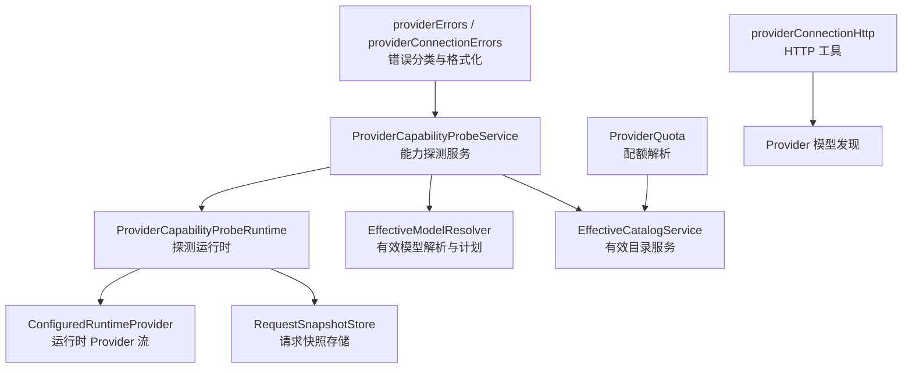
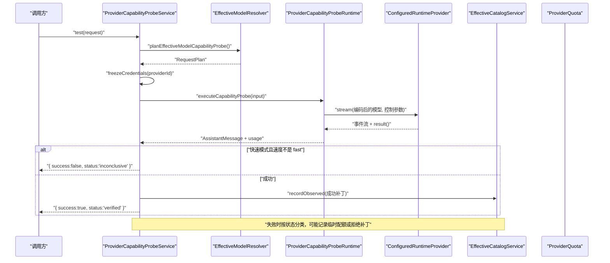
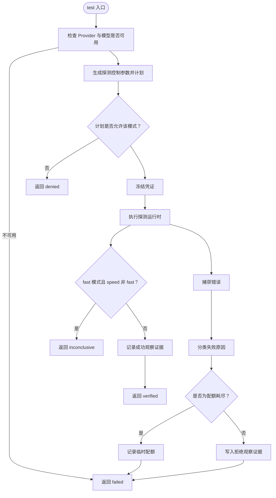
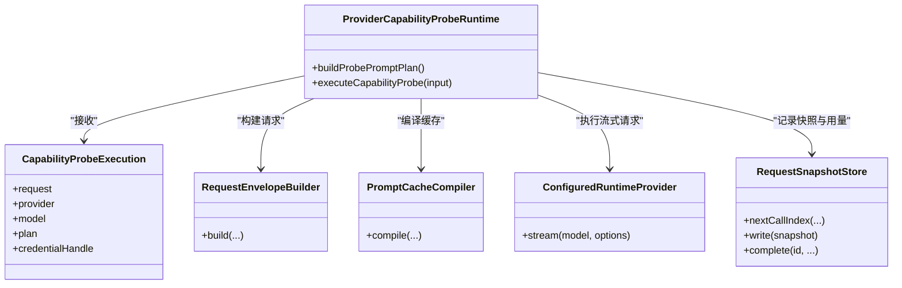
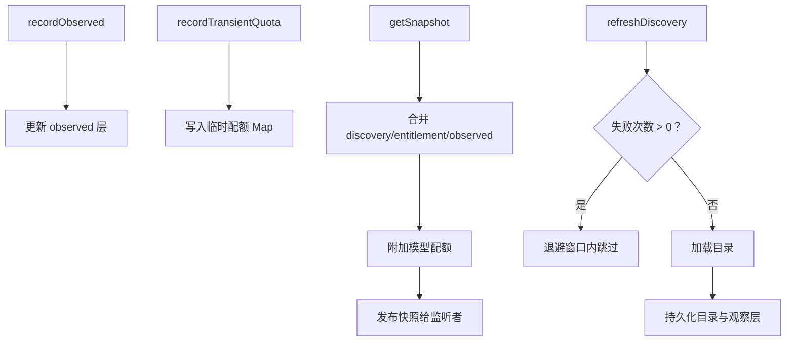
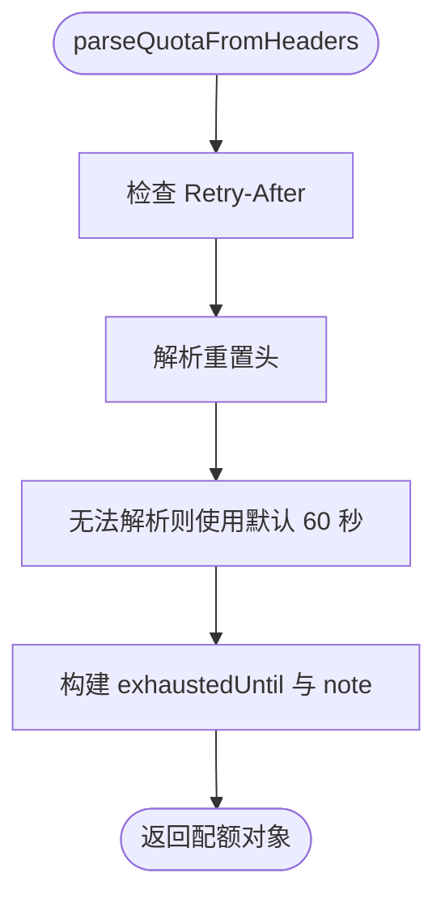
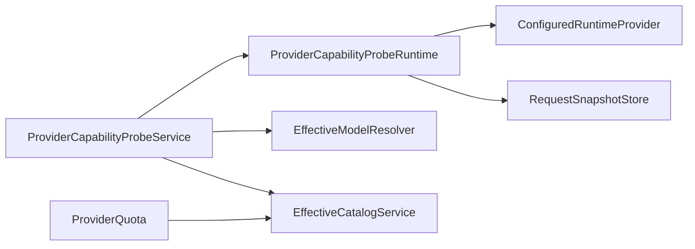
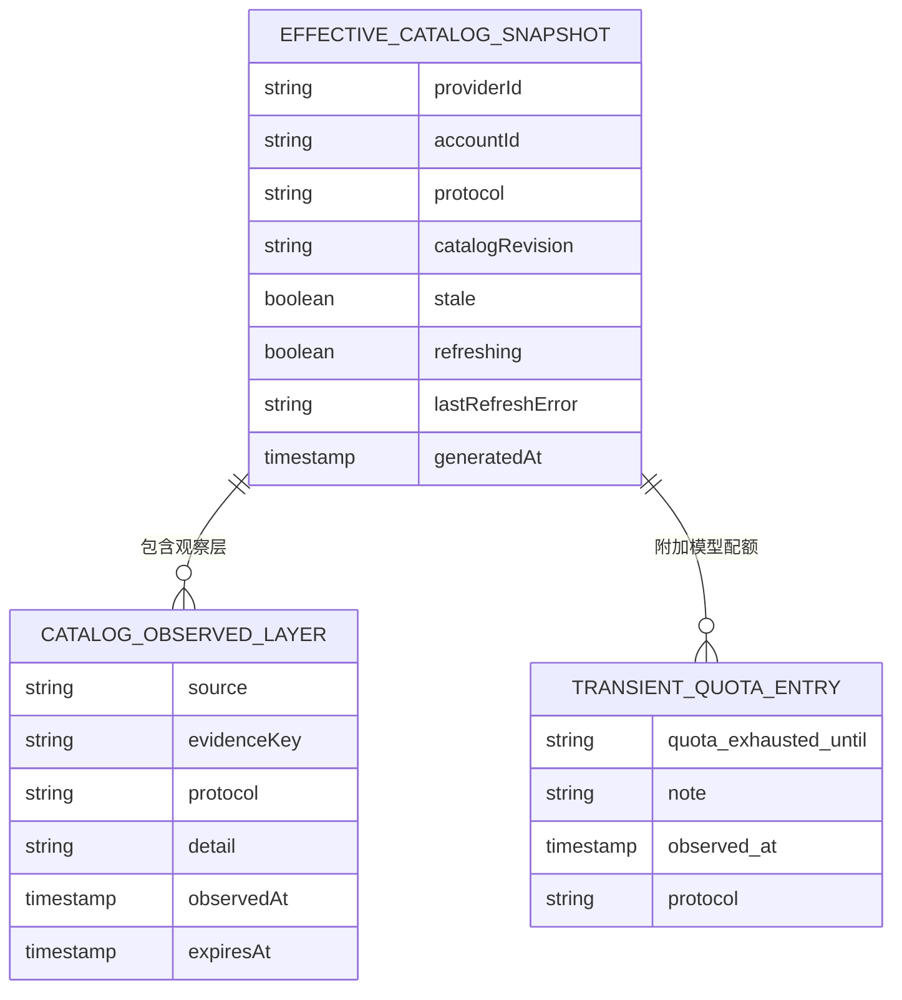

# 连接监控与健康检查

<cite>
**本文引用的文件**   
- [ProviderCapabilityProbeService.ts](file://src/main/settings/ProviderCapabilityProbeService.ts)
- [ProviderCapabilityProbeRuntime.ts](file://src/main/settings/ProviderCapabilityProbeRuntime.ts)
- [EffectiveModelResolver.ts](file://src/main/settings/EffectiveModelResolver.ts)
- [EffectiveCatalogService.ts](file://src/main/settings/EffectiveCatalogService.ts)
- [ProviderQuota.ts](file://src/main/settings/ProviderQuota.ts)
- [providerConnectionHttp.ts](file://src/main/settings/providerConnectionHttp.ts)
- [providerConnectionErrors.ts](file://src/main/settings/providerConnectionErrors.ts)
- [providerErrors.ts](file://src/shared/types/providerErrors.ts)
</cite>

## 目录
1. [引言](#引言)
2. [项目结构](#项目结构)
3. [核心组件](#核心组件)
4. [架构总览](#架构总览)
5. [详细组件分析](#详细组件分析)
6. [依赖关系分析](#依赖关系分析)
7. [性能与容量特性](#性能与容量特性)
8. [告警与故障处理](#告警与故障处理)
9. [监控数据收集与存储](#监控数据收集与存储)
10. [健康检查配置说明](#健康检查配置说明)
11. [仪表板展示建议](#仪表板展示建议)
12. [故障排查指南](#故障排查指南)
13. [结论](#结论)

## 引言
本文围绕 Provider 连接监控与健康检查展开，重点解释以下能力：
- `ProviderCapabilityProbeService` 的显式能力探测流程、重试与配额回退。
- 连接质量指标：响应时间、成功率、错误率与服务可用性在系统中的记录方式。
- `ProviderQuota` 的配额解析、超时计算与临时配额状态传播。
- 告警机制现状：系统内未发现集中式告警模块，但通过错误分类、观察层和诊断信息实现可观测性基础。
- 监控数据的收集、聚合与持久化路径，包括有效目录快照、观察证据与配额状态。
- 健康检查的配置项来源：请求模式、路由计划、凭证冻结、探测运行时的限制参数。
- 面向运维的仪表板展示建议和常见排查方法。

需要特别说明：当前仓库未提供“自动周期性健康检查调度器”。现有健康检查以“显式探测”为主，由外部调用者决定何时触发；同时存在通用目录刷新退避机制，用于模型发现与目录重建，而非针对 Provider 健康状态的定时探测。

## 项目结构
与连接监控和健康检查直接相关的代码集中在主进程设置子系统与代理运行时桥接处：
- 能力探测服务：负责编排一次完整的能力探测生命周期。
- 能力探测运行时：封装最小化的真实 API 调用与流式消费。
- 有效模型解析与请求计划：把探测请求映射到 Provider 路由、上下文层级、推理策略等。
- 有效目录服务：持久化观察结果、临时配额、目录快照，并通知订阅者。
- 配额解析：从 HTTP 429 或相关头中解析限流截止时间。
- 连接工具：HTTP 超时、错误格式化、最小探针体构造。
- 错误类型：统一的 Provider 错误码、诊断消息与重试语义。

**图表来源**
- [ProviderCapabilityProbeService.ts:1-200](file://src/main/settings/ProviderCapabilityProbeService.ts#L1-L200)
- [ProviderCapabilityProbeRuntime.ts:1-116](file://src/main/settings/ProviderCapabilityProbeRuntime.ts#L1-L116)
- [EffectiveModelResolver.ts:1-120](file://src/main/settings/EffectiveModelResolver.ts#L1-L120)
- [EffectiveCatalogService.ts:1-120](file://src/main/settings/EffectiveCatalogService.ts#L1-L120)
- [ProviderQuota.ts:1-76](file://src/main/settings/ProviderQuota.ts#L1-L76)
- [providerConnectionHttp.ts:1-104](file://src/main/settings/providerConnectionHttp.ts#L1-L104)
- [providerErrors.ts:1-39](file://src/shared/types/providerErrors.ts#L1-L39)
- [providerConnectionErrors.ts:1-14](file://src/main/settings/providerConnectionErrors.ts#L1-L14)

**章节来源**
- [ProviderCapabilityProbeService.ts:1-200](file://src/main/settings/ProviderCapabilityProbeService.ts#L1-L200)
- [ProviderCapabilityProbeRuntime.ts:1-116](file://src/main/settings/ProviderCapabilityProbeRuntime.ts#L1-L116)
- [EffectiveModelResolver.ts:1-120](file://src/main/settings/EffectiveModelResolver.ts#L1-L120)
- [EffectiveCatalogService.ts:1-120](file://src/main/settings/EffectiveCatalogService.ts#L1-L120)
- [ProviderQuota.ts:1-76](file://src/main/settings/ProviderQuota.ts#L1-L76)
- [providerConnectionHttp.ts:1-104](file://src/main/settings/providerConnectionHttp.ts#L1-L104)
- [providerErrors.ts:1-39](file://src/shared/types/providerErrors.ts#L1-L39)
- [providerConnectionErrors.ts:1-14](file://src/main/settings/providerConnectionErrors.ts#L1-L14)

## 核心组件
- `ProviderCapabilityProbeService`：对外暴露能力探测入口，执行目标解析、计划、凭证冻结、探测执行、成功/失败补丁写入与凭证释放。
- `ProviderCapabilityProbeRuntime`：构建最小探测提示计划，走正式请求管线，消费流并记录用量。
- `EffectiveModelResolver`：将探测请求转换为包含路由、上下文层级、推理选择等的 `RequestPlan`。
- `EffectiveCatalogService`：维护目录快照、观察证据、临时配额、监听器与本地持久化。
- `ProviderQuota`：从 HTTP 429 响应头解析配额耗尽截止时间，并把临时配额写入有效目录服务。
- `providerConnectionHttp`：定义 HTTP 超时、错误格式化、最小探针体等基础能力。
- 错误类型：统一 Provider 错误码、诊断结构与连接错误解析。

**章节来源**
- [ProviderCapabilityProbeService.ts:1-200](file://src/main/settings/ProviderCapabilityProbeService.ts#L1-L200)
- [ProviderCapabilityProbeRuntime.ts:1-116](file://src/main/settings/ProviderCapabilityProbeRuntime.ts#L1-L116)
- [EffectiveModelResolver.ts:1-120](file://src/main/settings/EffectiveModelResolver.ts#L1-L120)
- [EffectiveCatalogService.ts:1-120](file://src/main/settings/EffectiveCatalogService.ts#L1-L120)
- [ProviderQuota.ts:1-76](file://src/main/settings/ProviderQuota.ts#L1-L76)
- [providerConnectionHttp.ts:1-104](file://src/main/settings/providerConnectionHttp.ts#L1-L104)
- [providerErrors.ts:1-39](file://src/shared/types/providerErrors.ts#L1-L39)
- [providerConnectionErrors.ts:1-14](file://src/main/settings/providerConnectionErrors.ts#L1-L14)

## 架构总览
下图展示了显式能力探测的核心调用链：上层请求进入探测服务，服务先做前置校验与计划，再使用运行时执行真实请求，最后根据结果更新有效目录中的观察证据或临时配额。

**图表来源**
- [ProviderCapabilityProbeService.ts:201-354](file://src/main/settings/ProviderCapabilityProbeService.ts#L201-L354)
- [ProviderCapabilityProbeRuntime.ts:1-116](file://src/main/settings/ProviderCapabilityProbeRuntime.ts#L1-L116)
- [EffectiveModelResolver.ts:1-120](file://src/main/settings/EffectiveModelResolver.ts#L1-L120)
- [EffectiveCatalogService.ts:120-220](file://src/main/settings/EffectiveCatalogService.ts#L120-L220)
- [ProviderQuota.ts:1-76](file://src/main/settings/ProviderQuota.ts#L1-L76)

## 详细组件分析

### ProviderCapabilityProbeService：能力探测编排器
该服务是连接监控与健康检查的编排中心，职责包括：
- 解析目标 Provider 与 EffectiveModel。
- 根据探测模式生成控制参数，并调用计划逻辑。
- 冻结凭证后执行探测，成功后记录观察证据。
- 对失败进行状态分类，必要时写入临时配额或拒绝补丁。
- 保证凭证句柄最终释放。

关键行为要点：
- 目标不可用或未启用时立即返回失败。
- max-context 模式要求存在可选的最大上下文层级；fast 模式要求 fast 控件可选择。
- 计划被拒绝时会返回 denied。
- 快速模式下如果 Provider 未确认 `usage.speed=fast`，则返回 inconclusive。
- 失败时根据 HTTP 状态与 manifest 声明判断是否为配额耗尽、鉴权失败、路由不可用等。
- 配额耗尽时不会写拒绝补丁，而是记录临时配额并延迟重试。
- 成功时写入观察证据，失败且为明确拒绝时写入带 TTL 的观察证据。

**图表来源**
- [ProviderCapabilityProbeService.ts:201-354](file://src/main/settings/ProviderCapabilityProbeService.ts#L201-L354)

**章节来源**
- [ProviderCapabilityProbeService.ts:1-200](file://src/main/settings/ProviderCapabilityProbeService.ts#L1-L200)
- [ProviderCapabilityProbeService.ts:201-354](file://src/main/settings/ProviderCapabilityProbeService.ts#L201-L354)

### ProviderCapabilityProbeRuntime：最小探测运行时
探测运行时不编写复杂业务逻辑，而是复用完整的请求管线，确保探测能真实验证 Provider 的路由、协议、缓存、推理契约与流式解析能力。

主要行为：
- 构造最小探测提示计划，内容为简短文本并要求只回复 OK。
- 生成稳定的提示片段指纹与 token 估算。
- 构建请求信封，写入 capability probe mode、最大输出 token、推理契约等信息。
- 写入请求快照，然后调用运行时 Provider 的 stream。
- 完全消费事件流，等待 result，并记录 input/output/cache/reasoning token 用量。
- 返回 AssistantMessage，供上层服务生成证据。

**图表来源**
- [ProviderCapabilityProbeRuntime.ts:1-116](file://src/main/settings/ProviderCapabilityProbeRuntime.ts#L1-L116)

**章节来源**
- [ProviderCapabilityProbeRuntime.ts:1-116](file://src/main/settings/ProviderCapabilityProbeRuntime.ts#L1-L116)

### EffectiveModelResolver：探测计划与路由选择
探测计划把用户请求映射到具体 Provider 路由、上下文层级、推理策略、温度、最大输出 token 等运行时参数。它读取已加载的 Provider Surface、目录定义、用户覆盖与有效配置，从而生成可用于实际调用的 `RequestPlan`。

关键点：
- 探测会基于当前设置与 Provider Surface 选择路由。
- 上下文层级与 fast/max-context 控制影响探测模式。
- 推理契约来自路由能力解析，用于决定 reasoning wire。
- 探测计划成功与否直接影响探测服务是否能继续执行。

**章节来源**
- [EffectiveModelResolver.ts:1-120](file://src/main/settings/EffectiveModelResolver.ts#L1-L120)

### EffectiveCatalogService：观察证据与配额状态中枢
有效目录服务不仅管理模型发现，还承担连接监控相关的数据落盘与发布：
- `recordObserved`：写入能力探测的成功或拒绝证据，支持过期时间。
- `recordTransientQuota`：写入短期配额状态，例如 429 或探测触发的临时配额。
- `getSnapshot`：合并 discovered、entitlement、observed 层，并在模型上附加 quota 字段。
- 订阅者机制：监听最新快照变更。
- 本地持久化：读写 catalog-v4.json，支持 schema 版本与清理。
- 刷新退避：目录刷新失败时使用指数退避，避免雪崩。

**图表来源**
- [EffectiveCatalogService.ts:120-464](file://src/main/settings/EffectiveCatalogService.ts#L120-L464)

**章节来源**
- [EffectiveCatalogService.ts:1-220](file://src/main/settings/EffectiveCatalogService.ts#L1-L220)
- [EffectiveCatalogService.ts:220-464](file://src/main/settings/EffectiveCatalogService.ts#L220-L464)

### ProviderQuota：配额解析与 429 处理
配额模块专注于从 HTTP 429 响应中解析限流信息：
- 优先解析 `Retry-After`。
- 其次遍历一组常见重置头，如 `x-ratelimit-reset-requests`、`x-ratelimit-reset-tokens`、`ratelimit-reset` 等。
- 支持秒、毫秒、分钟、小时单位，也支持绝对时间戳或日期字符串。
- 若无法解析，默认延后 60 秒。
- 当响应为 429 时，调用有效目录服务记录临时配额，包含耗尽时间和来源说明。

**图表来源**
- [ProviderQuota.ts:1-76](file://src/main/settings/ProviderQuota.ts#L1-L76)

**章节来源**
- [ProviderQuota.ts:1-76](file://src/main/settings/ProviderQuota.ts#L1-L76)

### providerConnectionHttp：连接工具与最小探针
HTTP 工具定义了连接测试与模型发现的通用能力：
- 固定请求超时：20 秒。
- HTTP 错误格式化：区分密钥无效、端点不可用、服务端错误等。
- URL 拼接与查询参数追加。
- 最小探针体构造：OpenAI 兼容与 Anthropic 风格的 ping 请求。

这些能力主要用于连接测试与目录发现，而不是直接作为健康检查心跳，但它们构成了连接质量的基础。

**章节来源**
- [providerConnectionHttp.ts:1-104](file://src/main/settings/providerConnectionHttp.ts#L1-L104)

## 依赖关系分析
- `ProviderCapabilityProbeService` 依赖：
  - `EffectiveModelResolver` 完成探测计划。
  - `ProviderCapabilityProbeRuntime` 执行真实请求。
  - `EffectiveCatalogService` 写入观察证据与配额。
  - 凭证租约接口冻结与释放 Provider 凭证。
- `ProviderCapabilityProbeRuntime` 依赖：
  - 运行时 Provider 流。
  - 请求快照存储。
  - 提示缓存编译器。
  - 路由能力解析。
- `EffectiveCatalogService` 依赖：
  - 文件系统持久化。
  - 订阅者回调。
  - 目录合并与审计元数据。
- `ProviderQuota` 依赖：
  - 设置服务获取 Provider 信息。
  - 有效目录服务写入临时配额。

**图表来源**
- [ProviderCapabilityProbeService.ts:1-200](file://src/main/settings/ProviderCapabilityProbeService.ts#L1-L200)
- [ProviderCapabilityProbeRuntime.ts:1-116](file://src/main/settings/ProviderCapabilityProbeRuntime.ts#L1-L116)
- [EffectiveCatalogService.ts:1-120](file://src/main/settings/EffectiveCatalogService.ts#L1-L120)
- [ProviderQuota.ts:1-76](file://src/main/settings/ProviderQuota.ts#L1-L76)

**章节来源**
- [ProviderCapabilityProbeService.ts:1-200](file://src/main/settings/ProviderCapabilityProbeService.ts#L1-L200)
- [ProviderCapabilityProbeRuntime.ts:1-116](file://src/main/settings/ProviderCapabilityProbeRuntime.ts#L1-L116)
- [EffectiveCatalogService.ts:1-120](file://src/main/settings/EffectiveCatalogService.ts#L1-L120)
- [ProviderQuota.ts:1-76](file://src/main/settings/ProviderQuota.ts#L1-L76)

## 性能与容量特性
- 探测请求的最小化：
  - 探测提示内容短小稳定，减少 token 消耗。
  - 最大输出 token 限制为固定值，降低响应压力。
  - 不使用工具调用，避免额外网络与解析成本。
- 流式消费：
  - 探测运行时完整消费流事件，确保 Provider 解析与终端错误充分落地。
  - 记录 input/output/cache/reasoning token，便于后续统计。
- 目录刷新退避：
  - 目录刷新失败时使用指数退避，上限为固定值，避免频繁重试导致负载放大。
- 配额保护：
  - 探测遇到 429 时记录临时配额，避免短时间内重复触发。
  - 配额解析支持多种头格式，提高对不同 Provider 的兼容性。

**章节来源**
- [ProviderCapabilityProbeRuntime.ts:1-116](file://src/main/settings/ProviderCapabilityProbeRuntime.ts#L1-L116)
- [EffectiveCatalogService.ts:400-464](file://src/main/settings/EffectiveCatalogService.ts#L400-L464)
- [ProviderQuota.ts:1-76](file://src/main/settings/ProviderQuota.ts#L1-L76)

## 告警与故障处理
当前仓库没有独立的集中式告警服务。连接异常与容量不足主要通过以下机制体现：
- 错误分类：
  - 探测失败按 HTTP 状态与 manifest 匹配分为配额耗尽、鉴权失败、路由不可用等。
  - 连接层错误会区分超时、API Key 无效、端点不可用、服务端错误等。
- 诊断信息：
  - Provider 错误类型包含错误码、是否可重试、HTTP 状态、消息与详情。
  - 助手消息失败时可附带诊断条目，包含时间戳、错误名称、消息与堆栈。
- 观察证据：
  - 成功或拒绝探测会写入 effective catalog 的 observed 层，带有协议、模型、时间与说明。
- 临时配额：
  - 429 或探测触发的配额耗尽会写入 transient quota，影响后续模型可用性投影。

建议扩展方向：
- 增加告警处理器，监听 `EffectiveCatalogService` 的快照变化，当出现连续 denied、quota exhausted 或 refresh backoff 时触发告警。
- 将探测失败比例、配额耗尽频率、刷新失败次数纳入指标采集，接入外部告警系统。

**章节来源**
- [ProviderCapabilityProbeService.ts:1-200](file://src/main/settings/ProviderCapabilityProbeService.ts#L1-L200)
- [providerConnectionErrors.ts:1-14](file://src/main/settings/providerConnectionErrors.ts#L1-L14)
- [providerErrors.ts:1-39](file://src/shared/types/providerErrors.ts#L1-L39)
- [EffectiveCatalogService.ts:120-220](file://src/main/settings/EffectiveCatalogService.ts#L120-L220)

## 监控数据收集与存储
连接监控数据分布在以下位置：
- 请求快照：
  - 探测运行时写入 `RequestSnapshotStore`，包含 turnId、callIndex、route、requestPlan、usage 等。
  - 适合用于单次探测的请求级追踪。
- 有效目录快照：
  - `EffectiveCatalogService.getSnapshot` 返回模型列表、stale、refreshing、lastRefreshError 等。
  - 订阅者可消费快照，用于 UI 渲染或指标聚合。
- 观察证据：
  - `recordObserved` 写入 observed 层，包含 evidenceKey、protocol、effectiveModelId、observedAt、usage、detail。
  - 支持 TTL，适合短期能力验证结果。
- 临时配额：
  - `recordTransientQuota` 写入内存中的 transient quota map，并随快照发布。
  - 配额过期后自动移除，避免长期污染。
- 本地持久化：
  - catalog-v4.json 保存 discoveries、entitlements、observed、schemaVersion 等。
  - 读取失败或版本不一致时会尝试清理并重写。

**图表来源**
- [EffectiveCatalogService.ts:120-464](file://src/main/settings/EffectiveCatalogService.ts#L120-L464)
- [ProviderCapabilityProbeService.ts:201-354](file://src/main/settings/ProviderCapabilityProbeService.ts#L201-L354)
- [ProviderQuota.ts:1-76](file://src/main/settings/ProviderQuota.ts#L1-L76)

**章节来源**
- [EffectiveCatalogService.ts:120-464](file://src/main/settings/EffectiveCatalogService.ts#L120-L464)
- [ProviderCapabilityProbeService.ts:201-354](file://src/main/settings/ProviderCapabilityProbeService.ts#L201-L354)
- [ProviderQuota.ts:1-76](file://src/main/settings/ProviderQuota.ts#L1-L76)

## 健康检查配置说明
现有健康检查并非独立调度器，而是由 `ProviderCapabilityProbeService.test` 暴露的显式探测入口驱动。其配置选项主要来自以下几层：

- 探测请求模式：
  - fast：验证快速模式能力。
  - max-context：验证最大上下文能力。
- 模型与 Provider：
  - 必须已配置且启用，否则直接返回失败。
- 计划控制：
  - reasoningLevel：关闭或默认推理选择。
  - maxContextMode：是否启用最大上下文。
  - fastModel：是否启用快速模型。
- 凭证：
  - 使用凭证租约冻结与释放，避免泄露。
- 探测运行时限制：
  - 最大输出 token 固定为较小值。
  - 不使用工具，仅消费流事件并记录用量。
- 目录与观察层：
  - 成功或拒绝证据可带 TTL，默认观察有效期为一天。
  - 配额耗尽时临时配额默认 60 秒。
- 连接层：
  - HTTP 请求超时 20 秒。
  - 连接错误可区分超时、密钥无效、端点不可用、服务端错误。

注意：
- 当前没有全局“自动探测间隔”配置。
- 没有独立“健康检查超时”配置；探测使用运行时流式请求，连接层超时由 HTTP 工具提供。
- 没有集中阈值配置；失败判定主要由 HTTP 状态与 manifest 匹配决定。
- 自定义检查逻辑可通过注入 `ProviderCapabilityProbeDependencies` 扩展 resolve、plan、execute、凭证管理与记录逻辑。

**章节来源**
- [ProviderCapabilityProbeService.ts:1-200](file://src/main/settings/ProviderCapabilityProbeService.ts#L1-L200)
- [ProviderCapabilityProbeService.ts:201-354](file://src/main/settings/ProviderCapabilityProbeService.ts#L201-L354)
- [ProviderCapabilityProbeRuntime.ts:1-116](file://src/main/settings/ProviderCapabilityProbeRuntime.ts#L1-L116)
- [providerConnectionHttp.ts:1-104](file://src/main/settings/providerConnectionHttp.ts#L1-L104)

## 仪表板展示建议
面向运维与产品的监控仪表板应聚焦以下维度：

- 连接可用性：
  - 每个 Provider 与模型的 availability、enabled、unavailableReason。
  - 最近探测结果：verified、denied、inconclusive、failed。
  - 观察证据的时间线与 detail。
- 配额与限流：
  - 当前是否存在临时配额。
  - 配额耗尽截止时间、来源头与备注。
  - 429 发生频率与持续时间。
- 性能指标：
  - 探测输入 token、输出 token、缓存命中/写入、推理 token。
  - 快速模式是否被确认。
  - 流式请求是否顺利完成。
- 目录健康：
  - 目录是否 stale。
  - 是否在刷新中。
  - 上次刷新错误。
  - 刷新失败次数与退避窗口。
- 错误分布：
  - auth_unconfigured、auth_expired、rate_limit、quota_exceeded、network、timeout 等错误码占比。
  - 连接层超时、密钥无效、端点不可用、服务端错误。

建议数据来源：
- 订阅 `EffectiveCatalogService` 的最新快照。
- 从 observed 层聚合最近探测证据。
- 从 transient quota 表聚合配额状态。
- 从 `RequestSnapshotStore` 聚合单次探测用量（如需更细粒度）。

**章节来源**
- [EffectiveCatalogService.ts:120-464](file://src/main/settings/EffectiveCatalogService.ts#L120-L464)
- [ProviderCapabilityProbeService.ts:201-354](file://src/main/settings/ProviderCapabilityProbeService.ts#L201-L354)
- [ProviderQuota.ts:1-76](file://src/main/settings/ProviderQuota.ts#L1-L76)
- [providerErrors.ts:1-39](file://src/shared/types/providerErrors.ts#L1-L39)
- [providerConnectionErrors.ts:1-14](file://src/main/settings/providerConnectionErrors.ts#L1-L14)

## 故障排查指南
常见问题与定位步骤：

1. 探测返回 denied：
   - 检查是否因 max-context 或 fast 模式未被计划允许。
   - 查看 observed 层是否记录了 entitlement-denied 或对应 HTTP 状态。
   - 检查 manifest 中 entitlementDenialMatchers 是否匹配。
2. 探测返回 failed：
   - 检查 Provider 是否已配置且启用。
   - 检查凭证是否可冻结。
   - 检查错误详情是否包含认证失败、路由不可用或网络问题。
3. 探测返回 inconclusive：
   - 通常是 fast 模式请求但未收到 `usage.speed=fast`。
   - 可结合 Provider 文档确认该模式是否支持。
4. 频繁 429 或配额耗尽：
   - 检查临时配额是否生效。
   - 查看配额来源头是否被正确解析。
   - 降低探测频率或等待配额过期。
5. 目录刷新失败：
   - 查看 lastRefreshError。
   - 关注退避窗口是否仍在生效。
   - 手动触发刷新或检查网络与端点可达性。
6. 连接测试超时：
   - 检查 HTTP 超时是否触发。
   - 检查 Provider 端点是否可达。
   - 区分 AbortError 与其他连接错误。

常用工具与方法：
- 使用 `ProviderCapabilityProbeService.test` 触发显式探测。
- 订阅 `EffectiveCatalogService` 获取最新快照与错误信息。
- 查看 catalog-v4.json 中的 observations 与 quotas。
- 使用 `parseProviderError` 理解连接层错误消息。
- 使用 `classifyCapabilityProbeFailure` 理解探测失败分类。

**章节来源**
- [ProviderCapabilityProbeService.ts:201-354](file://src/main/settings/ProviderCapabilityProbeService.ts#L201-L354)
- [EffectiveCatalogService.ts:120-464](file://src/main/settings/EffectiveCatalogService.ts#L120-L464)
- [ProviderQuota.ts:1-76](file://src/main/settings/ProviderQuota.ts#L1-L76)
- [providerConnectionErrors.ts:1-14](file://src/main/settings/providerConnectionErrors.ts#L1-L14)
- [providerErrors.ts:1-39](file://src/shared/types/providerErrors.ts#L1-L39)

## 结论
当前仓库的连接监控与健康检查以“显式能力探测”为核心，配合有效目录服务的观察证据、临时配额与快照发布机制，形成一套可观测但不自动调度的健康体系。`ProviderCapabilityProbeService` 负责探测编排，`ProviderCapabilityProbeRuntime` 负责最小真实请求执行，`ProviderQuota` 负责配额解析，`EffectiveCatalogService` 负责状态聚合与持久化。虽然缺少自动周期探测与集中告警模块，但该设计已经为后续扩展提供了清晰扩展点：可以在调用侧加入定时探测任务，在订阅侧接入告警处理器，并在仪表板中展示可用性、配额、性能与错误分布。