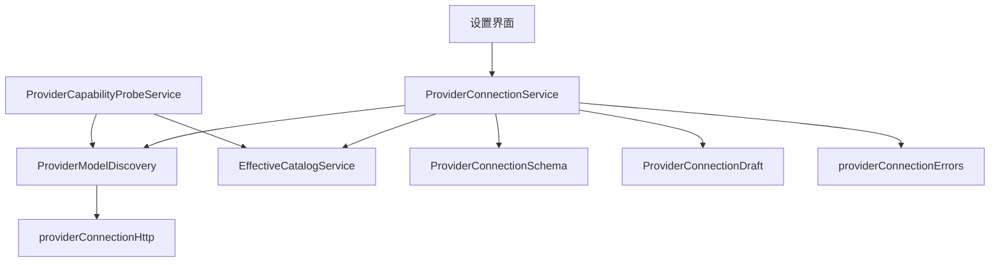
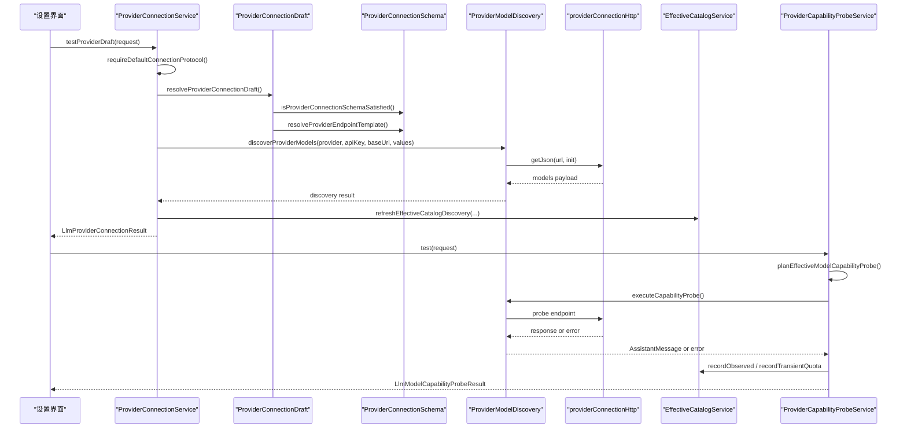
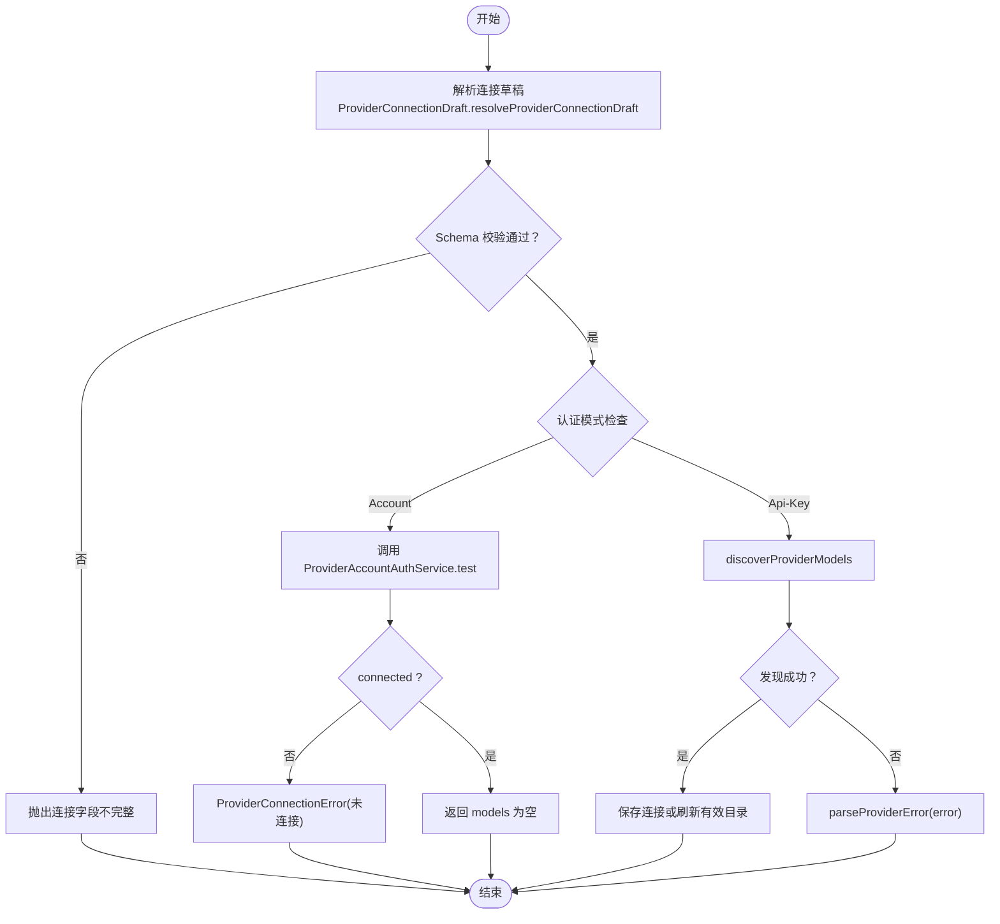
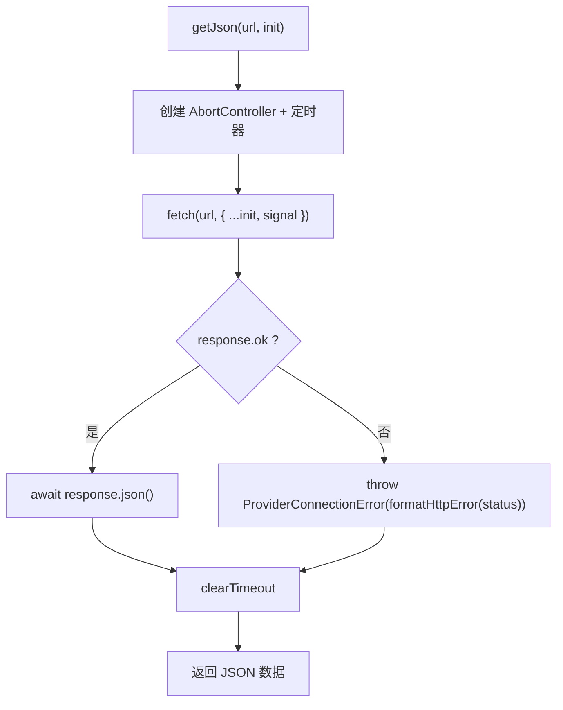
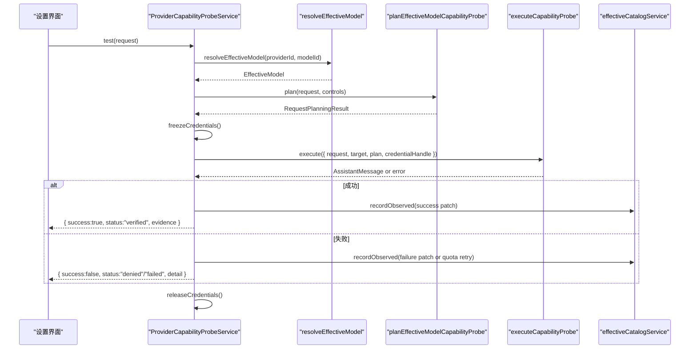
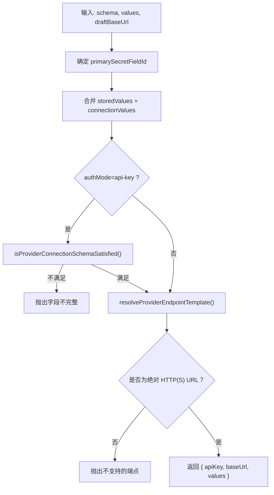
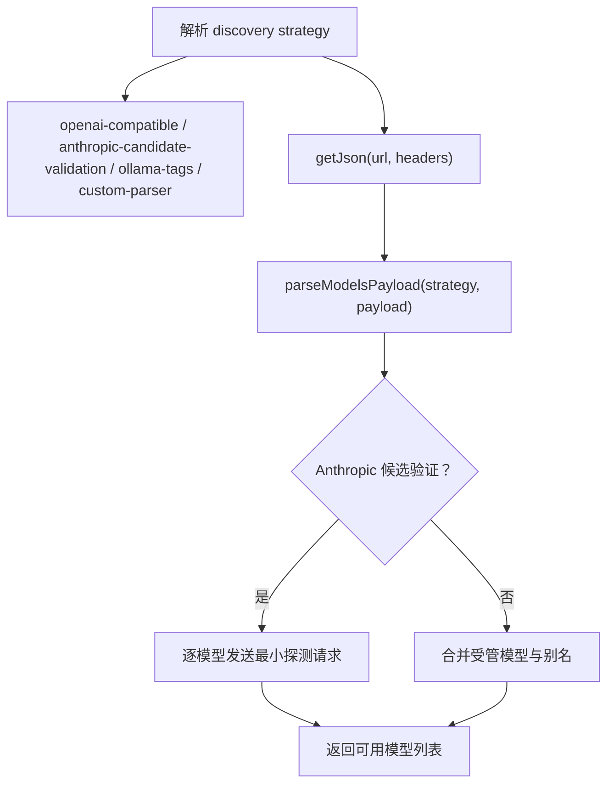
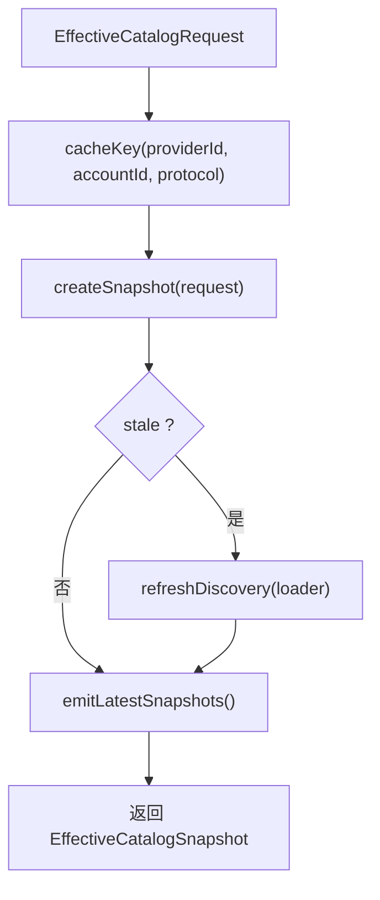
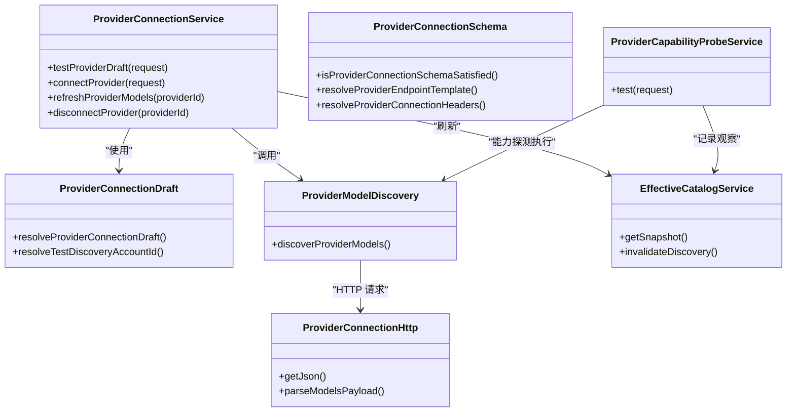

# 连接验证与测试

<cite>
**本文引用的文件**   
- [ProviderConnectionService.ts](file://src/main/settings/ProviderConnectionService.ts)
- [providerConnectionHttp.ts](file://src/main/settings/providerConnectionHttp.ts)
- [ProviderCapabilityProbeService.ts](file://src/main/settings/ProviderCapabilityProbeService.ts)
- [ProviderConnectionSchema.ts](file://src/main/settings/ProviderConnectionSchema.ts)
- [providerConnectionErrors.ts](file://src/main/settings/providerConnectionErrors.ts)
- [ProviderConnectionDraft.ts](file://src/main/settings/ProviderConnectionDraft.ts)
- [ProviderModelDiscovery.ts](file://src/main/settings/ProviderModelDiscovery.ts)
- [EffectiveCatalogService.ts](file://src/main/settings/EffectiveCatalogService.ts)
</cite>

## 目录
1. [引言](#引言)
2. [项目结构](#项目结构)
3. [核心组件](#核心组件)
4. [架构总览](#架构总览)
5. [详细组件分析](#详细组件分析)
6. [依赖关系分析](#依赖关系分析)
7. [性能与可靠性](#性能与可靠性)
8. [故障排除指南](#故障排除指南)
9. [结论](#结论)

## 引言
本文聚焦 Provider 连接验证与能力探测体系，围绕以下目标展开：
- 说明 ProviderConnectionService 的连接验证流程，包括基本格式校验、认证信息检查与网络连通性测试。
- 解释 providerConnectionHttp.ts 的 HTTP 连接实现，涵盖超时、重试、代理、SSL/TLS 与错误处理策略。
- 说明 ProviderCapabilityProbeService 的能力探测机制，包括模型列表获取、API 端点测试和功能特性验证。
- 梳理常见异常场景的处理逻辑，如无效凭据、网络超时、服务不可用等。
- 定义连接测试的状态码、错误分类和诊断信息收集方式。
- 提供可操作的连接故障排除指南。

## 项目结构
本次文档涉及的代码主要位于主进程设置子系统，核心文件组织如下：
- 连接服务层：ProviderConnectionService.ts
- HTTP 基础设施：providerConnectionHttp.ts
- 能力探测服务层：ProviderCapabilityProbeService.ts
- 连接模式与端点解析：ProviderConnectionSchema.ts、ProviderConnectionDraft.ts
- 模型发现与校验：ProviderModelDiscovery.ts
- 有效目录与缓存：EffectiveCatalogService.ts

**图表来源**
- [ProviderConnectionService.ts:1-356](file://src/main/settings/ProviderConnectionService.ts#L1-L356)
- [ProviderCapabilityProbeService.ts:1-354](file://src/main/settings/ProviderCapabilityProbeService.ts#L1-L354)
- [ProviderModelDiscovery.ts:1-200](file://src/main/settings/ProviderModelDiscovery.ts#L1-L200)
- [providerConnectionHttp.ts:1-104](file://src/main/settings/providerConnectionHttp.ts#L1-L104)
- [ProviderConnectionSchema.ts:1-85](file://src/main/settings/ProviderConnectionSchema.ts#L1-L85)
- [ProviderConnectionDraft.ts:1-76](file://src/main/settings/ProviderConnectionDraft.ts#L1-L76)
- [EffectiveCatalogService.ts:1-180](file://src/main/settings/EffectiveCatalogService.ts#L1-L180)

**章节来源**
- [ProviderConnectionService.ts:1-356](file://src/main/settings/ProviderConnectionService.ts#L1-L356)
- [providerConnectionHttp.ts:1-104](file://src/main/settings/providerConnectionHttp.ts#L1-L104)
- [ProviderCapabilityProbeService.ts:1-354](file://src/main/settings/ProviderCapabilityProbeService.ts#L1-L354)
- [ProviderConnectionSchema.ts:1-85](file://src/main/settings/ProviderConnectionSchema.ts#L1-L85)
- [ProviderConnectionDraft.ts:1-76](file://src/main/settings/ProviderConnectionDraft.ts#L1-L76)
- [ProviderModelDiscovery.ts:1-200](file://src/main/settings/ProviderModelDiscovery.ts#L1-L200)
- [EffectiveCatalogService.ts:1-180](file://src/main/settings/EffectiveCatalogService.ts#L1-L180)

## 核心组件
- ProviderConnectionService：负责 Provider 连接草稿解析、连接测试、连接保存、账号登录状态管理、模型刷新与断开连接。
- providerConnectionHttp：封装 JSON 请求、URL 拼接、查询参数拼接、模型载荷解析、最小探测报文生成及 HTTP 错误格式化。
- ProviderCapabilityProbeService：对已配置的 Provider 与模型执行能力探测，产出成功、拒绝或失败结果，并更新有效目录观察结果。
- ProviderConnectionSchema / ProviderConnectionDraft：负责连接字段完整性、凭证替代方案、端点模板解析、头映射与连接草稿构造。
- ProviderModelDiscovery：按 Provider 协议与清单策略拉取模型列表，进行候选模型校验、编码计划匹配、受管模型合并等。
- EffectiveCatalogService：维护有效目录快照、发现缓存、观察证据与配额退避。

**章节来源**
- [ProviderConnectionService.ts:1-356](file://src/main/settings/ProviderConnectionService.ts#L1-L356)
- [providerConnectionHttp.ts:1-104](file://src/main/settings/providerConnectionHttp.ts#L1-L104)
- [ProviderCapabilityProbeService.ts:1-354](file://src/main/settings/ProviderCapabilityProbeService.ts#L1-L354)
- [ProviderConnectionSchema.ts:1-85](file://src/main/settings/ProviderConnectionSchema.ts#L1-L85)
- [ProviderConnectionDraft.ts:1-76](file://src/main/settings/ProviderConnectionDraft.ts#L1-L76)
- [ProviderModelDiscovery.ts:1-200](file://src/main/settings/ProviderModelDiscovery.ts#L1-L200)
- [EffectiveCatalogService.ts:1-180](file://src/main/settings/EffectiveCatalogService.ts#L1-L180)

## 架构总览
连接验证与能力探测的整体调用链如下：

**图表来源**
- [ProviderConnectionService.ts:1-200](file://src/main/settings/ProviderConnectionService.ts#L1-L200)
- [ProviderConnectionDraft.ts:1-76](file://src/main/settings/ProviderConnectionDraft.ts#L1-L76)
- [ProviderConnectionSchema.ts:1-85](file://src/main/settings/ProviderConnectionSchema.ts#L1-L85)
- [ProviderModelDiscovery.ts:1-200](file://src/main/settings/ProviderModelDiscovery.ts#L1-L200)
- [providerConnectionHttp.ts:1-104](file://src/main/settings/providerConnectionHttp.ts#L1-L104)
- [EffectiveCatalogService.ts:1-180](file://src/main/settings/EffectiveCatalogService.ts#L1-L180)
- [ProviderCapabilityProbeService.ts:1-354](file://src/main/settings/ProviderCapabilityProbeService.ts#L1-L354)

## 详细组件分析

### ProviderConnectionService：连接验证流程
职责概述：
- 将前端提交的前端草稿与持久化值合并为连接草稿。
- 校验 Provider 协议与认证模式是否合法。
- 调用模型发现接口完成网络连通性测试。
- 将测试结果写入有效目录；保存连接时同时持久化模型与偏好。
- 支持账号模式（OAuth 等）连接状态管理与刷新。

关键流程：
- 基本格式验证：通过 ProviderConnectionDraft.resolveProviderConnectionDraft 调用 schema 校验，确保必填字段满足要求、端点模板可解析且为绝对 HTTP(S) URL。
- 认证信息检查：区分 api-key 与 account 模式；account 模式委托 ProviderAccountAuthService；api-key 模式下根据 Provider 类型决定是否允许空密钥（例如 Vertex/Bedrock）。
- 网络连通性测试：discoverProviderModels 按策略拉取模型列表，若返回成功则视为连通性测试通过。
- 结果处理：成功返回 models、contributions、entitlementContributions 与 discoveryAccountId；失败统一使用 parseProviderError 转换为可读消息。

**图表来源**
- [ProviderConnectionService.ts:1-200](file://src/main/settings/ProviderConnectionService.ts#L1-L200)
- [ProviderConnectionService.ts:201-356](file://src/main/settings/ProviderConnectionService.ts#L201-L356)
- [ProviderConnectionDraft.ts:1-76](file://src/main/settings/ProviderConnectionDraft.ts#L1-L76)
- [ProviderConnectionSchema.ts:1-85](file://src/main/settings/ProviderConnectionSchema.ts#L1-L85)
- [providerConnectionErrors.ts:1-14](file://src/main/settings/providerConnectionErrors.ts#L1-L14)

**章节来源**
- [ProviderConnectionService.ts:1-200](file://src/main/settings/ProviderConnectionService.ts#L1-L200)
- [ProviderConnectionService.ts:201-356](file://src/main/settings/ProviderConnectionService.ts#L201-L356)
- [ProviderConnectionDraft.ts:1-76](file://src/main/settings/ProviderConnectionDraft.ts#L1-L76)
- [ProviderConnectionSchema.ts:1-85](file://src/main/settings/ProviderConnectionSchema.ts#L1-L85)
- [providerConnectionErrors.ts:1-14](file://src/main/settings/providerConnectionErrors.ts#L1-L14)

### providerConnectionHttp：HTTP 连接实现
重点特性：
- 超时控制：所有 JSON 请求默认使用 REQUEST_TIMEOUT_MS（20 秒），基于 AbortController 实现。
- 重试机制：该模块未内置重试；上层 ProviderModelDiscovery 可按需重试或继续探测其他候选模型。
- 代理设置：直接使用 Node.js fetch，不直接注入代理配置；如需代理应通过运行时环境或全局代理配置生效。
- SSL/TLS：沿用系统 TLS 栈，无需额外证书配置。
- 错误处理：非 2xx 响应被包装为 ProviderConnectionError，并按状态码给出可读消息（401/403、404、5xx）。

辅助能力：
- appendPath、appendQueryParam：安全拼接基础 URL 与路径、参数。
- parseModelsPayload：根据 DiscoveryStrategy 解析不同提供商的模型载荷。
- createTinyAnthropicProbeBody / createTinyOpenAiProbeBody：生成最小探测请求体，用于候选模型验证。

**图表来源**
- [providerConnectionHttp.ts:1-104](file://src/main/settings/providerConnectionHttp.ts#L1-L104)

**章节来源**
- [providerConnectionHttp.ts:1-104](file://src/main/settings/providerConnectionHttp.ts#L1-L104)

### ProviderCapabilityProbeService：能力探测机制
职责概述：
- 校验模型是否已配置且可用。
- 规划探测任务（推理级别、上下文模式、快速模式等）。
- 冻结凭证并执行探测，记录成功或失败证据到有效目录。
- 对限流/配额耗尽进行短时退避，避免频繁重试。

探测流程要点：
- 前置校验：若模型不可用、未启用或所选模式不受支持，直接返回 denied 或 failed。
- 凭证生命周期：使用 freezeProviderRuntimeCredentials 获取临时凭证句柄，finally 中释放。
- 执行与评估：executeCapabilityProbe 返回 AssistantMessage，包含 usage；fast 模式需要确认 speed=fast。
- 结果分类：
  - success=true、status=verified：探测成功，记录 observed 并授予相应 entitlement。
  - status=denied：由 classifyCapabilityProbeFailure 判定为权限不足、路由不可用或配额耗尽等。
  - status=failed：未知错误或凭证冻结失败等。
- 配额退避：当收到 429 或特定 402 详情时，记录短暂配额限制（60 秒）并推迟重试。

**图表来源**
- [ProviderCapabilityProbeService.ts:1-354](file://src/main/settings/ProviderCapabilityProbeService.ts#L1-L354)
- [EffectiveCatalogService.ts:1-180](file://src/main/settings/EffectiveCatalogService.ts#L1-L180)

**章节来源**
- [ProviderCapabilityProbeService.ts:1-354](file://src/main/settings/ProviderCapabilityProbeService.ts#L1-L354)

### ProviderConnectionSchema 与 ProviderConnectionDraft：连接字段与端点校验
连接字段校验：
- resolvePrimaryConnectionSecretFieldId：优先使用显式 primarySecretFieldId，否则回退到 apiKey 或常见令牌字段名，最终取第一个 secret 字段。
- isProviderConnectionSchemaSatisfied：校验必填字段；支持 credentialAlternatives 的环境变量或字段组合替代方案。
- resolveProviderEndpointTemplate：替换 ${FIELD} 模板，要求结果为绝对 HTTP(S) URL，不允许未解析占位符。
- resolveProviderConnectionHeaders：根据 headerMappings 生成自定义请求头。

连接草稿构造：
- resolveProviderConnectionDraft：合并 storedValues 与 connectionValues；当 authMode=api-key 时强制校验 schema；对于 Vertex/Bedrock 等允许空 API Key（由后端凭据解析器处理）。
- resolveTestDiscoveryAccountId：在测试未提交秘密的情况下，为避免覆盖已有账户的发现缓存，使用匿名账户键。

**图表来源**
- [ProviderConnectionSchema.ts:1-85](file://src/main/settings/ProviderConnectionSchema.ts#L1-L85)
- [ProviderConnectionDraft.ts:1-76](file://src/main/settings/ProviderConnectionDraft.ts#L1-L76)

**章节来源**
- [ProviderConnectionSchema.ts:1-85](file://src/main/settings/ProviderConnectionSchema.ts#L1-L85)
- [ProviderConnectionDraft.ts:1-76](file://src/main/settings/ProviderConnectionDraft.ts#L1-L76)

### ProviderModelDiscovery：模型列表获取与端点测试
职责概述：
- 根据 Provider 协议与 surface 清单选择 discovery strategy。
- 为 Anthropic 候选模型执行最小消息探测以确认可用性。
- 针对编码计划类 Provider 进行在线模型匹配与受管模型合并。
- 使用 providerConnectionHttp.getJson 统一发起 JSON 请求。

关键点：
- validateAnthropicCandidateModels：对每个候选模型发送最小 POST /messages 探测，仅保留成功的模型。
- validateCodingPlanModels：从编码计划端点拉取可用模型集合，过滤出当前 Provider 匹配的模型，并与受管模型合并。
- 头信息构建：根据不同协议自动附加 Authorization、anthropic-version、User-Agent 等头部，并合并 schema 定义的 headerMappings。

**图表来源**
- [ProviderModelDiscovery.ts:1-200](file://src/main/settings/ProviderModelDiscovery.ts#L1-L200)
- [providerConnectionHttp.ts:1-104](file://src/main/settings/providerConnectionHttp.ts#L1-L104)

**章节来源**
- [ProviderModelDiscovery.ts:1-200](file://src/main/settings/ProviderModelDiscovery.ts#L1-L200)

### 有效目录与缓存：EffectiveCatalogService
职责概述：
- 管理有效目录快照、发现缓存、观察证据与配额退避。
- 支持发现过期、增量刷新与监听器通知。
- 对 capability-probe 产生的 observed 数据进行 TTL 管理。

关键点：
- cacheKey：基于 providerId、accountId、protocol 作为缓存键。
- invalidateDiscovery：清除指定 provider/account 的发现与观察数据，触发刷新。
- getSnapshot：返回快照并在需要时异步刷新；含 backoff 与 lastErrors 跟踪。

**图表来源**
- [EffectiveCatalogService.ts:1-180](file://src/main/settings/EffectiveCatalogService.ts#L1-L180)

**章节来源**
- [EffectiveCatalogService.ts:1-180](file://src/main/settings/EffectiveCatalogService.ts#L1-L180)

## 依赖关系分析
组件耦合关系如下：
- ProviderConnectionService 依赖 ProviderConnectionDraft、ProviderConnectionSchema、ProviderModelDiscovery、EffectiveCatalogService 与 providerConnectionErrors。
- ProviderModelDiscovery 依赖 providerConnectionHttp 与多个 Provider 专属解析器。
- ProviderCapabilityProbeService 依赖 EffectiveCatalogService 与 ProviderModelDiscovery（通过 executeCapabilityProbe）。
- providerConnectionHttp 是底层 HTTP 工具，被 ProviderModelDiscovery 与内部探测逻辑复用。

**图表来源**
- [ProviderConnectionService.ts:1-356](file://src/main/settings/ProviderConnectionService.ts#L1-L356)
- [ProviderConnectionDraft.ts:1-76](file://src/main/settings/ProviderConnectionDraft.ts#L1-L76)
- [ProviderConnectionSchema.ts:1-85](file://src/main/settings/ProviderConnectionSchema.ts#L1-L85)
- [ProviderModelDiscovery.ts:1-200](file://src/main/settings/ProviderModelDiscovery.ts#L1-L200)
- [providerConnectionHttp.ts:1-104](file://src/main/settings/providerConnectionHttp.ts#L1-L104)
- [ProviderCapabilityProbeService.ts:1-354](file://src/main/settings/ProviderCapabilityProbeService.ts#L1-L354)
- [EffectiveCatalogService.ts:1-180](file://src/main/settings/EffectiveCatalogService.ts#L1-L180)

**章节来源**
- [ProviderConnectionService.ts:1-356](file://src/main/settings/ProviderConnectionService.ts#L1-L356)
- [ProviderCapabilityProbeService.ts:1-354](file://src/main/settings/ProviderCapabilityProbeService.ts#L1-L354)
- [ProviderModelDiscovery.ts:1-200](file://src/main/settings/ProviderModelDiscovery.ts#L1-L200)
- [providerConnectionHttp.ts:1-104](file://src/main/settings/providerConnectionHttp.ts#L1-L104)
- [ProviderConnectionSchema.ts:1-85](file://src/main/settings/ProviderConnectionSchema.ts#L1-L85)
- [ProviderConnectionDraft.ts:1-76](file://src/main/settings/ProviderConnectionDraft.ts#L1-L76)
- [EffectiveCatalogService.ts:1-180](file://src/main/settings/EffectiveCatalogService.ts#L1-L180)

## 性能与可靠性
- 超时配置：JSON 请求统一 20 秒超时，避免长时间阻塞。
- 重试策略：HTTP 层无内置重试；ProviderModelDiscovery 对候选模型逐个探测，单个失败不影响其余。
- 代理与 TLS：使用系统网络栈，不直接注入代理；TLS 由系统默认管理。
- 缓存与退避：
  - EffectiveCatalogService 对发现结果进行缓存，过期后异步刷新，带 backoff。
  - ProviderCapabilityProbeService 对 429/402 配额超限进行 60 秒短时退避，降低瞬时压力。
- 资源清理：能力探测结束后释放凭证句柄，防止泄漏。

[本节为通用性能建议，不直接分析具体文件]

## 故障排除指南

### 连接验证常见问题
- 连接字段不完整：
  - 现象：提示“连接字段不完整”。
  - 原因：ProviderConnectionSchema.isProviderConnectionSchemaSatisfied 校验失败，或 api-key 模式下缺少必要字段。
  - 处理：检查必填字段、环境变量替代方案、primarySecretFieldId 是否正确。
- 端点非法：
  - 现象：提示“端点必须为绝对 HTTP(S) URL”或“不支持的模板变量”。
  - 原因：resolveProviderEndpointTemplate 校验失败。
  - 处理：修正 baseUrl 或 endpointTemplate，确保所有 ${FIELD} 已填充。
- 认证模式不支持：
  - 现象：提示“不支持的认证模式”或“未配置账号登录”。
  - 原因：Provider.authModeOptions 不包含请求的 authMode，或账号登录未配置。
  - 处理：选择支持的认证模式，或配置 Provider 的账号登录。

**章节来源**
- [ProviderConnectionSchema.ts:1-85](file://src/main/settings/ProviderConnectionSchema.ts#L1-L85)
- [ProviderConnectionDraft.ts:1-76](file://src/main/settings/ProviderConnectionDraft.ts#L1-L76)
- [ProviderConnectionService.ts:201-356](file://src/main/settings/ProviderConnectionService.ts#L201-L356)

### 网络连接问题
- 超时：
  - 现象：提示“连接测试超时，请稍后重试”。
  - 原因：AbortError，请求超过 20 秒。
  - 处理：检查网络延迟、防火墙、DNS；必要时降低并发或优化远端服务。
- 服务不可用：
  - 现象：提示“Provider 服务暂时不可用”或“连接测试失败（HTTP 5xx）”。
  - 原因：远端返回 5xx。
  - 处理：稍后重试，检查服务健康状态与负载均衡。
- 代理与证书：
  - 现象：连接失败但状态码不明确。
  - 原因：系统代理或证书未正确配置。
  - 处理：配置系统代理与可信证书根，确保 Electron 应用继承系统网络设置。

**章节来源**
- [providerConnectionHttp.ts:1-104](file://src/main/settings/providerConnectionHttp.ts#L1-L104)
- [providerConnectionErrors.ts:1-14](file://src/main/settings/providerConnectionErrors.ts#L1-L14)

### 认证失败与权限问题
- 无效凭据：
  - 现象：提示“API Key 无效或权限不足”，或能力探测返回 denied。
  - 原因：HTTP 401/403，或 manifest 声明的 entitlementDenialMatchers 命中。
  - 处理：核对 API Key、租户/项目访问权限；检查清单中的 entitlement 配置。
- 路由不可用：
  - 现象：提示“模型发现端点不可用”，或能力探测返回 route-unavailable。
  - 原因：HTTP 404。
  - 处理：检查端点路径、baseUrl 与 path 拼接逻辑。

**章节来源**
- [providerConnectionHttp.ts:1-104](file://src/main/settings/providerConnectionHttp.ts#L1-L104)
- [ProviderCapabilityProbeService.ts:1-354](file://src/main/settings/ProviderCapabilityProbeService.ts#L1-L354)

### 配额与限流
- 现象：能力探测返回 quota-exhausted，或短时间内反复失败。
- 原因：HTTP 429 或 402 包含 quota_exceeded/out of budget 等关键词。
- 处理：等待 60 秒后重试；检查计费与配额上限；减少探测频率。

**章节来源**
- [ProviderCapabilityProbeService.ts:201-354](file://src/main/settings/ProviderCapabilityProbeService.ts#L201-L354)

### 诊断信息收集
- 连接测试诊断：
  - 成功：models、contributions、entitlementContributions、discoveryAccountId。
  - 失败：error 字符串（来自 parseProviderError）。
- 能力探测证据：
  - evidence.protocol、effectiveModelId、observedAt、usage.inputTokens/outputTokens/totalTokens/speed。
  - effectiveCatalogService.observed 中记录 entitlement granted/denied 与 TTL。

**章节来源**
- [ProviderConnectionService.ts:1-200](file://src/main/settings/ProviderConnectionService.ts#L1-L200)
- [ProviderCapabilityProbeService.ts:201-354](file://src/main/settings/ProviderCapabilityProbeService.ts#L201-L354)
- [EffectiveCatalogService.ts:1-180](file://src/main/settings/EffectiveCatalogService.ts#L1-L180)

## 结论
ProviderConnectionService 与 ProviderCapabilityProbeService 分别承担连接验证与能力探测的职责，并通过 ProviderModelDiscovery 与 providerConnectionHttp 实现对多协议 Provider 的统一发现与探测。连接验证强调字段与端点合法性、认证模式正确性与网络连通性；能力探测进一步验证模型功能特性并更新有效目录的观察证据。通过统一的超时、错误分类与配额退避机制，系统在复杂网络与鉴权环境下具备较好的鲁棒性与可观测性。

[本节为总结性内容，不直接分析具体文件]