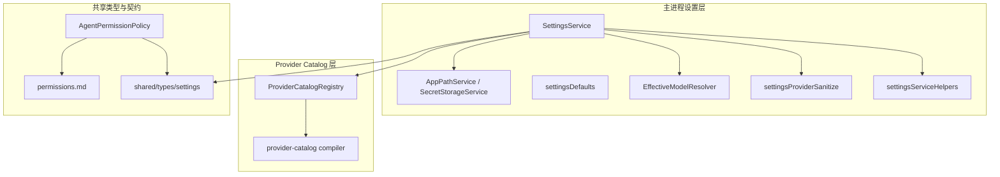
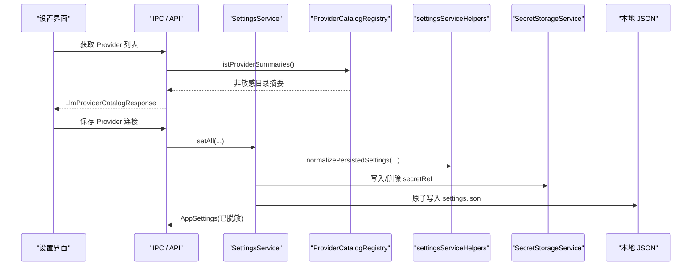
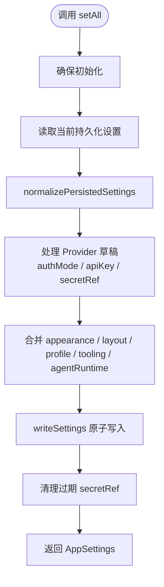
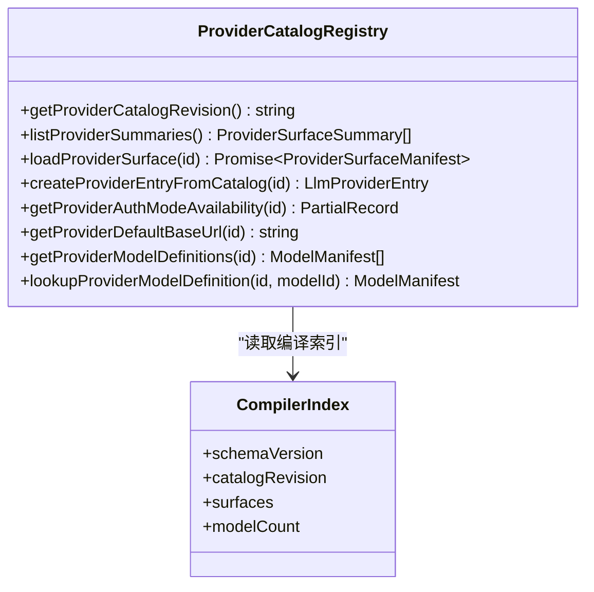
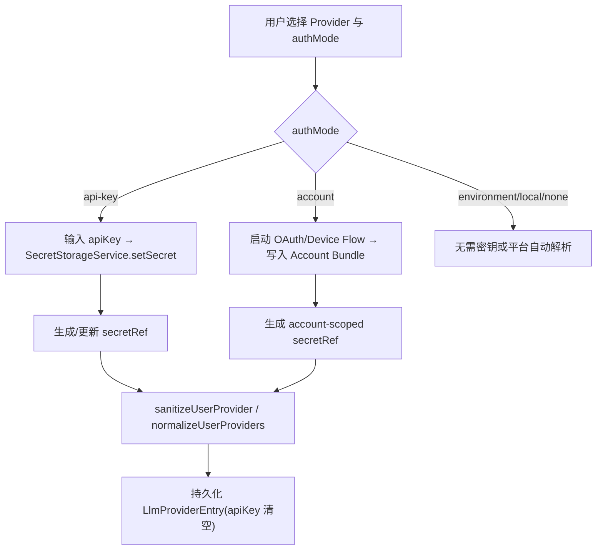
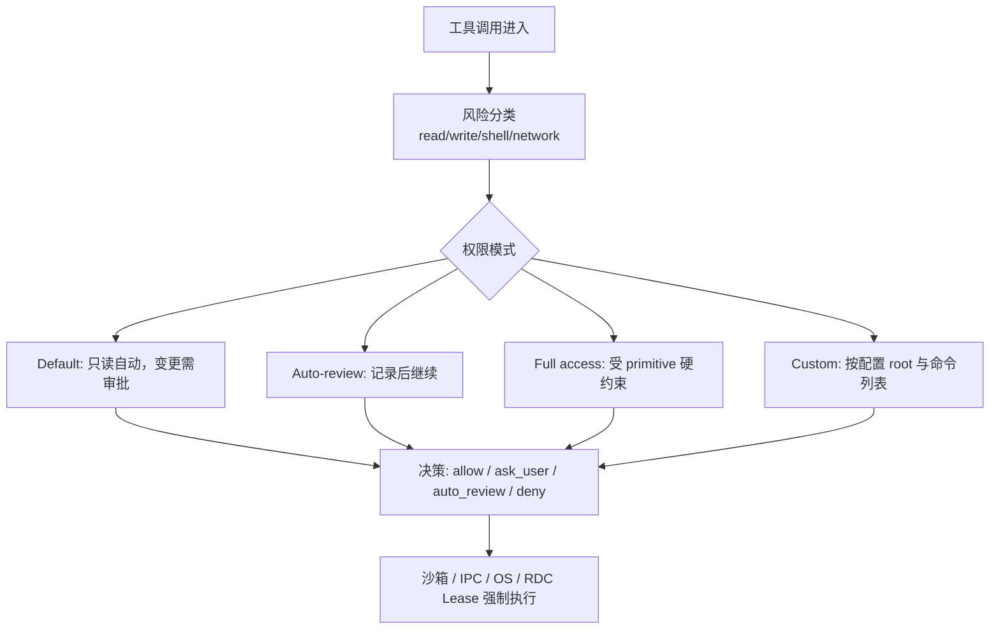
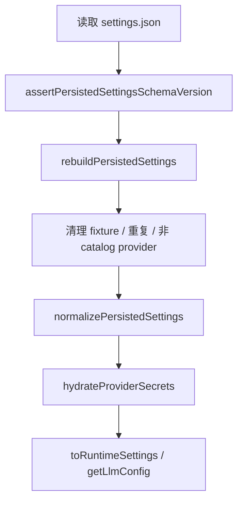
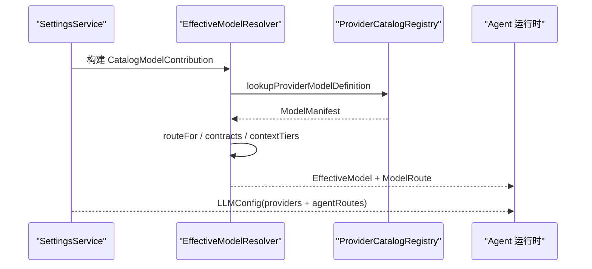
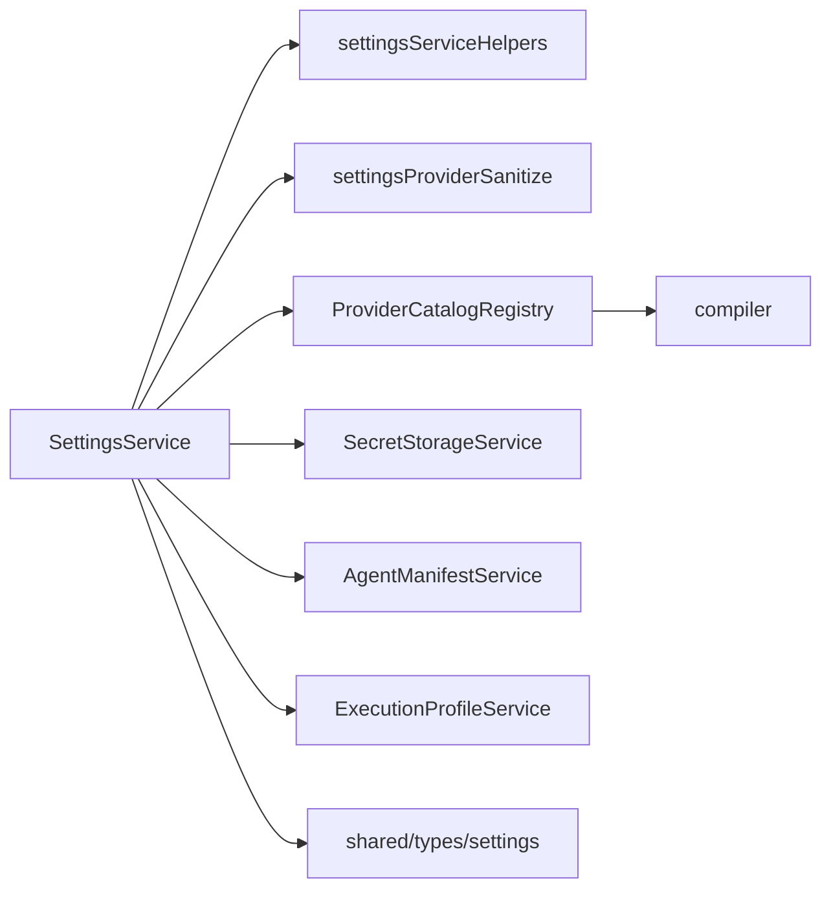

# 配置与设置

<cite>
**本文引用的文件**   
- [SettingsService.ts](file://src/main/settings/SettingsService.ts)
- [settingsServiceHelpers.ts](file://src/main/settings/settingsServiceHelpers.ts)
- [settingsDefaults.ts](file://src/main/settings/settingsDefaults.ts)
- [settingsProviderSanitize.ts](file://src/main/settings/settingsProviderSanitize.ts)
- [EffectiveModelResolver.ts](file://src/main/settings/EffectiveModelResolver.ts)
- [README.md](file://src/main/settings/README.md)
- [ProviderCatalogRegistry.ts](file://src/main/provider-catalog/ProviderCatalogRegistry.ts)
- [compiler.ts](file://src/shared/provider-catalog/compiler.ts)
- [settings.ts](file://src/shared/types/settings.ts)
- [permissions.md](file://docs/contracts/permissions.md)
- [AgentPermissionPolicy.ts](file://src/main/agent-runtime/permissions/AgentPermissionPolicy.ts)
</cite>

## 目录
1. [引言](#引言)
2. [项目结构](#项目结构)
3. [核心组件](#核心组件)
4. [架构总览](#架构总览)
5. [详细组件分析](#详细组件分析)
6. [依赖关系分析](#依赖关系分析)
7. [性能与可靠性](#性能与可靠性)
8. [故障排查指南](#故障排查指南)
9. [结论](#结论)
10. [附录：配置示例与最佳实践](#附录配置示例与最佳实践)

## 引言
本文件围绕“配置与设置”主题，系统化说明以下能力：
- `SettingsService` 的统一配置管理：初始化、读写、规范化、权限与工具配置持久化。
- `ProviderCatalogRegistry` 的 Provider 发现、编译索引、按需加载、认证模式映射和可用性判断。
- Provider 的配置选项、认证方式、连接字段、密钥边界和连接管理。
- Agent 权限模型：fail-closed 安全策略、工具授权、作用域（scope）管理。
- 配置的持久化存储、版本迁移、冲突解决机制。
- Provider 的动态发现、可用性检查、配额与账户信息投影。
- 与 Agent 系统的集成：有效模型解析、路由选择、配置生效路径。

## 项目结构
本项目将“应用设置”和“Provider 目录”拆分为两条稳定边界：
- 主进程设置层：`src/main/settings`，负责用户配置、Provider 连接、Secret、Agent 运行时权限和有效模型计算。
- Provider Catalog 层：`src/shared/provider-catalog` 提供编译契约，`src/main/provider-catalog` 提供运行时注册表。

**图表来源**
- [SettingsService.ts:1-200](file://src/main/settings/SettingsService.ts#L1-L200)
- [ProviderCatalogRegistry.ts:1-120](file://src/main/provider-catalog/ProviderCatalogRegistry.ts#L1-L120)
- [compiler.ts:1-120](file://src/shared/provider-catalog/compiler.ts#L1-L120)
- [settings.ts:1-120](file://src/shared/types/settings.ts#L1-L120)

**章节来源**
- [SettingsService.ts:1-200](file://src/main/settings/SettingsService.ts#L1-L200)
- [ProviderCatalogRegistry.ts:1-120](file://src/main/provider-catalog/ProviderCatalogRegistry.ts#L1-L120)
- [compiler.ts:1-120](file://src/shared/provider-catalog/compiler.ts#L1-L120)
- [settings.ts:1-120](file://src/shared/types/settings.ts#L1-L120)
- [README.md:1-71](file://src/main/settings/README.md#L1-L71)

## 核心组件
- `SettingsService`：统一入口，负责初始化、读取、合并、校验、持久化应用设置，以及 Provider 连接、账号凭证、Agent 运行时权限与 Agent 定义提交。
- `settingsServiceHelpers`：JSON 文件读写、原子写入、默认值构建、版本断言、持久化数据重建、运行时设置装配。
- `settingsDefaults`：Schema 版本、默认外观/布局/工具链/Agent 权限等常量。
- `settingsProviderSanitize`：Provider 条目清洗、认证模式解析、账户密钥引用、OAuth bundle 解析、连接字段处理。
- `ProviderCatalogRegistry`：从编译后的 Catalog 索引中枚举 Provider、按需加载 surface、映射认证模式、生成 `LlmProviderEntry`。
- `compiler`：Catalog 编译契约、schemaVersion、surface 合约合并、失败默认合约、稳定性哈希。
- `EffectiveModelResolver`：根据 Provider、Catalog、模型覆盖和请求计划，选择协议、baseUrl、headers、contracts 和上下文预算。
- `AgentPermissionPolicy`：工具调用风险分类、读写根、命令白黑名单、shell 风险评估、策略下界与 fail-closed 决策。
- `shared/types/settings`：所有设置与 Provider 相关的 TypeScript 类型定义，包括认证模式、连接字段、模型偏好、目录项、权限模式等。

**章节来源**
- [SettingsService.ts:1-200](file://src/main/settings/SettingsService.ts#L1-L200)
- [settingsServiceHelpers.ts:1-120](file://src/main/settings/settingsServiceHelpers.ts#L1-L120)
- [settingsDefaults.ts:1-80](file://src/main/settings/settingsDefaults.ts#L1-L80)
- [settingsProviderSanitize.ts:1-120](file://src/main/settings/settingsProviderSanitize.ts#L1-L120)
- [ProviderCatalogRegistry.ts:1-120](file://src/main/provider-catalog/ProviderCatalogRegistry.ts#L1-L120)
- [compiler.ts:1-120](file://src/shared/provider-catalog/compiler.ts#L1-L120)
- [EffectiveModelResolver.ts:1-120](file://src/main/settings/EffectiveModelResolver.ts#L1-L120)
- [AgentPermissionPolicy.ts:1-120](file://src/main/agent-runtime/permissions/AgentPermissionPolicy.ts#L1-L120)
- [settings.ts:1-200](file://src/shared/types/settings.ts#L1-L200)

## 架构总览
系统采用“目录权威 + 用户配置 + 运行时凭据”三层分离设计：
- Catalog 是 Provider 身份、协议、路由、能力和可用性的权威来源。
- Settings 保存用户可见且可编辑的配置、连接字段和状态投影。
- Secret 仅在主进程凭据租约内使用，不进入 UI、Manifest、Route、Trace 或 IPC。

**图表来源**
- [ProviderCatalogRegistry.ts:120-200](file://src/main/provider-catalog/ProviderCatalogRegistry.ts#L120-L200)
- [SettingsService.ts:201-510](file://src/main/settings/SettingsService.ts#L201-L510)
- [settingsServiceHelpers.ts:300-397](file://src/main/settings/settingsServiceHelpers.ts#L300-L397)
- [settingsProviderSanitize.ts:120-200](file://src/main/settings/settingsProviderSanitize.ts#L120-L200)

**章节来源**
- [README.md:1-71](file://src/main/settings/README.md#L1-L71)
- [SettingsService.ts:201-510](file://src/main/settings/SettingsService.ts#L201-L510)
- [ProviderCatalogRegistry.ts:120-200](file://src/main/provider-catalog/ProviderCatalogRegistry.ts#L120-L200)
- [settingsServiceHelpers.ts:300-397](file://src/main/settings/settingsServiceHelpers.ts#L300-L397)

## 详细组件分析

### SettingsService：统一配置管理
`SettingsService` 是应用设置的唯一协调者。它负责：
- 初始化运行时路径、读取并重建持久化设置。
- 提供 `getAll`、`setAll`、窗口布局快速写入、Provider 连接、账号连接、旋转凭据、断开连接。
- 通过 `getLlmConfig` 输出供 Agent 运行时使用的 Provider 配置和 Agent 路由。
- 通过 `getProviderCatalog` 暴露 Catalog 服务。

关键行为：
- `initialize` 先初始化路径、读取原始设置、执行 schema 版本断言、重建持久化设置并写回。
- `setAll` 合并外观、布局、Profile、Tooling、Agent 运行时权限、LLM Provider 列表，并最终持久化。
- Provider 密钥以 `secretRef` 形式写入 Secret 存储；返回给渲染层的 provider entry 会清空 `apiKey`。
- 窗口布局提供同步和异步两种轻量写入，跳过 Provider 归一化和密钥水合，避免频繁 IO。

**图表来源**
- [SettingsService.ts:201-510](file://src/main/settings/SettingsService.ts#L201-L510)
- [settingsServiceHelpers.ts:300-397](file://src/main/settings/settingsServiceHelpers.ts#L300-L397)

**章节来源**
- [SettingsService.ts:1-200](file://src/main/settings/SettingsService.ts#L1-L200)
- [SettingsService.ts:201-510](file://src/main/settings/SettingsService.ts#L201-L510)

### ProviderCatalogRegistry：Provider 发现与认证流程
`ProviderCatalogRegistry` 从编译后的 Catalog 索引中提供 Provider 发现能力：
- `listProviderSummaries` 返回只读摘要。
- `loadProviderSurface` 按需加载完整 surface，带内存缓存和并发去重。
- `createProviderEntryFromCatalog` 将 Catalog surface 转换为 `LlmProviderEntry`，用于 UI 初始列表。
- `getProviderAuthModeAvailability` 聚合 surface 级别和 authMode 级别的可用性。
- `getProviderDefaultBaseUrl`、`getProviderModelDefinitions`、`lookupProviderModelDefinition` 支持模型路由查询。

认证模式映射规则：
- `oauth`、`device` → `account`
- `none` → `none`
- `environment`、`local` → 对应模式
- 其他 → `api-key`

**图表来源**
- [ProviderCatalogRegistry.ts:1-200](file://src/main/provider-catalog/ProviderCatalogRegistry.ts#L1-L200)
- [compiler.ts:1-120](file://src/shared/provider-catalog/compiler.ts#L1-L120)

**章节来源**
- [ProviderCatalogRegistry.ts:1-200](file://src/main/provider-catalog/ProviderCatalogRegistry.ts#L1-L200)
- [ProviderCatalogRegistry.ts:201-283](file://src/main/provider-catalog/ProviderCatalogRegistry.ts#L201-L283)
- [compiler.ts:1-120](file://src/shared/provider-catalog/compiler.ts#L1-L120)

### 配置选项、认证方式与连接管理
Provider 的配置由多个维度组成：
- `protocol`：Wire 协议，如 `OpenAICompatibleChatCompletions`、`AnthropicMessages`、`GoogleGemini` 等。
- `category`：产品分组，如 `login-authorization`、`official-direct`、`cloud-platform`、`coding-token-plan`、`local` 等。
- `authMode`：认证方式，`none`、`api-key`、`local`、`account`、`environment`。
- `connectionSchema`：连接字段定义，包含 `secret`、`text`、`url`、`region`、`path`，以及可选替代凭据方案。
- `models`、`recommendedModels`、`capabilities`：模型和能力声明。

连接管理要点：
- `api-key` 模式：API key 写入 Secret 存储，使用 `secretRef` 引用；`SettingsService.getProviderSecret` 和 `hasProviderSecret` 提供主进程凭据访问。
- `account` 模式：OAuth 或设备流凭据以 Bundle 形式存储在 Secret 存储中，`resolveAccountRuntimeCredential` 按 provider 解析 token、baseUrl、accountId。
- `environment`、`local`、`none`：通常不需要额外密钥，`hasStoredSecretByAuthMode` 标记为已满足。
- 连接字段中的 secret 字段不会进入持久化 JSON；非 secret 字段可投影到冻结 Route。

**图表来源**
- [settingsProviderSanitize.ts:1-200](file://src/main/settings/settingsProviderSanitize.ts#L1-L200)
- [SettingsService.ts:201-510](file://src/main/settings/SettingsService.ts#L201-L510)
- [settings.ts:200-400](file://src/shared/types/settings.ts#L200-L400)

**章节来源**
- [settings.ts:200-400](file://src/shared/types/settings.ts#L200-L400)
- [settingsProviderSanitize.ts:1-200](file://src/main/settings/settingsProviderSanitize.ts#L1-L200)
- [SettingsService.ts:201-510](file://src/main/settings/SettingsService.ts#L201-L510)

### 权限模型：fail-closed、工具授权与作用域
Agent 权限模型以“默认拒绝 + 策略评估”为核心：
- `AgentPermissionPolicy` 对工具调用进行风险分类，决定 `allow`、`ask_user`、`auto_review`、`deny`。
- 权限模式包括 `default`、`auto-review`、`full-access`、`custom`。
- 文件系统工具按 read-only 与 mutation 区分；网络工具单独识别。
- shell 命令通过 `ShellCommandRiskAnalyzer` 和硬拒绝规则评估。
- scope 管理以当前工作区 root、session attachments、knowledge read roots 为基础。
- 文档明确：权限分类不是最终安全边界，真正边界来自 Electron sandbox、IPC schema、Browser Bridge 校验、Secret 隔离、RDC context lease 等。

**图表来源**
- [AgentPermissionPolicy.ts:1-120](file://src/main/agent-runtime/permissions/AgentPermissionPolicy.ts#L1-L120)
- [permissions.md:1-120](file://docs/contracts/permissions.md#L1-L120)

**章节来源**
- [AgentPermissionPolicy.ts:1-120](file://src/main/agent-runtime/permissions/AgentPermissionPolicy.ts#L1-L120)
- [permissions.md:1-120](file://docs/contracts/permissions.md#L1-L120)

### 配置的持久化、版本迁移与冲突解决
持久化存储：
- 设置文件位于 `AppRuntimePaths.settingsPath`，由 `settingsServiceHelpers.readJsonFile`、`writeSettings`、`writeSettingsAsync` 管理。
- 写入使用临时文件加原子 rename，失败时清理临时文件，提升健壮性。

版本迁移：
- `SETTINGS_SCHEMA_VERSION` 当前为 `8`。
- `assertPersistedSettingsSchemaVersion` 要求 schemaVersion 匹配，并拒绝已废弃字段（如旧 embedding 选择、持久化 agentRoutes）。
- `rebuildPersistedSettings` 在初始化时重建持久化设置，移除 fixture provider、重复 provider、非 catalog provider，并输出 fixes/warnings。

冲突解决：
- Provider 定义提交支持客户端 revision 与服务端最新 revision 比较，返回 `committed`、`superseded`、`failed`。
- 账户密钥在 `api-key` 模式下当新 key 与旧 key 不一致时创建新的 `secretRef`，并标记旧 ref 待删除。
- 设置合并时对 appearance、layout、tooling、agentRuntime 做 sanitize 与默认值兜底。

**图表来源**
- [settingsServiceHelpers.ts:1-200](file://src/main/settings/settingsServiceHelpers.ts#L1-L200)
- [settingsServiceHelpers.ts:201-397](file://src/main/settings/settingsServiceHelpers.ts#L201-L397)
- [settingsDefaults.ts:1-80](file://src/main/settings/settingsDefaults.ts#L1-L80)

**章节来源**
- [settingsServiceHelpers.ts:1-200](file://src/main/settings/settingsServiceHelpers.ts#L1-L200)
- [settingsServiceHelpers.ts:201-397](file://src/main/settings/settingsServiceHelpers.ts#L201-L397)
- [settingsDefaults.ts:1-80](file://src/main/settings/settingsDefaults.ts#L1-L80)

### 动态发现、可用性检查与配额管理
动态发现：
- Catalog 编译产物包含 `schemaVersion`、`catalogRevision`、`surfaceCount`、`modelCount`。
- `ProviderCatalogRegistry.loadProviderSurface` 按 id 加载 surface，并验证 schemaVersion 与 catalogRevision 一致。
- `createProviderEntryFromCatalog` 基于 Catalog 生成初始 `LlmProviderEntry`，未配置时 status 为 `unconfigured`。

可用性检查：
- `combineAvailability` 合并 provider 级别与 mode 级别可用性，优先 `unavailable`，其次 `unknown`，否则 `available`。
- `getProviderAuthModeAvailability` 按 authMode 分组计算可用性，并将 unavailable reason 拼接。
- 模型 availability 受 `presencePolicy` 影响：`account-entitled` 且 available 时显示为 `unknown`，表示需要账户额度确认。

配额管理：
- `effectiveCatalogTypes`、`EffectiveModelResolver`、`copilotBilling` 相关逻辑表明，账户额度、计费上下文、context tier 会影响模型启用与预算。
- `LlmProviderCapability` 暴露 `chat`、`tool-calling`、`structured-output`、`reasoning`、`prompt-cache`、`vision-input`、`model-discovery` 等能力标志，下游代码应依据这些标志决定是否启用功能。

**章节来源**
- [ProviderCatalogRegistry.ts:1-200](file://src/main/provider-catalog/ProviderCatalogRegistry.ts#L1-L200)
- [ProviderCatalogRegistry.ts:201-283](file://src/main/provider-catalog/ProviderCatalogRegistry.ts#L201-L283)
- [EffectiveModelResolver.ts:1-120](file://src/main/settings/EffectiveModelResolver.ts#L1-L120)
- [settings.ts:400-683](file://src/shared/types/settings.ts#L400-L683)

### 与 Agent 系统的集成与配置生效机制
配置生效路径：
- `SettingsService.getLlmConfig` 过滤出 enabled、isConfigured、status 为 verified 的 Provider，并注入真实凭据。
- Agent 路由由 `compiledRoutesFromDefinitions(settings.agents.definitions)` 生成。
- `EffectiveModelResolver.routeFor` 根据 Catalog route、用户 model route、provider baseUrl 与 headers 选择最终路由。
- Catalog 编译器会为缺失 mechanic 的 route 生成 fail-closed 合约，防止未声明能力被误用。

**图表来源**
- [SettingsService.ts:400-510](file://src/main/settings/SettingsService.ts#L400-L510)
- [EffectiveModelResolver.ts:1-120](file://src/main/settings/EffectiveModelResolver.ts#L1-L120)
- [compiler.ts:120-200](file://src/shared/provider-catalog/compiler.ts#L120-L200)

**章节来源**
- [SettingsService.ts:400-510](file://src/main/settings/SettingsService.ts#L400-L510)
- [EffectiveModelResolver.ts:1-120](file://src/main/settings/EffectiveModelResolver.ts#L1-L120)
- [compiler.ts:120-200](file://src/shared/provider-catalog/compiler.ts#L120-L200)

## 依赖关系分析
- `SettingsService` 依赖：
  - `appPathService`：运行路径。
  - `executionProfileService`：资源目录与诊断。
  - `agentManifestService`：Agent 定义、全局指令、路由。
  - `providerCatalogService`：Catalog DTO。
  - `secretStorageService`：密钥存储。
  - `settingsServiceHelpers`：JSON 读写、默认值、迁移。
  - `settingsProviderSanitize`：Provider 清洗与凭据解析。
  - `ProviderCatalogRegistry`：Provider 发现。
- `ProviderCatalogRegistry` 依赖：
  - 编译后的虚拟模块 `virtual:rdc-provider-catalog-index`。
  - `@shared/provider-catalog/*` schema 与 compiler。
- 类型依赖：
  - `shared/types/settings` 定义所有 Provider、模型、权限、连接字段、目录响应类型。

**图表来源**
- [SettingsService.ts:1-200](file://src/main/settings/SettingsService.ts#L1-L200)
- [ProviderCatalogRegistry.ts:1-120](file://src/main/provider-catalog/ProviderCatalogRegistry.ts#L1-L120)
- [compiler.ts:1-120](file://src/shared/provider-catalog/compiler.ts#L1-L120)
- [settings.ts:1-200](file://src/shared/types/settings.ts#L1-L200)

**章节来源**
- [SettingsService.ts:1-200](file://src/main/settings/SettingsService.ts#L1-L200)
- [ProviderCatalogRegistry.ts:1-120](file://src/main/provider-catalog/ProviderCatalogRegistry.ts#L1-L120)
- [compiler.ts:1-120](file://src/shared/provider-catalog/compiler.ts#L1-L120)
- [settings.ts:1-200](file://src/shared/types/settings.ts#L1-L200)

## 性能与可靠性
- Catalog 索引在进程内加载，surface 按需加载，并使用 `loadedSurfaces` 与 `surfaceLoads` 缓存，避免重复解析。
- 设置写入使用临时文件 + rename，减少损坏风险。
- `persistWindowLayout` 与 `persistWindowLayoutAsync` 提供轻量写入，避免每次窗口事件都触发 Provider 归一化。
- Catalog 编译产物包含 `schemaVersion` 与 `catalogRevision`，运行时校验失败直接抛错，避免加载不一致数据。
- Secret 访问集中在主进程凭据租约内，UI 层不持有明文。

[本节为通用指导，不直接分析具体文件]

## 故障排查指南
常见问题与定位建议：
- 设置文件无法读取或版本不支持：检查 `STORAGE_SCHEMA`、`STORAGE_SCHEMA_UNSUPPORTED` 错误，确认 `SETTINGS_SCHEMA_VERSION` 与文件 schemaVersion 一致。
- Provider 未出现在目录：确认 Catalog 编译产物是否包含该 id，检查 `isBuiltinProviderId`、`summaryById`、`loadProviderSurface`。
- 认证失败或凭据为空：检查 `secretRef` 是否存在，确认 `getResolvedProviderSecret` 和 `resolveAccountRuntimeCredential` 返回空值的原因。
- 模型不可用：检查 `availability`、`presencePolicy`、`unavailableReason`，确认账户额度是否满足。
- Agent 工具被拒绝：检查 `AgentPermissionPolicy` 的风险分类、权限模式、shell 硬拒绝规则、读写 root 配置。

**章节来源**
- [settingsServiceHelpers.ts:1-200](file://src/main/settings/settingsServiceHelpers.ts#L1-L200)
- [ProviderCatalogRegistry.ts:1-120](file://src/main/provider-catalog/ProviderCatalogRegistry.ts#L1-L120)
- [settingsProviderSanitize.ts:1-200](file://src/main/settings/settingsProviderSanitize.ts#L1-L200)
- [AgentPermissionPolicy.ts:1-120](file://src/main/agent-runtime/permissions/AgentPermissionPolicy.ts#L1-L120)
- [permissions.md:1-120](file://docs/contracts/permissions.md#L1-L120)

## 结论
本项目的配置与设置体系以“Catalog 权威、Settings 可控、Secret 隔离、权限严格”为核心原则：
- `SettingsService` 统一管理用户设置、Provider 连接、Agent 运行时权限和有效模型。
- `ProviderCatalogRegistry` 提供稳定的 Provider 发现、认证模式映射、可用性与模型清单。
- 权限模型采用 fail-closed 策略，结合工具元数据、shell 风险、读写 root 和 session scope 控制 Agent 行为。
- 持久化设置具备版本断言、重建修复、原子写入和密钥生命周期管理。
- 与 Agent 系统集成通过 `getLlmConfig` 和 `EffectiveModelResolver` 完成，确保路由、协议、headers、contracts 与上下文预算正确生效。

[本节为总结性内容，不直接分析具体文件]

## 附录：配置示例与最佳实践

### Provider 配置示例
以下为不同认证方式的配置结构说明（不包含真实密钥）：

- OpenAI 兼容 API Key
  - `id`: 内置 Provider id
  - `protocol`: `OpenAICompatibleChatCompletions`
  - `authMode`: `api-key`
  - `connectionValues`: `{}`
  - `secretRef`: Secret 存储引用
  - `models`: 用户启用的模型列表
  - `status`: `verified` 或 `unconfigured`

- Anthropic Account
  - `id`: 内置 Account Provider id
  - `protocol`: `AnthropicMessages`
  - `authMode`: `account`
  - `connectionValues`: `{}`
  - `secretRef`: OAuth bundle 引用
  - `accountLabel`: 账户标签
  - `planLabel`: 订阅计划标签

- Local Ollama
  - `id`: local provider id
  - `protocol`: `OllamaOpenAICompatibleChatCompletions`
  - `authMode`: `local`
  - `baseUrl`: 本地服务地址
  - `models`: 本地模型清单

**章节来源**
- [settings.ts:200-400](file://src/shared/types/settings.ts#L200-L400)
- [settingsProviderSanitize.ts:1-200](file://src/main/settings/settingsProviderSanitize.ts#L1-L200)

### 最佳实践
- 不要将 `apiKey`、`secretRef`、OAuth token 放入 Catalog DTO 或 UI 状态。
- 新增 Provider 时优先修改 Catalog manifest，而不是直接修改用户设置。
- 对高风险工具调用保持默认拒绝，并通过权限模式逐步放开。
- 使用 `connectionSchema` 描述连接字段，避免在 UI 中硬编码凭据位置。
- 在 Plan 路由生成时遵循 fail-closed：Provider 或模型无效时返回空值，不静默降级。
- 定期运行 `pnpm run check:provider-system`、`check:provider-catalog`、`check:settings-agents`、`check:shared-exports`、`typecheck`。

**章节来源**
- [README.md:1-71](file://src/main/settings/README.md#L1-L71)
- [permissions.md:1-120](file://docs/contracts/permissions.md#L1-L120)