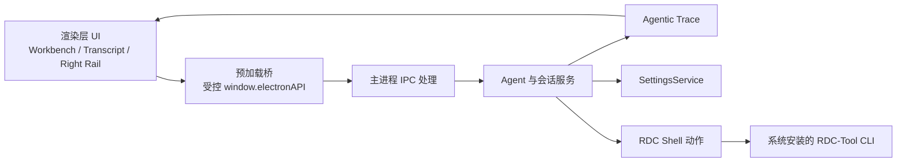
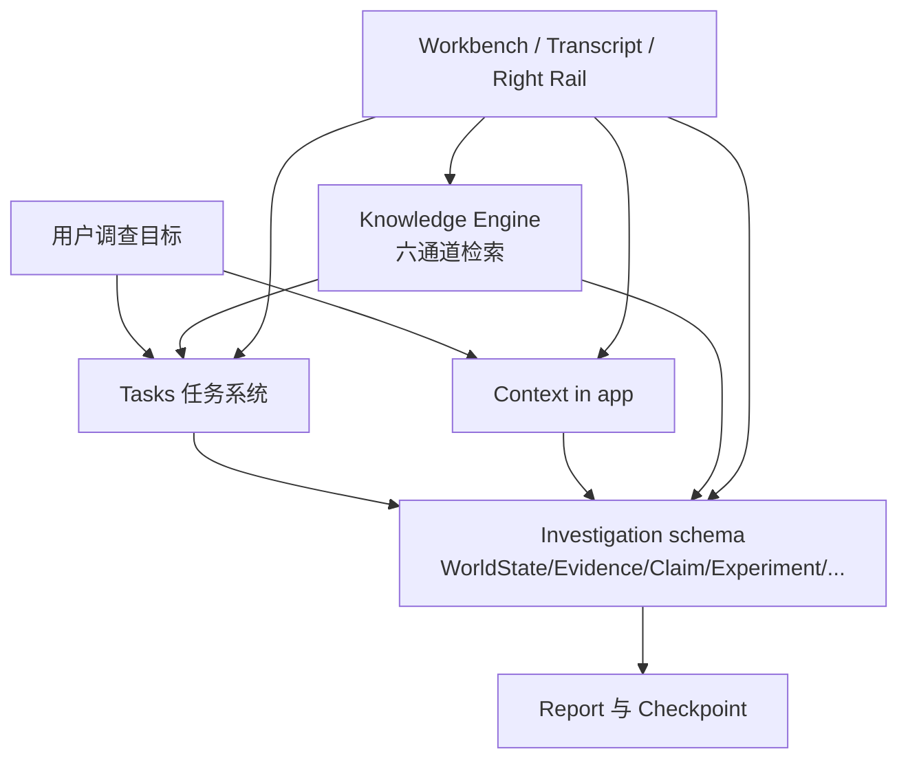
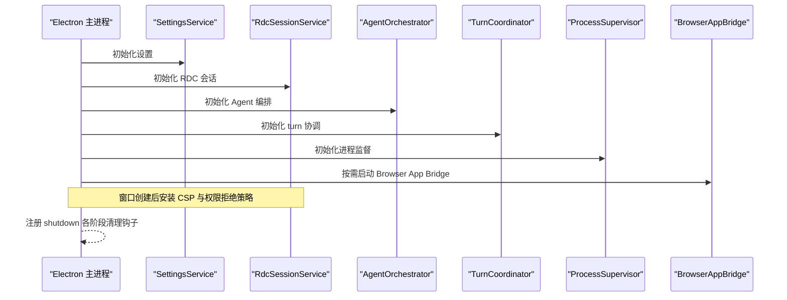
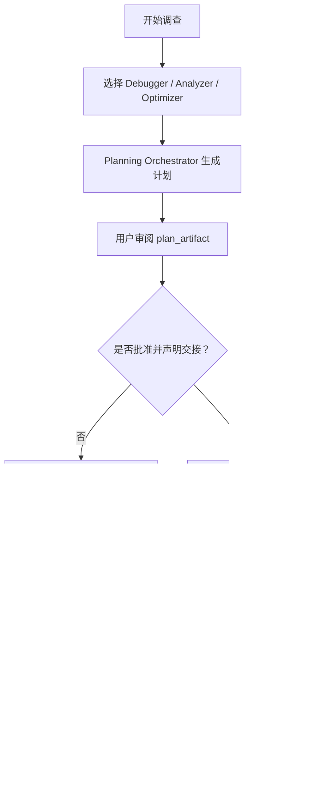
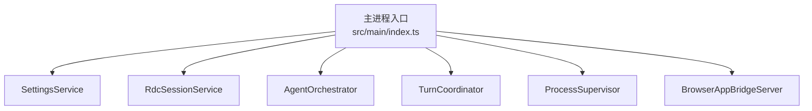

# 项目概览

<cite>
**本文引用的文件**   
- [README.en.md](file://README.en.md)
- [DESIGN.md](file://DESIGN.md)
- [package.json](file://package.json)
- [docs/README.md](file://docs/README.md)
- [docs/architecture/overview.md](file://docs/architecture/overview.md)
- [docs/architecture/module-map.md](file://docs/architecture/module-map.md)
- [docs/product/renderdoc-agent-complete-design.md](file://docs/product/renderdoc-agent-complete-design.md)
- [docs/product/vertical-debugger-overview.md](file://docs/product/vertical-debugger-overview.md)
- [docs/workflows/plan-handoff-acceptance-continuation.md](file://docs/workflows/plan-handoff-acceptance-continuation.md)
- [docs/ui/knowledge-center.md](file://docs/ui/knowledge-center.md)
- [docs/ui/workbench-and-transcript.md](file://docs/ui/workbench-and-transcript.md)
- [src/main/index.ts](file://src/main/index.ts)
</cite>

## 目录
1. [引言](#引言)
2. [项目结构](#项目结构)
3. [核心目标与产品边界](#核心目标与产品边界)
4. [四大核心系统](#四大核心系统)
5. [三种垂直调试方法](#三种垂直调试方法)
6. [架构总览](#架构总览)
7. [快速开始四步指南](#快速开始四步指南)
8. [环境与首次使用流程](#环境与首次使用流程)
9. [实际使用场景示例](#实际使用场景示例)
10. [依赖与模块关系分析](#依赖与模块关系分析)
11. [性能与可靠性特征](#性能与可靠性特征)
12. [故障排查要点](#故障排查要点)
13. [结论](#结论)

## 引言
RDC-Agent 是一个面向 Windows 桌面的 GPU 调查工作台，核心目标很明确：把 RenderDoc `.rdc` capture 分析与 AI Agent 能力整合在一个可审计、可追溯的工作区中，让用户从「为什么这帧有问题」推进到「证据是什么、假设如何竞争、实验是否可回滚、结论是否可信」。

它不是简单的 LLM + Skill + Tool 组合。产品把「调查循环」作为基本单元：问题 → 假设 → 检查 → 实验 → 证据 → 结论。Tasks 任务系统追踪待验证项与证据缺口；Context in app 让当前 capture、replay、context、任务、工件和上下文集中在一个会话内；Investigation schema 用 World State、Evidence、Claim、Experiment、Challenge、Checkpoint、Report 等可引用工件划定认识论边界；Knowledge Engine 以 markdown-first 六通道检索连接知识，而不是用不透明的嵌入分数替代证据。

该仓库版本为 `0.6.0-rc.8`，基于 Electron、React、TypeScript，主进程负责 IPC、工作流编排、设置、会话存储、报告、证据、trace 与外部能力调用；渲染层提供工作台 UI、交互状态与工作过程呈现。

**章节来源**
- [README.en.md:1-136](file://README.en.md#L1-L136)
- [package.json:1-143](file://package.json#L1-L143)

## 项目结构
代码按四层组织：

| 层级 | 职责 | 典型位置 |
|---|---|---|
| 主进程 | Electron shell、IPC、Agent 工作流、设置、会话、捕获、报告、trace、外部能力调用 | `src/main/*` |
| 预加载桥 | 向渲染层暴露受控 API | `src/preload/*` |
| 渲染层 | React UI、工作区展示、工作过程、右栏、Composer、Transcript | `src/renderer/*` |
| 共享层 | 跨层类型、常量、纯辅助函数 | `src/shared/*` |

**图表来源**
- [docs/architecture/overview.md:1-41](file://docs/architecture/overview.md#L1-L41)

文档索引建议阅读顺序是：仓库根说明 → DESIGN.md → AGENTS.md → 运行时内核契约 → 权限契约 → 失败模型 → 架构总览与模块地图 → 具体 product / ui / workflows 文档。

**章节来源**
- [docs/architecture/overview.md:1-41](file://docs/architecture/overview.md#L1-L41)
- [docs/README.md:1-23](file://docs/README.md#L1-L23)
- [docs/architecture/module-map.md:1-32](file://docs/architecture/module-map.md#L1-L32)

## 核心目标与产品边界
### 核心目标
- 打开项目和 `.rdc` capture，保持 capture、replay、context 身份清晰。
- 让 Agent 通过 Work Process 暴露真实执行过程，而不是隐藏推理或伪造结果。
- 在需要图形领域推理时进入 Debugger、Analyzer 或 Optimizer 方法面。
- 在同一会话中保存观察、证据、结论和下一步行动。

### 产品边界
- RDC-Agent 是通用 Agent workbench，并一等公民支持 RDC/RDC 与 RenderDoc `.rdc`。
- 发布面是 Windows-only。macOS/Linux 安装包与公证不在产品范围内。
- Capture 管理、诊断与 RDC/RenderDoc 操作由主机上配置的独立 RDC-Tool CLI 驱动。
- Agent 工作包括阅读、规划、编辑、搜索、shell 命令、工具调用、交接、memory 与 subagent 编排。
- 用户资源位于 `~/.rdc-agent`，项目资源位于 `<project-root>/.rdc-agent`。
- Agent loop 不能把耗尽轮次或重复相同工具轮次当作完成；必须区分“仍在继续”和“真正完成”。
- 本地 PNG 成功不等于 Android 设备呈现成功。

**章节来源**
- [DESIGN.md:1-73](file://DESIGN.md#L1-L73)
- [README.en.md:1-136](file://README.en.md#L1-L136)

## 四大核心系统
### Tasks 任务系统
Tasks 追踪下一次必须验证什么、还有哪些证据缺口、调查关闭前需要什么条件。它不是简单日志，而是调查计划的可执行投影：每次创建或更新留下历史卡，列表冻结为变更时刻的状态快照，右栏 Progress 显示最新任务列表，父回复结束后的后台变更只刷新子代理卡和右栏，不在旧回复中倒插历史卡。

### Context in app 上下文管理
Context in app 让当前 capture、replay、context、任务、Artifacts、Outputs、Context 和 Capture 在同一个会话中可见。prepareTurn 会冻结 capture、replay 与 context 身份；临时时间点查询必须由主进程核对执行前后 context 与恢复结果，恢复失败要隔离 lease，不得刷新为查询中的临时画面。

### Investigation schema 调查模式
Investigation schema 定义 `rdc.investigation.v1`，包含 World State、Evidence、Claim、Experiment、Challenge、Checkpoint、Report 等可引用工件。Mission 正常完成必须能解引用 MissionCheckpoint 与 kind=report、status=ready、完整章节、outputPhase=final_answer 的引用。Renderer 唯一读取通道是 `investigation:read({ sessionId, artifactId, expectedHash })`。

### Knowledge Engine 知识引擎
Knowledge Engine 的目标拓扑是 markdown-first 六通道：Identity/Path、Scope/Metadata、Lexical、Structural、Relation/Graph、Temporal/Version，配合五个服务和五个 deferred 工具，以及 Knowledge Center 三列 UI。Semantic lane 与 Embedding capability 已被删除，禁止恢复。导入走 `KnowledgeImportService.importToSpace`，写入走 `KnowledgeWriteService.write/promote`，Candidate 只能由用户显式意图触发。

**图表来源**
- [DESIGN.md:1-73](file://DESIGN.md#L1-L73)
- [docs/product/renderdoc-agent-complete-design.md:1-188](file://docs/product/renderdoc-agent-complete-design.md#L1-L188)
- [docs/ui/knowledge-center.md:1-43](file://docs/ui/knowledge-center.md#L1-L43)

**章节来源**
- [docs/ui/workbench-and-transcript.md:1-176](file://docs/ui/workbench-and-transcript.md#L1-L176)
- [docs/product/renderdoc-agent-complete-design.md:1-188](file://docs/product/renderdoc-agent-complete-design.md#L1-L188)
- [docs/ui/knowledge-center.md:1-43](file://docs/ui/knowledge-center.md#L1-L43)

## 三种垂直调试方法
三种方法共享同一套 agent 循环、项目资源边界、权限模型和会话证据链，不是三个孤立聊天角色。

| 方法 | 核心问题 | 主要行为 |
|---|---|---|
| Debugger | 为什么结果错了？ | 沿事件、资源、管线状态、shader 回溯视觉症状 |
| Analyzer | 这个未知渲染系统怎样工作？ | 跨 capture、event、evidence 建立可回顾材料 |
| Optimizer | 成本在哪里，怎样降低？ | 比较真实、可逆干预的成本与收益 |

Debugger 的典型用户流程是：打开项目 → 打开 `.rdc` capture → 选择 Debugger profile → 给出调试目标 → 查看 Work Process、工具调用、审批、诊断与交接 → 由已批准的应用入口执行 RDC 操作 → 查看 trace、evidence、artifacts 与 report 输出。

**章节来源**
- [docs/product/vertical-debugger-overview.md:1-29](file://docs/product/vertical-debugger-overview.md#L1-L29)
- [README.en.md:1-136](file://README.en.md#L1-L136)

## 架构总览
RDC-Agent 的主进程入口注册安全策略、会话生命周期、IPC、Agent 编排、turn 协调、进程监督、RDC 会话、回放设备和浏览器 QA bridge。应用退出时按阶段释放 owned runtimes、终止进程、断开 MCP、终止 shell、停止 bridge、flush storage。

**图表来源**
- [src/main/index.ts:1-200](file://src/main/index.ts#L1-L200)

**章节来源**
- [src/main/index.ts:1-200](file://src/main/index.ts#L1-L200)
- [docs/architecture/overview.md:1-41](file://docs/architecture/overview.md#L1-L41)

## 快速开始四步指南
首次启动后，标题栏问号可重新打开四步引导。每步说明操作入口、动作和完成预期；关闭或完成仅记录 UI 已阅读状态，不表示配置成功，也不创建 Project、Provider 或模型请求。

| 步骤 | 操作 | 完成预期 |
|---|---|---|
| 第一步 | 准备开始 | 理解 RDC-Agent 是桌面工作区，不是普通聊天机器人 |
| 第二步 | 连接模型 | 在 Settings 配置 Provider、API Key 与模型 |
| 第三步 | 创建项目 | 新建 Project 并导入 `.rdc` capture |
| 第四步 | 启用 RDC | 安装并配置 RDC-Tool CLI，使 RDC 能力可用 |

如果只需普通 Agent 工作，可以跳过 RDC；只有涉及 capture、replay、RDC 原生诊断时才需要第四步。

**章节来源**
- [docs/ui/workbench-and-transcript.md:1-176](file://docs/ui/workbench-and-transcript.md#L1-L176)
- [README.en.md:1-136](file://README.en.md#L1-L136)

## 环境与首次使用流程
### 环境要求
- 操作系统：Windows。
- Node.js：`>=22.13.0`。
- pnpm：`11.7.0`。
- RDC-Tool CLI：可通过 Settings 配置并可被主进程发现。
- RenderDoc 运行基线：当前打包与验证基线为 RenderDoc 1.45；RDC-Agent 0.6.x 对应 RDC-Tool 1.0.0。

### 下载与安装
Windows release 提供 NSIS 安装包 `*-setup.exe` 与便携 zip。应从本仓库 Releases 下载并校验 SHA-256，不要禁用安全保护。稳定正式版仍需签名；源版本 `0.6.0-rc.5` 指向未签名 prerelease 通道。

### 首次使用流程
1. 安装或解压 RDC-Agent。
2. 打开 Settings → Providers，配置 Provider、Account、API Key 与 Model。
3. 新建 Project。
4. 在 Project 中导入 `.rdc` capture。
5. 如需 RDC 能力，在 Settings → Tools 中选择 RDC-Tool 根目录，点击 Detect installation / Select folder → Verify and apply。
6. 从 General 开始日常任务；需要图形诊断时切换到 Debugger、Analyzer 或 Optimizer。

注意：RDC-Tool 是独立分发组件，检测的是其根目录，不是 Python 可执行文件本身。

**章节来源**
- [README.en.md:1-136](file://README.en.md#L1-L136)
- [docs/workflows/plan-handoff-acceptance-continuation.md:1-108](file://docs/workflows/plan-handoff-acceptance-continuation.md#L1-L108)

## 实际使用场景示例
### 场景一：Debugger 定位着色器或管线问题
1. 打开包含问题帧的 `.rdc` capture。
2. 选择 Debugger profile，描述视觉异常。
3. 观察 Work Process 中的探测、RDC context 检查和工具调用。
4. 如果计划需要修改或深入实验，审阅 plan_artifact 并通过声明 handoff 切到 General。
5. 在 Evidence、Claim、Experiment 和 Report 中确认结论是否来自真实执行，而非模型自述。

### 场景二：Analyzer 解释未知渲染子系统
1. 提供多个 capture 或一组线索。
2. 让 Analyzer 构建可回顾的结构假设、证据与竞争假设。
3. 使用 Knowledge Center 复用已有的 Identity、Scope、Relation 或 Temporal 知识。
4. 将可复用的知识点以 Candidate 形式提交，经人工 review 提升为正式知识。

### 场景三：Optimizer 比较优化干预
1. 建立 baseline、intervention、variant 和 rollback 的真实执行引用。
2. 比较 cost、correctness、quality 与 scope。
3. 不要把模型声明、拒绝执行或普通 shell 回显当作已执行实验。
4. 在 Report 中标明哪些结论仍只是推断，哪些有可验证证据支撑。

**图表来源**
- [docs/product/renderdoc-agent-complete-design.md:1-188](file://docs/product/renderdoc-agent-complete-design.md#L1-L188)
- [docs/workflows/plan-handoff-acceptance-continuation.md:1-108](file://docs/workflows/plan-handoff-acceptance-continuation.md#L1-L108)

## 依赖与模块关系分析
### 主进程关键依赖
主进程入口聚合以下关键服务：
- `settingsService`：应用设置与 Provider 配置。
- `rdcSessionService`：RDC 会话生命周期。
- `agentOrchestrator`：Agent 编排与 subagent 管理。
- `turnCoordinator`：turn 所有权、取消与结算。
- `processSupervisor`：子进程监督与回收。
- `rendererEventHub` / `browserAppBridge`：Browser QA 与渲染层事件桥。

**图表来源**
- [src/main/index.ts:1-200](file://src/main/index.ts#L1-L200)

### 模块域关系
| 领域 | 主进程实现 | 共享契约 | 渲染层入口 |
|---|---|---|---|
| Agentic Trace | `src/main/agent-trace/*` | `AgentRunPresentation`、`TraceEvent`、`TraceNode` | Work Process transcript |
| Agent workbench | `src/main/workflow/debugger/AgentOrchestrator.ts`、`src/main/settings/AgentManifestService.ts` | `.agent.md`、`AgentId`、`WorkflowState` | Composer、Settings Agents、Right Rail |
| RDC runtime boundary | `src/main/tools/RdcCliInvokerService.ts`、`ShellInvocationService.ts` | `RdcRuntimeContext`、`OpenedCaptureState` | Settings Tools、capture library |
| Sessions/captures | `src/main/sessions/*`、`src/main/captures/*` | `SessionRecord`、`RunSummary` | project tree、opened capture panels |
| Reports/evidence | `src/main/reports/*` | `ArtifactRecord`、`EvidencePacket` | Activity、artifacts、trace cards |

**章节来源**
- [docs/architecture/module-map.md:1-32](file://docs/architecture/module-map.md#L1-L32)
- [src/main/index.ts:1-200](file://src/main/index.ts#L1-L200)

## 性能与可靠性特征
### 可靠性优先于速度
- 首次冻结 `EffectiveRuntimePlan`，Prompt 与 Executor 共用；在途 turn 不读可变 Settings。
- turn 所有权单调变化：Active → Aborting → Orphaned → Settled；orphaned 时 begin turn fail-closed。
- 子进程超时未观察到 close 标记为 `unconfirmed_orphan`，保留 registry，不伪造已退出。
- 归属 RDC daemon 必须 clear+stop 且有进程回执，失败不得假装已退出。
- 取消使用 cancelled，未执行使用 skipped，真实失败使用 error，不伪造用户拒绝。

### 并发与预算
- 默认不安全；只有显式声明 concurrency-safe 的工具才允许并发。
- RDC、Live Capture、shell、write、task mutation、MCP、ask、output_register 一律串行。
- 并发组前原子扣减预算；abort 使用 `Promise.allSettled` join，避免孤儿进程。
- 带 RDC lease 的 child 必须通过受限 delegated lease 取得 parent RDC context 并串行。

### 可观测性
- Work Process 是真实 runtime transcript，不是假 stage 日志。
- Loop thinking 分为 quiet spark、已完成思考与 commentary，不展示隐藏 CoT。
- 连续第二轮无进展注入纠偏指令，第三轮仍相同则终止；达到最大轮次且仍需 continuation 也终止。

**章节来源**
- [DESIGN.md:1-73](file://DESIGN.md#L1-L73)
- [docs/product/renderdoc-agent-complete-design.md:1-188](file://docs/product/renderdoc-agent-complete-design.md#L1-L188)
- [docs/ui/workbench-and-transcript.md:1-176](file://docs/ui/workbench-and-transcript.md#L1-L176)

## 故障排查要点
### RDC-Tool 无法识别
- 确认选择的是 RDC-Tool 根目录，而不是 Python 可执行文件。
- 检测路径包括已配置位置和 `%LOCALAPPDATA%/Programs/rdc-tool`；PATH 可选。
- 验证失败应保留原配置，未配置 RDC 不应阻塞 General。

### 模型不可执行或静默回退
- 非法 model fail-closed，禁止静默回退。
- Agent 可执行模型必须具备 source-backed `toolCalling.supported` 与已实现 structured-tool adapter。
- `unknown`/`unsupported` 不是选择项；已持久 override 或 Agent route 指向它们时应报错并给出同 provider 已验证候选项。

### 调查没有进展
- 检查是否出现 `AGENT_NO_PROGRESS` 或 `AGENT_MAX_TURNS_EXCEEDED`。
- 确认不是单纯耗尽 turns 或重复相同 tool call。
- 查看 Work Process 中是否有真实 tool result、approval 或 evidence，而不是仅有模型正文。

### 知识导入异常
- 导入文件只能是 zip、yaml 或 yml；禁止 All Files。
- 导入结果每项自带 status、record、missingAssets、reason、existingCardId。
- 不同源同 ID 是导入冲突，不会自动写入 Conflicts；需人工核对。

**章节来源**
- [README.en.md:1-136](file://README.en.md#L1-L136)
- [docs/ui/knowledge-center.md:1-43](file://docs/ui/knowledge-center.md#L1-L43)
- [docs/workflows/plan-handoff-acceptance-continuation.md:1-108](file://docs/workflows/plan-handoff-acceptance-continuation.md#L1-L108)

## 结论
RDC-Agent 的核心价值不是提供更多按钮，而是让 GPU 调查具备稳定性、证据性和可追溯性。Tasks 系统保证“下一步要验证什么”，Context in app 保证“这次调查的对象是谁”，Investigation schema 保证“什么是事实、什么是假设、什么是结论”，Knowledge Engine 保证“经验可复用但不会取代证据”。Debugger、Analyzer、Optimizer 共享同一基础设施，把一次 GPU 帧问题转化为可审计的证据链，而不是散落在终端、截图和聊天记录中的碎片信息。

对初学者，可以从四步引导开始，先理解工作台、Project、capture 和 Work Process；对有经验的开发者，应重点阅读 DESIGN.md、runtime-kernel、permissions、failure-model、architecture overview、module map 以及 renderdoc-agent-complete-design，确保后续改动收敛到现有契约，而不是引入第二条执行通道或双轨实现。