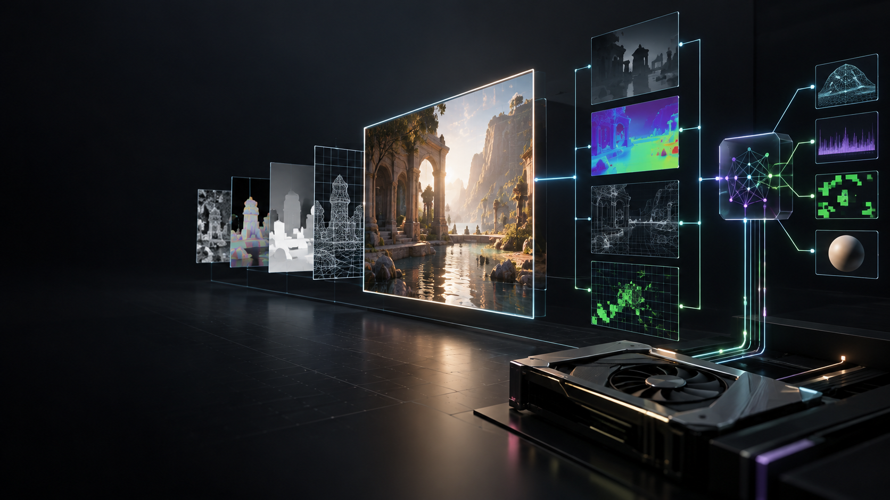
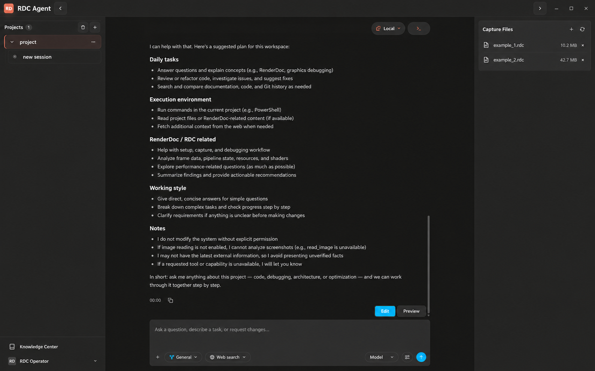

<div align="center">



# RDC-Agent

### Turn one GPU frame problem into a traceable chain of answers

RenderDoc `.rdc` capture × AI Agent workbench × native RDC diagnostics

[中文](./README.md) · [Architecture](./ARCHITECTURE.md) · [UI/UX design](./DESIGN.md) · [Issues](https://github.com/haolange/RDC-Agent/issues)

</div>

## A workbench that moves GPU questions forward

RDC-Agent is a Windows desktop application that brings everyday agent collaboration, RenderDoc capture investigation, and native RDC operations into one auditable workspace.

Start with “Why is this frame wrong?” and work through a stable chain:

1. Open a project and its `.rdc` captures while keeping capture, replay, and context identity explicit.
2. Let the agent inspect code, run commands, check RDC context, and expose the real execution process through Work Process.
3. Enter Debugger, Analyzer, or Optimizer methods when the problem calls for graphics-specific reasoning.
4. Keep observations, evidence, conclusions, and next actions in the same session instead of scattering them across terminals, screenshots, and chat logs.

## RDC-Agent is not just LLM + Skill + Tool

Many visible RenderDoc agent integrations still stop at a familiar shape: wrap Replay API operations as MCP tools, add a Skill, and let the LLM choose tool calls. That answers “can the model call RenderDoc?” It does not, by itself, answer “is the investigation stable, sufficiently evidenced, and trustworthy?”

RDC-Agent treats the investigation loop—not an individual tool call—as the product primitive:

```text
Problem
  ↓
Hypothesis
  ↓
Inspection
  ↓
Experiment
  ↓
Evidence
  ↓
Conclusion
```

Four systems keep that loop grounded:

- **Tasks system** tracks what must be verified next, which evidence gaps remain, and what is required before an investigation can close.
- **Context in app** keeps the current capture / replay / context, tasks, Artifacts, Outputs, Context, and Capture visible in one session instead of relying on model memory alone.
- **Investigation schema** stores World State, Evidence, Claim, Experiment, Challenge, Checkpoint, and Report as referenceable session artifacts with explicit epistemic and verification boundaries.
- **Knowledge Engine** connects six markdown-first retrieval lanes—Identity / Path, Scope / Metadata, Lexical, Structural, Relation / Graph, and Temporal / Version—without replacing evidence with an opaque embedding score.

The goal is not simply to expose more GPU buttons. It is to make the agent know which object is under investigation, what is observed, which hypotheses compete, how an experiment can be rolled back, and which conclusions are still only inferences.

That is also why several boundaries are intentional: MCP is not RDC-Agent's runtime authority; the programmable RDC-Tool CLI / JSON contract is the operation surface shared by agents, scripts, tests, and people. Remote / Android replay is an explicit runtime capability—local PNG success must not silently become a claim of remote success. Tools are discovered, described, and scoped from a catalog instead of dumping an ungoverned full table into every model turn. Fewer tools with complete facts, explicit identity, and honest failure are more valuable than a larger button count.

## One investigation, one report that points back to its evidence

The result should not be only a chat answer. An investigation's Report is part of its record and reads as a document in the right rail's Artifacts:

- it runs through goal, plan, evidence and findings, claims (conclusions and root cause), experiments and verification, review and open questions, and conclusion;
- each claim carries one verification label, plus its verdict when one was decided;
- record identifiers reach the clipboard only through "Copy diagnostics" and are not part of the text.

Report Writer assembles it from eligible claims and evidence without upgrading their qualification or hiding limitations; every important statement points back to referenceable Claims, Evidence and verification state, so readability never outruns trustworthiness.



> This is a public showcase preview based on the real in-app Browser QA `/app` workbench layout. Project names, capture names, conversation history, and model information have been replaced with neutral placeholders. It shows product structure, not fabricated runtime results.

## Three focused ways to investigate

- **Debugger** traces a visual symptom back to events, resources, pipeline state, and shaders.
- **Analyzer** connects clues across captures, events, and evidence into material that can be reviewed later.
- **Optimizer** compares cost and benefit through real, reversible interventions.

These are not three isolated chat personas. They share the same agent loop, project resource boundaries, permission model, and session evidence chain. General handles ordinary engineering work; RenderDoc investigations are handed off to the appropriate method surface when needed.

## What is real, and where the boundary is

- **Capture workflow**: manage the project's `.rdc` inputs, open, switch and diagnose captures; RDC / RenderDoc operations come from the external RDC-Tool CLI configured on the host.
- **Agent workflow**: reading, planning, editing, searching, shell commands, tool calls, handoffs, memory, and subagent orchestration; execution permissions are enforced by the main process and the frozen run plan. Official Agents, Skills and Hooks are bundled under `resources/agent-runtime` and are not copied into user space.
- **Auditable resources**: user resources live under `~/.rdc-agent`, project resources under `<project-root>/.rdc-agent`; Agents, Skills, MCP, Hooks, Policies, Knowledge and explicit Memory each have a clear scope.
- **Real execution**: Work Process reflects actual execution and provider reasoning semantics. It does not fabricate hidden chain-of-thought or treat model self-report as evidence.
- **Devices and replay**: local replay and Android presentation depend on the installed RDC / RenderDoc environment and the target GPU. A connected device is not a promise that every capture replays everywhere.

The release surface is **Windows-only**; the source runs on Windows and Linux (x64) (host differences: [`docs/architecture/host-platform.md`](docs/architecture/host-platform.md)). RDC-Agent does not bundle your captures, provider keys, or RenderDoc installation. Configure the RDC-Tool CLI, provider / model, and device environment yourself.

## Why it fits serious graphics debugging

- **Context does not drift**: capture, replay, context and session identity are frozen when a turn starts, so the investigation cannot silently switch objects halfway.
- **Permissions do not rely on prompts**: Skills provide method knowledge and cannot widen tool permissions; Shell, RDC, IPC and secret boundaries are enforced by the main process.
- **Failures are explainable**: security refusals, integrity degradation and recoverable errors are reported separately; a failure is never masked by an empty result or a fixed success value.
- **Results can be reviewed**: investigation material, capture evidence and run records have explicit sources and boundaries, ready for review and handover.

## Download and first use

Windows releases provide an NSIS installer (`*-setup.exe`) and a portable zip. Extract the whole zip before running `RdcAgent.exe`; Node.js and pnpm are only needed for source development. Source version **0.6.0-rc.8 targets the unsigned prerelease channel**; see [Releases](https://github.com/haolange/RDC-Agent/releases) for available downloads. Windows may warn about an unknown publisher or block execution under managed security policies. Download only from this repository and verify SHA-256; do not disable security protections. Stable releases still require signing.

First launch opens no guide dialog: the empty workbench lists the setup steps still missing (RDC tool, model service, project), each step links straight to its setting, and the list disappears once everything is done. The title bar's question mark reopens the same list at any time. Configure your own provider/API key and model in Settings to use General; General works without RDC.

For RenderDoc investigations, download the self-contained zip from [RDC-Tool Releases](https://github.com/haolange/RDC-Tool/releases), extract it, then use Settings → Tools → Detect installation / Select folder → Verify and apply:

- Select the `rdc-tool` root containing its bundled Python and CLI, not the Python executable; no separate Python install is needed, and installing into PATH is optional.
- Detection checks the configured location, plus the default install folder `%LOCALAPPDATA%/Programs/rdc-tool` on Windows; on Linux select the extracted root.
- Code Interpreter remains a separate, optional configuration.

## Source development

Requirements: Windows or Linux (x64), Node.js `>=22.13.0`, pnpm `11.7.0`, and an RDC-Tool CLI that can be configured from Settings. Saving provider keys on Linux needs an unlocked system keyring (GNOME Keyring or KWallet).

```powershell
pnpm install
pnpm run dev
```

For the real in-app Browser QA surface:

```powershell
pnpm run start:agent-browser
```

Useful verification commands:

```powershell
pnpm run typecheck
pnpm test
pnpm run check:gates
pnpm run build
```

Then, in the app:

1. Add a Project.
2. Put `.rdc` files into `<project-root>/.rdc-agent/inputs/`, or import them from the Capture panel.
3. Configure the RDC-Tool CLI and a provider / model.
4. Describe the goal to General; enter Debugger, Analyzer or Optimizer when the problem needs a graphics investigation.

## About this public repository

This repository is evolving quickly. The README shows the product boundaries that have landed and the workflows that were verified for real; the per-platform, provider, GPU, Android and release verification records, together with what is still unverified, are in the [acceptance ledger](./docs/product/acceptance-ledger.md). Verification without the matching environment is never presented here as an all-platform guarantee.

Please report reproducible problems with the smallest safe reproduction you can share. Never upload private `.rdc` captures, provider keys, user data, or logs containing sensitive paths.

## Documentation

- [Documentation index](./docs/README.md)
- [Product and architecture rulings](./ARCHITECTURE.md)
- [RenderDoc Agent design book](<docs/product/RenderDoc Agent 完整设计书.md>) (Chinese; the domain authority)
- [Runtime and permission contracts](./docs/contracts/runtime-kernel.md)
- [RDC runtime](./docs/architecture/rdc-runtime.md)
- [Workbench / Transcript / Composer](./docs/ui/workbench-and-transcript.md)
- [UI Design System](./docs/ui/design-system.md)
- [Acceptance ledger](./docs/product/acceptance-ledger.md)

## RenderDoc runtime baseline

The current assembled and verified baseline is **RenderDoc 1.45**. RDC-Tool does not track every upstream minor release: a newer runtime becomes the baseline only after matching runtime packaging, catalog checks, tests and release gates pass. RenderDoc 1.44 and earlier official GUI releases are not separate assembly targets. Use the replay path matching this bundled runtime. Capture-format compatibility follows upstream RenderDoc.

RDC-Agent **0.6.x** is verified against RDC-Tool **1.1.2** (the current stable release) and the RenderDoc **1.45** runtime. Catalog definitions and fingerprints, not package version numbers, authorize operations. Local PNG export does not prove Android device presentation.

## Reporting safely

Do not upload private captures, provider keys or full logs containing local absolute paths. Redact logs and use the installation or bug-report template.

## License

See [LICENSE](./LICENSE).
