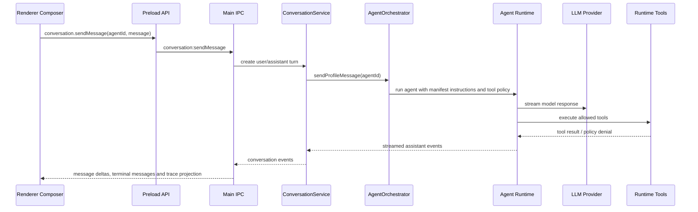
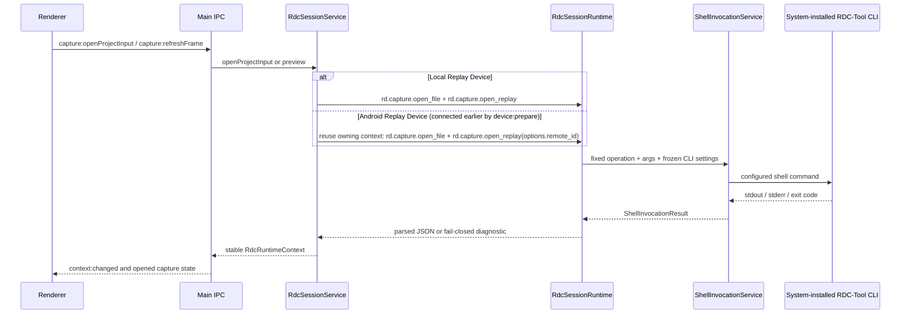
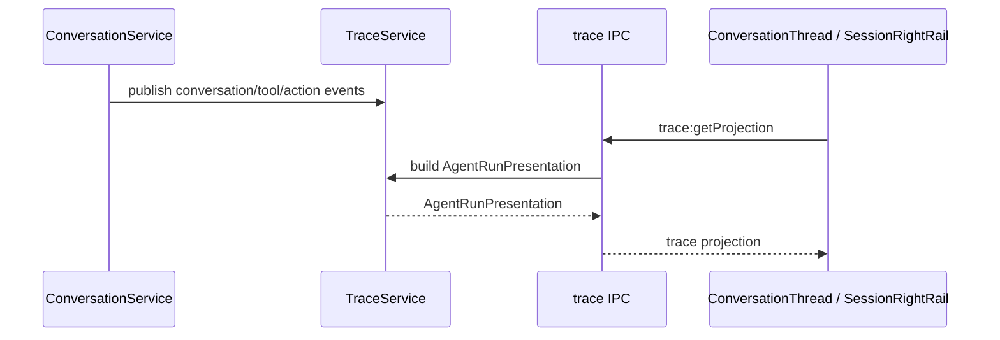

# Data Flow

本文描述当前 project state、agent turn、Agentic Trace projection 和 RDC shell action 的跨层流向。

## Agent Turn

Streaming updates of a message leave main as deltas (`src/shared/conversation/messageDelta.ts`): `WorkflowProjectionPublisher` turns each `message_patched` into a `message_delta` carrying only the fields and work-trace blocks that changed since its previous update of the same message, numbered by `seq`/`baseSeq`; the first update (`baseSeq: 0`) is complete. `message_completed` / `message_errored` stay whole and end the stream. The renderer's `conversationMessageAssembler` rebuilds the whole message before any store sees it; a delta that does not build on the last applied update (reload mid-turn, dropped event) is discarded and the stream resumes from `conversation:getMessageSnapshot`. One update therefore costs the same at step 300 as at step 3, instead of carrying the whole trace each time.

Ids of a turn come from its request: `conversationTurnIds(requestId)` (`src/shared/conversation/conversationTurnIds.ts`) names the turn, the user and assistant messages, the model-switch notice and an edit-and-resend's branch. `ConversationTurnStarter` creates them with it and the Composer shows its messages under the same ids before main answers, so main's messages (stream event or send result, whichever arrives first) update them in place; a refused or revoked request removes its messages by `requestId`.

`.agent.md` is the source for instructions, model, tools, agent handoffs, skills, MCP servers, and invocability. `plan_artifact` is a human-in-the-loop pause with a live session plan and a frozen approved copy; it is not a Right Rail output.

## RDC Shell Actions

turn 冻结、lease/quarantine、`rdc_probe`、`capture_select / restore / recover` 等 RDC 操作契约见 [`rdc-runtime.md`](rdc-runtime.md)。

RDC installation details remain under `settings.tooling.rdcCli`. The main session boundary constructs the fixed native operation names and arguments, and freezes CLI settings for each turn; renderer and preload never construct lifecycle commands.

Local Open invokes `rd.capture.open_file` followed by `rd.capture.open_replay`. `rd.remote.connect` 在选择 Android Replay Device 时由 `device:prepare` 执行；Remote Open 复用该连接所属的 context，依次调用 `rd.capture.open_file` 与 `rd.capture.open_replay`，并以 `options.remote_id` 绑定已准备好的连接，返回的 `remote_id` 必须与所选连接一致。 Failures expose structured diagnostics (`message`, optional `classification` / `fix_hint`) rather than truncated CLI stderr alone.

## Trace Projection

`TraceService` builds renderer-facing `AgentRunPresentation` from conversation messages, action events, artifacts, and run summaries.

## Settings Flow

`SettingsService` is the single writer of `config.json`. It reads the file once at startup into a frozen `SettingsSnapshot { revision, user }`; every later read is in memory through narrow accessors: `snapshot()` for user sections, `providerConnections` (catalog facts + the user's provider state + secret presence, memoized until the provider states or the secrets change), `agentModelRoutes.resolve(agentId)`, `agentDefinitions()` (cached effective Agent profiles) and `settingsView()` for the renderer's view; paths come from `appPathService`. `settings:get` returns `SettingsView { revision, … }`: the user sections, each provider's connection state without catalog facts, the Agent routes and the selected project's Agents (with `projectId`). The renderer reads the static catalog once at startup with `settings:getProviderCatalog` and joins it with the connection state into `LlmProviderEntry`; it computes the Agent model choices from the effective catalog projection, so a catalog change needs no settings read. Startup reads `settings:get` once; after that the renderer reads it again only when Settings opens (to pick up edits made outside the app), when it switches to a project other than the view's, and on `settings:changed` for `providers`, `agentModels` or `globalInstructions` that its own writes did not produce (its patches and model toggles answer with the revision they committed; it writes the other sections itself). A change that arrives while one of its writes is in flight waits for that write, and a read is merged by revision, never over an optimistic change still in flight. The renderer writes settings only through `settings:patch`: a list of discriminated ops applied in order and committed once. Section ops (appearance, layout, profile, tooling, agentRuntime, globalInstructions) merge a partial value; `agentModels` has field ops only (`setDefault`, `setAgentField`, `clearAgentField`), so concurrent edits of different fields never overwrite each other. `update` sanitizes each op against the committed section, writes only a changed document, bumps the revision and broadcasts `settings:changed { revision, sections }`; the reply is `{ revision, changed }` with the changed sections and Agent bindings only. Provider state is never part of a patch: it changes through the provider commands, and the model toggle (`settings:saveProviderDefinition`) carries only the model choices and the connection they were made on. The renderer applies ops optimistically and, on failure, rolls back what that intent changed while later intents stay.

## Revisioned Intents

Every renderer write that a person can repeat faster than main answers uses one primitive, `RevisionLanes` (`src/renderer/lib/revisionLanes.ts`). A lane is one thing that changes: a provider's model choices, an Agent file (scope, project, id), a session's model override, its turn controls, the sidebar selection, a catalog scope. Each intent takes the lane's next client revision (clock-seeded, so it keeps growing across renderer reloads while main lives on) and is sent at once; nothing waits in a renderer queue. Main orders each lane by that revision: `SettingsProviderOps` and `SettingsAgentOps` answer an older revision as superseded, `SessionModelLanes` writes a session field only for a revision newer than the last one written. A result changes renderer state only through `isLatest` / `applyIfNewer`, and `settled(lane)` lets a send wait for the lane's writes in flight (failing when the newest failed) before it freezes the configuration. The intent itself shows as an overlay: `SettingsIntents` keeps the confirmed settings at their revision with every intent in flight (patch ops, provider model choices, Agent definitions) replayed on top, and folds main's commit in when it is newer than the last one folded for its lane; `sessionRecordStore.pending` does the same for session fields. Asynchronous reads of a value go through `useAsyncValue` (`src/renderer/lib/useAsyncValue.ts`): each key is a read revision, a superseded read's answer is dropped (and released, for object URLs) and the value shown always belongs to the current key.

Inputs Settings does not own keep their own revisions: the secret store (secret map and decrypted values cached in memory), Agent manifests with project trust and the selected project, and the global instructions file. Writes through the app invalidate them; edits made outside the app are re-checked by file mtime and size when a turn is prepared (`startProfileTurn`) and when Settings opens (`settings:get`). Nothing polls.

Renderer Settings editors never invent provider/model facts; Effective Catalog and connection state come from main. Secret material stays in main-process opaque storage.
